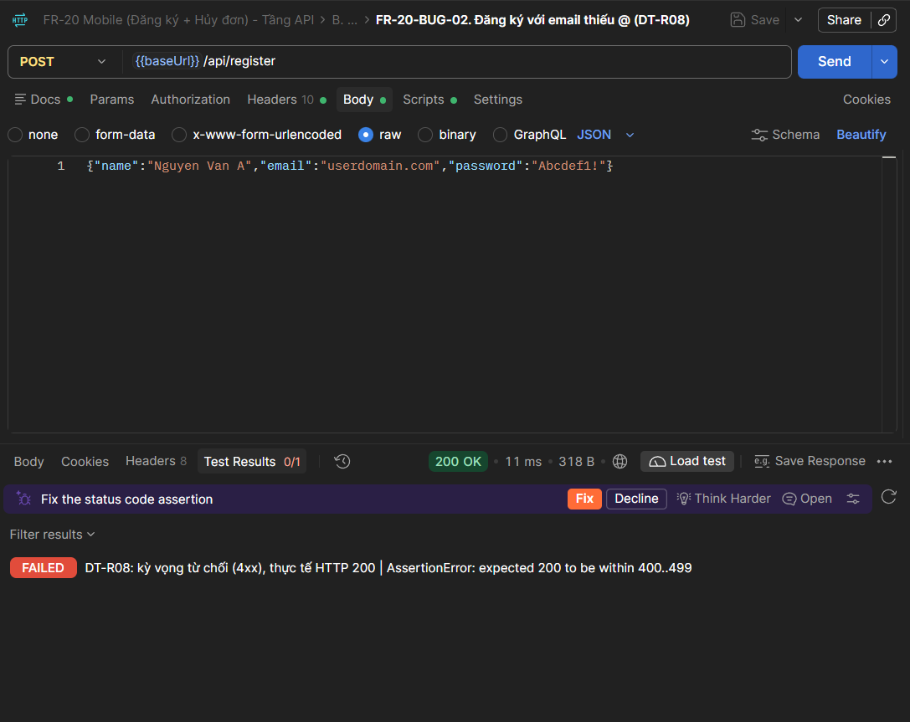

# FR-20-BUG-02

**Tiêu đề Issue:** `[FR-20] Đăng ký không kiểm tra định dạng email, nhận cả `userdomain.com`, `user@`, `@domain.com`, email có khoảng trắng (FR-01)`

| Trường | Giá trị |
| :--- | :--- |
| Bug ID | FR-20-BUG-02 |
| Mức độ | High |
| Feature | FR-20 (Mobile: Đăng ký và Hủy đơn), tầng API |
| Yêu cầu SRS bị vi phạm | FR-01: "Email phải có định dạng hợp lệ (`user@domain.com`)." |
| Môi trường | Backend localhost:3000, SUT commit 85af3ba (commit trong bản clone của mình, hãy thay bằng `git rev-parse --short HEAD` trong repo của bạn) |
| Test case liên quan | DT-R08, DT-R09, DT-R10, DT-R12 |
| GitHub Issue | TODO (link) |
| Trạng thái | Open |

## Các bước tái hiện
Postman: import `FR20_API_RunAll.postman_collection.json`, mở folder **B**, Send lần lượt từ B0 xuống. 
1. Gửi B0.
2. Gửi `FR-20-BUG-02`: `POST /api/register` body `{"name":"Nguyen Van A","email":"userdomain.com","password":"Abcdef1!"}`.
3. Lặp lại với `user@`, `@domain.com`, `us er@domain.com` (sửa tay trường email).
4. Gửi "Đọc lại (admin)" để xác nhận tài khoản đã được tạo.

## Kết quả thực tế
HTTP 200, tài khoản được tạo (id 10, 11, 12, 14 trong lần chạy của bạn).

## Kết quả mong đợi (theo SRS)
4xx, không tạo tài khoản.

## Bằng chứng

TODO: chụp request + response trong Postman (tab Body và Test Results) và đính kèm vào Issue.

## Ghi chú
DT-R11 (`user@domain` thiếu đuôi miền) chưa tính vào bug vì SRS chưa rõ (`clarifications.md` #8).
