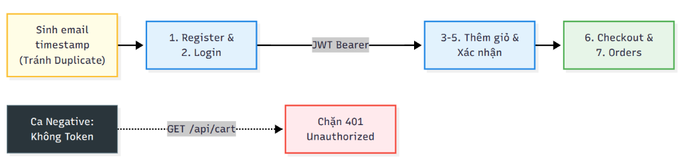

<!-- Slide 1: Section Title Slide -->
<!-- _paginate: false -->
<!-- _header: "" -->
<!-- _footer: "" -->

   

# KARATE FRAMEWORK
## Kiểm Thử API Tự Động Bằng Mã Nguồn (Bộ Kịch Bản K1, K2 & K3)

BDD DSL Không Tầng Trung Gian · Schema & Fuzzy Matchers · Data-Driven Testing · Stateful E2E Workflow

---

<!-- Slide 2: Motivation & Core Advantages -->

# Động Lực: 3 Ưu Thế Cốt Lõi Của Karate Framework

Code-based Testing là mắt xích quyết định trong pipeline CI/CD:

### 💻 Code BDD DSL trực quan
*  Viết kịch bản bằng ngôn ngữ Gherkin tự nhiên, tích hợp sẵn giao thức HTTP mà không cần viết mã trung gian Java.
* Vừa là Living Docs vừa là mã chạy trực tiếp.

### 🛡️ Native Schema Validation
* Kiểm tra cấu trúc JSON sâu trực tiếp không cần thư viện phụ.
* Fuzzy Matchers linh hoạt với dữ liệu động.

### ⚙️ Tự động hóa CI/CD tự nhiên qua Maven
* Quản lý kịch bản dạng mã nguồn thuần.
* Thực thi nhanh chóng bằng một dòng lệnh CLI.
* Tự động sinh báo cáo HTML trực quan kèm wire log.

Tập trung vào logic nghiệp vụ và chất lượng kiểm thử thay vì bảo trì mã boilerplate trung gian.

---

<!-- Slide 3: SUT Context & 3 Levels Coverage -->

# Hệ Thống SUT EShop & Chiến Lược Bao Phủ 3 Cấp Độ

  

---

<!-- Slide 4: Principle 1 - No Step Definitions -->

# Nguyên Lý 1: Triết Lý BDD DSL Không Tầng Trung Gian

  

### Framework truyền thống
* Cần viết thêm lớp trung gian Step Definitions để nối câu chữ Gherkin với HTTP Client.
* Dễ phát sinh lỗi mismatch regex khi sửa câu chữ kịch bản.

### Karate Framework
* Cú pháp Gherkin (Given path, When method, Then status, And match) kết nối trực tiếp với HTTP Engine nội tại.
* Không boilerplate, trực quan cho cả QA, Dev và BA.

---

<!-- Slide 5: Principle 2 - Schema & Fuzzy Matchers -->

# Nguyên Lý 2: Schema Validation & Fuzzy Matchers

<b>Thách thức từ Dynamic Data:</b> Dữ liệu API thực tế biến đổi liên tục (IDs tự tăng, Tokens JWT, Timestamp, UUIDs). Việc so khớp giá trị cứng khiến test dễ bị lỗi khi dữ liệu đầu vào hoặc trạng thái hệ thống thay đổi.

### 📋 Khung Tra Cứu & Ví Dụ Minh Họa Fuzzy Matchers

<table class="ref-table" style="font-size: 21px;">
  <thead>
    <tr>
      <th style="width: 22%;">Cú pháp Matcher</th>
      <th style="width: 38%;">Ý nghĩa & Quy tắc khớp</th>
      <th style="width: 40%;">Ví dụ minh chứng trong K1 (EShop)</th>
    </tr>
  </thead>
  <tbody>
    <tr>
      <td><code>#number</code></td>
      <td>Số nguyên hoặc số thực</td>
      <td><code>{ price: '#number', id: '#number' }</code></td>
    </tr>
    <tr>
      <td><code>#string</code></td>
      <td>Chuỗi ký tự bất kỳ</td>
      <td><code>{ name: '#string', imageUrl: '#string' }</code></td>
    </tr>
    <tr>
      <td><code>#boolean</code></td>
      <td>Giá trị logic (true / false)</td>
      <td><code>{ in_stock: '#boolean' }</code></td>
    </tr>
    <tr>
      <td><code>#[]</code></td>
      <td>Cấu trúc mảng JSON Array</td>
      <td><code>match response == '#[]'</code></td>
    </tr>
    <tr>
      <td><code>contains deep</code></td>
      <td>Khớp thuộc tính lồng nhau</td>
      <td><code>match response[0] contains { id: '#number' }</code></td>
    </tr>
  </tbody>
</table>

---

<!-- Slide 6: Principle 3 - Data-Driven Testing -->

# Nguyên Lý 3: Data-Driven — Characterization vs Spec Test

Tách bạch giữa **Logic kiểm thử** và **Tập dữ liệu đầu vào** qua `Scenario Outline` + `Examples`:

### 🔍 1. Characterization Test
**Kiểm thử ghi nhận hành vi hiện tại**
* **Bản chất:** Ghi lại trung thực hành vi hiện hành của hệ thống SUT để làm mốc đối soát (**Regression Baseline**).
* **Mục tiêu:** Đảm bảo hệ thống không bị biến đổi ngoài tầm kiểm soát khi nâng cấp hoặc refactor.
* **Minh chứng K2:** Ghi nhận SUT trả về `price: "28000000"` (`#string`) ở ID 2 để duy trì baseline theo dõi.

### 🎯 2. Specification Test
**Kiểm thử kiểm chứng theo đặc tả chuẩn**
* **Bản chất:** Áp đặt các ràng buộc chuẩn mực theo tài liệu thiết kế (chuẩn RESTful API quy định).
* **Mục tiêu:** Phát hiện sai lệch & khiếm khuyết khi hành vi thực tế không khớp với thiết kế.
* **Bằng chứng lỗi:** Khi lệch đặc tả $\rightarrow$ **Test FAIL**, cung cấp **Defect Evidence** xác thực cho dev sửa.

---

<!-- Slide 7: Principle 4 - Stateful Workflow & Isolation -->

# Nguyên Lý 4: Stateful Workflow & Cô Lập Dữ Liệu Động (K3)

  

### 1. Duy trì trạng thái (State Chaining)
* Trích xuất JWT Token từ API Đăng nhập.
* Tự động truyền biến vào Header cho các bước nghiệp vụ sau: `'Bearer ' + authToken`

### 2. Cô lập dữ liệu kiểm thử
* SUT có ràng buộc `UNIQUE(email)` trong SQLite.
* Karate gọi Java runtime sinh email độc nhất:  `'karate_k3_' + timestamp + '@eshop.com'`
* Giúp test suite lặp lại vô hạn lần trên CI/CD mà không xung đột!

---

<!-- Slide 8: Principle 5 - Playback & Multi-Layer Assertions -->

# Nguyên Lý 5: Luận Điểm Playback & Kiểm Chứng Đa Tầng

### 1. Luận điểm "Playback" trong Code-based Testing
* Khả năng **tái hiện tự động (Automated Replay)** toàn bộ kịch bản nghiệp vụ thông qua lệnh Maven CLI và CI/CD pipeline.
* Đảm bảo tính nhất quán, loại bỏ hoàn toàn các sai số và độ trễ do thao tác thủ công.

### 2. Chiến lược 3 tầng kiểm chứng tránh bẫy False Positive
Bẫy **False Positive** xảy ra khi server trả về mã 200 nhưng body rỗng hoặc lỗi dữ liệu ngầm. Nhóm thiết lập 3 tầng khiên:

* **Tầng 1 (Status):** Khẳng định mã phản hồi HTTP (status 200 / 401).
* **Tầng 2 (Structure):** Kiểm tra cấu trúc mảng & kích thước (`match response == '#[]'`, `assert response.length > 0`).
* **Tầng 3 (Schema & Deep Match):** Kiểm tra ràng buộc kiểu dữ liệu từng trường và so khớp thuộc tính nghiệp vụ sâu (`contains deep`).

Không có công cụ nào tự động chống False Positive; chính kiến trúc kiểm chứng đa tầng chặt chẽ mới bảo vệ được chất lượng kịch bản.

---

<!-- Slide 9: Matrix K2 & Discrepancies -->

# Ma Trận K2: Đối Soát Hành Vi Thực Tế vs Kiểm Chứng Đặc Tả

| Case kiểm thử | ID Sản phẩm | Mục đích kiểm thử | Hành vi Backend SUT | Assertion áp dụng trong kịch bản |
|:---:|:---:|---|---|---|
| **Case 1** | `1` | **Happy Path** (ID lẻ chuẩn) | Trả về `price: 30000000` (Number) | `match response contains { price: '#number' }` |
| **Case 2** | `2` | **Characterization** (ID chẵn lệch kiểu) | Trả về `price: "28000000"` (String) | `match response contains { price: '#string' }` |
| **Case 3** | `9999` | **Characterization** (ID không tồn tại) | Trả về `200 OK` + `{}` (thay vì 404) | `status 200` & `match response == {}` |

### ⚠️ Lưu ý kỹ thuật về cơ chế so khớp Object rỗng trong Karate:
* Trong Karate, cú pháp `match response contains {}` **luôn luôn trả về TRUE với mọi JSON Object** (kể cả object có chứa thuộc tính), do đó hoàn toàn vô giá trị trong việc chứng minh response rỗng!
* Để khẳng định chính xác response trả về một JSON Object rỗng, bắt buộc phải sử dụng phép so khớp bằng tuyệt đối: match response == {}

---

<!-- Slide 10: Experimental Results & SUT Defects -->

# Kết Quả Thực Nghiệm: Báo Cáo HTML & Khiếm Khuyết SUT

### 📊 1. Chỉ số thực thi trên `karate-summary.html`
* **Tổng số Feature Files:** **2 Features** (`products` & `auth-cart-checkout`).
* **Tổng số Scenarios:** **6 Scenarios**.
* **Tỷ lệ thành công:** **100% Passed (0 Failures)** trên baseline hiện hành.
* **Tổng thời gian thực thi:** **~350 mili-giây** (hiệu năng vượt trội nhờ tối ưu hóa HTTP Client).
* **Wire Logs:** Lưu trữ chi tiết toàn bộ HTTP Headers, Body và Request timeline phục vụ kiểm toán chất lượng.

### 🐛 2. Bằng chứng 2 khiếm khuyết của SUT EShop
* **Khiếm khuyết 1 (Sai kiểu dữ liệu ở ID chẵn):**  
  `GET /api/products/2` trả về `price` dạng String (`"28000000"`), tiềm ẩn rủi ro gãy logic tính tiền giỏ hàng.
* **Khiếm khuyết 2 (Thiếu mã lỗi 404 chuẩn RESTful):**  
  `GET /api/products/9999` trả về `200 OK` kèm `{}` thay vì trả về `404 Not Found`.

<b>Giá trị thực tiễn:</b> Báo cáo HTML tự sinh là <b>Bằng chứng kiểm thử (Test Evidence)</b> độc lập, minh bạch, sẵn sàng đính kèm vào hệ thống quản lý lỗi (Jira / GitHub Issues).

---

<!-- Slide 11: Multi-Tool Synergy & Limitations -->

# Mô Hình Bổ Trợ Đa Tầng & Các Hạn Chế Thực Tế Của Karate

### 1. Phối hợp bổ trợ 3 công cụ
* **Postman:** Khám phá API ban đầu, kiểm thử thủ công và debug nhanh cho lập trình viên.
* **Pact JS:** Kiểm thử hợp đồng (Contract Testing), bảo đảm tính tương thích giữa các microservices độc lập.
* **Karate Framework:** Kiểm thử hồi quy tự động (Automated Regression), kiểm tra chuỗi nghiệp vụ có trạng thái (Stateful E2E) tích hợp sâu vào CI/CD.

### 2. Các hạn chế thực tế của Karate
* Phụ thuộc môi trường thực thi Java và công cụ quản lý dự án Maven.
* Ngôn ngữ DSL riêng đòi hỏi thời gian học tập ban đầu; khó debug luồng code sâu hơn mã JS/Java thuần.
* Hệ sinh thái công cụ hỗ trợ trên IDE còn hạn chế (phụ thuộc vào extension ngoài).
* Không có cơ chế tự động "Record" lưu vết traffic từ trình duyệt như các tool UI.

<b>Đánh giá khách quan:</b> Không có một công cụ vạn năng duy nhất. Sự kết hợp hiệp đồng giữa Postman, Pact và Karate tạo nên chiến lược bảo đảm chất lượng toàn diện cho hệ thống.

---

<!-- Slide 12: Conclusions & Q&A -->
<!-- _paginate: false -->

# Tổng Kết & Phiên Hỏi - Đáp (Q&A)

### 3 Thông điệp đúc kết:
1. **Tinh gọn & Mạnh mẽ:** BDD DSL loại bỏ mã trung gian, tích hợp xác thực schema tự nhiên giúp viết test nhanh và bảo trì dễ dàng.
2. **Đối soát trung thực:** Kỹ thuật Data-Driven và Stateful Workflow giúp kiểm chứng trọn vẹn luồng mua sắm, phát hiện chính xác các khiếm khuyết thực tế của SUT.
3. **Sẵn sàng cho CI/CD:** Bộ test suite độc lập, ổn định, sẵn sàng đóng vai trò Quality Gate tự động cho phần mềm.

### Thông tin chuyên đề & Mã nguồn:
* **Người thực hiện:** **Nguyễn Quốc Kỳ** (MSSV: 23120138)  
  *Thành viên Nhóm 11 — Seminar Kiểm thử phần mềm*
* **Mã nguồn kiểm thử:**  
  Thư mục `tests/karate/src/test/java/eshop/`

 

<b>Chân thành cảm ơn Thầy Cô và các bạn đã chú ý lắng nghe!</b>

