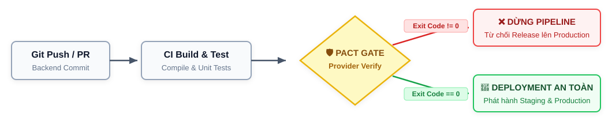

<!-- Slide 1: Section Title Slide -->
<!-- _paginate: false -->
<!-- _header: "" -->
<!-- _footer: "" -->

<br><br><br>

# PACT JS & CONTRACT TESTING
## Kịch Bản C3: Kiểm Soát Tiến Hóa Phần Mềm & Deployment Gate

<div class="highlight-box">
Consumer-Driven Contract Testing · Loose-Coupling Matching Rules · Fault Injection Runner · Chốt Chặn CI/CD Tự Động
</div>

---

<!-- Slide 2: Problem - Software Evolution & Breaking Changes -->

# Bài Toán: Tiến Hóa Phần Mềm & Nguy Cơ Breaking Change

<div class="grid-2">
<div>

### 1. Bối cảnh Software Evolution
* Khi Backend tái cấu trúc mã nguồn (refactoring) hoặc tối ưu hóa cơ sở dữ liệu:
  * Vô tình đổi tên trường dữ liệu: `price` $\rightarrow$ `unit_price`.
  * Format lại kiểu chuỗi: `price: "30.000.000 ₫"`.
* **Breaking Change** là bất kỳ thay đổi nào từ phía Provider làm phá vỡ kỳ vọng đã thỏa thuận của Consumer đang chạy ổn định.

</div>
<div>

### 2. Vì sao kiểm tra HTTP 200 OK là chưa đủ?
* Server xử lý logic nội bộ thành công và vẫn phản hồi mã **HTTP 200 OK**.
* Nếu bộ test chức năng chỉ kiểm tra status code mà thiếu assertion schema payload $\rightarrow$ Test báo **PASS** dù dữ liệu đã bị biến dạng!
* **Hậu quả trên Mobile App:** `product.price` nhận về `undefined` $\rightarrow$ Phép tính giỏ hàng bị `NaN ₫` hoặc gây **App Crash** trên tay người dùng.

</div>
</div>

<div class="highlight-box">
⚖️ <b>Góc nhìn công bằng về công cụ:</b> Postman hay bất kỳ HTTP Client nào vẫn có thể viết script assertion kiểm tra kiểu dữ liệu. Sự khác biệt cốt lõi nằm ở: <b>Ai là người định nghĩa kỳ vọng?</b> Tester tự phán đoán đơn phương hay chính Consumer đưa ra yêu cầu?
</div>

---

<!-- Slide 3: CDCT Sequence & E2E Comparison -->

# Consumer-Driven Contract Testing (CDCT) vs Kiểm Thử E2E


<div class="grid-2">
<div>

### 1. Bản chất của CDCT
* Consumer đóng vai trò **dẫn dắt**, chủ động định nghĩa cấu trúc dữ liệu cần dùng và đóng gói thành tệp hợp đồng JSON (`pact file`).
* Quá trình Provider Verification sẽ phát lại (*replay*) các request từ hợp đồng vào Backend thật để đối soát độc lập.

</div>
<div>

### 2. So sánh với Kiểm thử E2E truyền thống
* **E2E Test:** Đòi hỏi dựng toàn bộ môi trường (Mobile, Web, DB, Gateway), chạy rất chậm (vài phút), tốn tài nguyên và dễ chập chờn (*flaky*).
* **CDCT (Pact):** Cho phép kiểm thử tính tương thích **hoàn toàn độc lập** với tốc độ mili-giây, cô lập và định vị chính xác nguyên nhân lỗi.

</div>
</div>

---

<!-- Slide 4: Contract JSON, Matching Rules & Provider State -->

# Tệp Hợp Đồng & Quy Tắc So Khớp 

<div class="grid-2">
<div>

###  `EShopMobile-EShopBackend.json`
```json
{
  "consumer": { "name": "EShopMobile" },
  "provider": { "name": "EShopBackend" },
  "interactions": [{
    "description": "a request for product with ID 1",
    "providerStates": [{ "name": "product with ID 1 exists" }],
    "request": { "method": "GET", "path": "/api/products/1" },
    "response": {
      "status": 200,
      "body": { "id": 1, "name": "iPhone 15 Pro Max", "price": 30000000 },
      "matchingRules": {
        "body": { "$.price": { "matchers": [{ "match": "integer" }] } }
      }
    }
  }]
}
```

</div>
<div>

### 3 Điểm kỹ thuật cốt lõi:

1. **Loose-Coupling Matcher :**
   Không so khớp cứng giá trị cụ thể, mà ràng buộc bắt buộc tồn tại trường `price` và kiểu dữ liệu phải là số nguyên để tính toán giỏ hàng.
2. **Khái niệm Provider State:**
   Thiết lập tiền điều kiện môi trường — Provider phải đảm bảo sản phẩm ID 1 tồn tại trong database trước khi chạy xác thực.
3. **Giới hạn phạm vi bảo vệ của hợp đồng:**
   Hợp đồng chỉ mới đăng ký tương tác cho sản phẩm ID 1. Các endpoint hoặc ID khác nằm ngoài phạm vi bảo vệ của bản hợp đồng này.

</div>
</div>

---

<!-- Slide 5: Breaking vs Non-breaking & Safe Field Removal -->

# Phân Loại Thay Đổi API: Khi Nào Hợp Đồng Bị Phá Vỡ?

<div class="grid-2">
<div class="card-red">

### Nhóm Breaking Change (Bị Pact Chặn Đứng)
* **Đổi tên hoặc xóa trường** Consumer đang sử dụng (`price` $\rightarrow$ `unit_price`).
* **Thay đổi kiểu dữ liệu** của trường bắt buộc (Số nguyên $\rightarrow$ Chuỗi format tiền tệ).
* **Thay đổi mã HTTP status** (200 $\rightarrow$ 204 hoặc 400), xóa endpoint, hoặc bổ sung tham số bắt buộc (*required query/header*).

</div>
<div class="card-blue">

### Nhóm Non-breaking & Lợi Ích Tiến Hóa An Toàn
* **Bổ sung trường mới (Nguyên lý Postel):**  
  Backend thêm `brand: "Apple"` mà Consumer chưa đăng ký $\rightarrow$ Pact tự động bỏ qua, bài test vẫn PASS.
* **LỢI ÍCH MẠNH NHẤT CỦA CDCT — Xóa trường an toàn (Safe Dead Code Removal):**
  * Backend muốn xóa một trường cũ trong database nhưng sợ làm gãy ứng dụng ngoài client: **Chỉ cần kiểm tra hợp đồng!**
  * Nếu không có Consumer nào đăng ký trường đó trong Pact, Backend có thể **tự tin xóa bỏ 100% an toàn mà không cần họp hành phán đoán!**

</div>
</div>

---

<!-- Slide 6: Deployment Gate & Pact Broker Roadmap -->

# Pact - Deployment Gate: Hiện Tại & Chuẩn Công Nghiệp

<div style="text-align: center; margin-top: 0; margin-bottom: 14px;">
  
</div>

<div class="grid-2">
<div>

### 1. Cơ chế Deployment Gate trong CI/CD
* Là chốt chặn kiểm soát tự động: Nếu Provider Verification trả về `Exit Code != 0` $\rightarrow$ Lập tức dừng bản build, từ chối phát hành lên Production.
* **Phạm vi hiện tại của nhóm:** Thực thi **Local Provider Verification** dựa trên tệp JSON tĩnh, chặn build thông qua mã thoát của tiến trình.

</div>
<div>

### 2. Chuẩn công nghiệp mở rộng
* Tích hợp **Pact Broker / PactFlow** để lưu trữ và quản lý hợp đồng tập trung giữa nhiều nhóm Agile phát triển độc lập.
* Sử dụng công cụ CLI **`can-i-deploy`** đối soát ma trận phiên bản giữa Consumer và Provider theo từng môi trường triển khai (*Dev $\rightarrow$ Staging $\rightarrow$ Production*).

</div>
</div>

---

<!-- Slide 7: Roadmap - 2 Experimental Methods -->

# Lộ Trình Thực Nghiệm: 2 Góc Nhìn Bổ Trợ

<div class="grid-2">
<div class="card">

### 🔬 Phương Pháp 1: Bằng Chứng SUT Thật (Cổng 3000)
* **Môi trường:** Chạy trực tiếp trên mã nguồn `backend/server.js` và database SQLite thật.
* **Thao tác:** Sử dụng bộ lệnh CLI để tiêm đột biến:
  * `npm run demo:mutate:rename` (`price` $\rightarrow$ `unit_price`).
  * `npm run demo:mutate:type` (`price: '30.000.000 ₫'`).
* **Mục tiêu:** Chứng minh tính chân thực của việc Pact bắt lỗi trên hệ thống thật.

</div>
<div class="card">

### ⚙️ Phương Pháp 2: Tự Động Hóa CI/CD (Cổng 3005)
* **Môi trường:** Bộ điều phối tự động `pact-c3-runner.js`.
* **Thao tác:** Chu trình 3 pha tự động khép kín chỉ với 1 dòng lệnh duy nhất:
  ```bash
  npm run test:c3
  ```
* **Kịch bản:** Baseline $\rightarrow$ Tiêm lỗi (Rename, Type, Non-breaking) $\rightarrow$ Rollback hoàn nguyên.
* **Mục tiêu:** Mô phỏng kịch bản kiểm tra tự động trước khi triển khai trong DevOps.

</div>
</div>


---

<!-- Slide 8: Method 2 CI/CD Runner & Stub Architecture -->

# Phương Pháp 2: Bộ Điều Phối CI/CD Runner

<div style="text-align: center; margin-top: 0; margin-bottom: 8px;">
  
</div>

<div class="grid-2" style="gap: 16px; margin-top: 4px;">
<div class="card" style="padding: 10px 16px; font-size: 18px;">

### 💡 Stub Provider Có Trạng Thái (Cổng 3005)
Không phải backend thật mà là **Stub Provider kiểm soát mode động qua biến `currentMode`**, phục vụ kỹ thuật Fault Injection khép kín độc lập với database SQLite thật.

</div>
<div class="card" style="padding: 10px 16px; font-size: 18px;">

### 🛡️ Kiểm Tra Cổng Kiểm Soát (Testing the Gate)
Mục đích cốt lõi là **kiểm chứng độ nhạy của Verification Gate** trong CI/CD: bắt đúng lỗi phá vỡ, cho qua trường hợp an toàn, chạy tự động toàn chu trình với `npm run test:c3`.

</div>
</div>


---

<!-- Slide 9: Experimental Results Matrix & Assertion Caveat -->

# Ma Trận Đánh Giá Kết Quả Kiểm Thử Toàn Diện

<table style="font-size: 18px; margin-top: 6px; margin-bottom: 12px;">
  <thead>
    <tr>
      <th style="width: 10%; text-align: center;">Pha</th>
      <th style="width: 32%;">Kịch bản kiểm tra</th>
      <th style="width: 18%; text-align: center;">Kỳ vọng</th>
      <th style="width: 16%; text-align: center;">Thực tế</th>
      <th style="width: 24%;">Kết luận</th>
    </tr>
  </thead>
  <tbody>
    <tr>
      <td style="text-align: center;"><b>1</b></td>
      <td>Pha 1: Baseline Verification</td>
      <td style="text-align: center;"><code>PASS</code></td>
      <td style="text-align: center; color: #16a34a; font-weight: bold;">PASS</td>
      <td><b>ĐẠT (Hợp đồng toàn vẹn)</b></td>
    </tr>
    <tr>
      <td style="text-align: center;"><b>2A</b></td>
      <td>Pha 2A: Rename <code>price</code> &rarr; <code>unit_price</code></td>
      <td style="text-align: center;"><code>BLOCK (FAIL)</code></td>
      <td style="text-align: center; color: #dc2626; font-weight: bold;">BLOCKED</td>
      <td><b>ĐẠT (Bắt đúng thiếu trường <code>price</code>)</b></td>
    </tr>
    <tr>
      <td style="text-align: center;"><b>2B</b></td>
      <td>Pha 2B: Type Integer &rarr; String</td>
      <td style="text-align: center;"><code>BLOCK (FAIL)</code></td>
      <td style="text-align: center; color: #dc2626; font-weight: bold;">BLOCKED</td>
      <td><b>ĐẠT (Bắt đúng lệch kiểu dữ liệu)</b></td>
    </tr>
    <tr>
      <td style="text-align: center;"><b>2C</b></td>
      <td>Pha 2C: Add <code>brand</code> (Non-breaking)</td>
      <td style="text-align: center;"><code>PASS</code></td>
      <td style="text-align: center; color: #16a34a; font-weight: bold;">PASS</td>
      <td><b>ĐẠT (Tiến hóa an toàn theo Postel)</b></td>
    </tr>
    <tr>
      <td style="text-align: center;"><b>3</b></td>
      <td>Pha 3: Rollback &amp; Re-verify</td>
      <td style="text-align: center;"><code>PASS</code></td>
      <td style="text-align: center; color: #16a34a; font-weight: bold;">PASS</td>
      <td><b>ĐẠT (Hệ thống hoàn nguyên an toàn)</b></td>
    </tr>
  </tbody>
</table>

<div class="card-red" style="padding: 10px 16px; font-size: 19px;">

### ⚠️ Lưu ý kỹ thuật chuyên sâu: Tránh bẫy "Đúng kết quả nhưng sai lý do"
* Nếu runner chỉ kiểm tra `exitCode != 0` mà không kiểm tra thông điệp lỗi, hệ thống có thể dính bẫy phán quyết sai (ví dụ server sập hoặc lỗi kết nối mạng cũng khiến exit code != 0).
* **Giải pháp của nhóm:** Bộ runner đối soát chính xác nội dung lỗi: Phải chứa `missing keys: price` (Pha 2A) và `expected integer` (Pha 2B) mới xác nhận phán quyết `BLOCKED ĐẠT`.

</div>

---

<!-- Slide 10: Retrospective, Limitations & Future Roadmap -->

# Đúc Kết Giá Trị, Hạn Chế Thực Tế & Hướng Phát Triển

<div class="grid-3">
<div class="card">

### 💎 1. Giá Trị Cốt Lõi
* Khẳng định tính khả thi của việc dùng Pact JS làm **Deployment Gate** tự động chặn đứng lỗi hợp đồng trong CI/CD.
* Giúp Provider tự tin refactor và **xóa an toàn mã nguồn thừa (Safe Dead Code Removal)** mà không sợ gãy ứng dụng client.

</div>
<div class="card-red">

### ⚠️ 2. Hạn Chế Thực Tế
* Hợp đồng phụ thuộc vào **phạm vi đăng ký của Consumer** (hợp đồng C1 hiện tại chỉ mới bảo vệ ID 1, chưa bao phủ ID 2).
* Tốn công sức duy trì các hàm `stateHandlers` đồng bộ với database thật khi cấu trúc dữ liệu thay đổi.

</div>
<div class="card-blue">

### 🚀 3. Hướng Phát Triển
* Triển khai **Pact Broker tập trung** để quản trị hợp đồng giữa nhiều nhóm phát triển Agile độc lập.
* Tích hợp lệnh CLI **`can-i-deploy`** vào GitHub Actions để đối soát ma trận tương thích đa môi trường (*Dev $\rightarrow$ Staging $\rightarrow$ Production*).

</div>
</div>

---

<!-- Slide 11: Closing & QA -->
<!-- _paginate: false -->
<!-- _header: "" -->
<!-- _footer: "" -->

# Tổng Kết Kịch Bản C3 & Phiên Hỏi - Đáp (Q&A)

<div class="grid-2">
<div>

### 🎯 Thông Điệp Kết Thúc:
*"Consumer-Driven Contract Testing với Pact JS đã chứng minh vai trò là một giải pháp kiểm soát tiến hóa phần mềm tin cậy, bảo vệ ứng dụng khỏi các rủi ro Breaking Change ngầm trước khi chạm tới Production."*

### 💬 Mời Thảo Luận & Hỏi - Đáp:
Sẵn sàng trao đổi về:
* Nguyên lý CDCT & Matching Rules
* Cơ chế Provider State & Mock Engine
* Kỹ thuật Fault Injection & CI/CD Runner
* Tích hợp Deployment Gate vào DevOps

</div>
<div>

<div class="card" style="padding: 16px 20px; font-size: 20px;">

### 👨‍💻 Thông Tin Chuyên Đề & Nhóm:
* **Người thực hiện:** **Nguyễn Quốc Kỳ** (MSSV: 23120138)  
  *Thành viên Nhóm 11 — Seminar Kiểm thử phần mềm*
* **Thành viên phối hợp:** **Nguyễn Hoàng Anh Tú** (MSSV: 23120183)
* **Môn học:** CS423 / CSC15003 — FIT@HCMUS
* **Mã nguồn kịch bản:** Thư mục `tests/pact/`

<br>

<div class="highlight-box" style="margin: 0; padding: 10px 14px; font-size: 19px;">
<b>Chân thành cảm ơn Thầy Cô và các bạn đã chú ý lắng nghe!</b>
</div>

</div>

</div>
</div>
