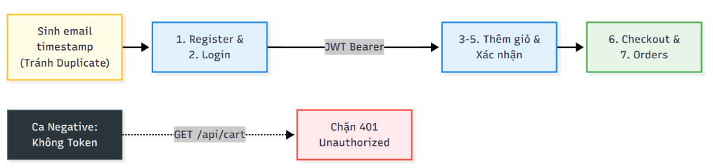
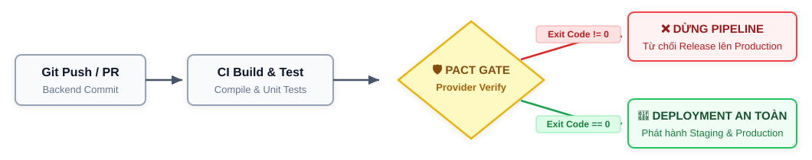

<!-- Slide 1: Title Slide -->
<!-- _paginate: false -->
<!-- _header: "" -->
<!-- _footer: "" -->

<br><br>

# T06 — API & Contract Testing

**Môn học:** CS423 / CSC15003 — Kiểm thử Phần mềm (Software Testing)  
**Khoa Công nghệ Thông tin — Trường ĐH Khoa học Tự nhiên, ĐHQG-HCM**  

<div class="highlight-box">

**Nhóm thực hiện: Nhóm 11**
* **Nguyễn Hoàng Anh Tú** (MSSV: 23120183) — *Pact C1/C2, Newman P3, Slides*
* **Nguyễn Quốc Kỳ** (MSSV: 23120138) — *Karate K1/K2/K3, Pact C3*
* **Hà Quốc Kiên** (MSSV: 23120056) — *Postman P1/P2, AI Agent Testing, Report*

**Giảng viên hướng dẫn:** M.Sc Hồ Tuấn Thanh  
*Thời lượng trình bày: 30 phút (Lý thuyết chuyên sâu & Live Demo)*
</div>

---

<!-- Slide 2: Agenda -->

# Mục Tiêu & Cấu Trúc Buổi Seminar

1. **Tổng Quan Về API Testing:** Bản chất, 4 trọng tâm kiểm thử & giải phẫu HTTP
2. **Công Cụ 1 — Postman & Newman CLI:** Từ kiểm thử thủ công đến CI/CD
   * Cấu trúc Collection, Variables Scopes & Scripting Sandbox
   * Kỹ thuật Token Chaining & Data-Driven CSV
   * Demo Kịch bản P1, P2 & P3 (Newman HTML Extra Dashboard)
3. **Công Cụ 2 — Karate Framework:**
   * K1 Smoke (Fuzzy Matcher) & K2 Data-Driven (Bắt 2 bug SUT)
   * K3 Stateful Shopping Workflow (Login $\rightarrow$ Cart $\rightarrow$ Checkout)
4. **Công Cụ 3 — Lý Thuyết Contract Testing & Pact JS:**
   * Bản chất Contract Testing & Vì sao nó sống còn trong Microservices?
   * Demo C1 (Consumer Contract), C2 (Provider Verification), C3 (Bắt Breaking Change)
5. **So Sánh Tổng Hợp 3 Công Cụ, Hướng AI & Kết Luận:**

---

<!-- Slide 3: API Testing Fundamentals -->

# Tổng Quan Về API Testing: Bản Chất & Phân Loại

<div class="grid-2">
<div>

### 1. Bản chất của API Testing
* Kiểm thử tại tầng trung gian (**Business Logic Layer**), độc lập với UI.
* **Shift-Left Testing:** Phát hiện lỗi sớm ngay khi backend vừa viết xong endpoint, không cần chờ hoàn thiện giao diện Web/Mobile.
* Tốc độ thực thi nhanh gấp 10–50 lần so với UI Test, ổn định, không bị "flaky" khi UI đổi CSS/Layout.

</div>
<div>

### 2. 4 Trọng tâm kiểm thử cốt lõi
* **Functional Testing:** Kiểm tra mã trạng thái HTTP, tính chính xác của dữ liệu và nghiệp vụ.
* **Schema Validation:** Kiểm tra kiểu dữ liệu (`number`, `string`), các trường bắt buộc/tùy chọn.
* **Negative & Boundary:** Dữ liệu trống, sai định dạng, vượt giới hạn số, SQLi, mã 400/404.
* **Security & Auth:** Kiểm tra xác thực Token, phân quyền Admin vs Customer (401 Unauthorized, 403 Forbidden).

</div>
</div>

<div class="highlight-box">
Kim tự tháp kiểm thử hiện đại: API Testing chiếm tỷ trọng lớn nhờ chi phí vận hành thấp và độ bao phủ cao.
</div>

---

<!-- Slide 4: HTTP Request & Response Anatomy -->

# Giải Phẫu HTTP Request/Response & Cơ Chế Kiểm Thử

```text
HTTP REQUEST                                           HTTP RESPONSE
+------------------------------------------------+     +------------------------------------------------+
| POST /api/cart HTTP/1.1                        |     | HTTP/1.1 200 OK                                |
| Host: localhost:3000                           |     | Content-Type: application/json; charset=utf-8  |
| Authorization: Bearer eyJhbGciOi...            |     | X-Response-Time: 12ms                          |
| Content-Type: application/json                 |     +------------------------------------------------+
+------------------------------------------------+     | {                                              |
| { "productId": 1, "quantity": 2 }              |     |   "success": true, "cartId": 101,              |
+------------------------------------------------+     |   "items": [ { "id": 1, "qty": 2 } ]          |
                                                       | }                                              |
                                                       +------------------------------------------------+
```

### 3 Thành phần kinh điển trong một ca kiểm thử API:
1. **Setup & Pre-request:** Chuẩn bị dữ liệu đầu vào, mã hóa mật khẩu, sinh timestamp, chuẩn bị token.
2. **Execution:** Gửi request HTTP tương ứng với Method, Path, Headers và Body.
3. **Checkpoints & Assertions:** Đo lường Response Status, Response Time ($< 500\text{ms}$), Schema & Data Integrity.

---

<!-- Slide 5: Postman Architecture & Ecosystem -->

# Chuyên Sâu Postman: Hệ Sinh Thái & Kiến Trúc Nền Tảng

Postman không chỉ là công cụ gửi HTTP request đơn thuần, mà là một **Nền Tảng API Testing Hoàn Chỉnh**:

<div class="grid-2">
<div>

### 1. Tổ chức phân cấp Collection
* **Workspace $\rightarrow$ Collection $\rightarrow$ Folders $\rightarrow$ Requests**.
* Quản lý API mạch lạc theo từng phân hệ nghiệp vụ: `Auth`, `Products`, `Cart`, `Checkout`.
* Lưu trữ và chia sẻ đặc tả API, mock server trong nhóm phát triển.

### 2. Thứ bậc biến số (Variables Scopes)
* `Global` $\rightarrow$ `Collection` $\rightarrow$ `Environment` $\rightarrow$ `Data` $\rightarrow$ `Local`.
* Cho phép chuyển đổi môi trường tức thì giữa **Local (`localhost:3000`)**, **Staging**, và **Production**.

</div>
<div>

### 3. Scripting Engine (JavaScript Sandbox)
* Tích hợp Node-like sandbox, hỗ trợ đầy đủ thư viện `Lodash`, `CryptoJS`, `moment`.
* Khung kiểm thử chuẩn **Chai.js BDD** (`pm.test()`, `pm.expect()`).
* **Hai điểm can thiệp mã nguồn:**
  * **Pre-request Script:** Chạy *trước khi* request gửi đi (tạo dynamic payload, tính chữ ký số).
  * **Tests Script:** Chạy *sau khi* nhận response (bắt assertion, lưu token).

</div>
</div>

---

<!-- Slide 6: Postman Advanced Techniques -->

# Kỹ Thuật Nâng Cao: Token Chaining & Data-Driven

<div class="grid-2">
<div>

### 1. Token Chaining (Quản lý phiên)
* Trích xuất JWT Token tự động từ API Đăng nhập và lưu vào Environment:
```javascript
pm.test("Login success & save token", function() {
    pm.response.to.have.status(200);
    var jsonData = pm.response.json();
    pm.environment.set("jwt_token", jsonData.token);
});
```
* Các API sau (Cart, Checkout) chỉ cần khai báo header dùng biến:  
  `Authorization: Bearer {{jwt_token}}`
* Không bao giờ phải copy-paste token thủ công!

</div>
<div>

### 2. Data-Driven Testing (Nạp CSV/JSON)
* Cho phép thực thi 1 request lặp lại hàng trăm lần với các bộ dữ liệu khác nhau:
```javascript
// Đọc dữ liệu từ file login_data.csv
var expectedStatus = pm.iterationData.get("status");
pm.test("Status matches test case", function() {
    pm.response.to.have.status(expectedStatus);
});
```
* **Ứng dụng trên EShop:**
  * `login_data.csv`: Test tài khoản đúng, sai pass, tài khoản rỗng.
  * `product_ids.csv`: Quét biên ID hợp lệ và không hợp lệ.

</div>
</div>

---

<!-- Slide 7: Demo Postman P1, P2 & Newman P3 -->

# Demo Postman (P1, P2) & Tự Động Hóa Newman CLI (P3)

<div class="grid-2">
<div>

### Demo Kịch bản P1 & P2:
* **P1 (Basic):** `POST /api/login` (Lưu token) $\rightarrow$ `GET /api/products` (Mã 200, Content-Type JSON).
* **P2 (Runner & Checkpoints):**
  * Nạp file `product_ids.csv` quét kiểm thử biên.
  * Checkpoint SLA: `pm.expect(responseTime).to.be.below(200);`
  * Checkpoint Schema: Đảm bảo đủ các trường bắt buộc.

</div>
<div>

### Demo Kịch bản P3: Newman CLI CI/CD
* Chạy headless hoàn toàn trong terminal:
```bash
newman run eshop_api_all_tests.json \
  -e local_env.json -d login_data.csv \
  --reporters cli,htmlextra
```
* Tích hợp tự động vào GitHub Actions / GitLab CI.
* Xuất báo cáo trực quan **HTML Extra Dashboard** với đầy đủ biểu đồ Pass/Fail.

</div>
</div>

<div class="highlight-box">
🎬 <b>Minh chứng Video Demo:</b> Clip P1 (Setup & Basic), Clip P2 (Data-driven Runner) và Clip P3 (Newman CLI CI/CD).
</div>

---

<!-- Slide 1: Section Title Slide -->
<!-- _paginate: false -->
<!-- _header: "" -->
<!-- _footer: "" -->

<br><br><br>

# KARATE FRAMEWORK
## Kiểm Thử API Tự Động Bằng Mã Nguồn (Bộ Kịch Bản K1, K2 & K3)

<div class="highlight-box">
BDD DSL Không Tầng Trung Gian · Schema & Fuzzy Matchers · Data-Driven Testing · Stateful E2E Workflow
</div>

---

<!-- Slide 2: Motivation & Core Advantages -->

# Động Lực: 3 Ưu Thế Cốt Lõi Của Karate Framework

Code-based Testing là mắt xích quyết định trong pipeline CI/CD:

<div class="grid-3">
<div class="card">

### Code BDD DSL trực quan
*  Viết kịch bản bằng ngôn ngữ Gherkin tự nhiên, tích hợp sẵn giao thức HTTP mà không cần viết mã trung gian Java.
* Vừa là Living Docs vừa là mã chạy trực tiếp.

</div>
<div class="card">

### Native Schema Validation
* Kiểm tra cấu trúc JSON sâu trực tiếp không cần thư viện phụ.
* Fuzzy Matchers linh hoạt với dữ liệu động.

</div>
<div class="card">

### Tự động hóa CI/CD qua Maven
* Quản lý kịch bản dạng mã nguồn thuần.
* Thực thi nhanh chóng bằng một dòng lệnh CLI.
* Tự động sinh báo cáo HTML trực quan kèm wire log.

</div>
</div>

<div class="highlight-box">
Tập trung vào logic nghiệp vụ và chất lượng kiểm thử thay vì bảo trì mã boilerplate trung gian.
</div>

---

<!-- Slide 3: SUT Context & 3 Levels Coverage -->

# Hệ Thống SUT EShop & Chiến Lược Bao Phủ 3 Cấp Độ

<div style="text-align: center; margin-top: 10px;">
  
</div>

---

<!-- Slide 4: Principle 1 - No Step Definitions -->

# Nguyên Lý 1: Triết Lý BDD DSL Không Tầng Trung Gian

<div style="text-align: center; margin-top: 10px; margin-bottom: 20px;">
  
</div>

<div class="grid-2">
<div>

### Karate Framework
* Cú pháp Gherkin (Given path, When method, Then status, And match) kết nối trực tiếp với HTTP Engine nội tại.
* Không boilerplate, trực quan cho cả QA, Dev và BA. 
</div>
<div>

### 
### Framework truyền thống
* Cần viết thêm lớp trung gian Step Definitions để nối câu chữ Gherkin với HTTP Client.
* Gây tốn kém thời gian bảo trì, tạo ra lượng mã thừa khổng lồ và dễ phát sinh lỗi mismatch regex khi sửa câu chữ kịch bản.


</div>
</div>

---

<!-- Slide 5: Principle 2 - Schema & Fuzzy Matchers -->

# Nguyên Lý 2: Schema Validation & Fuzzy Matchers

<div class="highlight-box" style="margin-top: 0; margin-bottom: 14px; padding: 8px 16px; font-size: 19px;">
<b>Thách thức từ Dynamic Data:</b> Dữ liệu API thực tế biến đổi liên tục (IDs tự tăng, Tokens JWT, Timestamp, UUIDs). Việc so khớp giá trị cứng khiến test dễ bị lỗi khi dữ liệu đầu vào hoặc trạng thái hệ thống thay đổi.
</div>

<div class="card" style="padding: 12px 18px;">

### 📋 Khung Tra Cứu & Ví Dụ Minh Họa Fuzzy Matchers

<table class="ref-table" style="font-size: 21px;">
  <thead>
    <tr>
      <th style="width: 22%;">Cú pháp Matcher</th>
      <th style="width: 38%;">Ý nghĩa & Quy tắc khớp</th>
      <th style="width: 40%;">Ví dụ minh chứng trong K1 (EShop)</th>
    </tr>
  </thead>
  <tbody>
    <tr>
      <td><code>#number</code></td>
      <td>Số nguyên hoặc số thực</td>
      <td><code>{ price: '#number', id: '#number' }</code></td>
    </tr>
    <tr>
      <td><code>#string</code></td>
      <td>Chuỗi ký tự bất kỳ</td>
      <td><code>{ name: '#string', imageUrl: '#string' }</code></td>
    </tr>
    <tr>
      <td><code>#boolean</code></td>
      <td>Giá trị logic (true / false)</td>
      <td><code>{ in_stock: '#boolean' }</code></td>
    </tr>
    <tr>
      <td><code>#[]</code></td>
      <td>Cấu trúc mảng JSON Array</td>
      <td><code>match response == '#[]'</code></td>
    </tr>
    <tr>
      <td><code>contains deep</code></td>
      <td>Khớp thuộc tính lồng nhau</td>
      <td><code>match each response contains { id: '#number' }</code></td>
    </tr>
  </tbody>
</table>


---

<!-- Slide 6: Principle 3 - Data-Driven Testing -->

# Nguyên Lý 3: Data-Driven — Characterization vs Spec Test

Tách bạch giữa **Logic kiểm thử** và **Tập dữ liệu đầu vào** qua `Scenario Outline` + `Examples`:

<div class="grid-2">
<div class="card-blue">

### 🔍 1. Characterization Test
**Kiểm thử ghi nhận hành vi hiện tại**
* **Bản chất:** Ghi lại trung thực hành vi hiện hành của hệ thống SUT để làm mốc đối soát (**Regression Baseline**).
* **Mục tiêu:** Đảm bảo hệ thống không bị biến đổi ngoài tầm kiểm soát khi nâng cấp hoặc refactor.
* **Minh chứng K2:** Ghi nhận SUT trả về `price: "28000000"` (`#string`) ở ID 2 để duy trì baseline theo dõi.

</div>
<div class="card-red">

### 🎯 2. Specification Test
**Kiểm thử kiểm chứng theo đặc tả chuẩn**
* **Bản chất:** Áp đặt các ràng buộc chuẩn mực theo tài liệu thiết kế (chuẩn RESTful API quy định).
* **Mục tiêu:** Phát hiện sai lệch & khiếm khuyết khi hành vi thực tế không khớp với thiết kế.
* **Bằng chứng lỗi:** Khi lệch đặc tả $\rightarrow$ **Test FAIL**, cung cấp **Defect Evidence** xác thực cho dev sửa.

</div>
</div>


---

<!-- Slide 7: Principle 4 - Stateful Workflow & Isolation -->

# Nguyên Lý 4: Stateful Workflow & Cô Lập Dữ Liệu Động (K3)

<div style="text-align: center; margin-top: 4px; margin-bottom: 10px;">
  
</div>

<div class="grid-2">
<div>

### 1. Duy trì trạng thái (State Chaining)
* Trích xuất JWT Token từ API Đăng nhập.
* Tự động truyền biến vào Header cho các bước nghiệp vụ sau: `'Bearer ' + authToken`

</div>
<div>

### 2. Cô lập dữ liệu kiểm thử
* SUT có ràng buộc `UNIQUE(email)` trong SQLite.
* Karate gọi Java runtime sinh email độc nhất:  `'karate_k3_' + timestamp + '@eshop.com'`
* Giúp test suite lặp lại vô hạn lần trên CI/CD mà không xung đột!

</div>
</div>

---

<!-- Slide 8: Principle 5 - Playback & Multi-Layer Assertions -->

# Nguyên Lý 5: Luận Điểm Playback & Kiểm Chứng Đa Tầng

<div class="grid-2">
<div class="card">

### 1. Luận điểm "Playback" trong Code-based Testing
* Khả năng **tái hiện tự động (Automated Replay)** toàn bộ kịch bản nghiệp vụ thông qua lệnh Maven CLI và CI/CD pipeline.
* Đảm bảo tính nhất quán, loại bỏ hoàn toàn các sai số và độ trễ do thao tác thủ công.

</div>
<div class="card">

### 2. Chiến lược 3 tầng kiểm chứng tránh bẫy False Positive
Bẫy **False Positive** xảy ra khi kịch bản chỉ kiểm tra sơ sài mã trạng thái HTTP 200 mà bỏ qua nội dung payload. . Nhóm thiết lập 3 tầng kiểm chứng::

* **Tầng 1 (Status):** Khẳng định mã phản hồi HTTP (status 200 / 401).
* **Tầng 2 (Structure):** Kiểm tra cấu trúc mảng & kích thước (`match response == '#[]'`, `assert response.length > 0`).
* **Tầng 3 (Schema & Deep Match):** Kiểm tra ràng buộc kiểu dữ liệu từng trường và so khớp thuộc tính nghiệp vụ sâu (`contains deep`).

</div>
</div>

<div class="highlight-box">
Không có công cụ nào tự động chống False Positive; chính kiến trúc kiểm chứng đa tầng chặt chẽ mới bảo vệ được chất lượng kịch bản.
</div>

---

<!-- Slide 9: Matrix K2 & Discrepancies -->

# Ma Trận K2: Kiểm Chứng Đặc Tả & Bắt Trọn Khiếm Khuyết SUT

| Case kiểm thử | ID Sản phẩm | Kỳ vọng theo Đặc tả (Spec) | Hành vi Backend SUT | Kết quả (Verdict) | Ý nghĩa kiểm thử |
|:---:|:---:|---|---|:---:|---|
| **Case 1** | `1` | `status 200` & `price: '#number'` | Trả về `price: 30000000` (Number) | ✅ **PASSED** | **Happy Path:** Chuẩn mực đặc tả |
| **Case 2** | `2` | `status 200` & `price: '#number'` | Trả về `price: "28000000"` (String) | ❌ **FAILED** | **BẮT LỖI 1:** Sai lệch kiểu dữ liệu |
| **Case 3** | `9999` | `status 404` | Trả về `200 OK` + `{}` | ❌ **FAILED** | **BẮT LỖI 2:** Vi phạm chuẩn RESTful 404 |

<div class="highlight-box">
<b>Tư duy kiểm thử chuẩn mực:</b> Nhóm không thỏa hiệp với lỗi của SUT để "ép xanh" báo cáo. Hai ca FAILED chính là <b>Bằng chứng kiểm thử (Defect Evidence)</b> minh bạch nhất để QA yêu cầu đội ngũ lập trình viên sửa lỗi!
</div>

---

<!-- Slide 10: Execution Results & SUT Defects -->

# Kết Quả Thực Nghiệm: Báo Cáo HTML & Khiếm Khuyết SUT

<div class="grid-2">
<div class="card-blue">

### 📊 Chỉ số thực thi trên `karate-summary.html`
* **Kịch bản K1 (@smoke):** **`100% Passed`** — Danh mục đáp ứng hoàn hảo schema qua `match each`.
* **Kịch bản K2 (@data-driven):** **`1 Passed, 2 Failed`** — Bắt trọn 2 lỗi lệch đặc tả của SUT.
* **Kịch bản K3 (@e2e):** **`100% Passed`** — 7 bước mua hàng và ca bảo mật 401 hoạt động bền bỉ.
* **Tổng thời gian thực thi:** **~350 mili-giây** (Cực nhanh qua JVM HTTP Client).

</div>
<div class="card-red">

### 🚨 Bằng chứng 2 khiếm khuyết của SUT EShop
* **Khiếm khuyết 1 (Sai kiểu dữ liệu ở ID chẵn):** `GET /api/products/2` trả về `price: "28000000"` (String) thay vì Number, gây lỗi số học khi tính tổng tiền.
* **Khiếm khuyết 2 (Thiếu mã lỗi RESTful 404):** `GET /api/products/9999` trả về `200 OK` kèm `{}` thay vì `404 Not Found`, gây crash client ứng dụng di động.

</div>
</div>

<div class="highlight-box">
Báo cáo HTML là <b>Bằng chứng kiểm thử (Test Evidence)</b> độc lập, minh bạch, sẵn sàng đính kèm trực tiếp vào ticket lỗi cho đội ngũ Backend Developer.
</div>

---

<!-- Slide 11: Multi-Tool Synergy & Limitations -->

# Mô Hình Bổ Trợ Đa Tầng & Các Hạn Chế Thực Tế Của Karate

<div class="grid-2">
<div>

### 1. Phối hợp bổ trợ 3 công cụ
* **Postman:** Khám phá API ban đầu, kiểm thử thủ công và debug nhanh cho lập trình viên.
* **Pact JS:** Kiểm thử hợp đồng (Contract Testing), bảo đảm tính tương thích giữa các microservices độc lập.
* **Karate Framework:** Kiểm thử hồi quy tự động (Automated Regression), kiểm tra chuỗi nghiệp vụ có trạng thái (Stateful E2E) tích hợp sâu vào CI/CD.
</div>
<div>

### 2. Các hạn chế thực tế của Karate
* Phụ thuộc môi trường thực thi Java và công cụ quản lý dự án Maven.
* Ngôn ngữ DSL riêng đòi hỏi thời gian học tập ban đầu; khó debug luồng code sâu hơn mã JS/Java thuần.
* Hệ sinh thái công cụ hỗ trợ trên IDE còn hạn chế (phụ thuộc vào extension ngoài).
* Không có cơ chế tự động "Record" lưu vết traffic từ trình duyệt như các tool UI.

</div>
</div>

<div class="highlight-box">
<b>Đánh giá khách quan:</b> Không có một công cụ vạn năng duy nhất. Sự kết hợp hiệp đồng giữa Postman, Pact và Karate tạo nên chiến lược bảo đảm chất lượng toàn diện cho hệ thống.
</div>

---

<!-- Slide 10: Contract Testing Theory -->

# Lý Thuyết Contract Testing: Bản Chất & Vì Sao Nó Cần Thiết?

<div class="grid-2">
<div>

### 1. Contract Testing là gì?
* Là phương pháp kiểm thử **sự thỏa thuận giao tiếp** giữa:
  * **Consumer:** Web, Mobile, Microservice
  * **Provider:** Backend

### 2. Sự bế tắc của E2E Testing
* Dựng môi trường tích hợp đầy đủ rất tốn kém, vận hành chậm chạp (vài chục phút).
* Thường xuyên bị lỗi giả (**Flaky**) do nghẽn mạng, cơ sở dữ liệu không đồng bộ.

</div>
<div>

### 3. Vấn đề "API Drift" trong Microservices
* Backend và Frontend được phát triển bởi các nhóm độc lập theo Agile Sprints.
* Backend tự ý thay đổi
* Mock Server tĩnh hoặc Swagger Docs không phát hiện được sự sai lệch này.

</div>
</div>

<div class="highlight-box">
Contract Testing cho phép kiểm thử Consumer và Provider <b>hoàn toàn độc lập (Decoupled)</b> nhưng vẫn đảm bảo 100% không bị gãy vỡ khi ghép nối thật!
</div>

---

<!-- Slide 11: Pact Architecture & C1, C2 -->

# Consumer-Driven Contract Testing — Pact C1 & C2

```text
[ GIAI ĐOẠN 1: CONSUMER TEST ]
+---------------------+      GET /api/products (Expected)       +--------------------+
| EShop Mobile Client | -------------------------------------> |  Pact Mock Server  | ---> Sinh hợp đồng JSON:
+---------------------+ <------------------------------------- +--------------------+      EShopMobile-EShopBackend.json
                             Mock Response (id, name, price)                                       |
[ GIAI ĐOẠN 2: PROVIDER VERIFICATION ]                                                             |
+---------------------+      Replay HTTP Request                                                   v
|  Actual Node SUT    | <------------------------------------- +--------------------+
| (EShop Backend:3000)| -------------------------------------> |   Pact Verifier    | ---> Đối soát 100% (Pass!)
+---------------------+      Actual Response                   +--------------------+
```

* **Kịch bản C1 (`npm run test:consumer`):** Mobile Client định nghĩa hợp đồng kỳ vọng.
* **Kịch bản C2 (`npm run test:provider`):** Backend SUT xác thực tuân thủ hợp đồng: `1 interaction, 0 failures` (PASS).

---

<!-- Slide 1: Section Title Slide -->
<!-- _paginate: false -->
<!-- _header: "" -->
<!-- _footer: "" -->

<br><br><br>

# PACT JS & CONTRACT TESTING
## Kịch Bản C3: Kiểm Soát Tiến Hóa Phần Mềm & Deployment Gate

<div class="highlight-box">
Consumer-Driven Contract Testing · Loose-Coupling Matching Rules · Fault Injection Runner · Chốt Chặn CI/CD Tự Động
</div>

---

<!-- Slide 2: Problem - Software Evolution & Breaking Changes -->

# Bài Toán: Tiến Hóa Phần Mềm & Nguy Cơ Breaking Change

<div class="grid-2">
<div>

### 1. Bối cảnh Software Evolution
* Khi Backend tái cấu trúc mã nguồn hoặc tối ưu hóa cơ sở dữ liệu:
  * Vô tình đổi tên trường dữ liệu: `price` $\rightarrow$ `unit_price`.
  * Format lại kiểu chuỗi: `price: "30.000.000 ₫"`.
* **Breaking Change** là bất kỳ thay đổi nào từ phía Provider làm phá vỡ kỳ vọng đã thỏa thuận của Consumer đang chạy ổn định.

</div>
<div>

### 2. Vì sao kiểm tra HTTP 200 OK là chưa đủ?
* Server xử lý logic nội bộ thành công và vẫn phản hồi mã **HTTP 200 OK**.
* Nếu bộ test chức năng chỉ kiểm tra status code mà thiếu assertion schema payload $\rightarrow$ Test báo **PASS** dù dữ liệu đã bị biến dạng!
* **Hậu quả trên Mobile App:** `product.price` nhận về `undefined` $\rightarrow$ Phép tính giỏ hàng bị `NaN ₫` hoặc gây **App Crash** trên tay người dùng.

</div>
</div>

<div class="highlight-box">
⚖️ <b>Góc nhìn công bằng về công cụ:</b> Postman hay bất kỳ HTTP Client nào vẫn có thể viết script assertion kiểm tra kiểu dữ liệu. Sự khác biệt cốt lõi nằm ở: <b>Ai là người định nghĩa kỳ vọng?</b> Tester tự phán đoán đơn phương hay chính Consumer đưa ra yêu cầu?
</div>

---

<!-- Slide 3: CDCT Sequence & E2E Comparison -->

# Consumer-Driven Contract Testing (CDCT) vs Kiểm Thử E2E


<div class="grid-2">
<div>

### 1. Bản chất của CDCT
* Consumer đóng vai trò **dẫn dắt**, chủ động định nghĩa cấu trúc dữ liệu cần dùng và đóng gói thành tệp hợp đồng JSON (`pact file`).
* Quá trình Provider Verification sẽ phát lại (*replay*) các request từ hợp đồng vào Backend thật để đối soát độc lập.

</div>
<div>

### 2. So sánh với Kiểm thử E2E truyền thống
* **E2E Test:** Đòi hỏi dựng toàn bộ môi trường (Mobile, Web, DB, Gateway), chạy rất chậm (vài phút), tốn tài nguyên và dễ chập chờn (*flaky*).
* **CDCT (Pact):** Cho phép kiểm thử tính tương thích **hoàn toàn độc lập** với tốc độ mili-giây, cô lập và định vị chính xác nguyên nhân lỗi.

</div>
</div>

---

<!-- Slide 4: Contract JSON, Matching Rules & Provider State -->

# Tệp Hợp Đồng & Quy Tắc So Khớp 

<div class="grid-2">
<div>

###  `EShopMobile-EShopBackend.json`
```json
{
  "consumer": { "name": "EShopMobile" },
  "provider": { "name": "EShopBackend" },
  "interactions": [{
    "description": "a request for product with ID 1",
    "providerStates": [{ "name": "product with ID 1 exists" }],
    "request": { "method": "GET", "path": "/api/products/1" },
    "response": {
      "status": 200,
      "body": { "id": 1, "name": "iPhone 15 Pro Max", "price": 30000000 },
      "matchingRules": {
        "body": { "$.price": { "matchers": [{ "match": "integer" }] } }
      }
    }
  }]
}
```

</div>
<div>

### 3 Điểm kỹ thuật cốt lõi:

1. **Loose-Coupling Matcher :**
   Không so khớp cứng giá trị cụ thể, mà ràng buộc bắt buộc tồn tại trường `price` và kiểu dữ liệu phải là số nguyên để tính toán giỏ hàng.
2. **Khái niệm Provider State:**
   Thiết lập tiền điều kiện môi trường — Provider phải đảm bảo sản phẩm ID 1 tồn tại trong database trước khi chạy xác thực.
3. **Giới hạn phạm vi bảo vệ của hợp đồng:**
   Hợp đồng chỉ mới đăng ký tương tác cho sản phẩm ID 1. Các endpoint hoặc ID khác nằm ngoài phạm vi bảo vệ của bản hợp đồng này.

</div>
</div>

---

<!-- Slide 5: Breaking vs Non-breaking & Safe Field Removal -->

# Phân Loại Thay Đổi API: Khi Nào Hợp Đồng Bị Phá Vỡ?

<div class="grid-2">
<div class="card-red">

### Nhóm Breaking Change 
* **Đổi tên hoặc xóa trường** Consumer đang sử dụng (`price` $\rightarrow$ `unit_price`).
* **Thay đổi kiểu dữ liệu** của trường bắt buộc (Số nguyên $\rightarrow$ Chuỗi format tiền tệ).
* **Thay đổi mã HTTP status** (200 $\rightarrow$ 204 hoặc 400), xóa endpoint, hoặc bổ sung tham số bắt buộc (*required query/header*).

</div>
<div class="card-blue">

### Nhóm Non-breaking & Lợi ích Tiến hóa an toàn
* **Bổ sung trường mới (Nguyên lý Postel):**  
  Backend thêm `brand: "Apple"` mà Consumer chưa đăng ký $\rightarrow$ Pact tự động bỏ qua, bài test vẫn PASS.
* **Lợi ích lớn mạnh nhất của CDCT — Xóa trường an toàn (Safe Dead Code Removal):**
  * Backend muốn xóa một trường cũ trong database nhưng sợ làm gãy ứng dụng ngoài client: Chỉ cần kiểm tra hợp đồng.
  * Nếu không có Consumer nào đăng ký trường đó trong Pact, Backend có thể dọn dẹp an toàn, loại bỏ hoàn toàn sự phỏng đoán mơ hồ. 

</div>
</div>

---

<!-- Slide 6: Deployment Gate & Pact Broker Roadmap -->

# Pact - Deployment Gate: Hiện Tại & Chuẩn Công Nghiệp

<div style="text-align: center; margin-top: 0; margin-bottom: 14px;">
  
</div>

<div class="grid-2">
<div>

### 1. Cơ chế Deployment Gate trong CI/CD
* Là chốt chặn kiểm soát tự động: Nếu Provider Verification trả về `Exit Code != 0` $\rightarrow$ Lập tức dừng bản build, từ chối phát hành lên Production.
* **Phạm vi hiện tại của nhóm:** Thực thi **Local Provider Verification** dựa trên tệp JSON tĩnh, chặn build thông qua mã thoát của tiến trình.

</div>
<div>

### 2. Chuẩn công nghiệp mở rộng
* Tích hợp **Pact Broker / PactFlow** để lưu trữ và quản lý hợp đồng tập trung giữa nhiều nhóm Agile phát triển độc lập.
* Sử dụng công cụ CLI **`can-i-deploy`** đối soát ma trận phiên bản giữa Consumer và Provider theo từng môi trường triển khai (*Dev $\rightarrow$ Staging $\rightarrow$ Production*).

</div>
</div>

---

<!-- Slide 7: Roadmap - 2 Experimental Methods -->

# Lộ Trình Thực Nghiệm: 2 Góc Nhìn Bổ Trợ

<div class="grid-2">
<div class="card">

### Phương Pháp 1: Bằng Chứng SUT Thật (Cổng 3000)
* **Môi trường:** Chạy trực tiếp trên mã nguồn `backend/server.js` và database SQLite thật.
* **Thao tác:** Sử dụng bộ lệnh CLI để tiêm đột biến:
  * `npm run demo:mutate:rename` (`price` $\rightarrow$ `unit_price`).
  * `npm run demo:mutate:type` (`price: '30.000.000 ₫'`).
* **Mục tiêu:** Chứng minh tính chân thực của việc Pact bắt lỗi trên hệ thống thật.

</div>
<div class="card">

### Phương Pháp 2: Tự Động Hóa CI/CD (Cổng 3005)
* **Môi trường:** Bộ điều phối tự động `pact-c3-runner.js`.
* **Thao tác:** Chu trình 3 pha tự động khép kín chỉ với 1 dòng lệnh duy nhất:
  ```bash
  npm run test:c3
  ```
* **Kịch bản:** Baseline $\rightarrow$ Tiêm lỗi (Rename, Type, Non-breaking) $\rightarrow$ Rollback hoàn nguyên.
* **Mục tiêu:** Mô phỏng kịch bản kiểm tra tự động trước khi triển khai trong DevOps.

</div>
</div>


---

<!-- Slide 8: Method 2 CI/CD Runner & Stub Architecture -->

# Phương Pháp 2: Bộ Điều Phối CI/CD Runner

<div style="text-align: center; margin-top: 0; margin-bottom: 8px;">
  
</div>

<div class="grid-2" style="gap: 16px; margin-top: 4px;">
<div class="card" style="padding: 10px 16px; font-size: 18px;">

### Stub Provider Có Trạng Thái (Cổng 3005)
Không phải backend thật mà là Stub Provider kiểm soát mode động qua biến `currentMode`, phục vụ kỹ thuật Fault Injection khép kín độc lập với database SQLite thật.

</div>
<div class="card" style="padding: 10px 16px; font-size: 18px;">

### Kiểm Tra Cổng Kiểm Soát (Testing the Gate)
Mục đích cốt lõi là kiểm chứng độ nhạy của Verification Gate trong CI/CD: bắt đúng lỗi phá vỡ, cho qua trường hợp an toàn, chạy tự động toàn chu trình với `npm run test:c3`.

</div>
</div>


---

<!-- Slide 9: Experimental Results Matrix & Assertion Caveat -->

# Ma Trận Đánh Giá Kết Quả Kiểm Thử Toàn Diện

<table style="font-size: 18px; margin-top: 6px; margin-bottom: 12px;">
  <thead>
    <tr>
      <th style="width: 10%; text-align: center;">Pha</th>
      <th style="width: 32%;">Kịch bản kiểm tra</th>
      <th style="width: 18%; text-align: center;">Kỳ vọng</th>
      <th style="width: 16%; text-align: center;">Thực tế</th>
      <th style="width: 24%;">Kết luận</th>
    </tr>
  </thead>
  <tbody>
    <tr>
      <td style="text-align: center;"><b>1</b></td>
      <td>Pha 1: Baseline Verification</td>
      <td style="text-align: center;"><code>PASS</code></td>
      <td style="text-align: center; color: #16a34a; font-weight: bold;">PASS</td>
      <td><b>ĐẠT (Hợp đồng toàn vẹn)</b></td>
    </tr>
    <tr>
      <td style="text-align: center;"><b>2A</b></td>
      <td>Pha 2A: Rename <code>price</code> &rarr; <code>unit_price</code></td>
      <td style="text-align: center;"><code>BLOCK (FAIL)</code></td>
      <td style="text-align: center; color: #dc2626; font-weight: bold;">BLOCKED</td>
      <td><b>ĐẠT (Bắt đúng thiếu trường <code>price</code>)</b></td>
    </tr>
    <tr>
      <td style="text-align: center;"><b>2B</b></td>
      <td>Pha 2B: Type Integer &rarr; String</td>
      <td style="text-align: center;"><code>BLOCK (FAIL)</code></td>
      <td style="text-align: center; color: #dc2626; font-weight: bold;">BLOCKED</td>
      <td><b>ĐẠT (Bắt đúng lệch kiểu dữ liệu)</b></td>
    </tr>
    <tr>
      <td style="text-align: center;"><b>2C</b></td>
      <td>Pha 2C: Add <code>brand</code> (Non-breaking)</td>
      <td style="text-align: center;"><code>PASS</code></td>
      <td style="text-align: center; color: #16a34a; font-weight: bold;">PASS</td>
      <td><b>ĐẠT (Tiến hóa an toàn theo Postel)</b></td>
    </tr>
    <tr>
      <td style="text-align: center;"><b>3</b></td>
      <td>Pha 3: Rollback &amp; Re-verify</td>
      <td style="text-align: center;"><code>PASS</code></td>
      <td style="text-align: center; color: #16a34a; font-weight: bold;">PASS</td>
      <td><b>ĐẠT (Hệ thống hoàn nguyên an toàn)</b></td>
    </tr>
  </tbody>
</table>

<div class="card-red" style="padding: 10px 16px; font-size: 19px;">

### ⚠️ Lưu ý kỹ thuật chuyên sâu: Tránh bẫy "Đúng kết quả nhưng sai lý do"
* Nếu runner chỉ kiểm tra `exitCode != 0` mà không kiểm tra thông điệp lỗi, hệ thống có thể dính bẫy phán quyết sai (ví dụ server sập hoặc lỗi kết nối mạng cũng khiến exit code != 0).
* **Giải pháp của nhóm:** Bộ runner đối soát chính xác nội dung lỗi: Phải chứa `missing keys: price` (Pha 2A) và `expected integer` (Pha 2B) mới xác nhận phán quyết `BLOCKED ĐẠT`.

</div>

---

<!-- Slide 10: Retrospective, Limitations & Future Roadmap -->

# Đúc Kết Giá Trị, Hạn Chế Thực Tế & Hướng Phát Triển

<div class="grid-3">
<div class="card">

### 1. Giá Trị Cốt Lõi
* Khẳng định tính khả thi của việc dùng Pact JS làm **Deployment Gate** tự động chặn đứng lỗi hợp đồng trong CI/CD.
* Giúp Provider tự tin refactor và xóa an toàn mã nguồn thừa (Safe Dead Code Removal) mà không sợ gãy ứng dụng client.

</div>
<div class="card-red">

### 2. Hạn Chế Thực Tế
* Hợp đồng phụ thuộc vào phạm vi đăng ký của Consumer (hợp đồng C1 hiện tại chỉ mới bảo vệ ID 1, chưa bao phủ ID 2).
* Tốn công sức duy trì các hàm `stateHandlers` đồng bộ với database thật khi cấu trúc dữ liệu thay đổi.

</div>
<div class="card-blue">

### 3. Hướng Phát Triển
* Triển khai Pact Broker tập trung để quản trị hợp đồng giữa nhiều nhóm phát triển Agile độc lập.
* Tích hợp lệnh CLI **`can-i-deploy`** vào GitHub Actions để đối soát ma trận tương thích đa môi trường (*Dev $\rightarrow$ Staging $\rightarrow$ Production*).

</div>
</div>

---

<!-- Slide 13: Tools Comparison Matrix -->

# Ma Trận So Sánh Tổng Hợp: Postman vs Karate vs Pact JS

| Tiêu chí | Postman & Newman | Karate Framework | Pact JS (CDCT) |
|---|---|---|---|
| **Mục tiêu cốt lõi** | Thăm dò API, Functional & API Docs | E2E API Automation & Stateful Workflow | Consumer-Driven Contract Testing |
| **Cú pháp / Format** | JavaScript (GUI + Script) | Gherkin DSL (No-code / Low-code) | JavaScript / TypeScript (Code-first) |
| **Cơ chế Assertions** | `pm.test()`, Chai.js BDD | Native Fuzzy Matchers (`#number`, `#string`) | Contract Schema & Value Matchers |
| **Data-Driven** | CSV / JSON file qua Runner | Bảng `Examples` ngay trong Feature | Dựa trên Provider States |
| **Bắt Lỗi API Drift** | Không (phụ thuộc SUT online) | Không (phụ thuộc SUT online) | **CỰC MẠNH** (Bắt sai lệch ngay khi build) |
| **Hỗ trợ CI/CD** | Cực mạnh với Newman CLI | Maven / Gradle / JUnit 5 runner | Pact CLI / Pact Broker |
| **Tình huống sử dụng** | **Thăm dò nhanh, tài liệu hóa, manual** | **Tự động hóa luồng E2E phức tạp** | **Hệ thống Microservices nhiều team** |

---

<!-- Slide 14: AI Agent Testing -->

# Ứng Dụng AI Agent: Sinh Test Từ OpenAPI 3.0

```text
[ OpenAPI 3.0 Spec ] + [ AI Agent Testing Skill ]
               |
               v
      ( AI Prompt / Agent )
               |
               v
  [ Test Matrix & Scaffold Tests ]
               |
               v (Human Reviewer: Duyệt & Bổ sung ràng buộc nghiệp vụ)
               |
  [ Test Suite Thực Thi (Karate / Postman) ]
```

### Đánh giá năng lực của AI trong Testing:
* **Điểm mạnh (Pros):** Sinh toàn bộ khung ca test (scaffold), fuzzy schema assertion cho hàng chục endpoints chỉ trong vài giây. Tiết kiệm ~70% thời gian thiết lập ban đầu.
* **Điểm yếu / Failure Modes (Cons):** AI chỉ hiểu cấu trúc mô tả (Schema), **hoàn toàn mù mờ về ràng buộc nghiệp vụ ngầm** (Business Rules: ví dụ coupon hết hạn, trừ tồn kho âm, race condition). Bắt buộc phải có **Human-in-the-Loop** kiểm định.

---

<!-- Slide 15: Conclusions & QA -->
<!-- _paginate: false -->

# Kết Luận & Phiên Hỏi - Đáp (Q&A)

<div class="grid-2">
<div>

### 3 Bài học thực tiễn:
1. **API Testing là nền tảng:** Đảm bảo độ tin cậy của logic nghiệp vụ với tốc độ nhanh và chi phí thấp.
2. **Postman & Karate hỗ trợ bổ trợ:** Postman mạnh về khám phá & Newman CI; Karate chuyên biệt cho luồng E2E phức tạp.
3. **Pact giải quyết bài toán Microservices:** Xóa bỏ nguy cơ API Drift giữa các team phát triển độc lập.

</div>
<div>

### Q&A Session
Nhóm 11 chân thành cảm ơn Thầy Cô và các bạn!

</div>
</div>
