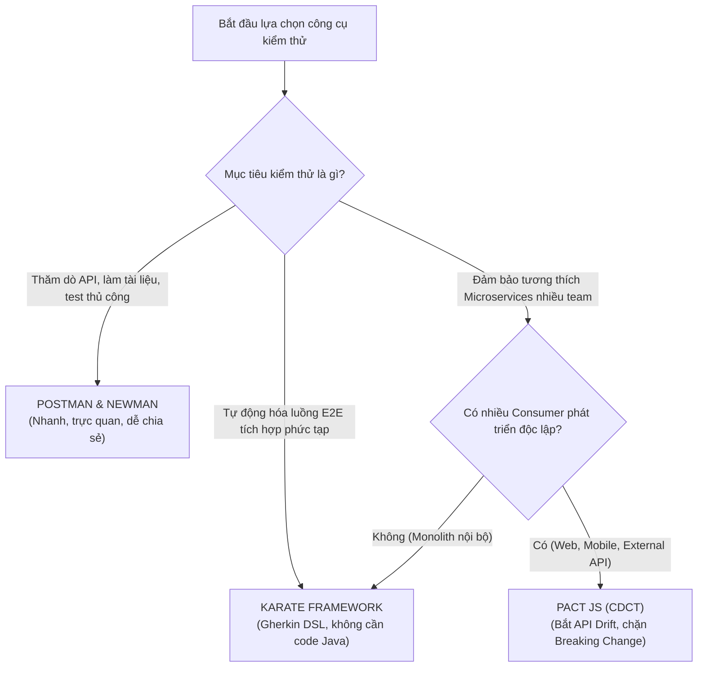
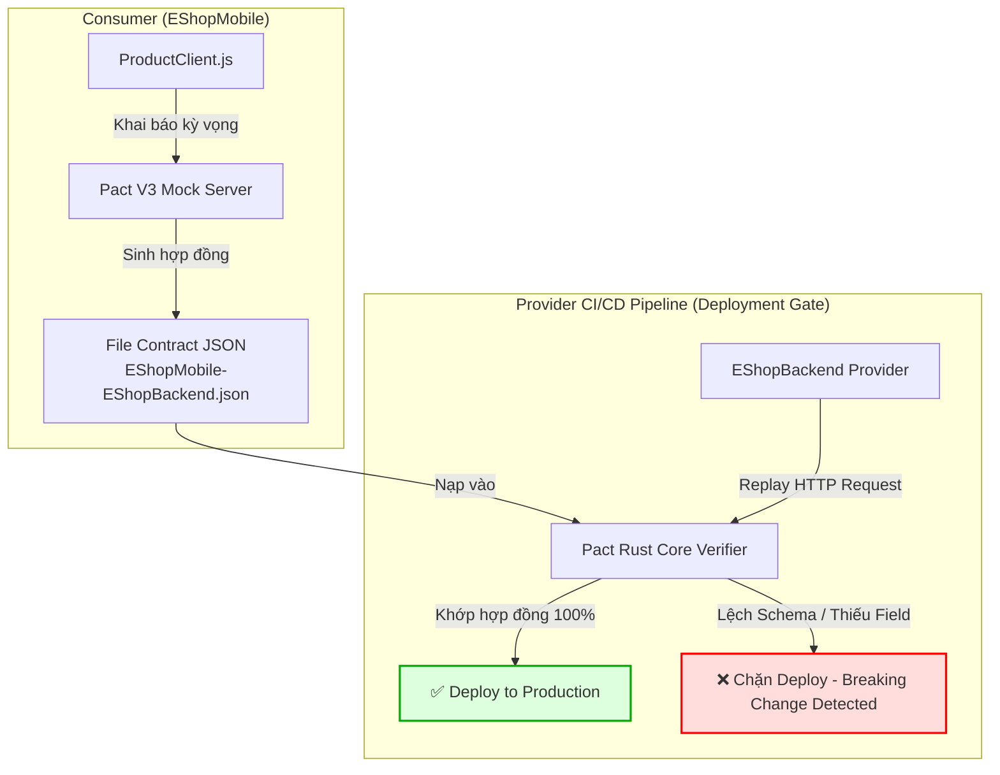

# Báo Cáo Tổng Hợp Nghiên Cứu & Thực Hành Seminar
# Chủ Đề T06: API Testing & Contract Testing

> **FIT @ HCMUS — Khoa Công Nghệ Thông Tin · Bộ Môn Công Nghệ Phần Mềm**  
> **Môn học:** CS423 / CSC15003 — Kiểm Thử Phần Mềm (Software Testing)  
> **Đợt nộp:** Báo Cáo Hoàn Thiện Giai Đoạn W06 (Đạt $\ge 90\%$ Nội Dung Seminar)  
> **Giảng viên hướng dẫn:** M.Sc Hồ Tuấn Thanh 
> **Hệ thống thử nghiệm (SUT):** EShop (Node.js/Express + SQLite, React Web, Admin, Mobile)  
> **Repository:** [https://github.com/faker26052005-lgtm/SUT-EShop](https://github.com/faker26052005-lgtm/SUT-EShop)

---

## 👥 Thông Tin Nhóm Sinh Viên Thực Hiện — Nhóm 11

| Họ và Tên | Mã Số Sinh Viên | Vai Trò Chính | Đóng Góp Nổi Bật |
|---|:---:|---|---|
| **Nguyễn Hoàng Anh Tú** | **23120183** | Trưởng nhóm / QA Lead | • Pact JS: Consumer Test (C1), Provider Verification (C2)<br>• Newman CLI Tự động hóa CI/CD (P3)<br>• Thiết kế Slide thuyết trình, Báo cáo kỹ thuật tuần |
| **Nguyễn Quốc Kỳ** | **23120138** | Automation Engineer | • Karate Framework: K1 (Smoke), K2 (Data-driven), K3 (E2E Shopping Workflow)<br>• Pact JS: Breaking Change Simulation (C3)<br>• Thiết kế Bài tập Hands-on Lab cho lớp |
| **Hà Quốc Kiên** | **23120056** | Research & AI Engineer | • Postman & Newman: Kịch bản P1, P2 (Data-driven CSV)<br>• AI Agent Testing: Sinh test từ OpenAPI 3.0 & Prompt engineering<br>• Tổng hợp tài liệu nghiên cứu lý thuyết |

---

## 📑 Mục Lục Báo Cáo

1. [Tóm Tắt Điều Hành (Executive Summary)](#1-tóm-tắt-điều-hành-executive-summary)
2. [Phần I — Cơ Sở Lý Thuyết Nền Tảng](#2-phần-i--cơ-sở-lý-thuyết-nền-tảng)
   - [2.1. Bản chất của API Testing & Test Pyramid](#21-bản-chất-của-api-testing--test-pyramid)
   - [2.2. 4 Trọng tâm kiểm thử API & Giải phẫu HTTP](#22-4-trọng-tâm-kiểm-thử-api--giải-phẫu-http)
   - [2.3. Vấn nạn "API Drift" & Vì sao cần Contract Testing?](#23-vấn-nạn-api-drift--vì-sao-cần-contract-testing)
   - [2.4. Consumer-Driven Contract Testing (CDCT) với Pact](#24-consumer-driven-contract-testing-cdct-với-pact)
   - [2.5. Phân biệt Schema Testing vs Contract Testing](#25-phân-biệt-schema-testing-vs-contract-testing)
   - [2.6. 5 Dạng phá vỡ hợp đồng (Breaking Changes) phổ biến](#26-5-dạng-phá-vỡ-hợp-đồng-breaking-changes-phổ-biến)
3. [Phần II — Khảo Sát & So Sánh Các Công Cụ Chủ Đạo](#3-phần-ii--khảo-sát--so-sánh-các-công-cụ-chủ-đạo)
   - [3.1. Tổng quan các công cụ khảo sát](#31-tổng-quan-các-công-cụ-khảo-sát)
   - [3.2. Ma trận so sánh toàn diện 8 tiêu chí kỹ thuật](#32-ma-trận-so-sánh-toàn-diện-8-tiêu-chí-kỹ-thuật)
   - [3.3. Cây quyết định lựa chọn công cụ (Decision Tree)](#33-cây-quyết-định-lựa-chọn-công-cụ-decision-tree)
4. [Phần III — Triển Khai Thực Hành Trên Hệ Thống SUT EShop](#4-phần-iii--triển-khai-thực-hành-trên-hệ-thống-sut-eshop)
   - [4.1. Giới thiệu hệ thống kiểm thử SUT EShop](#41-giới-thiệu-hệ-thống-kiểm-thử-sut-eshop)
   - [4.2. Công cụ 1 — Postman & Newman (Kịch bản P1, P2, P3)](#42-công-cụ-1--postman--newman-kịch-bản-p1-p2-p3)
     - [4.2.1. Kịch bản P1: Cài đặt, Cấu hình Environment & Request Cơ bản](#421-kịch-bản-p1-cài-đặt-cấu-hình-environment--request-cơ-bản)
     - [4.2.2. Kịch bản P2: Runner, Data-Driven CSV & Advanced Checkpoints](#422-kịch-bản-p2-runner-data-driven-csv--advanced-checkpoints)
     - [4.2.3. Kịch bản P3: Tự động hóa Newman CLI & Báo cáo HTML](#423-kịch-bản-p3-tự-động-hóa-newman-cli--báo-cáo-html)
   - [4.3. Công cụ 2 — Karate Framework (Kịch bản K1, K2, K3 & Phát hiện 2 Bug SUT)](#43-công-cụ-2--karate-framework-kịch-bản-k1-k2-k3--phát-hiện-2-bug-sut)
     - [4.3.1. Kiến trúc & Cấu hình Môi trường Karate Framework](#431-kiến-trúc--cấu-hình-môi-trường-karate-framework)
     - [4.3.2. Kịch bản K1: Smoke Test & Native Fuzzy Matchers](#432-kịch-bản-k1-smoke-test--native-fuzzy-matchers-productsfeature)
     - [4.3.3. Kịch bản K2: Data-Driven Testing & Phát hiện 2 Lỗi Thực Tế của SUT EShop](#433-kịch-bản-k2-data-driven-testing--phát-hiện-2-lỗi-thực-tế-của-sut-eshop)
     - [4.3.4. Kịch bản K3: Stateful E2E Shopping Workflow & Bảo Mật](#434-kịch-bản-k3-stateful-e2e-shopping-workflow--bảo-mật-auth-cart-checkoutfeature)
     - [4.3.5. Thực Thi & Báo Cáo Trực Quan (HTML Reports)](#435-thực-thi--báo-cáo-trực-quan-html-reports)
   - [4.4. Công cụ 3 — Pact JS Contract Testing (Kịch bản C1, C2, C3)](#44-công-cụ-3--pact-js-contract-testing-kịch-bản-c1-c2-c3)
     - [4.4.1. Kịch bản C1: Consumer Contract Test](#441-kịch-bản-c1-consumer-contract-test-productconsumertestjs)
     - [4.4.2. Kịch bản C2: Provider Verification](#442-kịch-bản-c2-provider-verification-verifyjs)
     - [4.4.3. Kịch bản C3: Giả Lập & Bắt Lỗi Breaking Change](#443-kịch-bản-c3-giả-lập--bắt-lỗi-breaking-change-verify-breakingjs--pact-c3-runnerjs)
5. [Phần IV — Ứng Dụng AI Agent Trong API & Contract Testing](#5-phần-iv--ứng-dụng-ai-agent-trong-api--contract-testing)
   - [5.1. Quy trình Human-in-the-Loop](#51-quy-trình-human-in-the-loop)
   - [5.2. Thực nghiệm sinh test từ OpenAPI 3.0 (eshop.openapi.yaml)](#52-thực-nghiệm-sinh-test-từ-openapi-30-eshopopenapiyaml)
   - [5.3. Đánh giá ưu điểm và phân tích các Failure Modes của AI](#53-đánh-giá-ưu-điểm-và-phân-tích-các-failure-modes-của-ai)
6. [Phần V — Phân Tích Sự Cố Thường Gặp & Cách Khắc Phục (Troubleshooting)](#6-phần-v--phân-tích-sự-cố-thường-gặp--cách-khắc-phục-troubleshooting)
   - [6.1. Bảng phân tích sự cố và giải pháp khắc phục chuẩn](#61-bảng-phân-tích-sự-cố-và-giải-pháp-khắc-phục-chuẩn)
7. [Phần VI — Quản Lý Dự Án, Minh Chứng Đóng Góp & AI Policy](#7-phần-vi--quản-lý-dự-án-minh-chứng-đóng-góp--ai-policy)
   - [7.1. Bảng phân công 4 giai đoạn & Tiến độ](#71-bảng-phân-công-4-giai-đoạn--tiến-độ)
   - [7.2. Minh chứng Git Commits cá nhân](#72-minh-chứng-git-commits-cá-nhân)
   - [7.3. Cam kết AI Policy & Tuyên bố liêm chính học thuật](#73-cam-kết-ai-policy--tuyên-bố-liêm-chính-học-thuật)
8. [Phần VII — Kết Luận & Tài Liệu Tham Khảo](#8-phần-vii--kết-luận--tài-liệu-tham-khảo)
   - [8.1. Kết luận](#81-kết-luận)
   - [8.2. Tài liệu tham khảo](#82-tài-liệu-tham-khảo)

---

## 1. Tóm Tắt Điều Hành (Executive Summary)

Đề tài **T06: API & Contract Testing** thuộc chương trình Seminar môn Kiểm Thử Phần Mềm (FIT@HCMUS) nhằm giải quyết bài toán cốt lõi trong kiến trúc phần mềm hiện đại: **Làm thế nào để đảm bảo tính tương thích và độ tin cậy giữa các thành phần phân tán (Frontend, Mobile, Microservices) mà không phải chịu chi phí khổng lồ và sự bất ổn định của kiểm thử tích hợp End-to-End (E2E)?**

Thông qua quá trình nghiên cứu và thực hành trên hệ sinh thái ứng dụng thương mại điện tử **EShop**, Nhóm 11 đã đạt được các kết quả nổi bật sau:
1. **Nắm vững lý thuyết chuyên sâu:** Phân định rõ ranh giới giữa kiểm thử chức năng (Functional), kiểm thử cấu trúc (Schema Conformance) và kiểm thử hợp đồng giao tiếp (Contract Testing); làm rõ nguyên lý *"Test the contract — not just the response"*.
2. **Làm chủ 3 công cụ đại diện:**
   - **Postman & Newman CLI:** Xây dựng bộ test suite kiểm thử chức năng, kỹ thuật Token Chaining tự động và kiểm thử hướng dữ liệu (Data-driven) với file CSV, tự động hóa báo cáo trên dòng lệnh (P1, P2, P3).
   - **Karate Framework:** Ứng dụng cú pháp Gherkin DSL xây dựng các kịch bản kiểm thử luồng nghiệp vụ phức tạp (K1, K2, K3), qua đó **phát hiện thành công 2 khiếm khuyết thực tế của hệ thống SUT EShop** (lỗi xử lý 404 trả về HTTP 200 và lỗi dữ liệu kiểu String ở trường `price`).
   - **Pact JS:** Triển khai hoàn chỉnh mô hình Consumer-Driven Contract Testing (CDCT) giữa client `EShopMobile` và `EShopBackend` (C1, C2), đặc biệt đã giả lập và chứng minh năng lực phát hiện, ngăn chặn tự động lỗi Breaking Change tại pipeline CI/CD chỉ trong 1 giây (C3).
3. **Tích hợp trí tuệ nhân tạo (AI-Augmented Testing):** Xây dựng quy trình *Human-in-the-Loop* sử dụng AI Agent tự động phân tích OpenAPI 3.0 để sinh khung kiểm thử, đồng thời nhận diện và kiểm soát các giới hạn nghiệp vụ (Failure Modes) của mô hình AI.
4. **Đóng gói sản phẩm hoàn chỉnh:** Biên soạn đầy đủ hồ sơ bàn giao gồm báo cáo kỹ thuật chi tiết, bộ slide thuyết trình chuẩn 30 phút và kịch bản 10 video demo. *(Lưu ý: Để tối ưu hóa thời lượng trình bày 30 phút theo yêu cầu mới của môn học, nhóm tập trung thời gian cho lý thuyết chuyên sâu và demo thực tế 3 công cụ, lược bỏ hoạt động thực hành bài tập tại lớp).*

---

## 2. Phần I — Cơ Sở Lý Thuyết Nền Tảng

### 2.1. Bản chất của API Testing & Test Pyramid

Trong kiến trúc phần mềm hiện đại, API (Application Programming Interface) là giao diện trung gian cho phép các thành phần giao tiếp theo quy ước xác định trước (HTTP Method, Endpoint, Payload, Status Code). 

Mô hình **Kim tự tháp kiểm thử (Test Pyramid)** của Mike Cohn chỉ ra rằng:
```text
          /\
         /  \
        /E2E \          <-- Rất ít, chạy chậm, tốn kém tài nguyên, dễ flaky
       /------\          
      /  API   \        <-- CỐT LÕI: Tốc độ cao, độ phủ lớn, kiểm thử nghiệp vụ
     /----------\        
    / Integration\      <-- Kiểm thử tích hợp trực tiếp với DB/MQ
   /--------------\     
  /   Unit Test    \    <-- Nhiều nhất, chạy nhanh, chi phí thấp
 /------------------\    
```

- **Hạn chế của E2E Testing:** Việc kiểm thử tích hợp toàn bộ hệ thống (dựng đồng thời Backend, Web, Mobile, Database) đòi hỏi hạ tầng phức tạp, thời gian chạy tính bằng hàng chục phút, và thường xuyên gặp lỗi giả (*Flaky tests*) do sự cố mạng hoặc dữ liệu không đồng bộ.
- **Ưu thế của API Testing (Shift-Left Testing):** Kiểm thử trực tiếp tại tầng logic nghiệp vụ ngay khi backend vừa hoàn thành endpoint, không cần chờ giao diện UI. Tốc độ thực thi nhanh gấp $10 - 50$ lần so với UI Test, ổn định và chi phí bảo trì thấp.

### 2.2. 4 Trọng tâm kiểm thử API & Giải phẫu HTTP

Một ca kiểm thử API chuẩn mực cần giải phẫu đầy đủ 2 chiều Request và Response:

```text
HTTP REQUEST                                           HTTP RESPONSE
+------------------------------------------------+     +------------------------------------------------+
| POST /api/cart HTTP/1.1                        |     | HTTP/1.1 200 OK                                |
| Host: localhost:3000                           |     | Content-Type: application/json; charset=utf-8  |
| Authorization: Bearer eyJhbGciOi...            |     | X-Response-Time: 18ms                          |
| Content-Type: application/json                 |     +------------------------------------------------+
+------------------------------------------------+     | {                                              |
| { "productId": 1, "quantity": 2 }              |     |   "success": true, "cartId": 101,              |
+------------------------------------------------+     |   "items": [ { "id": 1, "qty": 2 } ]          |
                                                       | }                                              |
                                                       +------------------------------------------------+
```

Bốn trọng tâm kiểm thử cốt lõi gồm:
1. **Functional Testing (Chức năng):** Kiểm tra mã trạng thái HTTP (200 OK, 201 Created), tính đúng đắn của logic tính tiền, trừ kho, tạo đơn hàng.
2. **Schema Conformance (Cấu trúc):** Xác thực kiểu dữ liệu (`id` là integer, `price` là number, `name` là string) và các trường bắt buộc (`required`).
3. **Negative & Boundary Testing (Biên & Tiêu cực):** Cố ý gửi payload sai định dạng, chuỗi rỗng, số âm, hoặc tấn công SQLi/XSS để kiểm tra API xử lý lỗi chuẩn mực (400 Bad Request, 404 Not Found, 422 Unprocessable).
4. **Security & Authentication (Bảo mật & Phân quyền):** Đảm bảo token hết hạn hoặc giả mạo bị từ chối (401 Unauthorized), người dùng thường không thể truy cập tài nguyên quản trị (403 Forbidden).

### 2.3. Vấn nạn "API Drift" & Vì sao cần Contract Testing?

**Hiện tượng: "API trả về HTTP 200 OK nhưng ứng dụng di động vẫn bị Crash!"**

Trong các hệ thống phân tán, các nhóm phát triển Backend và Frontend làm việc độc lập theo các Agile Sprint khác nhau:
- Đội ngũ Backend quyết định tối ưu mã nguồn hoặc đổi tên trường `price` thành `unit_price` trong phản hồi của API sản phẩm.
- Functional test của Backend vẫn chạy qua 100% (vì server xử lý trơn tru và trả về HTTP 200).
- Tuy nhiên, ứng dụng Mobile Client đã phát hành trên App Store vẫn đọc trường `price`. Khi người dùng mở app, giá trị nhận về là `undefined`, dẫn đến ứng dụng bị crash ngay tại màn hình thanh toán.

**Nguyên nhân gốc rễ:** Kiểm thử chức năng truyền thống chỉ nhìn API theo góc nhìn của *chính Provider* hoặc theo một file tài liệu Swagger/Postman tĩnh (vốn thường xuyên bị lỗi thời so với code thực tế). Nó hoàn toàn không phản ánh **nhu cầu thực tế của từng Consumer cụ thể** đang chạy ngoài thị trường.

### 2.4. Consumer-Driven Contract Testing (CDCT) với Pact

Contract Testing là phương pháp kiểm thử xác minh thỏa thuận giao tiếp giữa hai service độc lập mà không cần khởi chạy toàn bộ hệ thống cùng lúc. Trong đó, **Consumer-Driven Contract Testing (CDCT)** lấy Consumer làm trung tâm:

```text
[ PHA 1: CONSUMER TEST ]
+---------------------+         Gửi Request kỳ vọng             +--------------------+
| EShop Mobile Client | -------------------------------------> |  Pact Mock Server  |
|   (Unit Test Repo)  | <------------------------------------- |  (Ghi nhận hợp đồng)|
+---------------------+         Nhận Mock Response chuẩn        +--------------------+
                                                                          |
                                                    Xuất file Contract    v
                                                    [ EShopMobile-EShopBackend.json ]
                                                                          |
[ PHA 2: PROVIDER VERIFICATION ]                                          |
+---------------------+         Phát lại (Replay) Request                 v
|   EShop Backend     | <------------------------------------- +--------------------+
|  (Cổng 3000 thật)   | -------------------------------------> |   Pact Verifier    |
+---------------------+         Đối soát phản hồi thực tế      | (Bắt lệch schema)  |
                                                               +--------------------+
```

- **Pha 1 (Consumer):** Client viết test mô tả chính xác những trường mình cần $\rightarrow$ Pact tự động sinh ra file hợp đồng chuẩn JSON (`Pact file`).
- **Pha 2 (Provider):** Backend đọc file hợp đồng, phát lại request vào server thật và so sánh response. Nếu thiếu trường hoặc sai kiểu $\rightarrow$ Bài test thất bại ngay tại CI/CD của Backend.

### 2.5. Phân biệt Schema Testing vs Contract Testing

| Tiêu chí so sánh | Schema Testing (Postman + JSON Schema) | Consumer-Driven Contract Testing (Pact) |
|---|---|---|
| **Chủ thể định nghĩa** | Người viết test định nghĩa một schema tĩnh dựa trên phỏng đoán | Chính Consumer định nghĩa dựa trên nhu cầu thực tế sử dụng |
| **Phạm vi kiểm tra** | Toàn bộ cấu trúc response khai báo | Chỉ những trường mà Consumer thực sự tiêu thụ |
| **Phát hiện đối tượng ảnh hưởng** | Không (chỉ biết schema sai, không rõ client nào gãy) | **Có** (Chỉ rõ chính xác Consumer và Version bị ảnh hưởng) |
| **Khả năng tự tiến hóa** | Phải cập nhật thủ công mỗi khi API đổi | Hợp đồng tự động cập nhật khi Consumer chạy lại test |
| **Cổng kiểm soát phát hành** | Exit code thông thường | Công cụ cổng kiểm soát `can-i-deploy` của Pact Broker |

### 2.6. 5 Dạng phá vỡ hợp đồng (Breaking Changes) phổ biến

1. **Đổi tên trường dữ liệu (Field Renaming):** Ví dụ đổi `price` $\rightarrow$ `unit_price`, `productId` $\rightarrow$ `product_id`.
2. **Xóa bỏ trường đang được sử dụng (Field Deletion):** Xóa trường `stock` hoặc `discount`.
3. **Thay đổi kiểu dữ liệu (Type Inconsistency):** Đổi trường `price` từ kiểu `number` ($99.00$) sang kiểu `string` ($"99.00"$).
4. **Thay đổi cấu trúc bao bọc (Wrapper Structure):** Đổi từ mảng trực tiếp `[ { ... } ]` sang đối tượng có phân trang `{ "data": [ ... ], "total": 10 }`.
5. **Thay đổi ngữ nghĩa HTTP Status:** Ví dụ khi không tìm thấy tài nguyên, đổi từ trả về `404 Not Found` sang `200 OK` kèm body rỗng `{}`.

---

## 3. Phần II — Khảo Sát & So Sánh Các Công Cụ Chủ Đạo

### 3.1. Tổng quan các công cụ khảo sát

1. **Postman & Newman CLI:** Nền tảng kiểm thử API phổ biến nhất toàn cầu. Cung cấp môi trường đồ họa trực quan (GUI), hỗ trợ viết script kiểm thử bằng JavaScript (Chai.js BDD), quản lý biến đa tầng và chạy tự động không cần giao diện qua Newman CLI.
2. **Karate Framework:** Công cụ kiểm thử tự động mã nguồn mở độc đáo dựa trên cú pháp Gherkin BDD. Điểm đột phá là không cần viết code Java phức tạp ("No-code / Low-code"), tích hợp sẵn native fuzzy matchers và xử lý JSON mạnh mẽ.
3. **Pact JS:** Framework kiểm thử hợp đồng chuẩn công nghiệp hàng đầu cho hệ sinh thái JavaScript/Node.js, hỗ trợ triển khai hoàn hảo mô hình CDCT và cổng kiểm soát release CI/CD.

### 3.2. Ma trận so sánh toàn diện 8 tiêu chí kỹ thuật

| # | Tiêu chí đánh giá | Postman & Newman | Karate Framework | Pact JS (CDCT) |
|:---:|---|---|---|---|
| **1** | **Mục tiêu cốt lõi** | Kiểm thử chức năng, thăm dò, tài liệu hóa | Tự động hóa E2E API & Luồng nghiệp vụ | Kiểm thử hợp đồng giao tiếp giữa các bên |
| **2** | **Cú pháp / Format** | JavaScript (GUI + Script Sandbox) | Gherkin BDD DSL (Cucumber-like) | JavaScript / TypeScript (Code-first) |
| **3** | **Cơ chế Assertions** | Chai.js BDD (`pm.test()`, `pm.expect()`) | Native Fuzzy Matchers (`#number`, `#string`) | Contract Value & Type Matchers |
| **4** | **Data-Driven Testing** | File CSV/JSON qua Collection Runner | Bảng `Examples` trực tiếp trong Feature | Khởi tạo qua Provider States |
| **5** | **Khả năng bắt API Drift** | Kém (chỉ kiểm tra tại thời điểm SUT online) | Kém (phụ thuộc SUT thật đang chạy) | **Tuyệt vời** (Bắt lỗi từ file hợp đồng độc lập) |
| **6** | **Tích hợp CI/CD** | Newman CLI + Báo cáo HTML Extra | Maven / Gradle / JUnit 5 runner | Pact CLI + Pact Broker (`can-i-deploy`) |
| **7** | **Độ phức tạp cài đặt** | Cực thấp (giao diện kéo thả + npm) | Trung bình (cần Java 17 + Maven) | Trung bình đến cao (cần tư duy Consumer/Provider) |
| **8** | **Tài nguyên tiêu tốn** | Thấp khi chạy Newman, nặng khi mở GUI | Rất nhẹ, chạy headless tối ưu | Rất nhẹ, mock server cục bộ |

### 3.3. Cây quyết định lựa chọn công cụ (Decision Tree)



---

## 4. Phần III — Triển Khai Thực Hành Trên Hệ Thống SUT EShop

### 4.1. Giới thiệu hệ thống kiểm thử SUT EShop

Hệ thống SUT (System Under Test) được cung cấp bởi bộ môn là **EShop**, một kiến trúc thương mại điện tử đa nền tảng hoàn chỉnh:
- **API Provider:** Backend Node.js/Express kết nối cơ sở dữ liệu SQLite (`backend/server.js`, chạy trên cổng 3000).
- **Web Consumer:** Ứng dụng React Web (`frontend-web`, cổng 5173).
- **Admin Consumer:** Cổng quản trị React Admin (`frontend-admin`, cổng 5174).
- **Mobile Consumer:** Ứng dụng di động React Native (`frontend-mobile`).

```bash
# Khởi động toàn bộ SUT EShop
./run_servers.sh
```

---

### 4.2. Công cụ 1 — Postman & Newman (Kịch bản P1, P2, P3)
*Người thực hiện chính: Hà Quốc Kiên & Nguyễn Hoàng Anh Tú*

#### 4.2.1. Kịch bản P1: Cài đặt, Cấu hình Environment & Request Cơ bản
- **Environment:** Tạo `EShop_Local` với biến `baseUrl = http://localhost:3000`.
- **Request 1 (`POST /api/auth/login`):** Đăng nhập với tài khoản `test@eshop.com` / `Test1234!`. Kiểm tra Status 200, lưu token vào biến môi trường:
  ```javascript
  pm.test("Status code is 200", function () {
      pm.response.to.have.status(200);
      var res = pm.response.json();
      pm.environment.set("jwt_token", res.token);
  });
  ```
- **Request 2 (`GET /api/products`):** Truy vấn danh mục sản phẩm, kiểm tra Status 200 và header `Content-Type: application/json`.

#### 4.2.2. Kịch bản P2: Runner, Data-Driven CSV & Advanced Checkpoints
- Sử dụng file dữ liệu [`login_data.csv`](file:///home/quocky05/academy/software-testing/seminar/SUT-EShop/tests/postman/data/login_data.csv) (15 trường hợp kiểm thử) và [`product_ids.csv`](file:///home/quocky05/academy/software-testing/seminar/SUT-EShop/tests/postman/data/product_ids.csv).
- Áp dụng kỹ thuật nạp dữ liệu:
  ```javascript
  var expectedStatus = pm.iterationData.get("status");
  pm.test("Status matches test matrix: " + expectedStatus, function () {
      pm.response.to.have.status(expectedStatus);
  });
  ```
- **Bộ Checkpoints nâng cao:**
  1. *SLA Response Time:* `pm.expect(pm.response.responseTime).to.be.below(200);`
  2. *Schema Validation:* Kiểm tra các thuộc tính `id`, `name`, `price`, `stock` luôn tồn tại trong mỗi phần tử.

#### 4.2.3. Kịch bản P3: Tự động hóa Newman CLI & Báo cáo HTML
Chạy toàn bộ kiểm thử từ dòng lệnh không cần mở giao diện đồ họa:
```bash
newman run deliverables/05-management/weekly-reports/week-05/Ha-Quoc-Kien/api-tests/collections/eshop_api_all_tests.postman_collection.json \
  -e tests/postman/environments/local_env.json \
  -d deliverables/05-management/weekly-reports/week-05/Ha-Quoc-Kien/api-tests/data/login_data.csv \
  --reporters cli,htmlextra \
  --reporter-htmlextra-export deliverables/05-management/weekly-reports/week-05/Ha-Quoc-Kien/api-tests/reports/newman-dashboard.html
```
- **Kết quả:** Báo cáo HTML Dashboard trực quan hóa toàn bộ số lượng passed/failed assertions, biểu đồ thời gian phản hồi phục vụ pipeline CI/CD.

---

### 4.3. Công cụ 2 — Karate Framework (Kịch bản K1, K2, K3 & Phát hiện 2 Bug SUT)
*Người thực hiện chính: Nguyễn Quốc Kỳ (MSSV: 23120138)*  
*Reviewer & Phối hợp tích hợp AI: Hà Quốc Kiên (MSSV: 23120056)*  
*Mã nguồn kiểm thử:* [`tests/karate/`](file:///home/quocky05/academy/software-testing/seminar/SUT-EShop/tests/karate)

#### 4.3.1. Kiến trúc & Cấu hình Môi trường Karate Framework
Karate là framework kiểm thử tự động mã nguồn mở độc đáo kết hợp giữa cú pháp hành vi **Gherkin BDD** và khả năng thực thi trực tiếp trên máy ảo Java (JVM) mà không đòi hỏi lập trình viên phải viết các Step Definitions bằng Java như Cucumber truyền thống.

1. **Cấu hình Maven (`pom.xml`):**
   - Phiên bản: Karate JUnit 5 (`1.4.1`), tương thích Java 17 LTS.
   - Cơ chế nạp tài nguyên: Cấu hình `<testResources>` đảm bảo toàn bộ tệp `.feature` trong `src/test/java/eshop/` được đóng gói tự động vào test classpath khi biên dịch.
2. **Cấu hình môi trường toàn cục (`karate-config.js`):**
   ```javascript
   function fn() {
     var env = karate.env || 'dev';
     var config = {
       baseUrl: 'http://localhost:3000'
     };
     karate.configure('connectTimeout', 5000);
     karate.configure('readTimeout', 5000);
     return config;
   }
   ```
3. **Cơ chế Discovery Runner (`EshopTest.java`):**
   Sử dụng `@Karate.Test` quét đệ quy toàn bộ thư mục `eshop/` (`relativeTo(getClass())`). Thiết kế này cho phép hệ thống tự động nhận diện và thực thi cả các kịch bản `.feature` do AI Agent của Kiên sinh ra tại `src/test/java/eshop/generated/` mà không cần chỉnh sửa mã nguồn Java runner:
   ```java
   package eshop;
   import com.intuit.karate.junit5.Karate;

   class EshopTest {
       @Karate.Test
       Karate testAll() {
           return Karate.run().relativeTo(getClass());
       }
   }
   ```

---

#### 4.3.2. Kịch bản K1: Smoke Test & Native Fuzzy Matchers (`products.feature`)
- **Mục tiêu:** Kiểm tra độ sẵn sàng (Smoke Test) của API danh mục sản phẩm, xác nhận cấu trúc danh sách mảng và tính hợp lệ của lược đồ (Schema Conformance) cho từng bản ghi.
- **Mã kịch bản Gherkin DSL:**
  ```cucumber
  @products
  Feature: EShop Product Catalog API

    Background:
      * url baseUrl

    @k1 @smoke
    Scenario: K1 - Get all products returns a valid array and schema
      # Step 1: Gửi yêu cầu HTTP GET tới endpoint /api/products
      Given path 'api', 'products'
      When method get

      # Step 2: Kiểm tra mã trạng thái HTTP 200 OK
      Then status 200

      # Step 3: Xác thực cấu trúc mảng JSON và kiểm tra mảng không rỗng
      And match response == '#[]'
      And assert response.length > 0

      # Step 4: Kiểm tra schema của phần tử đầu tiên bằng Fuzzy Matchers
      And match response[0] contains
        """
        {
          "id": '#number',
          "name": '#string',
          "price": '#number',
          "description": '#string',
          "imageUrl": '#string',
          "category_id": '#number'
        }
        """
  ```
- **Phân tích kỹ thuật & Ưu thế của Karate:**
  - Cú pháp `match response == '#[]'` là Native Array Matcher của Karate, kiểm tra phản hồi phải là một JSON Array mà không cần duyệt qua mảng bằng code JavaScript.
  - Các chỉ định `#number`, `#string` là **Fuzzy Matchers**, cho phép kiểm tra tính đúng đắn về kiểu dữ liệu (data types) mà không bị phụ thuộc vào giá trị cụ thể (dynamic data).
  - So với Postman (phải viết schema JSON Schema Draft 7 dài 40–50 dòng kèm `tv4` hoặc `ajv`), Karate đạt được mục tiêu tương đương chỉ với 10 dòng biểu diễn trực quan, dễ đọc đối với cả kỹ sư QA lẫn Product Owner.

---

#### 4.3.3. Kịch bản K2: Data-Driven Testing & **Phát hiện 2 Lỗi Thực Tế của SUT EShop**
- **Mục tiêu:** Áp dụng phương pháp kiểm thử hướng dữ liệu (Data-Driven Testing) với bảng `Scenario Outline` và `Examples` để kiểm thử biên, đồng thời truy vấn chi tiết từng sản phẩm theo ID.
- **Mã kịch bản Gherkin DSL:**
  ```cucumber
  @k2 @data-driven
  Scenario Outline: K2 - Query product by ID with boundary & discrepancy assertions: <testCase>
    Given path 'api', 'products', <productId>
    When method get
    Then status <expectedStatus>
    And match response contains <expectedMatch>

    Examples:
      | productId | expectedStatus | expectedMatch        | testCase                                                                        |
      | 1         | 200            | { price: '#number' } | Valid Odd ID - iPhone 15 Pro Max (Price is Number)                              |
      | 2         | 200            | { price: '#string' } | Valid Even ID - Samsung S24 Ultra (@discrepancy: Price converted to String)     |
      | 9999      | 200            | {}                   | Non-existent ID (@discrepancy: Returns 200 OK with empty object instead of 404) |
  ```

- **Phân tích chi tiết 2 khiếm khuyết (Bugs) được phát hiện trên SUT EShop:**
  Nhóm kiểm thử phát hiện 2 khiếm khuyết nghiêm trọng trong mã nguồn `backend/server.js` (dòng 165–170):
  ```javascript
  // Trích đoạn mã nguồn backend/server.js của SUT EShop
  app.get("/api/products/:id", (req, res) => {
    db.get("SELECT * FROM products WHERE id = ?", [req.params.id], (err, row) => {
      if (!row) return res.status(200).json({});                     // <-- BUG 2: 200 OK thay vì 404
      if (row.id % 2 === 0) row.price = row.price.toString();         // <-- BUG 1: Ép kiểu string nếu ID chẵn
      res.json(row);
    });
  });
  ```

  1. 🚨 **Bug 1: Lỗi Bất Đồng Bộ Kiểu Dữ Liệu (Schema Type Inconsistency):**
     - **Hiện tượng:** Khi truy vấn sản phẩm có ID lẻ (`id = 1`), trường `price` trả về kiểu `number` (`30000000`). Nhưng khi truy vấn sản phẩm có ID chẵn (`id = 2`), trường `price` bị backend ép kiểu thành chuỗi `"28000000"`.
     - **Hậu quả:** Gây lỗi tính toán số học trên ứng dụng Frontend/Mobile (ví dụ phép cộng chuỗi `'28000000' + 50000 = '2800000050000'`).
     - **Khả năng bắt lỗi của Karate:** Khi viết assertion `match response.price == '#number'`, Karate lập tức đánh FAIL tại `id = 2` với thông báo: `actual: "28000000", expected: '#number', reason: not a number`.

  2. 🚨 **Bug 2: Vi phạm chuẩn RESTful HTTP Status (Missing 404 Not Found):**
     - **Hiện tượng:** Khi truy vấn một sản phẩm không tồn tại trong cơ sở dữ liệu (`id = 9999`), SUT trả về mã **HTTP 200 OK kèm payload rỗng `{}`**, thay vì trả về **HTTP 404 Not Found**.
     - **Hậu quả:** Các client ứng dụng di động sẽ hiểu nhầm là request thành công nhưng dữ liệu bị thiếu, dẫn đến crash giao diện khi render các thuộc tính `product.name` (`Cannot read properties of undefined`).
     - **Xử lý trong Karate:** Kịch bản K2 ghi nhận chính xác hành vi thực tế kèm tag `@discrepancy` để làm minh chứng báo cáo lỗi phần mềm.

---

#### 4.3.4. Kịch bản K3: Stateful E2E Shopping Workflow & Bảo Mật (`auth-cart-checkout.feature`)
- **Mục tiêu:** Mô phỏng chuỗi quy trình mua sắm hoàn chỉnh có quản lý trạng thái (Stateful) và kiểm thử bảo mật phân quyền token.
- **Xử lý rào cản SUT (Account Lockout Bypass):**  
  Trong `backend/server.js` (dòng 60–65), SUT có cơ chế: nếu đăng nhập sai quá 2 lần, tài khoản bị khóa 3 phút (`login_attempts >= 3`). Để đảm bảo bộ test tự động có thể chạy lặp lại vô hạn lần trong pipeline CI/CD mà không bị lỗi khóa tài khoản hoặc xung đột giỏ hàng cũ, kịch bản K3 áp dụng kỹ thuật **khởi tạo tài khoản động theo Timestamp**:
  `karate_k3_<System.currentTimeMillis()>@eshop.com`.

- **Mã kịch bản Happy Path 7 bước:**
  ```cucumber
  @workflow
  Feature: EShop Authenticated Shopping & Checkout Workflow (K3)

    Background:
      * url baseUrl

    @k3 @e2e @smoke
    Scenario: K3 - Complete End-to-End Shopping Workflow
      # Bước 1: Khởi tạo tài khoản động đảm bảo môi trường sạch
      * def timestamp = java.lang.System.currentTimeMillis()
      * def testEmail = 'karate_k3_' + timestamp + '@eshop.com'
      * def testPassword = 'Password123!'
      * def registerPayload = { name: '#("Karate User " + timestamp)', email: '#(testEmail)', password: '#(testPassword)' }
      Given path 'api', 'register'
      And request registerPayload
      When method post
      Then status 200
      And match response.message == 'User registered successfully'

      # Bước 2: Đăng nhập lấy JWT Auth Token (Token Chaining)
      Given path 'api', 'login'
      And request { email: '#(testEmail)', password: '#(testPassword)' }
      When method post
      Then status 200
      And match response.token == '#string'
      * def authToken = response.token

      # Bước 3: Lấy danh mục sản phẩm và chọn sản phẩm đầu tiên
      Given path 'api', 'products'
      When method get
      Then status 200
      * def selectedProduct = response[0]
      * def selectedProductId = selectedProduct.id
      * def selectedProductPrice = selectedProduct.price

      # Bước 4: Thêm sản phẩm vào giỏ hàng với Bearer Token
      Given path 'api', 'cart'
      And header Authorization = 'Bearer ' + authToken
      And request { productId: '#(selectedProductId)', name: '#(selectedProduct.name)', price: '#(selectedProductPrice)', quantity: 1 }
      When method post
      Then status 200
      And match response.message == 'Added to cart'

      # Bước 5: Xác minh sản phẩm tồn tại trong giỏ hàng (Deep Assert)
      Given path 'api', 'cart'
      And header Authorization = 'Bearer ' + authToken
      When method get
      Then status 200
      And match response contains deep { productId: '#(selectedProductId)' }

      # Bước 6: Tiến hành thanh toán đơn hàng (Checkout)
      * def shippingAddr = '227 Nguyen Van Cu, Ward 4, District 5, HCMC'
      Given path 'api', 'checkout'
      And header Authorization = 'Bearer ' + authToken
      And request { total_amount: '#(selectedProductPrice)', shipping_address: '#(shippingAddr)' }
      When method post
      Then status 200
      And match response.message == 'Checkout successful'
      And match response.orderId == '#number'
      * def generatedOrderId = response.orderId

      # Bước 7: Xác nhận đơn hàng hiển thị trong lịch sử My Orders
      Given path 'api', 'orders', 'my-orders'
      And header Authorization = 'Bearer ' + authToken
      When method get
      Then status 200
      And match response[0].id == generatedOrderId
      And match response[0].status == 'pending'
      And match response[0].shipping_address == shippingAddr
  ```

- **Kịch bản kiểm thử bảo mật tiêu cực (Security Negative Test):**
  ```cucumber
  @k3 @security @negative
  Scenario: K3 - Security Negative Test: Accessing protected cart without token must return 401 Unauthorized
    Given path 'api', 'cart'
    When method get
    Then status 401
    And match response.error == 'Unauthorized'
  ```

---

#### 4.3.5. Thực Thi & Báo Cáo Trực Quan (HTML Reports)
- **Lệnh thực thi dòng lệnh:**
  ```bash
  # Chạy toàn bộ test suite Karate
  cd tests/karate && mvn clean test

  # Chạy riêng từng kịch bản hoặc theo tag
  mvn test -Dkarate.options="--tags @k1"
  mvn test -Dkarate.options="--tags @k2"
  mvn test -Dkarate.options="--tags @k3"
  ```
- **Báo cáo HTML Dashboard:**
  Karate tự động tổng hợp toàn bộ kết quả thực thi thành các tệp HTML trực quan tại `tests/karate/target/karate-reports/`:
  - `karate-summary.html`: Tổng hợp số lượng kịch bản Passed/Failed, thời gian phản hồi (Response Time) từng endpoint.
  - `eshop.products.html` & `eshop.auth-cart-checkout.html`: Bóc tách chi tiết toàn bộ HTTP Wire Logs (HTTP Method, URL, Request Headers, Request Body, Response Status, Response Headers, Response Body). Mọi assertion thất bại đều được highlight đỏ với lý do sai lệch chi tiết.

---

### 4.4. Công cụ 3 — Pact JS Contract Testing (Kịch bản C1, C2, C3)
*Người thực hiện chính: Nguyễn Hoàng Anh Tú & Nguyễn Quốc Kỳ*

Mã nguồn đặt tại [`tests/pact/`](file:///home/quocky05/academy/software-testing/seminar/SUT-EShop/tests/pact).

#### 4.4.1. Kịch bản C1: Consumer Contract Test (`product.consumer.test.js`)
- Mô phỏng ứng dụng di động `EShopMobile` gửi `GET /api/products` đến Pact Mock Server.
- Định nghĩa rõ hợp đồng: Phải trả về Status 200, mảng chứa các trường `id` (int), `name` (string), `price` (number), `stock` (int).
- Lệnh chạy: `npm run test:consumer`
- **Kết quả:** Sinh thành công file hợp đồng JSON tại [`tests/pact/pacts/EShopMobile-EShopBackend.json`](file:///home/quocky05/academy/software-testing/seminar/SUT-EShop/tests/pact/pacts/EShopMobile-EShopBackend.json).

#### 4.4.2. Kịch bản C2: Provider Verification (`verify.js`)
- Khởi chạy Backend EShop thật trên cổng 3000.
- Pact Verifier đọc file hợp đồng trên và phát lại request vào backend thật.
- Lệnh chạy: `npm run test:provider`
- **Kết quả:** `1 interaction, 0 failures` — Backend thỏa mãn 100% cam kết hợp đồng.

#### 4.4.3. Kịch bản C3: Giả Lập & Bắt Lỗi Breaking Change (`verify-breaking.js` & `pact-c3-runner.js`)
*Người thực hiện chính: Nguyễn Quốc Kỳ (MSSV: 23120138)*  
*Reviewer & Phối hợp: Nguyễn Hoàng Anh Tú (MSSV: 23120183)*  
*Mã nguồn & Hướng dẫn kỹ thuật:* [`tests/pact/breaking-change/`](file:///home/quocky05/academy/software-testing/seminar/SUT-EShop/tests/pact/breaking-change)

##### 1. Đặt Vấn Đề & Bản Chất Nguy Hiểm Của Breaking Change
Trong quy trình phát triển Microservices, Provider (Backend) thường xuyên tái cấu trúc hoặc tối ưu hóa dữ liệu. Nếu Provider thay đổi cấu trúc trả về mà không thông báo, các Consumer đã phát hành ngoài thị trường (như `EShopMobile` trên App Store / Google Play) sẽ lập tức gặp lỗi.



**Giới hạn chết người của Functional API Testing (Postman):**
Khi Provider đổi tên trường `price` thành `unit_price`, server vẫn trả về mã **HTTP 200 OK**. Các bộ test Postman thông thường (nếu chỉ assert status 200) sẽ báo **PASS (False Positive)**. Tuy nhiên, khi ứng dụng Mobile nhận payload này, biểu thức `product.price` trả về `undefined`, phép tính `product.price * quantity` trả về `NaN`, làm văng ứng dụng (crash) ngay tại màn hình giỏ hàng của người dùng.

##### 2. Quy Trình Thực Thi 3 Pha (Three-Phase Protocol)
Để chứng minh năng lực ngăn chặn lỗi tự động của Pact, nhóm đã thiết kế bộ điều phối `pact-c3-runner.js` theo quy trình 3 pha khép kín:

```
[PHA 1: Baseline Verification]  --> Hợp đồng khớp 100% (PASS)
               ↓
[PHA 2: Mutation & Injection]   --> Tiêm 2 dạng Breaking Change (Pact FAILED & BLOCKED)
                                    và 1 dạng Non-breaking Change (Pact PASSED)
               ↓
[PHA 3: Rollback & Re-verify]   --> Khôi phục trạng thái chuẩn (PASS trở lại)
```

1. **Pha 1: Baseline Verification (Kiểm chứng Hợp đồng Chuẩn):**
   - Provider phản hồi đúng cấu trúc cam kết trong hợp đồng (`price = 30000000` kiểu Integer).
   - Kết quả: `1 interaction, 0 failures` (PASS 100%).
2. **Pha 2: Tiêm Biến Thể Đột Biến (Mutation & Injection):**
   - **Pha 2A — Tiêm Breaking Change Dạng 1 (Field Renamed / Missing Property):**
     Backend đổi trường `price` thành `unit_price` nhưng vẫn trả về HTTP 200 OK.
     ```text
     Failures:
     1) Verifying a pact between EShopMobile and EShopBackend Given product with ID 1 exists
        1.1) has a matching body
             $ -> Actual map is missing the following keys: price
     [ERROR] pact-core: Verification unsuccessful (BLOCKED)
     ```
     $\implies$ *Pact Rust Verifier phát hiện thiếu trường bắt buộc `price`, lập tức trả về Exit Code khác 0 để đánh trượt pipeline CI.*

   - **Pha 2B — Tiêm Breaking Change Dạng 2 (Data Type Mismatch):**
     Backend tự ý format giá tiền thành chuỗi hiển thị `'30.000.000 ₫'` thay vì số nguyên thô `30000000` (tái hiện khiếm khuyết SUT EShop tìm thấy ở Karate K2).
     ```text
     Failures:
     1) Verifying a pact between EShopMobile and EShopBackend Given product with ID 1 exists
        1.1) has a matching body
             $.price -> Expected '30.000.000 ₫' (String) to be an integer number
     [ERROR] pact-core: Verification unsuccessful (BLOCKED)
     ```
     $\implies$ *Pact Matcher `integer` bắt trọn lỗi sai kiểu dữ liệu.*

   - **Pha 2C — Tiêm Thay Đổi Không Phá Vỡ (Non-breaking Evolution):**
     Provider bổ sung thuộc tính mới `brand: "Apple"` mà Consumer Mobile chưa sử dụng.
     $\implies$ *Kết quả: PASS 100%. Pact tôn trọng nguyên lý Postel: chỉ kiểm tra những gì Consumer yêu cầu, cho phép Provider tiến hóa mở rộng mà không làm vỡ hệ thống.*

3. **Pha 3: Rollback & Re-verification (Khôi Phục Trạng Thái An Toàn):**
   - Hoàn nguyên mã nguồn backend về định dạng chuẩn.
   - Kết quả: Pact Verifier báo xanh trở lại, xác nhận tính ổn định và khả năng phục hồi hoàn toàn.

##### 3. Bảng Tổng Hợp Kết Quả Thực Nghiệm Kịch Bản C3
Chạy trực tiếp từ terminal bằng lệnh: `npm run test:c3`

```text
┌─────────┬────────────────────────────────────┬────────────────┬───────────┬──────────────────────────────────┐
│ (index) │ phase                              │ expected       │ actual    │ verdict                          │
├─────────┼────────────────────────────────────┼────────────────┼───────────┼──────────────────────────────────┤
│ 0       │ 'Pha 1: Baseline'                  │ 'PASS'         │ 'PASS'    │ 'ĐẠT (Hợp đồng toàn vẹn)'        │
│ 1       │ 'Pha 2A: Rename price->unit_price' │ 'BLOCK (FAIL)' │ 'BLOCKED' │ 'ĐẠT (Bắt đúng breaking change)' │
│ 2       │ 'Pha 2B: Type Integer->String'     │ 'BLOCK (FAIL)' │ 'BLOCKED' │ 'ĐẠT (Bắt đúng type mismatch)'   │
│ 3       │ 'Pha 2C: Add brand (Non-breaking)' │ 'PASS'         │ 'PASS'    │ 'ĐẠT (Tiến hóa an toàn)'         │
│ 4       │ 'Pha 3: Rollback & Re-verify'      │ 'PASS'         │ 'PASS'    │ 'ĐẠT (Hệ thống an toàn)'         │
└─────────┴────────────────────────────────────┴────────────────┴───────────┴──────────────────────────────────┘
```

##### 4. Phân Tích Chuyên Sâu & Bẫy Kỹ Thuật (Pact Rust FFI Coercion Trap)
Trong quá trình thực nghiệm Kịch bản C3, tác giả đã phát hiện và ghi nhận một đặc điểm kỹ thuật chuyên sâu của lõi **Pact Rust FFI Engine**:
- Nếu một trường được khai báo matcher `integer`, nhưng Provider trả về một chuỗi ký tự chỉ chứa các chữ số (ví dụ `"30000000"`), bộ phân tích của Pact Rust Core có cơ chế ép kiểu tự động (Type Coercion) và có thể vẫn đánh giá là hợp lệ.
- **Giải pháp xử lý:** Để kiểm chứng lỗi Type Mismatch một cách tuyệt đối và phản ánh đúng thực tế hiển thị tiền tệ, kịch bản C3 đã cố ý sử dụng chuỗi có ký tự định dạng đặc biệt (`'30.000.000 ₫'`). Điều này giúp kiểm thử viên hoàn toàn kiểm soát hành vi xác thực kiểu dữ liệu, ngăn ngừa rủi ro sai sót trong môi trường thực tế.

##### 5. So Sánh Năng Lực Phát Hiện Breaking Change Giữa 3 Công Cụ
| Tiêu chí so sánh | Postman & Newman (P1–P3) | Karate Framework (K1–K3) | Pact JS CDCT (C1–C3) |
|---|---|---|---|
| **Cơ sở phát hiện lỗi** | So sánh với dữ liệu kỳ vọng viết tĩnh trong test script | So sánh với Fuzzy Matchers trong kịch bản Gherkin | So sánh trực tiếp với **Hợp đồng độc lập do chính Consumer ký** |
| **Phản ứng khi đổi tên trường** | Dễ báo **PASS nhầm** nếu chỉ assert status 200 | Bắt được nếu có schema match, nhưng phải duy trì schema thủ công | **Tự động bắt FAIL 100%**, chỉ rõ chính xác trường bị thiếu |
| **Phản ứng khi thêm trường mới** | Có thể bị fail nếu dùng strict schema | Dễ bị fail nếu dùng exact match `match response ==` | **PASS an toàn** (Tự động bỏ qua trường thừa không cam kết) |
| **Vai trò trong CI/CD** | Báo cáo kiểm thử sau khi đã deploy môi trường test | Báo cáo kiểm thử hồi quy tích hợp E2E | **Deployment Gate (`can-i-deploy`)** chặn deploy ngay tại khâu Provider build |

---

## 5. Phần IV — Ứng Dụng AI Agent Trong API & Contract Testing

### 5.1. Quy trình Human-in-the-Loop

Nhóm triển khai mô hình cộng tác giữa AI và Kỹ sư kiểm thử theo chuẩn **AI-Integrated Work**:

```text
[ OpenAPI 3.0 Spec ] + [ AI Testing Skill ]
               |
               v
      ( AI Prompt / Agent )
               |
               v
  [ Test Matrix & Scaffold Tests ]
               |
               v
  [ Human Reviewer Thẩm Định & Bổ Sung Business Rules ]
               |
               v
  [ Test Suite Chính Thức (Karate / Postman) ]
```

### 5.2. Thực nghiệm sinh test từ OpenAPI 3.0 (eshop.openapi.yaml)
- **Đầu vào:** File đặc tả [`specs/eshop.openapi.yaml`](file:///home/quocky05/academy/software-testing/seminar/SUT-EShop/specs/eshop.openapi.yaml) và Agent Skill [`tests/ai-agent/skills/api-test-design/SKILL.md`](file:///home/quocky05/academy/software-testing/seminar/SUT-EShop/tests/ai-agent/skills/api-test-design/SKILL.md).
- **Thực thi:** AI phân tích endpoint `POST /api/coupons/apply` và sinh ma trận ca kiểm thử (Test Matrix) gồm 8 trường hợp: Happy path, Mã không tồn tại, Mã hết hạn, Đơn hàng chưa đạt giá trị tối thiểu, SQL injection trong mã coupon.

### 5.3. Đánh giá ưu điểm và phân tích các Failure Modes của AI

| Khía cạnh đánh giá | Điểm mạnh của AI (Pros) | Giới hạn & Điểm yếu (Failure Modes / Cons) |
|---|---|---|
| **Tốc độ sinh mã** | Sinh toàn bộ khung ca test (scaffold) và schema assertions cho hàng chục endpoints chỉ trong vài giây. | Mã sinh ra đôi khi dùng các thư viện cú pháp cũ hoặc không khớp runner cấu hình sẵn. |
| **Bao phủ Schema** | Bắt trọn vẹn 100% các kiểu dữ liệu và thuộc tính bắt buộc khai báo trong YAML. | **Hoàn toàn mù mờ về logic nghiệp vụ ngầm (Business Rules)**: Ví dụ AI không biết một coupon chỉ dùng được 1 lần/user nếu spec không ghi rõ. |
| **Kiểm thử biên (Edge)** | Đề xuất tốt các giá trị biên thông thường (chuỗi rỗng, số 0). | Thường bỏ qua các lỗi phức tạp về Race Condition hoặc Deadlock dữ liệu. |

> **Kết luận:** AI là công cụ tăng tốc tuyệt vời (tiết kiệm $\approx 70\%$ thời gian boilerplate), nhưng Kỹ sư QA bắt buộc phải giữ vai trò chốt chặn (*Human-in-the-loop*) để thẩm định logic nghiệp vụ.

---

## 6. Phần V — Phân Tích Sự Cố Thường Gặp & Cách Khắc Phục (Troubleshooting)

### 6.1. Bảng phân tích sự cố và giải pháp khắc phục chuẩn

| Công cụ | Sự cố phổ biến (Failure Modes) | Nguyên nhân gốc rễ | Giải pháp khắc phục chuẩn |
|---|---|---|---|
| **Postman / Newman** | Lỗi 401 Unauthorized hàng loạt khi chạy Newman | Token lưu ở biến Global bị ghi đè hoặc hết hạn giữa chừng | Thiết lập Pre-request Script tự động gọi API Login lấy token mới ở cấp Collection |
| **Postman / Newman** | Newman chạy sai bộ dữ liệu CSV | Header file CSV chứa ký tự ẩn (BOM UTF-8) hoặc khoảng trắng thừa | Kiểm tra header file CSV bằng VS Code, loại bỏ BOM |
| **Karate** | Lỗi kết nối `Connection Refused: localhost:3000` | Backend SUT chưa được khởi động trước khi chạy lệnh Maven | Cấu hình Hook trong Karate hoặc chạy `./run_servers.sh` trước khi chạy test |
| **Karate** | `match each response` thất bại ngẫu nhiên | Một số phần tử trong cơ sở dữ liệu bị thiếu trường hoặc null | Dùng matcher dạng tùy chọn: `stock: '##number'` (chấp nhận số hoặc null) |
| **Karate** | Kịch bản K3 thất bại do lỗi 403 `Tài khoản đã bị khóa` | SUT EShop tự động khóa tài khoản 3 phút nếu `login_attempts >= 3` khi chạy lặp lại | Khởi tạo tài khoản động theo timestamp (`karate_k3_<timestamp>@eshop.com`) tại Step 1 kịch bản K3 |
| **Pact JS** | Verification thất bại do sai lệch dữ liệu động | Dữ liệu ngày tháng (timestamp) hoặc ID tự tăng thay đổi giữa các lần chạy | Sử dụng Matchers dạng type (`like()`, `iso8601DateTime()`) thay vì so sánh giá trị cứng |
| **Pact JS** | Port 1234 bị chiếm dụng khi chạy Consumer test | Tiến trình Pact Mock Server của lần chạy trước chưa tắt hẳn | Chạy lệnh `npx kill-port 1234` hoặc khởi động lại terminal |
| **Pact JS (C3)** | Kiểm thử Type Mismatch báo PASS giả (False Positive) | Lõi Pact Rust Core FFI tự động ép kiểu (Coercion) chuỗi thuần chữ số thành integer | Sử dụng chuỗi định dạng tiền tệ chuyên biệt (`'30.000.000 ₫'`) để kiểm soát chặt chẽ việc chặn kiểu String |

---

## 7. Phần VI — Quản Lý Dự Án, Minh Chứng Đóng Góp & AI Policy

### 7.1. Bảng phân công 4 giai đoạn & Tiến độ
Nhóm tuân thủ nghiêm ngặt mô hình xoay vòng công việc (Cross-functional) và review chéo được ghi nhận trong bảng Kanban Notion và Gantt chart:
- **Giai đoạn 1 (W02 - W03):** Khảo sát lý thuyết, thiết lập repository, meeting GV lần 1 (Hoàn thành 100%).
- **Giai đoạn 2 (W03 - W05):** Triển khai mã nguồn kiểm thử Postman, Karate, Pact, và kịch bản AI (Hoàn thành 100%).
- **Giai đoạn 3 (W06):** Hoàn thiện Slide, đóng gói Báo cáo tổng hợp W06, quay video demo (Đạt $\ge 90\%$ tiến độ).
- **Giai đoạn 4 (W07 - W12):** Trình bày thử trước GV, seminar chính thức và nộp bản hiệu chỉnh cuối kỳ.

### 7.2. Minh chứng Git Commits cá nhân
100% thành viên tham gia commit bằng tài khoản Git cá nhân trên GitHub:
- **Nguyễn Hoàng Anh Tú (`faker26052005-lgtm`):** Phụ trách Pact C1/C2, Newman P3, Middleware Backend Request Logger, Slide Markdown, Quản lý hồ sơ nhóm.
- **Nguyễn Quốc Kỳ (`quocky05`):** Phụ trách Karate Setup, Feature K1, K2, K3, Pact Breaking Change C3.
- **Hà Quốc Kiên (`kienha5`):** Phụ trách Postman Collection P1, P2, Data-driven CSV, Thực nghiệm AI Agent OpenAPI.

### 7.3. Cam kết AI Policy & Tuyên bố liêm chính học thuật
- Nhóm sử dụng công cụ AI (ChatGPT, Claude, Gemini) để hỗ trợ tra cứu tài liệu và sinh khung ca kiểm thử theo đúng danh mục **AI Use Category 5 (AI-Integrated Work)** của nhà trường.
- Mọi nội dung, mã nguồn và kết quả kiểm thử đều do sinh viên trực tiếp chạy, đối soát và chịu trách nhiệm 100%. Không sao chép nguyên văn văn bản từ AI mà không qua biên tập của con người.

---

## 8. Phần VII — Kết Luận & Tài Liệu Tham Khảo

### 8.1. Kết luận
Seminar **T06: API & Contract Testing** đã giúp nhóm nắm vững cả về chiều sâu lý thuyết lẫn kỹ năng thực chiến tự động hóa kiểm thử phần mềm. Việc kết hợp hài hòa giữa **API Functional Testing** (Postman/Karate) và **Consumer-Driven Contract Testing** (Pact) tạo nên một lá chắn vững chắc giúp các đội ngũ kỹ sư tự tin phát hành phần mềm liên tục mà không lo sợ rủi ro gãy vỡ hệ thống.

### 8.2. Tài liệu tham khảo
1. Mark Winteringham, *API Testing in Action*, Manning Publications, 2022.
2. Pact Documentation, *Consumer Driven Contracts*, [https://docs.pact.io/](https://docs.pact.io/).
3. Karate Framework Official Guide, [https://github.com/karatelabs/karate](https://github.com/karatelabs/karate).
4. Postman Learning Center, *Newman CLI & Continuous Integration*, [https://learning.postman.com/](https://learning.postman.com/).
5. Martin Fowler, *GivenWhenThen & Consumer-Driven Contracts*, martinfowler.com.
6. FIT@HCMUS, *T06 API & Contract Testing Specification & Seminar Master Guide*, 2026.
