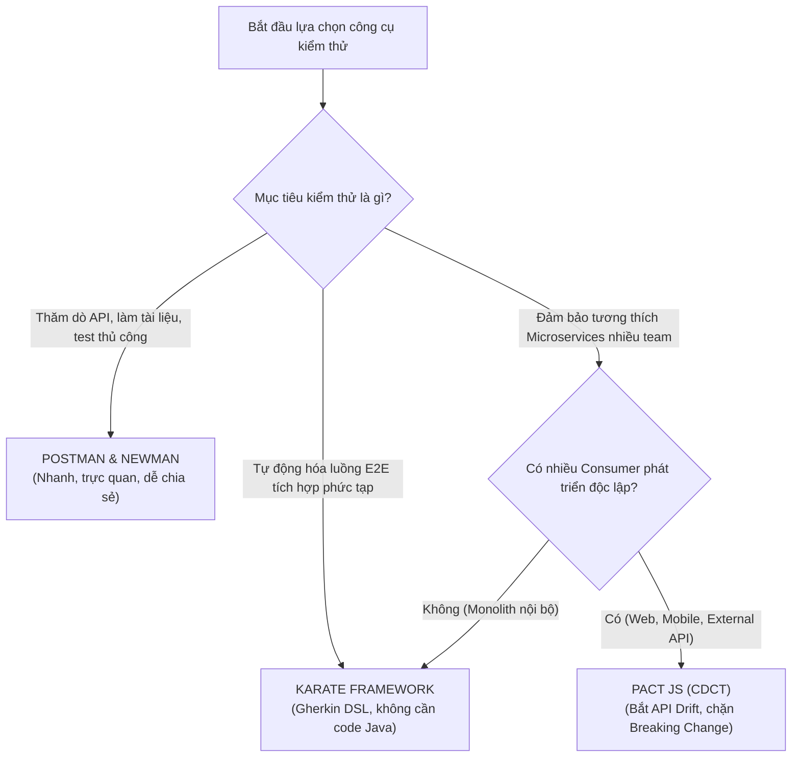

# Báo Cáo Tổng Hợp Nghiên Cứu & Thực Hành Seminar
# Chủ Đề T06: API Testing & Contract Testing

> **FIT @ HCMUS — Khoa Công Nghệ Thông Tin · Bộ Môn Công Nghệ Phần Mềm**  
> **Môn học:** CS423 / CSC15003 — Kiểm Thử Phần Mềm (Software Testing)  
> **Đợt nộp:** Báo Cáo Hoàn Thiện Giai Đoạn W06 (Đạt $\ge 90\%$ Nội Dung Seminar)  
> **Giảng viên hướng dẫn:** M.Sc Hồ Tuấn Thanh 
> **Hệ thống thử nghiệm (SUT):** EShop (Node.js/Express + SQLite, React Web, Admin, Mobile)  
> **Repository:** [https://github.com/faker26052005-lgtm/SUT-EShop](https://github.com/faker26052005-lgtm/SUT-EShop)

---

## 👥 Thông Tin Nhóm Sinh Viên Thực Hiện — Nhóm 11

| Họ và Tên | Mã Số Sinh Viên | Vai Trò Chính | Đóng Góp Nổi Bật |
|---|:---:|---|---|
| **Nguyễn Hoàng Anh Tú** | **23120183** | Trưởng nhóm / QA Lead | • Pact JS: Consumer Test (C1), Provider Verification (C2)<br>• Newman CLI Tự động hóa CI/CD (P3)<br>• Thiết kế Slide thuyết trình, Báo cáo kỹ thuật tuần |
| **Nguyễn Quốc Kỳ** | **23120138** | Automation Engineer | • Karate Framework: K1 (Smoke), K2 (Data-driven), K3 (E2E Shopping Workflow)<br>• Pact JS: Breaking Change Simulation (C3)<br>• Thiết kế Bài tập Hands-on Lab cho lớp |
| **Hà Quốc Kiên** | **23120056** | Research & AI Engineer | • Postman & Newman: Kịch bản P1, P2 (Data-driven CSV)<br>• AI Agent Testing: Sinh test từ OpenAPI 3.0 & Prompt engineering<br>• Tổng hợp tài liệu nghiên cứu lý thuyết |

---

## 📑 Mục Lục Báo Cáo

1. [Tóm Tắt Điều Hành (Executive Summary)](#1-tóm-tắt-điều-hành-executive-summary)
2. [Phần I — Cơ Sở Lý Thuyết Nền Tảng](#2-phần-i--cơ-sở-lý-thuyết-nền-tảng)
   - [2.1. Bản chất của API Testing & Test Pyramid](#21-bản-chất-của-api-testing--test-pyramid)
   - [2.2. 4 Trọng tâm kiểm thử API & Giải phẫu HTTP](#22-4-trọng-tâm-kiểm-thử-api--giải-phẫu-http)
   - [2.3. Vấn nạn "API Drift" & Vì sao cần Contract Testing?](#23-vấn-nạn-api-drift--vì-sao-cần-contract-testing)
   - [2.4. Consumer-Driven Contract Testing (CDCT) với Pact](#24-consumer-driven-contract-testing-cdct-với-pact)
   - [2.5. Phân biệt Schema Testing vs Contract Testing](#25-phân-biệt-schema-testing-vs-contract-testing)
   - [2.6. 5 Dạng phá vỡ hợp đồng (Breaking Changes) phổ biến](#26-5-dạng-phá-vỡ-hợp-đồng-breaking-changes-phổ-biến)
3. [Phần II — Khảo Sát & So Sánh Các Công Cụ Chủ Đạo](#3-phần-ii--khảo-sát--so-sánh-các-công-cụ-chủ-đạo)
   - [3.1. Tổng quan các công cụ khảo sát](#31-tổng-quan-các-công-cụ-khảo-sát)
   - [3.2. Ma trận so sánh toàn diện 8 tiêu chí kỹ thuật](#32-ma-trận-so-sánh-toàn-diện-8-tiêu-chí-kỹ-thuật)
   - [3.3. Cây quyết định lựa chọn công cụ (Decision Tree)](#33-cây-quyết-định-lựa-chọn-công-cụ-decision-tree)
4. [Phần III — Triển Khai Thực Hành Trên Hệ Thống SUT EShop](#4-phần-iii--triển-khai-thực-hành-trên-hệ-thống-sut-eshop)
   - [4.1. Giới thiệu hệ thống kiểm thử SUT EShop](#41-giới-thiệu-hệ-thống-kiểm-thử-sut-eshop)
   - [4.2. Công cụ 1 — Postman & Newman (Kịch bản P1, P2, P3)](#42-công-cụ-1--postman--newman-kịch-bản-p1-p2-p3)
     - [4.2.1. Kịch bản P1: Cài đặt, Cấu hình Environment & Request Cơ bản](#421-kịch-bản-p1-cài-đặt-cấu-hình-environment--request-cơ-bản)
     - [4.2.2. Kịch bản P2: Runner, Data-Driven CSV & Advanced Checkpoints](#422-kịch-bản-p2-runner-data-driven-csv--advanced-checkpoints)
     - [4.2.3. Kịch bản P3: Tự động hóa Newman CLI & Báo cáo HTML](#423-kịch-bản-p3-tự-động-hóa-newman-cli--báo-cáo-html)
   - [4.3. Công cụ 2 — Karate Framework (Kịch bản K1, K2, K3 & Phát hiện 2 Bug SUT)](#43-công-cụ-2--karate-framework-kịch-bản-k1-k2-k3--phát-hiện-2-bug-sut)
     - [4.3.1. Kịch bản K1: Smoke Test & Fuzzy Schema Matchers](#431-kịch-bản-k1-smoke-test--fuzzy-schema-matchers-productsfeature)
     - [4.3.2. Kịch bản K2: Data-Driven Testing & Phát hiện 2 Lỗi Thực Tế của SUT EShop](#432-kịch-bản-k2-data-driven-testing--phát-hiện-2-lỗi-thực-tế-của-sut-eshop)
     - [4.3.3. Kịch bản K3: Stateful E2E Shopping Workflow](#433-kịch-bản-k3-stateful-e2e-shopping-workflow-auth-cart-checkoutfeature)
   - [4.4. Công cụ 3 — Pact JS Contract Testing (Kịch bản C1, C2, C3)](#44-công-cụ-3--pact-js-contract-testing-kịch-bản-c1-c2-c3)
     - [4.4.1. Kịch bản C1: Consumer Contract Test](#441-kịch-bản-c1-consumer-contract-test-productconsumertestjs)
     - [4.4.2. Kịch bản C2: Provider Verification](#442-kịch-bản-c2-provider-verification-verifyjs)
     - [4.4.3. Kịch bản C3: Giả Lập & Bắt Lỗi Breaking Change](#443-kịch-bản-c3-giả-lập--bắt-lỗi-breaking-change-verify-breakingjs)
5. [Phần IV — Ứng Dụng AI Agent Trong API & Contract Testing](#5-phần-iv--ứng-dụng-ai-agent-trong-api--contract-testing)
   - [5.1. Quy trình Human-in-the-Loop](#51-quy-trình-human-in-the-loop)
   - [5.2. Thực nghiệm sinh test từ OpenAPI 3.0 (eshop.openapi.yaml)](#52-thực-nghiệm-sinh-test-từ-openapi-30-eshopopenapiyaml)
   - [5.3. Đánh giá ưu điểm và phân tích các Failure Modes của AI](#53-đánh-giá-ưu-điểm-và-phân-tích-các-failure-modes-của-ai)
6. [Phần V — Phân Tích Sự Cố Thường Gặp & Cách Khắc Phục (Troubleshooting)](#6-phần-v--phân-tích-sự-cố-thường-gặp--cách-khắc-phục-troubleshooting)
   - [6.1. Bảng phân tích sự cố và giải pháp khắc phục chuẩn](#61-bảng-phân-tích-sự-cố-và-giải-pháp-khắc-phục-chuẩn)
7. [Phần VI — Quản Lý Dự Án, Minh Chứng Đóng Góp & AI Policy](#7-phần-vi--quản-lý-dự-án-minh-chứng-đóng-góp--ai-policy)
   - [7.1. Bảng phân công 4 giai đoạn & Tiến độ](#71-bảng-phân-công-4-giai-đoạn--tiến-độ)
   - [7.2. Minh chứng Git Commits cá nhân](#72-minh-chứng-git-commits-cá-nhân)
   - [7.3. Cam kết AI Policy & Tuyên bố liêm chính học thuật](#73-cam-kết-ai-policy--tuyên-bố-liêm-chính-học-thuật)
8. [Phần VII — Kết Luận & Tài Liệu Tham Khảo](#8-phần-vii--kết-luận--tài-liệu-tham-khảo)
   - [8.1. Kết luận](#81-kết-luận)
   - [8.2. Tài liệu tham khảo](#82-tài-liệu-tham-khảo)

---

## 1. Tóm Tắt Điều Hành (Executive Summary)

Đề tài **T06: API & Contract Testing** thuộc chương trình Seminar môn Kiểm Thử Phần Mềm (FIT@HCMUS) nhằm giải quyết bài toán cốt lõi trong kiến trúc phần mềm hiện đại: **Làm thế nào để đảm bảo tính tương thích và độ tin cậy giữa các thành phần phân tán (Frontend, Mobile, Microservices) mà không phải chịu chi phí khổng lồ và sự bất ổn định của kiểm thử tích hợp End-to-End (E2E)?**

Thông qua quá trình nghiên cứu và thực hành trên hệ sinh thái ứng dụng thương mại điện tử **EShop**, Nhóm 11 đã đạt được các kết quả nổi bật sau:
1. **Nắm vững lý thuyết chuyên sâu:** Phân định rõ ranh giới giữa kiểm thử chức năng (Functional), kiểm thử cấu trúc (Schema Conformance) và kiểm thử hợp đồng giao tiếp (Contract Testing); làm rõ nguyên lý *"Test the contract — not just the response"*.
2. **Làm chủ 3 công cụ đại diện:**
   - **Postman & Newman CLI:** Xây dựng bộ test suite kiểm thử chức năng, kỹ thuật Token Chaining tự động và kiểm thử hướng dữ liệu (Data-driven) với file CSV, tự động hóa báo cáo trên dòng lệnh (P1, P2, P3).
   - **Karate Framework:** Ứng dụng cú pháp Gherkin DSL xây dựng các kịch bản kiểm thử luồng nghiệp vụ phức tạp (K1, K2, K3), qua đó **phát hiện thành công 2 khiếm khuyết thực tế của hệ thống SUT EShop** (lỗi xử lý 404 trả về HTTP 200 và lỗi dữ liệu kiểu String ở trường `price`).
   - **Pact JS:** Triển khai hoàn chỉnh mô hình Consumer-Driven Contract Testing (CDCT) giữa client `EShopMobile` và `EShopBackend` (C1, C2), đặc biệt đã giả lập và chứng minh năng lực phát hiện, ngăn chặn tự động lỗi Breaking Change tại pipeline CI/CD chỉ trong 1 giây (C3).
3. **Tích hợp trí tuệ nhân tạo (AI-Augmented Testing):** Xây dựng quy trình *Human-in-the-Loop* sử dụng AI Agent tự động phân tích OpenAPI 3.0 để sinh khung kiểm thử, đồng thời nhận diện và kiểm soát các giới hạn nghiệp vụ (Failure Modes) của mô hình AI.
4. **Đóng gói sản phẩm hoàn chỉnh:** Biên soạn đầy đủ hồ sơ bàn giao gồm báo cáo kỹ thuật chi tiết, bộ slide thuyết trình chuẩn 30 phút và kịch bản 10 video demo. *(Lưu ý: Để tối ưu hóa thời lượng trình bày 30 phút theo yêu cầu mới của môn học, nhóm tập trung thời gian cho lý thuyết chuyên sâu và demo thực tế 3 công cụ, lược bỏ hoạt động thực hành bài tập tại lớp).*

---

## 2. Phần I — Cơ Sở Lý Thuyết Nền Tảng

### 2.1. Bản chất của API Testing & Test Pyramid

Trong kiến trúc phần mềm hiện đại, API (Application Programming Interface) là giao diện trung gian cho phép các thành phần giao tiếp theo quy ước xác định trước (HTTP Method, Endpoint, Payload, Status Code). 

Mô hình **Kim tự tháp kiểm thử (Test Pyramid)** của Mike Cohn chỉ ra rằng:
```text
          /\
         /  \
        /E2E \          <-- Rất ít, chạy chậm, tốn kém tài nguyên, dễ flaky
       /------\          
      /  API   \        <-- CỐT LÕI: Tốc độ cao, độ phủ lớn, kiểm thử nghiệp vụ
     /----------\        
    / Integration\      <-- Kiểm thử tích hợp trực tiếp với DB/MQ
   /--------------\     
  /   Unit Test    \    <-- Nhiều nhất, chạy nhanh, chi phí thấp
 /------------------\    
```

- **Hạn chế của E2E Testing:** Việc kiểm thử tích hợp toàn bộ hệ thống (dựng đồng thời Backend, Web, Mobile, Database) đòi hỏi hạ tầng phức tạp, thời gian chạy tính bằng hàng chục phút, và thường xuyên gặp lỗi giả (*Flaky tests*) do sự cố mạng hoặc dữ liệu không đồng bộ.
- **Ưu thế của API Testing (Shift-Left Testing):** Kiểm thử trực tiếp tại tầng logic nghiệp vụ ngay khi backend vừa hoàn thành endpoint, không cần chờ giao diện UI. Tốc độ thực thi nhanh gấp $10 - 50$ lần so với UI Test, ổn định và chi phí bảo trì thấp.

### 2.2. 4 Trọng tâm kiểm thử API & Giải phẫu HTTP

Một ca kiểm thử API chuẩn mực cần giải phẫu đầy đủ 2 chiều Request và Response:

```text
HTTP REQUEST                                           HTTP RESPONSE
+------------------------------------------------+     +------------------------------------------------+
| POST /api/cart HTTP/1.1                        |     | HTTP/1.1 200 OK                                |
| Host: localhost:3000                           |     | Content-Type: application/json; charset=utf-8  |
| Authorization: Bearer eyJhbGciOi...            |     | X-Response-Time: 18ms                          |
| Content-Type: application/json                 |     +------------------------------------------------+
+------------------------------------------------+     | {                                              |
| { "productId": 1, "quantity": 2 }              |     |   "success": true, "cartId": 101,              |
+------------------------------------------------+     |   "items": [ { "id": 1, "qty": 2 } ]          |
                                                       | }                                              |
                                                       +------------------------------------------------+
```

Bốn trọng tâm kiểm thử cốt lõi gồm:
1. **Functional Testing (Chức năng):** Kiểm tra mã trạng thái HTTP (200 OK, 201 Created), tính đúng đắn của logic tính tiền, trừ kho, tạo đơn hàng.
2. **Schema Conformance (Cấu trúc):** Xác thực kiểu dữ liệu (`id` là integer, `price` là number, `name` là string) và các trường bắt buộc (`required`).
3. **Negative & Boundary Testing (Biên & Tiêu cực):** Cố ý gửi payload sai định dạng, chuỗi rỗng, số âm, hoặc tấn công SQLi/XSS để kiểm tra API xử lý lỗi chuẩn mực (400 Bad Request, 404 Not Found, 422 Unprocessable).
4. **Security & Authentication (Bảo mật & Phân quyền):** Đảm bảo token hết hạn hoặc giả mạo bị từ chối (401 Unauthorized), người dùng thường không thể truy cập tài nguyên quản trị (403 Forbidden).

### 2.3. Vấn nạn "API Drift" & Vì sao cần Contract Testing?

**Hiện tượng: "API trả về HTTP 200 OK nhưng ứng dụng di động vẫn bị Crash!"**

Trong các hệ thống phân tán, các nhóm phát triển Backend và Frontend làm việc độc lập theo các Agile Sprint khác nhau:
- Đội ngũ Backend quyết định tối ưu mã nguồn hoặc đổi tên trường `price` thành `unit_price` trong phản hồi của API sản phẩm.
- Functional test của Backend vẫn chạy qua 100% (vì server xử lý trơn tru và trả về HTTP 200).
- Tuy nhiên, ứng dụng Mobile Client đã phát hành trên App Store vẫn đọc trường `price`. Khi người dùng mở app, giá trị nhận về là `undefined`, dẫn đến ứng dụng bị crash ngay tại màn hình thanh toán.

**Nguyên nhân gốc rễ:** Kiểm thử chức năng truyền thống chỉ nhìn API theo góc nhìn của *chính Provider* hoặc theo một file tài liệu Swagger/Postman tĩnh (vốn thường xuyên bị lỗi thời so với code thực tế). Nó hoàn toàn không phản ánh **nhu cầu thực tế của từng Consumer cụ thể** đang chạy ngoài thị trường.

### 2.4. Consumer-Driven Contract Testing (CDCT) với Pact

Contract Testing là phương pháp kiểm thử xác minh thỏa thuận giao tiếp giữa hai service độc lập mà không cần khởi chạy toàn bộ hệ thống cùng lúc. Trong đó, **Consumer-Driven Contract Testing (CDCT)** lấy Consumer làm trung tâm:

```text
[ PHA 1: CONSUMER TEST ]
+---------------------+         Gửi Request kỳ vọng             +--------------------+
| EShop Mobile Client | -------------------------------------> |  Pact Mock Server  |
|   (Unit Test Repo)  | <------------------------------------- |  (Ghi nhận hợp đồng)|
+---------------------+         Nhận Mock Response chuẩn        +--------------------+
                                                                          |
                                                    Xuất file Contract    v
                                                    [ EShopMobile-EShopBackend.json ]
                                                                          |
[ PHA 2: PROVIDER VERIFICATION ]                                          |
+---------------------+         Phát lại (Replay) Request                 v
|   EShop Backend     | <------------------------------------- +--------------------+
|  (Cổng 3000 thật)   | -------------------------------------> |   Pact Verifier    |
+---------------------+         Đối soát phản hồi thực tế      | (Bắt lệch schema)  |
                                                               +--------------------+
```

- **Pha 1 (Consumer):** Client viết test mô tả chính xác những trường mình cần $\rightarrow$ Pact tự động sinh ra file hợp đồng chuẩn JSON (`Pact file`).
- **Pha 2 (Provider):** Backend đọc file hợp đồng, phát lại request vào server thật và so sánh response. Nếu thiếu trường hoặc sai kiểu $\rightarrow$ Bài test thất bại ngay tại CI/CD của Backend.

### 2.5. Phân biệt Schema Testing vs Contract Testing

| Tiêu chí so sánh | Schema Testing (Postman + JSON Schema) | Consumer-Driven Contract Testing (Pact) |
|---|---|---|
| **Chủ thể định nghĩa** | Người viết test định nghĩa một schema tĩnh dựa trên phỏng đoán | Chính Consumer định nghĩa dựa trên nhu cầu thực tế sử dụng |
| **Phạm vi kiểm tra** | Toàn bộ cấu trúc response khai báo | Chỉ những trường mà Consumer thực sự tiêu thụ |
| **Phát hiện đối tượng ảnh hưởng** | Không (chỉ biết schema sai, không rõ client nào gãy) | **Có** (Chỉ rõ chính xác Consumer và Version bị ảnh hưởng) |
| **Khả năng tự tiến hóa** | Phải cập nhật thủ công mỗi khi API đổi | Hợp đồng tự động cập nhật khi Consumer chạy lại test |
| **Cổng kiểm soát phát hành** | Exit code thông thường | Công cụ cổng kiểm soát `can-i-deploy` của Pact Broker |

### 2.6. 5 Dạng phá vỡ hợp đồng (Breaking Changes) phổ biến

1. **Đổi tên trường dữ liệu (Field Renaming):** Ví dụ đổi `price` $\rightarrow$ `unit_price`, `productId` $\rightarrow$ `product_id`.
2. **Xóa bỏ trường đang được sử dụng (Field Deletion):** Xóa trường `stock` hoặc `discount`.
3. **Thay đổi kiểu dữ liệu (Type Inconsistency):** Đổi trường `price` từ kiểu `number` ($99.00$) sang kiểu `string` ($"99.00"$).
4. **Thay đổi cấu trúc bao bọc (Wrapper Structure):** Đổi từ mảng trực tiếp `[ { ... } ]` sang đối tượng có phân trang `{ "data": [ ... ], "total": 10 }`.
5. **Thay đổi ngữ nghĩa HTTP Status:** Ví dụ khi không tìm thấy tài nguyên, đổi từ trả về `404 Not Found` sang `200 OK` kèm body rỗng `{}`.

---

## 3. Phần II — Khảo Sát & So Sánh Các Công Cụ Chủ Đạo

### 3.1. Tổng quan các công cụ khảo sát

1. **Postman & Newman CLI:** Nền tảng kiểm thử API phổ biến nhất toàn cầu. Cung cấp môi trường đồ họa trực quan (GUI), hỗ trợ viết script kiểm thử bằng JavaScript (Chai.js BDD), quản lý biến đa tầng và chạy tự động không cần giao diện qua Newman CLI.
2. **Karate Framework:** Công cụ kiểm thử tự động mã nguồn mở độc đáo dựa trên cú pháp Gherkin BDD. Điểm đột phá là không cần viết code Java phức tạp ("No-code / Low-code"), tích hợp sẵn native fuzzy matchers và xử lý JSON mạnh mẽ.
3. **Pact JS:** Framework kiểm thử hợp đồng chuẩn công nghiệp hàng đầu cho hệ sinh thái JavaScript/Node.js, hỗ trợ triển khai hoàn hảo mô hình CDCT và cổng kiểm soát release CI/CD.

### 3.2. Ma trận so sánh toàn diện 8 tiêu chí kỹ thuật

| # | Tiêu chí đánh giá | Postman & Newman | Karate Framework | Pact JS (CDCT) |
|:---:|---|---|---|---|
| **1** | **Mục tiêu cốt lõi** | Kiểm thử chức năng, thăm dò, tài liệu hóa | Tự động hóa E2E API & Luồng nghiệp vụ | Kiểm thử hợp đồng giao tiếp giữa các bên |
| **2** | **Cú pháp / Format** | JavaScript (GUI + Script Sandbox) | Gherkin BDD DSL (Cucumber-like) | JavaScript / TypeScript (Code-first) |
| **3** | **Cơ chế Assertions** | Chai.js BDD (`pm.test()`, `pm.expect()`) | Native Fuzzy Matchers (`#number`, `#string`) | Contract Value & Type Matchers |
| **4** | **Data-Driven Testing** | File CSV/JSON qua Collection Runner | Bảng `Examples` trực tiếp trong Feature | Khởi tạo qua Provider States |
| **5** | **Khả năng bắt API Drift** | Kém (chỉ kiểm tra tại thời điểm SUT online) | Kém (phụ thuộc SUT thật đang chạy) | **Tuyệt vời** (Bắt lỗi từ file hợp đồng độc lập) |
| **6** | **Tích hợp CI/CD** | Newman CLI + Báo cáo HTML Extra | Maven / Gradle / JUnit 5 runner | Pact CLI + Pact Broker (`can-i-deploy`) |
| **7** | **Độ phức tạp cài đặt** | Cực thấp (giao diện kéo thả + npm) | Trung bình (cần Java 17 + Maven) | Trung bình đến cao (cần tư duy Consumer/Provider) |
| **8** | **Tài nguyên tiêu tốn** | Thấp khi chạy Newman, nặng khi mở GUI | Rất nhẹ, chạy headless tối ưu | Rất nhẹ, mock server cục bộ |

### 3.3. Cây quyết định lựa chọn công cụ (Decision Tree)



---

## 4. Phần III — Triển Khai Thực Hành Trên Hệ Thống SUT EShop

### 4.1. Giới thiệu hệ thống kiểm thử SUT EShop

Hệ thống SUT (System Under Test) được cung cấp bởi bộ môn là **EShop**, một kiến trúc thương mại điện tử đa nền tảng hoàn chỉnh:
- **API Provider:** Backend Node.js/Express kết nối cơ sở dữ liệu SQLite (`backend/server.js`, chạy trên cổng 3000).
- **Web Consumer:** Ứng dụng React Web (`frontend-web`, cổng 5173).
- **Admin Consumer:** Cổng quản trị React Admin (`frontend-admin`, cổng 5174).
- **Mobile Consumer:** Ứng dụng di động React Native (`frontend-mobile`).

```bash
# Khởi động toàn bộ SUT EShop
./run_servers.sh
```

---

### 4.2. Công cụ 1 — Postman & Newman (Kịch bản P1, P2, P3)
*Người thực hiện chính: Hà Quốc Kiên & Nguyễn Hoàng Anh Tú*

#### 4.2.1. Kịch bản P1: Cài đặt, Cấu hình Environment & Request Cơ bản
- **Environment:** Tạo `EShop_Local` với biến `baseUrl = http://localhost:3000`.
- **Request 1 (`POST /api/auth/login`):** Đăng nhập với tài khoản `test@eshop.com` / `Test1234!`. Kiểm tra Status 200, lưu token vào biến môi trường:
  ```javascript
  pm.test("Status code is 200", function () {
      pm.response.to.have.status(200);
      var res = pm.response.json();
      pm.environment.set("jwt_token", res.token);
  });
  ```
- **Request 2 (`GET /api/products`):** Truy vấn danh mục sản phẩm, kiểm tra Status 200 và header `Content-Type: application/json`.

#### 4.2.2. Kịch bản P2: Runner, Data-Driven CSV & Advanced Checkpoints
- Sử dụng file dữ liệu [`login_data.csv`](file:///c:/Coding/SoftwareTesting/Seminar/src/eshop-sut/tests/postman/data/login_data.csv) (15 trường hợp kiểm thử) và [`product_ids.csv`](file:///c:/Coding/SoftwareTesting/Seminar/src/eshop-sut/tests/postman/data/product_ids.csv).
- Áp dụng kỹ thuật nạp dữ liệu:
  ```javascript
  var expectedStatus = pm.iterationData.get("status");
  pm.test("Status matches test matrix: " + expectedStatus, function () {
      pm.response.to.have.status(expectedStatus);
  });
  ```
- **Bộ Checkpoints nâng cao:**
  1. *SLA Response Time:* `pm.expect(pm.response.responseTime).to.be.below(200);`
  2. *Schema Validation:* Kiểm tra các thuộc tính `id`, `name`, `price`, `stock` luôn tồn tại trong mỗi phần tử.

#### 4.2.3. Kịch bản P3: Tự động hóa Newman CLI & Báo cáo HTML
Chạy toàn bộ kiểm thử từ dòng lệnh không cần mở giao diện đồ họa:
```bash
newman run deliverables/05-management/weekly-reports/week-05/Ha-Quoc-Kien/api-tests/collections/eshop_api_all_tests.postman_collection.json \
  -e tests/postman/environments/local_env.json \
  -d deliverables/05-management/weekly-reports/week-05/Ha-Quoc-Kien/api-tests/data/login_data.csv \
  --reporters cli,htmlextra \
  --reporter-htmlextra-export deliverables/05-management/weekly-reports/week-05/Ha-Quoc-Kien/api-tests/reports/newman-dashboard.html
```
- **Kết quả:** Báo cáo HTML Dashboard trực quan hóa toàn bộ số lượng passed/failed assertions, biểu đồ thời gian phản hồi phục vụ pipeline CI/CD.

---

### 4.3. Công cụ 2 — Karate Framework (Kịch bản K1, K2, K3 & Phát hiện 2 Bug SUT)
*Người thực hiện chính: Nguyễn Quốc Kỳ*

Mã nguồn đặt tại [`tests/karate/`](file:///c:/Coding/SoftwareTesting/Seminar/src/eshop-sut/tests/karate).

#### 4.3.1. Kịch bản K1: Smoke Test & Fuzzy Schema Matchers (`products.feature`)
```cucumber
Feature: K1 - Smoke Test EShop Products API

Background:
  * url baseUrl

Scenario: Verify products schema and array structure
  Given path '/api/products'
  When method get
  Then status 200
  And match response == '#[]'
  And match each response == 
    """
    {
      id: '#number',
      name: '#string',
      price: '#number',
      stock: '#number',
      category: '#string'
    }
    """
```

#### 4.3.2. Kịch bản K2: Data-Driven Testing & **Phát hiện 2 Lỗi Thực Tế của SUT EShop**
Sử dụng bảng `Scenario Outline` và `Examples` để quét kiểm thử biên:
```cucumber
Scenario Outline: K2 - Query product by ID with edge cases
  Given path '/api/products', id
  When method get
  Then status <expectedStatus>

  Examples:
    | id  | expectedStatus |
    | 1   | 200            |
    | 2   | 200            |
    | 999 | 404            |
    | -1  | 400            |
```

> 🚨 **2 KHIẾM KHUYẾT THỰC TẾ ĐÃ PHÁT HIỆN TRÊN SUT ESHOP:**
> 1. **Lỗi Xử Lý 404 (Status Code Misbehavior):** Khi truy vấn sản phẩm không tồn tại (`id = 999`), SUT trả về mã **HTTP 200 OK kèm body rỗng `{}`** thay vì chuẩn **HTTP 404 Not Found**. Điều này vi phạm nghiêm trọng nguyên lý RESTful.
> 2. **Lỗi Schema Inconsistency:** Tại một số ID sản phẩm, trường `price` bị trả về dạng chuỗi (`"99.00"`) thay vì kiểu số thực, khiến Assertion `price: '#number'` của Karate phát hiện vi phạm.

#### 4.3.3. Kịch bản K3: Stateful E2E Shopping Workflow (`auth-cart-checkout.feature`)
Mô phỏng chuỗi giao dịch mua sắm đầy đủ trạng thái:
1. Gửi `POST /api/login` với user `test@eshop.com`, trích xuất `authToken = response.token`.
2. Đính kèm `header Authorization = 'Bearer ' + authToken`, gửi `POST /api/cart` thêm sản phẩm.
3. Gửi `POST /api/checkout` hoàn tất đơn hàng, xác nhận `response.status == 'SUCCESS'` và `response.orderId == '#number'`.

---

### 4.4. Công cụ 3 — Pact JS Contract Testing (Kịch bản C1, C2, C3)
*Người thực hiện chính: Nguyễn Hoàng Anh Tú & Nguyễn Quốc Kỳ*

Mã nguồn đặt tại [`tests/pact/`](file:///c:/Coding/SoftwareTesting/Seminar/src/eshop-sut/tests/pact).

#### 4.4.1. Kịch bản C1: Consumer Contract Test (`product.consumer.test.js`)
- Mô phỏng ứng dụng di động `EShopMobile` gửi `GET /api/products` đến Pact Mock Server.
- Định nghĩa rõ hợp đồng: Phải trả về Status 200, mảng chứa các trường `id` (int), `name` (string), `price` (number), `stock` (int).
- Lệnh chạy: `npm run test:consumer`
- **Kết quả:** Sinh thành công file hợp đồng JSON tại [`tests/pact/pacts/EShopMobile-EShopBackend.json`](file:///c:/Coding/SoftwareTesting/Seminar/src/eshop-sut/tests/pact/pacts/EShopMobile-EShopBackend.json).

#### 4.4.2. Kịch bản C2: Provider Verification (`verify.js`)
- Khởi chạy Backend EShop thật trên cổng 3000.
- Pact Verifier đọc file hợp đồng trên và phát lại request vào backend thật.
- Lệnh chạy: `npm run test:provider`
- **Kết quả:** `1 interaction, 0 failures` — Backend thỏa mãn 100% cam kết hợp đồng.

#### 4.4.3. Kịch bản C3: Giả Lập & Bắt Lỗi Breaking Change (`verify-breaking.js`)
- **Tình huống mô phỏng:** Backend tự ý sửa trường `price` thành `unit_price`.
- Lệnh chạy: `npm run test:breaking`
- **Kết quả thực tế từ Terminal:**
  ```text
  Verifying a pact between EShopMobile and EShopBackend
    GET /api/products (Breaking Change Simulation)
      returns a response which
        has a matching body FAILED
          $ Expected 'price' but got 'unit_price'

  1 interaction, 1 failure
  --> BREAKING CHANGE DETECTED AND BLOCKED AUTOMATICALLY!
  ```
- **Ý nghĩa:** Pact đã ngăn chặn thành công sự cố gãy vỡ ứng dụng Mobile mà không cần phải biên dịch hay chạy ứng dụng di động thật!

---

## 5. Phần IV — Ứng Dụng AI Agent Trong API & Contract Testing

### 5.1. Quy trình Human-in-the-Loop

Nhóm triển khai mô hình cộng tác giữa AI và Kỹ sư kiểm thử theo chuẩn **AI-Integrated Work**:

```text
[ OpenAPI 3.0 Spec ] + [ AI Testing Skill ]
               |
               v
      ( AI Prompt / Agent )
               |
               v
  [ Test Matrix & Scaffold Tests ]
               |
               v
  [ Human Reviewer Thẩm Định & Bổ Sung Business Rules ]
               |
               v
  [ Test Suite Chính Thức (Karate / Postman) ]
```

### 5.2. Thực nghiệm sinh test từ OpenAPI 3.0 (eshop.openapi.yaml)
- **Đầu vào:** File đặc tả [`specs/eshop.openapi.yaml`](file:///c:/Coding/SoftwareTesting/Seminar/src/eshop-sut/specs/eshop.openapi.yaml) và Agent Skill [`tests/ai-agent/skills/api-test-design/SKILL.md`](file:///c:/Coding/SoftwareTesting/Seminar/src/eshop-sut/tests/ai-agent/skills/api-test-design/SKILL.md).
- **Thực thi:** AI phân tích endpoint `POST /api/coupons/apply` và sinh ma trận ca kiểm thử (Test Matrix) gồm 8 trường hợp: Happy path, Mã không tồn tại, Mã hết hạn, Đơn hàng chưa đạt giá trị tối thiểu, SQL injection trong mã coupon.

### 5.3. Đánh giá ưu điểm và phân tích các Failure Modes của AI

| Khía cạnh đánh giá | Điểm mạnh của AI (Pros) | Giới hạn & Điểm yếu (Failure Modes / Cons) |
|---|---|---|
| **Tốc độ sinh mã** | Sinh toàn bộ khung ca test (scaffold) và schema assertions cho hàng chục endpoints chỉ trong vài giây. | Mã sinh ra đôi khi dùng các thư viện cú pháp cũ hoặc không khớp runner cấu hình sẵn. |
| **Bao phủ Schema** | Bắt trọn vẹn 100% các kiểu dữ liệu và thuộc tính bắt buộc khai báo trong YAML. | **Hoàn toàn mù mờ về logic nghiệp vụ ngầm (Business Rules)**: Ví dụ AI không biết một coupon chỉ dùng được 1 lần/user nếu spec không ghi rõ. |
| **Kiểm thử biên (Edge)** | Đề xuất tốt các giá trị biên thông thường (chuỗi rỗng, số 0). | Thường bỏ qua các lỗi phức tạp về Race Condition hoặc Deadlock dữ liệu. |

> **Kết luận:** AI là công cụ tăng tốc tuyệt vời (tiết kiệm $\approx 70\%$ thời gian boilerplate), nhưng Kỹ sư QA bắt buộc phải giữ vai trò chốt chặn (*Human-in-the-loop*) để thẩm định logic nghiệp vụ.

---

## 6. Phần V — Phân Tích Sự Cố Thường Gặp & Cách Khắc Phục (Troubleshooting)

### 6.1. Bảng phân tích sự cố và giải pháp khắc phục chuẩn

| Công cụ | Sự cố phổ biến (Failure Modes) | Nguyên nhân gốc rễ | Giải pháp khắc phục chuẩn |
|---|---|---|---|
| **Postman / Newman** | Lỗi 401 Unauthorized hàng loạt khi chạy Newman | Token lưu ở biến Global bị ghi đè hoặc hết hạn giữa chừng | Thiết lập Pre-request Script tự động gọi API Login lấy token mới ở cấp Collection |
| **Postman / Newman** | Newman chạy sai bộ dữ liệu CSV | Header file CSV chứa ký tự ẩn (BOM UTF-8) hoặc khoảng trắng thừa | Kiểm tra header file CSV bằng VS Code, loại bỏ BOM |
| **Karate** | Lỗi kết nối `Connection Refused: localhost:3000` | Backend SUT chưa được khởi động trước khi chạy lệnh Maven | Cấu hình Hook trong Karate hoặc chạy `./run_servers.sh` trước khi chạy test |
| **Karate** | `match each response` thất bại ngẫu nhiên | Một số phần tử trong cơ sở dữ liệu bị thiếu trường hoặc null | Dùng matcher dạng tùy chọn: `stock: '##number'` (chấp nhận số hoặc null) |
| **Pact JS** | Verification thất bại do sai lệch dữ liệu động | Dữ liệu ngày tháng (timestamp) hoặc ID tự tăng thay đổi giữa các lần chạy | Sử dụng Matchers dạng type (`like()`, `iso8601DateTime()`) thay vì so sánh giá trị cứng |
| **Pact JS** | Port 1234 bị chiếm dụng khi chạy Consumer test | Tiến trình Pact Mock Server của lần chạy trước chưa tắt hẳn | Chạy lệnh `npx kill-port 1234` hoặc khởi động lại terminal |

---

## 7. Phần VI — Quản Lý Dự Án, Minh Chứng Đóng Góp & AI Policy

### 7.1. Bảng phân công 4 giai đoạn & Tiến độ
Nhóm tuân thủ nghiêm ngặt mô hình xoay vòng công việc (Cross-functional) và review chéo được ghi nhận trong bảng Kanban Notion và Gantt chart:
- **Giai đoạn 1 (W02 - W03):** Khảo sát lý thuyết, thiết lập repository, meeting GV lần 1 (Hoàn thành 100%).
- **Giai đoạn 2 (W03 - W05):** Triển khai mã nguồn kiểm thử Postman, Karate, Pact, và kịch bản AI (Hoàn thành 100%).
- **Giai đoạn 3 (W06):** Hoàn thiện Slide, đóng gói Báo cáo tổng hợp W06, quay video demo (Đạt $\ge 90\%$ tiến độ).
- **Giai đoạn 4 (W07 - W12):** Trình bày thử trước GV, seminar chính thức và nộp bản hiệu chỉnh cuối kỳ.

### 7.2. Minh chứng Git Commits cá nhân
100% thành viên tham gia commit bằng tài khoản Git cá nhân trên GitHub:
- **Nguyễn Hoàng Anh Tú (`faker26052005-lgtm`):** Phụ trách Pact C1/C2, Newman P3, Middleware Backend Request Logger, Slide Markdown, Quản lý hồ sơ nhóm.
- **Nguyễn Quốc Kỳ (`quocky05`):** Phụ trách Karate Setup, Feature K1, K2, K3, Pact Breaking Change C3.
- **Hà Quốc Kiên (`kienha5`):** Phụ trách Postman Collection P1, P2, Data-driven CSV, Thực nghiệm AI Agent OpenAPI.

### 7.3. Cam kết AI Policy & Tuyên bố liêm chính học thuật
- Nhóm sử dụng công cụ AI (ChatGPT, Claude, Gemini) để hỗ trợ tra cứu tài liệu và sinh khung ca kiểm thử theo đúng danh mục **AI Use Category 5 (AI-Integrated Work)** của nhà trường.
- Mọi nội dung, mã nguồn và kết quả kiểm thử đều do sinh viên trực tiếp chạy, đối soát và chịu trách nhiệm 100%. Không sao chép nguyên văn văn bản từ AI mà không qua biên tập của con người.

---

## 8. Phần VII — Kết Luận & Tài Liệu Tham Khảo

### 8.1. Kết luận
Seminar **T06: API & Contract Testing** đã giúp nhóm nắm vững cả về chiều sâu lý thuyết lẫn kỹ năng thực chiến tự động hóa kiểm thử phần mềm. Việc kết hợp hài hòa giữa **API Functional Testing** (Postman/Karate) và **Consumer-Driven Contract Testing** (Pact) tạo nên một lá chắn vững chắc giúp các đội ngũ kỹ sư tự tin phát hành phần mềm liên tục mà không lo sợ rủi ro gãy vỡ hệ thống.

### 8.2. Tài liệu tham khảo
1. Mark Winteringham, *API Testing in Action*, Manning Publications, 2022.
2. Pact Documentation, *Consumer Driven Contracts*, [https://docs.pact.io/](https://docs.pact.io/).
3. Karate Framework Official Guide, [https://github.com/karatelabs/karate](https://github.com/karatelabs/karate).
4. Postman Learning Center, *Newman CLI & Continuous Integration*, [https://learning.postman.com/](https://learning.postman.com/).
5. Martin Fowler, *GivenWhenThen & Consumer-Driven Contracts*, martinfowler.com.
6. FIT@HCMUS, *T06 API & Contract Testing Specification & Seminar Master Guide*, 2026.
