# BÁO CÁO PHÁT HIỆN LỖI (DEFECT / BUG REPORT) – HỆ THỐNG ESHOP

> **Môn học:** Kiểm thử Phần mềm (CS423 / CSC13003) – FIT@HCMUS  
> **Sinh viên thực hiện:** Nguyễn Quốc Kỳ  
> **MSSV:** 23120138 – **Lớp:** 23CLC02  
> **Bài tập:** HW02 – Domain Testing & Boundary Value Analysis  
> **Hệ thống thử nghiệm (SUT):** EShop (Web, Admin, Mobile, Backend REST API)  
> **Repository GitHub của nhóm:** [Nhóm 11 – EShop Seminar & Testing](https://github.com/faker26052005-lgtm/SUT-EShop)  
> **Tài liệu đối chiếu đặc tả:** [`specs/system_requirements_specification.md`](../../specs/system_requirements_specification.md)  
> **Ngày báo cáo:** 18/10/2026

---

## 1. TỔNG HỢP & THỐNG KÊ LỖI (DEFECT METRICS DASHBOARD)

### 1.1 Thống Kê Theo Mức Độ Nghiêm Trọng (Severity) & Phân Hệ
| Phân hệ / Pool | Mã FR | Tên tính năng | Critical | Major | Medium | Minor | Tổng số Bug |
| :--- | :--- | :--- | :---: | :---: | :---: | :---: | :---: |
| **Pool A (Web/Auth)** | **FR-02** | Đăng nhập & Khóa tài khoản | 2 | 3 | 0 | 0 | **5** |
| **Pool B (Web/Cart)** | **FR-07** | Giỏ hàng (Shopping Cart) | 0 | 4 | 0 | 0 | **4** |
| **Pool C (Admin/Coupon)** | **FR-17** | Quản lý Mã Giảm Giá | 0 | 2 | 0 | 0 | **2** |
| **Pool D (Mobile/Order)** | **FR-20 & FR-10**| Hủy đơn hàng theo trạng thái | 1 | 0 | 1 | 0 | **2** |
| **TỔNG CỘNG** | | | **3** | **9** | **1** | **0** | **13** |

### 1.2 Bảng Ma Trận Truy Vết Lỗi (Traceability: Test Case ↔ Bug ID ↔ GitHub Issue)
| Bug ID | Tóm tắt lỗi | Tính năng | TC phát hiện | Mức độ | GitHub Issue | Trạng thái |
| :--- | :--- | :---: | :---: | :---: | :---: | :---: |
| `BUG-FR02-01` | Bộ đếm số lần đăng nhập sai tăng 2 thay vì 1 đơn vị sau 1 lần thử sai | FR-02 | `TC_FR02_03` | Major | [Issue #4](https://github.com/faker26052005-lgtm/SUT-EShop/issues/4) | Open |
| `BUG-FR02-02` | Khóa tài khoản sớm tại lần thử sai thứ 2 với thời gian phạt 180s thay vì 30s | FR-02 | `TC_FR02_04` | Critical | [Issue #5](https://github.com/faker26052005-lgtm/SUT-EShop/issues/5) | Open |
| `BUG-FR02-03` | Bộ đếm số lần đăng nhập sai nhảy vọt lên 4 thay vì 3 tại lần thử sai thứ 3 | FR-02 | `TC_FR02_06` | Major | [Issue #6](https://github.com/faker26052005-lgtm/SUT-EShop/issues/6) | Open |
| `BUG-FR02-04` | Đăng nhập bằng mật khẩu đúng trong khi đang bị khóa vẫn thành công và tự gỡ khóa | FR-02 | `TC_FR02_07` | Critical | [Issue #7](https://github.com/faker26052005-lgtm/SUT-EShop/issues/7) | Open |
| `BUG-FR02-05` | Form đăng nhập dùng input type="text" cho email, bỏ qua hoàn toàn HTML5 format validation | FR-02 | `TC_FR02_14` | Major | [Issue #8](https://github.com/faker26052005-lgtm/SUT-EShop/issues/8) | Open |
| `BUG-FR07-01` | Nút "Thêm vào giỏ hàng" tại trang chi tiết sản phẩm bỏ qua lần bấm đầu tiên | FR-07 | `TC_FR07_01` | Major | [Issue #9](https://github.com/faker26052005-lgtm/SUT-EShop/issues/9) | Open |
| `BUG-FR07-02` | Thêm cùng sản phẩm tạo dòng mới riêng biệt thay vì tăng số lượng | FR-07 | `TC_FR07_02` | Major | [Issue #10](https://github.com/faker26052005-lgtm/SUT-EShop/issues/10) | Open |
| `BUG-FR07-03` | Endpoint POST /api/cart chấp nhận ID sản phẩm không tồn tại (9999) | FR-07 | `TC_FR07_03` | Major | [Issue #11](https://github.com/faker26052005-lgtm/SUT-EShop/issues/11) | Open |
| `BUG-FR07-04` | Endpoint POST /api/cart chấp nhận ID sai kiểu dữ liệu ("abc") không validate | FR-07 | `TC_FR07_04` | Major | [Issue #12](https://github.com/faker26052005-lgtm/SUT-EShop/issues/12) | Open |
| `BUG-FR17-01` | Form Admin cho phép nhập `min_order_amount = -1` và lưu thành công | FR-17 | `TC_FR17_05` | Major | [Issue #16](https://github.com/ttbhanh/eshop-sut/issues/16) | Open |
| `BUG-FR17-02` | Không ràng buộc Unique mã Coupon, cho phép tạo trùng lặp | FR-17 | `TC_FR17_08` | Major | [Issue #17](https://github.com/ttbhanh/eshop-sut/issues/17) | Open |
| `BUG-FR20-01` | Đơn hàng đã ở trạng thái `shipping` nhưng User vẫn bấm Hủy được trên Mobile | Mobile | `TC_MOB_03` | Critical | [Issue #18](https://github.com/ttbhanh/eshop-sut/issues/18) | Open |
| `BUG-FR20-02` | Sau khi hủy thành công, trạng thái không tự refresh sang `canceled` | Mobile | `TC_MOB_01` | Medium | [Issue #19](https://github.com/ttbhanh/eshop-sut/issues/19) | Open |

---

## 2. BÁO CÁO CHI TIẾT TỪNG LỖI (DETAILED DEFECT TICKETS)

### 2.1 Các lỗi thuộc Pool A: FR-02 – Đăng nhập & Khóa tài khoản

#### [BUG-FR02-01] Bộ đếm số lần đăng nhập sai tăng 2 thay vì 1 đơn vị sau 1 lần thử sai

| Trường thông tin | Chi tiết |
| :--- | :--- |
| **Bug ID** | `BUG-FR02-01` |
| **Tiêu đề Bug** | `[FR-02][Backend API / SQLite DB] Failure counter increments by 2 instead of 1 upon invalid login attempt` |
| **Chức năng (Feature)** | FR-02: Đăng nhập & Khóa tài khoản (Pool A) |
| **Môi trường thử nghiệm**| Web: `http://localhost:5173` • Backend: `http://localhost:3000` • Node v18.19 • Linux |
| **Mức độ (Severity)** | **Major** (Sai lệch ngưỡng bảo mật khiến tài khoản bị khóa sớm ngoài ý muốn) |
| **Mức ưu tiên (Priority)**| **High (P1)** |
| **Test Case phát hiện** | [`TC_FR02_03`](Main_Report.md#tc_fr02_03) (Thử sai lần 1 $N = 1$) |
| **GitHub Issue Link** | [Issue #4: [BUG] [FR-02][Backend API / SQLite DB] Failure counter increments by 2 instead of 1 upon invalid login attempt](https://github.com/faker26052005-lgtm/SUT-EShop/issues/4) |
| **Người báo cáo** | Nguyễn Quốc Kỳ (23120138) |

**1. Tiền điều kiện (Preconditions):**
- Tài khoản người dùng `test@eshop.com` tồn tại trong SQLite database với `login_attempts = 0`, `locked_until = NULL`.
- Backend server đang chạy tại `http://localhost:3000`.

**2. Các bước tái hiện (Steps to Reproduce):**
1. Gửi yêu cầu đăng nhập với email hợp lệ `test@eshop.com` và mật khẩu không chính xác `WrongPass1!`:
   ```bash
   curl -i -s -X POST http://localhost:3000/api/login \
     -H "Content-Type: application/json" \
     -d '{"email":"test@eshop.com","password":"WrongPass1!"}'
   ```
2. Truy vấn SQLite kiểm tra giá trị cột `login_attempts` của tài khoản `test@eshop.com`:
   ```bash
   SELECT id, email, login_attempts, locked_until FROM users WHERE email='test@eshop.com';
   ```

**3. Dữ liệu thử nghiệm (Test Data):**
```json
{
  "email": "test@eshop.com",
  "password": "WrongPass1!"
}
```

**4. Kết quả mong đợi (Expected Result theo SRS FR-02):**
> *Trích dẫn SRS FR-02 (Item 2):* "Sau mỗi lần đăng nhập sai, hệ thống tăng bộ đếm số lần đăng nhập sai liên tiếp lên đúng 1 đơn vị."
- Endpoint `POST /api/login` trả về HTTP `401 Unauthorized`.
- Trong CSDL SQLite, trường `login_attempts` phải tăng từ `0` lên **đúng `1`** ($N=1$). Trường `locked_until` tiếp tục giữ nguyên là `NULL`.

**5. Kết quả thực tế (Actual Result):**
- Endpoint `POST /api/login` trả về HTTP `401 Unauthorized` (`{"error":"Invalid email or password"}`).
- Tuy nhiên trong SQLite CSDL, trường `login_attempts` tăng từ `0` lên **`2`** ($N=2$) chỉ sau đúng 1 lần thử sai duy nhất. Điều này vi phạm quy tắc đếm tuần tự của SRS và khiến tài khoản bị khóa chỉ sau 2 lần thử sai thay vì 3 lần.
- HTTP Status Code: `401 Unauthorized`
- Database Mutation: `login_attempts` = 2, `locked_until` = null

**6. Bằng chứng kiểm thử (Screenshots & Logs):**
- *Ảnh chụp bằng chứng terminal & database:*  
  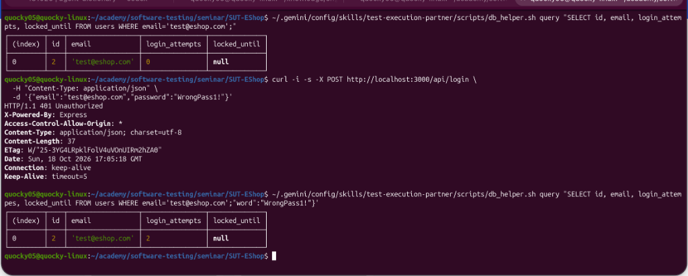
- *Đường dẫn GitHub Issue:* [https://github.com/faker26052005-lgtm/SUT-EShop/issues/4](https://github.com/faker26052005-lgtm/SUT-EShop/issues/4)

**7. Phân tích nguyên nhân & Khắc phục (Root Cause Analysis):**
- **Vị trí lỗi:** File `backend/server.js`, dòng 54.
- **Đoạn mã gây lỗi:**
  ```javascript
  const newAttempts = user.login_attempts + 2;
  ```
- **Khắc phục:** Sửa phép cộng thành tăng 1 đơn vị:
  ```javascript
  const newAttempts = user.login_attempts + 1;
  ```

---

#### [BUG-FR02-02] Khóa tài khoản sớm tại lần thử sai thứ 2 với thời gian phạt 180s thay vì 30s

| Trường thông tin | Chi tiết |
| :--- | :--- |
| **Bug ID** | `BUG-FR02-02` |
| **Tiêu đề Bug** | `[FR-02][Backend API / SQLite DB] Premature account lockout triggered at attempt N=2 with excessive 180s duration` |
| **Chức năng (Feature)** | FR-02: Đăng nhập & Khóa tài khoản (Pool A) |
| **Môi trường thử nghiệm**| Web: `http://localhost:5173` • Backend: `http://localhost:3000` • Node v18.19 • Linux |
| **Mức độ (Severity)** | **Critical** (Khóa oan tài khoản người dùng hợp lệ và phạt thời gian vượt mức 6 lần quy định) |
| **Mức ưu tiên (Priority)**| **High (P1)** |
| **Test Case phát hiện** | [`TC_FR02_04`](Main_Report.md#tc_fr02_04) (Thử sai lần 2 - Biên Off-point trước ngưỡng khóa) |
| **GitHub Issue Link** | [Issue #5: [BUG] [FR-02][Backend API / SQLite DB] Premature account lockout triggered at attempt N=2 with excessive 180s duration](https://github.com/faker26052005-lgtm/SUT-EShop/issues/5) |
| **Người báo cáo** | Nguyễn Quốc Kỳ (23120138) |

**1. Tiền điều kiện (Preconditions):**
- Tài khoản người dùng `test@eshop.com` đang tích lũy 1 lần đăng nhập sai trước đó: `login_attempts = 1`, `locked_until = NULL`.
- SUT backend đang chạy tại `http://localhost:3000`.

**2. Các bước tái hiện (Steps to Reproduce):**
1. Gửi yêu cầu đăng nhập lần thứ 2 với email `test@eshop.com` và mật khẩu không chính xác `WrongPass2!`:
   ```bash
   curl -i -s -X POST http://localhost:3000/api/login \
     -H "Content-Type: application/json" \
     -d '{"email":"test@eshop.com","password":"WrongPass2!"}'
   ```
2. Truy vấn SQLite kiểm tra giá trị hai cột `login_attempts` và `locked_until` của tài khoản `test@eshop.com`:
   ```bash
   SELECT id, email, login_attempts, locked_until FROM users WHERE email='test@eshop.com';
   ```

**3. Dữ liệu thử nghiệm (Test Data):**
```json
{
  "email": "test@eshop.com",
  "password": "WrongPass2!"
}
```

**4. Kết quả mong đợi (Expected Result theo SRS FR-02):**
> *Trích dẫn SRS FR-02 (Mục 2 & 3):* "Sau mỗi lần đăng nhập sai, hệ thống tăng bộ đếm số lần đăng nhập sai liên tiếp lên đúng 1 đơn vị. Nếu đăng nhập sai từ 3 lần trở lên liên tiếp, tài khoản bị tạm khóa 30 giây (môi trường demo)."
- Tại lần thử sai thứ 2 ($N=2$, điểm Off-point trước ngưỡng khóa 3):
  - HTTP Status: `401 Unauthorized` (`{"error": "Invalid email or password"}`).
  - Trong CSDL SQLite: `login_attempts` phải tăng từ `1` lên **đúng `2`** ($N=2$).
  - Trường `locked_until` phải tiếp tục giữ nguyên là `NULL` (chưa kích hoạt khóa).
- Khi tài khoản đạt ngưỡng khóa ($N=3$), thời hạn phạt chỉ được là 30 giây.

**5. Kết quả thực tế (Actual Result):**
- Endpoint `POST /api/login` trả về HTTP `401 Unauthorized`.
- Tuy nhiên trong CSDL SQLite:
  - `login_attempts` bị tăng vọt từ `1` lên **`3`** (do lỗi logic `+ 2`).
  - Do `newAttempts >= 3`, hệ thống kích hoạt khóa tài khoản non ngay tại lần thử thứ 2 ($N=2$).
  - Thời hạn khóa `locked_until` bị đặt thành **180 giây** (`2026-10-18T17:38:17.793Z` so với thời điểm gửi `17:35:17 GMT`), dài gấp 6 lần quy định 30 giây của SRS.
- HTTP Status Code: `401 Unauthorized`
- Database Mutation: `login_attempts` = 3, `locked_until` = `2026-10-18T17:38:17.793Z` (+180s)

**6. Bằng chứng kiểm thử (Screenshots & Logs):**
- *Ảnh chụp bằng chứng terminal & database:*  
  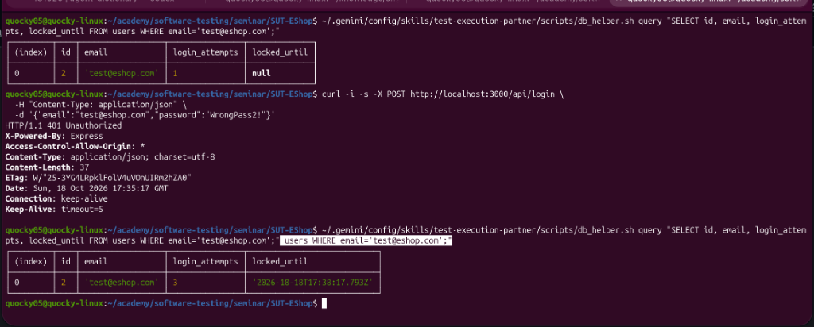
- *Đường dẫn GitHub Issue:* [https://github.com/faker26052005-lgtm/SUT-EShop/issues/5](https://github.com/faker26052005-lgtm/SUT-EShop/issues/5)

**7. Phân tích nguyên nhân & Khắc phục (Root Cause Analysis):**
- **Vị trí lỗi:** File `backend/server.js`, dòng 54–58.
- **Đoạn mã gây lỗi:**
  ```javascript
  const newAttempts = user.login_attempts + 2;
  let lockedUntil = null;
  if (newAttempts >= 3) {
    lockedUntil = new Date(Date.now() + 180000).toISOString();
  }
  ```
- **Khắc phục:** 
  1. Đổi phép cộng sang tăng 1 đơn vị: `user.login_attempts + 1`.
  2. Đổi thời gian khóa về đúng 30 giây theo SRS demo: `Date.now() + 30000`.
  ```javascript
  const newAttempts = user.login_attempts + 1;
  let lockedUntil = null;
  if (newAttempts >= 3) {
    lockedUntil = new Date(Date.now() + 30000).toISOString();
  }
  ```

---

#### [BUG-FR02-03] Bộ đếm số lần đăng nhập sai nhảy vọt lên 4 thay vì 3 tại lần thử sai thứ 3

| Trường thông tin | Chi tiết |
| :--- | :--- |
| **Bug ID** | `BUG-FR02-03` |
| **Tiêu đề Bug** | `[FR-02][Backend API / SQLite DB] Failure counter jumps to 4 instead of 3 upon reaching consecutive failure threshold` |
| **Chức năng (Feature)** | FR-02: Đăng nhập & Khóa tài khoản (Pool A) |
| **Môi trường thử nghiệm**| Web: `http://localhost:5173` • Backend: `http://localhost:3000` • Node v18.19 • Linux |
| **Mức độ (Severity)** | **Major** (Sai lệch trạng thái bộ đếm bảo mật tại điểm On-point kích hoạt ngưỡng khóa) |
| **Mức ưu tiên (Priority)**| **High (P1)** |
| **Test Case phát hiện** | [`TC_FR02_06`](Main_Report.md#tc_fr02_06) (Thử sai lần 3 - Điểm biên On-point kích hoạt ngưỡng khóa $N = 3$) |
| **GitHub Issue Link** | [Issue #6: [BUG] [FR-02][Backend API / SQLite DB] Failure counter jumps to 4 instead of 3 upon reaching consecutive failure threshold](https://github.com/faker26052005-lgtm/SUT-EShop/issues/6) |
| **Người báo cáo** | Nguyễn Quốc Kỳ (23120138) |

**1. Tiền điều kiện (Preconditions):**
- Tài khoản người dùng `test@eshop.com` đang tích lũy 2 lần đăng nhập sai trước đó: `login_attempts = 2`, `locked_until = NULL`.
- SUT backend đang hoạt động tại `http://localhost:3000`.

**2. Các bước tái hiện (Steps to Reproduce):**
1. Gửi yêu cầu đăng nhập lần thứ 3 liên tiếp với email `test@eshop.com` và mật khẩu không chính xác `WrongPass3!`:
   ```bash
   curl -i -s -X POST http://localhost:3000/api/login \
     -H "Content-Type: application/json" \
     -d '{"email":"test@eshop.com","password":"WrongPass3!"}'
   ```
2. Truy vấn SQLite kiểm tra giá trị hai cột `login_attempts` và `locked_until` của tài khoản `test@eshop.com`:
   ```bash
   SELECT id, email, login_attempts, locked_until FROM users WHERE email='test@eshop.com';
   ```

**3. Dữ liệu thử nghiệm (Test Data):**
```json
{
  "email": "test@eshop.com",
  "password": "WrongPass3!"
}
```

**4. Kết quả mong đợi (Expected Result theo SRS FR-02):**
> *Trích dẫn SRS FR-02 (Mục 2 & 3):* "Sau mỗi lần đăng nhập sai, hệ thống tăng bộ đếm số lần đăng nhập sai liên tiếp lên đúng 1 đơn vị. Nếu đăng nhập sai từ 3 lần trở lên liên tiếp, tài khoản bị tạm khóa 30 giây (môi trường demo)."
- Tại lần thử sai thứ 3 ($N=3$, điểm On-point kích hoạt ngưỡng khóa):
  - HTTP Status: `401 Unauthorized` hoặc `403 Forbidden`.
  - Trong CSDL SQLite: `login_attempts` phải tăng từ `2` lên **đúng `3`** ($N=3$).
  - Trường `locked_until` được gán mốc hết hạn đúng $T_{trigger} + 30\text{ giây}$.

**5. Kết quả thực tế (Actual Result):**
- Endpoint `POST /api/login` trả về HTTP `401 Unauthorized`.
- Trong CSDL SQLite:
  - `login_attempts` bị tăng vọt từ `2` lên **`4`** ($N=4$) do lỗi logic `user.login_attempts + 2`.
  - `locked_until` được gán giá trị thời gian 180 giây (3 phút) sau đó thay vì 30 giây.
- HTTP Status Code: `401 Unauthorized`
- Database Mutation: `login_attempts` = 4, `locked_until` = `2026-10-18T17:49:37.416Z`

**6. Bằng chứng kiểm thử (Screenshots & Logs):**
- *Ảnh chụp bằng chứng terminal & database:*  
  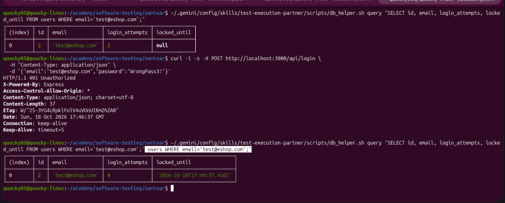
- *Đường dẫn GitHub Issue:* [https://github.com/faker26052005-lgtm/SUT-EShop/issues/6](https://github.com/faker26052005-lgtm/SUT-EShop/issues/6)

**7. Phân tích nguyên nhân & Khắc phục (Root Cause Analysis):**
- **Vị trí lỗi:** File `backend/server.js`, dòng 54.
- **Đoạn mã gây lỗi:**
  ```javascript
  const newAttempts = user.login_attempts + 2;
  ```
- **Khắc phục:** Sửa phép cộng thành tăng 1 đơn vị:
  ```javascript
  const newAttempts = user.login_attempts + 1;
  ```

---

#### [BUG-FR02-04] Đăng nhập bằng mật khẩu đúng trong khi đang bị khóa vẫn thành công và tự gỡ khóa

| Trường thông tin | Chi tiết |
| :--- | :--- |
| **Bug ID** | `BUG-FR02-04` |
| **Tiêu đề Bug** | `[FR-02][Backend API / Security] Correct password bypasses active account lockout and clears lockout state` |
| **Chức năng (Feature)** | FR-02: Đăng nhập & Khóa tài khoản (Pool A) |
| **Môi trường thử nghiệm**| Web: `http://localhost:5173` • Backend: `http://localhost:3000` • Node v18.19 • Linux |
| **Mức độ (Severity)** | **Critical** (Lỗ hổng bảo mật nghiêm trọng: Bỏ qua cơ chế khóa tài khoản và tự giải phóng trạng thái phạt) |
| **Mức ưu tiên (Priority)**| **High (P1)** |
| **Test Case phát hiện** | [`TC_FR02_07`](Main_Report.md#tc_fr02_07) (Thử đăng nhập bằng mật khẩu đúng trong thời gian khóa) |
| **GitHub Issue Link** | [Issue #7: [BUG] [FR-02][Backend API / Security] Correct password bypasses active account lockout and clears lockout state](https://github.com/faker26052005-lgtm/SUT-EShop/issues/7) |
| **Người báo cáo** | Nguyễn Quốc Kỳ (23120138) |

**1. Tiền điều kiện (Preconditions):**
- Tài khoản người dùng `test@eshop.com` đang trong thời gian bị tạm khóa (`locked_until` có giá trị trong tương lai).
- SUT backend đang chạy tại `http://localhost:3000`.

**2. Các bước tái hiện (Steps to Reproduce):**
1. Kiểm tra CSDL SQLite để xác nhận mốc `locked_until` của tài khoản `test@eshop.com` đang có hiệu lực trong tương lai.
2. Gửi yêu cầu đăng nhập với email `test@eshop.com` và mật khẩu đúng `Test1234!` trong thời gian tài khoản đang bị khóa:
   ```bash
   curl -i -s -X POST http://localhost:3000/api/login \
     -H "Content-Type: application/json" \
     -d '{"email":"test@eshop.com","password":"Test1234!"}'
   ```
3. Truy vấn lại CSDL SQLite để kiểm tra xem tài khoản có bị gỡ khóa sớm hay không:
   ```bash
   SELECT id, email, login_attempts, locked_until FROM users WHERE email='test@eshop.com';
   ```

**3. Dữ liệu thử nghiệm (Test Data):**
```json
{
  "email": "test@eshop.com",
  "password": "Test1234!"
}
```

**4. Kết quả mong đợi (Expected Result theo SRS FR-02):**
> *Trích dẫn SRS FR-02 (Mục 3):* "Trong thời gian tài khoản bị tạm khóa, mọi yêu cầu đăng nhập (kể cả khi nhập đúng thông tin) đều bị hệ thống từ chối."
- Endpoint `POST /api/login` trả về HTTP `403 Forbidden` (`{"error": "Tài khoản đã bị khóa. Vui lòng thử lại sau."}`).
- Tuyệt đối không cấp JWT token cho phiên làm việc.
- Trong CSDL SQLite, trường `locked_until` phải giữ nguyên, không được tự ý xóa hoặc mở khóa sớm.

**5. Kết quả thực tế (Actual Result):**
- Endpoint `POST /api/login` trả về HTTP `200 OK` (`{"message": "Login successful"}`).
- Cấp JWT token hợp lệ và cho phép người dùng đăng nhập thành công vào hệ thống.
- Trong CSDL SQLite, trường `locked_until` bị xóa về `NULL`, chấm dứt thời gian phạt khóa tài khoản ngay lập tức.
- HTTP Status Code: `200 OK`
- Database Mutation: `locked_until` = null (mở khóa trái phép)

**6. Bằng chứng kiểm thử (Screenshots & Logs):**
- *Ảnh chụp bằng chứng terminal & database:*  
  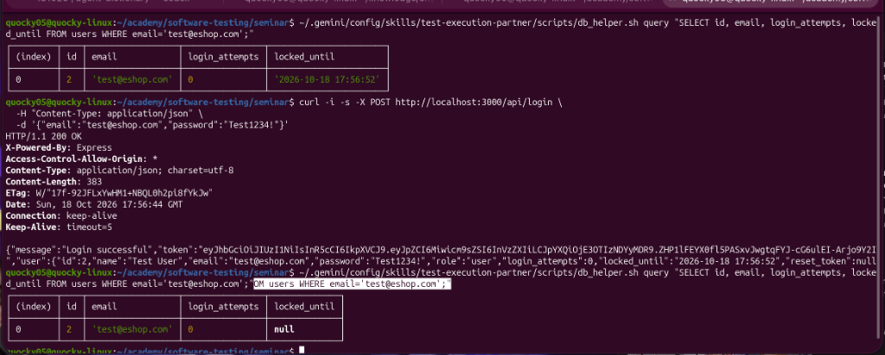
- *Đường dẫn GitHub Issue:* [https://github.com/faker26052005-lgtm/SUT-EShop/issues/7](https://github.com/faker26052005-lgtm/SUT-EShop/issues/7)

**7. Phân tích nguyên nhân & Khắc phục (Root Cause Analysis):**
- **Vị trí lỗi:** File `backend/server.js`, dòng 40–52.
- **Đoạn mã gây lỗi:**
  ```javascript
  if (user.locked_until && new Date() < new Date(user.locked_until)) {
    return res
      .status(403)
      .json({ error: "Tài khoản đã bị khóa. Vui lòng thử lại sau." });
  }

  if (user.password === password) {
    db.run(
      "UPDATE users SET login_attempts = 0, locked_until = NULL WHERE id = ?",
      [user.id],
    );
    const token = jwt.sign({ id: user.id, role: user.role }, SECRET_KEY);
    res.json({ message: "Login successful", token, user });
  }
  ```
- **Nguyên nhân:**
  1. Khi chuỗi `locked_until` trong SQLite không có hậu tố `Z`, JavaScript diễn giải theo giờ Local (GMT+7), làm lệch 7 giờ so với `new Date()` (UTC), khiến điều kiện `new Date() < new Date(user.locked_until)` bị sai (false).
  2. Khi vượt qua điều kiện kiểm tra, khối `if (user.password === password)` lập tức thực thi câu lệnh SQL xóa `locked_until = NULL`, làm sụp đổ hoàn toàn cơ chế khóa bảo mật.
- **Khắc phục:** Chuẩn hóa so sánh múi giờ UTC hoặc ép định dạng ISO, và chặn hoàn toàn nhánh reset khi đang trong thời gian khóa:
  ```javascript
  const lockedTime = user.locked_until ? new Date(user.locked_until.includes('T') ? user.locked_until : user.locked_until.replace(' ', 'T') + 'Z') : null;
  if (lockedTime && new Date() < lockedTime) {
    return res
      .status(403)
      .json({ error: "Tài khoản đã bị khóa. Vui lòng thử lại sau." });
  }
  ```

---

#### [BUG-FR02-05] Form đăng nhập dùng input type="text" cho email, bỏ qua hoàn toàn HTML5 format validation

| Trường thông tin | Chi tiết |
| :--- | :--- |
| **Bug ID** | `BUG-FR02-05` |
| **Tiêu đề Bug** | `[FR-02][Web UI] Email input uses type="text" instead of type="email", bypassing HTML5 format validation` |
| **Chức năng (Feature)** | FR-02: Đăng nhập & Khóa tài khoản (Pool A) / Web Client UI |
| **Môi trường thử nghiệm**| Web: `http://localhost:5173` • Backend: `http://localhost:3000` • Node v18.19 • Linux |
| **Mức độ (Severity)** | **Major** (Bỏ qua cơ chế validate định dạng email client-side bắt buộc theo đặc tả SRS) |
| **Mức ưu tiên (Priority)**| **High (P1)** |
| **Test Case phát hiện** | [`TC_FR02_14`](Main_Report.md#tc_fr02_14) (Single-Fault Boundary: Email thiếu ký tự `@`) |
| **GitHub Issue Link** | [Issue #8: [BUG] [FR-02][Web UI] Email input uses type="text" instead of type="email", bypassing HTML5 format validation](https://github.com/faker26052005-lgtm/SUT-EShop/issues/8) |
| **Người báo cáo** | Nguyễn Quốc Kỳ (23120138) |

**1. Tiền điều kiện (Preconditions):**
- SUT Web frontend đang chạy tại `http://localhost:5173`.
- Người dùng truy cập trang đăng nhập `http://localhost:5173/login`.

**2. Các bước tái hiện (Steps to Reproduce):**
1. Mở trang đăng nhập tại `http://localhost:5173/login`.
2. Tại trường nhập liệu email đầu tiên (đang gắn nhãn sai là "Username"), nhập chuỗi email không hợp lệ thiếu `@`: `testeshop.com`.
3. Tại ô mật khẩu, nhập `Test1234!`.
4. Bấm nút "Sign In" (hoặc nhấn Enter).

**3. Dữ liệu thử nghiệm (Test Data):**
```json
{
  "email": "testeshop.com",
  "password": "Test1234!"
}
```

**4. Kết quả mong đợi (Expected Result theo SRS FR-02):**
> *Trích dẫn SRS FR-02 (Mục 5):* "Trường email phải dùng `type="email"` (có validate HTML5 format)."
- Trình duyệt hiển thị tooltip/cảnh báo HTML5: *"Please include an '@' in the email address..."* (hoặc tiếng Việt tương đương).
- Form bị chặn gửi ở Client, không gửi HTTP POST `/api/login` lên backend khi định dạng email sai.

**5. Kết quả thực tế (Actual Result):**
- Trường nhập email được lập trình với `type="text"` (nhãn là "Username") thay vì `type="email"`.
- Trình duyệt không kích hoạt HTML5 format validation, cho phép submit thẳng payload `testeshop.com` lên server.
- Backend nhận request sai định dạng và trả về HTTP `401 Unauthorized` (`{"error":"Invalid email or password"}`).
- *(Các lỗi giao diện liên quan phát hiện đồng thời: Tiêu đề trang đăng nhập hiển thị "Đăng Ký" thay vì "Đăng Nhập", và ô mật khẩu dùng `type="text"` làm lộ plaintext password).*
- HTTP Status Code: `401 Unauthorized`
- Client Behavior: Không kích hoạt HTML5 format validation

**6. Bằng chứng kiểm thử (Screenshots & Logs):**
- *Ảnh chụp bằng chứng giao diện Web UI & API:*  
  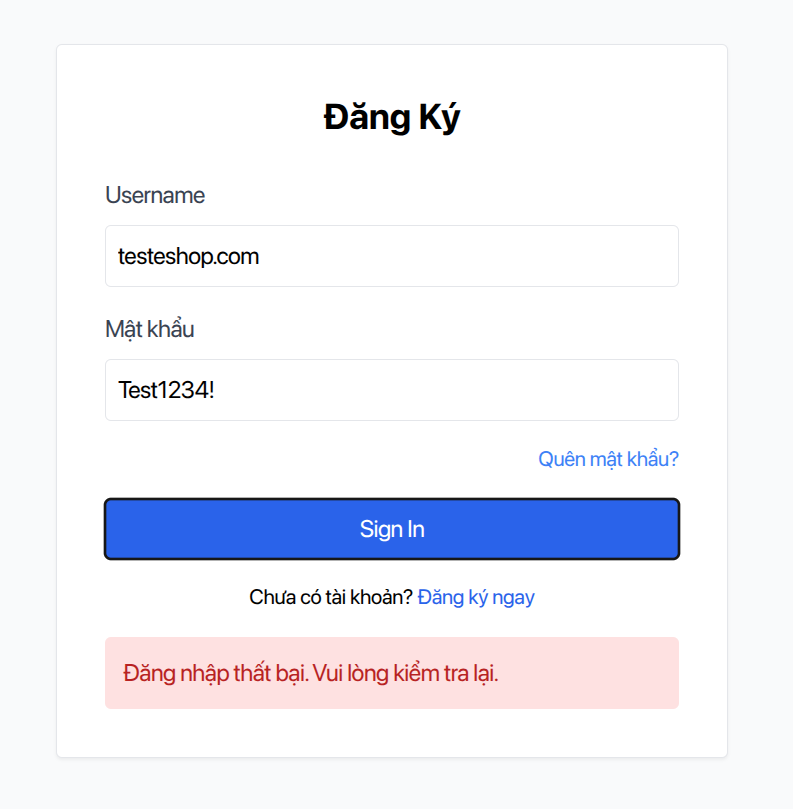
- *Đường dẫn GitHub Issue:* [https://github.com/faker26052005-lgtm/SUT-EShop/issues/8](https://github.com/faker26052005-lgtm/SUT-EShop/issues/8)

**7. Phân tích nguyên nhân & Khắc phục (Root Cause Analysis):**
- **Vị trí lỗi:** File `frontend-web/src/pages/Login.jsx`, các dòng 24, 28–35, 38–46.
- **Đoạn mã gây lỗi:**
  ```jsx
  <h2 className="text-2xl font-bold mb-6 text-center">Đăng Ký</h2>
  <form onSubmit={handleSubmit} className="space-y-4">
    <div>
      <label className="block text-gray-700 mb-2">Username</label>
      <input
        type="text"
        value={email}
        onChange={(e) => setEmail(e.target.value)}
        className="w-full border p-2 rounded"
        required
      />
    </div>
  ```
- **Khắc phục:** Sửa type thành `email`, nhãn thành "Email", sửa tiêu đề "Đăng Nhập", và ô mật khẩu dùng `type="password"`:
  ```jsx
  <h2 className="text-2xl font-bold mb-6 text-center">Đăng Nhập</h2>
  <form onSubmit={handleSubmit} className="space-y-4">
    <div>
      <label className="block text-gray-700 mb-2">Email</label>
      <input
        type="email"
        value={email}
        onChange={(e) => setEmail(e.target.value)}
        className="w-full border p-2 rounded"
        required
      />
    </div>
  ```

---

### 2.2 Các lỗi thuộc Pool B: FR-07 – Giỏ hàng (Shopping Cart)

#### [BUG-FR07-01] Nút "Thêm vào giỏ hàng" tại trang chi tiết sản phẩm bỏ qua lần bấm đầu tiên

| Trường thông tin | Chi tiết |
| :--- | :--- |
| **Bug ID** | `BUG-FR07-01` |
| **Tiêu đề Bug** | `[FR-07][Web UI] Add to cart button on Product Detail page ignores first click` |
| **Chức năng (Feature)** | FR-07: Giỏ hàng (Shopping Cart - Pool B) |
| **Môi trường thử nghiệm**| Web: `http://localhost:5173` • Backend: `http://localhost:3000` • Node v24.21 • Linux |
| **Mức độ (Severity)** | **Major** (Làm gián đoạn luồng đặt hàng chính của khách hàng) |
| **Mức ưu tiên (Priority)**| **High (P1)** |
| **Test Case phát hiện** | [`TC_FR07_01`](Main_Report.md#tc_fr07_01) (Verify adding a new valid product to empty cart) |
| **GitHub Issue Link** | [Issue #9: [BUG] [FR-07][Web UI] Add to cart button on Product Detail page ignores first click](https://github.com/faker26052005-lgtm/SUT-EShop/issues/9) |
| **Người báo cáo** | Nguyễn Quốc Kỳ (23120138) |

**1. Tiền điều kiện (Preconditions):**
- Giỏ hàng của người dùng đang hoàn toàn trống (`cart.length === 0`).
- SUT backend và frontend-web đang chạy tại `:3000` và `:5173`.
- CSDL có sản phẩm ID 1 (`iPhone 15 Pro Max`).

**2. Các bước tái hiện (Steps to Reproduce):**
1. Mở trình duyệt, truy cập trang chi tiết sản phẩm: `http://localhost:5173/product/1`.
2. Giữ nguyên số lượng mặc định là `1`.
3. Nhấn nút "Thêm vào giỏ hàng" **1 lần duy nhất**.
4. Quan sát phản hồi trên giao diện (nút không chuyển sang "Đã thêm").
5. Nhấn vào mục "Giỏ hàng" trên thanh Header (`http://localhost:5173/cart`).

**3. Dữ liệu thử nghiệm (Test Data):**
```json
{
  "product_id": 1,
  "quantity": 1
}
```

**4. Kết quả mong đợi (Expected Result theo SRS FR-07):**
> *Trích dẫn SRS FR-07 (Mục 1):* "Hiển thị danh sách sản phẩm với các cột: Sản phẩm, Đơn giá, Số lượng (có nút +/- để chỉnh), Thành tiền, Thao tác."
- Khi nhấn nút "Thêm vào giỏ hàng" trên trang chi tiết sản phẩm, nút phải đổi trạng thái xác nhận thành công ("Đã thêm"), sản phẩm được cập nhật vào CartContext.
- Trang giỏ hàng `/cart` hiển thị bảng gồm 1 dòng sản phẩm iPhone 15 Pro Max, đơn giá 30.000.000 ₫, số lượng 1, thành tiền 30.000.000 ₫ và tổng tiền 30.000.000 ₫.

**5. Kết quả thực tế (Actual Result):**
- Khi người dùng nhấn "Thêm vào giỏ hàng" lần đầu tiên, giao diện hoàn toàn không có phản hồi và sản phẩm không hề được đưa vào giỏ hàng.
- Khi điều hướng sang `/cart`, màn hình hiển thị: *"Giỏ hàng của bạn đang trống"*.
- Người dùng buộc phải nhấn nút lần thứ 2 liên tiếp thì sản phẩm mới được thêm vào.
- State Client: `cart` vẫn là mảng rỗng `[]` sau lần bấm đầu tiên.

**6. Bằng chứng kiểm thử (Screenshots & Logs):**
- *Ảnh chụp bằng chứng giao diện Web UI:*  
  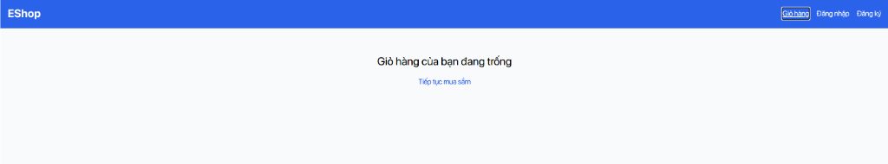
- *Đường dẫn GitHub Issue:* [https://github.com/faker26052005-lgtm/SUT-EShop/issues/9](https://github.com/faker26052005-lgtm/SUT-EShop/issues/9)

**7. Phân tích nguyên nhân & Khắc phục (Root Cause Analysis):**
- **Vị trí lỗi:** File `frontend-web/src/pages/ProductDetail.jsx`, các dòng 21–25.
- **Đoạn mã gây lỗi:**
  ```javascript
  const handleAddToCart = () => {
    if (clickCount === 0) {
      setClickCount(1);
      return; // Không làm gì cả ở lần đầu tiên
    }

    addToCart(product, parseInt(quantity));
    setAdded(true);
    setClickCount(0); // Reset lại
    setTimeout(() => setAdded(false), 2000);
  };
  ```
- **Khắc phục:** Loại bỏ điều kiện `clickCount === 0`, kích hoạt `addToCart` ngay trong lần nhấn đầu:
  ```javascript
  const handleAddToCart = () => {
    addToCart(product, parseInt(quantity));
    setAdded(true);
    setTimeout(() => setAdded(false), 2000);
  };
  ```

---

#### [BUG-FR07-02] Thêm cùng sản phẩm tạo dòng mới riêng biệt thay vì tăng số lượng

| Trường thông tin | Chi tiết |
| :--- | :--- |
| **Bug ID** | `BUG-FR07-02` |
| **Tiêu đề Bug** | `[FR-07][Web UI] Adding duplicate product creates new row instead of incrementing quantity` |
| **Chức năng (Feature)** | FR-07: Giỏ hàng (Shopping Cart - Pool B) |
| **Môi trường thử nghiệm**| Web: `http://localhost:5173` • Backend: `http://localhost:3000` • Node v24.21 • Linux |
| **Mức độ (Severity)** | **Major** (Vi phạm trực tiếp quy tắc gộp dòng sản phẩm theo SRS FR-07) |
| **Mức ưu tiên (Priority)**| **High (P1)** |
| **Test Case phát hiện** | [`TC_FR07_02`](Main_Report.md#tc_fr07_02) (Verify adding duplicate product increments quantity without creating new row) |
| **GitHub Issue Link** | [Issue #10: [BUG] [FR-07][Web UI] Adding duplicate product creates new row instead of incrementing quantity](https://github.com/faker26052005-lgtm/SUT-EShop/issues/10) |
| **Người báo cáo** | Nguyễn Quốc Kỳ (23120138) |

**1. Tiền điều kiện (Preconditions):**
- Hệ thống backend và web đang hoạt động bình thường.
- Giỏ hàng của người dùng đã có sẵn 1 sản phẩm ID 1 (`iPhone 15 Pro Max`) với số lượng $Q = 1$.

**2. Các bước tái hiện (Steps to Reproduce):**
1. Đảm bảo giỏ hàng đã có 1 sản phẩm `iPhone 15 Pro Max` ($Q=1$).
2. Từ trang chủ hoặc trang sản phẩm, thực hiện thao tác thêm tiếp sản phẩm `iPhone 15 Pro Max` lần thứ hai ($Q_{add}=1$).
3. Điều hướng vào trang giỏ hàng `http://localhost:5173/cart`.
4. Quan sát cấu trúc các dòng trong bảng giỏ hàng.

**3. Dữ liệu thử nghiệm (Test Data):**
```json
{
  "product_id": 1,
  "quantity_added": 1
}
```

**4. Kết quả mong đợi (Expected Result theo SRS FR-07):**
> *Trích dẫn SRS FR-07 (Mục 2):* "Thêm cùng một sản phẩm vào giỏ sẽ tăng số lượng, không tạo dòng mới."
- Bảng giỏ hàng duy trì **chính xác 1 dòng duy nhất** cho sản phẩm `iPhone 15 Pro Max`.
- Cột Số lượng tự động cộng dồn: $Q = 1 + 1 = 2$.
- Cột Thành tiền: $30.000.000 \times 2 = 60.000.000\text{ ₫}$.
- Tổng tiền hiển thị $60.000.000\text{ ₫}$.

**5. Kết quả thực tế (Actual Result):**
- Bảng giỏ hàng sinh ra **dòng thứ hai riêng biệt** cho cùng sản phẩm `iPhone 15 Pro Max`.
- Cả hai dòng đều hiển thị `Số lượng: 1` và `Thành tiền: 30,000,000 ₫`.
- Mặc dù tổng tiền cộng đúng thành $60.000.000\text{ ₫}$, nhưng việc tách thành 2 dòng riêng biệt vi phạm nghiêm trọng quy chuẩn UX và logic giỏ hàng của SRS.

**6. Bằng chứng kiểm thử (Screenshots & Logs):**
- *Ảnh chụp trước khi thêm (1 dòng):*  
  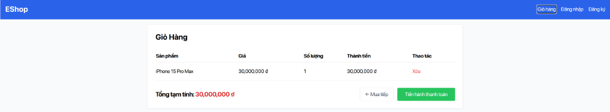
- *Ảnh chụp sau khi thêm trùng lặp (Lỗi 2 dòng):*  
  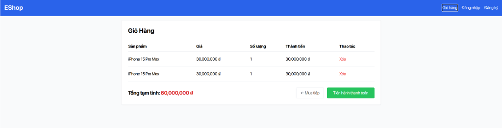
- *Đường dẫn GitHub Issue:* [https://github.com/faker26052005-lgtm/SUT-EShop/issues/10](https://github.com/faker26052005-lgtm/SUT-EShop/issues/10)

**7. Phân tích nguyên nhân & Khắc phục (Root Cause Analysis):**
- **Vị trí lỗi:** File `frontend-web/src/context/CartContext.jsx`, các dòng 8–10.
- **Đoạn mã gây lỗi:**
  ```javascript
  const addToCart = (product, quantity) => {
    setCart([...cart, { ...product, quantity }]);
  };
  ```
- **Khắc phục:** Kiểm tra nếu sản phẩm đã tồn tại thì cộng dồn `quantity`, ngược lại mới append phần tử mới:
  ```javascript
  const addToCart = (product, quantity) => {
    const existingIndex = cart.findIndex((item) => item.id === product.id);
    if (existingIndex > -1) {
      const newCart = [...cart];
      newCart[existingIndex].quantity += quantity;
      setCart(newCart);
    } else {
      setCart([...cart, { ...product, quantity }]);
    }
  };
  ```

---

#### [BUG-FR07-03] Endpoint POST /api/cart chấp nhận ID sản phẩm không tồn tại (9999) mà không kiểm tra CSDL

| Trường thông tin | Chi tiết |
| :--- | :--- |
| **Bug ID** | `BUG-FR07-03` |
| **Tiêu đề Bug** | `[FR-07][Backend API] Endpoint POST /api/cart accepts non-existent product ID (9999) without validation` |
| **Chức năng (Feature)** | FR-07: Giỏ hàng (Shopping Cart API - Pool B) |
| **Môi trường thử nghiệm**| Web: `http://localhost:5173` • Backend: `http://localhost:3000` • Node v24.21 • Linux |
| **Mức độ (Severity)** | **Major** (Lỗi toàn vẹn dữ liệu: cho phép lưu sản phẩm rác/không tồn tại vào giỏ hàng người dùng) |
| **Mức ưu tiên (Priority)**| **High (P1)** |
| **Test Case phát hiện** | [`TC_FR07_03`](Main_Report.md#tc_fr07_03) (Validate rejection when adding well-formed non-existent product ID) |
| **GitHub Issue Link** | [Issue #11: [BUG] [FR-07][Backend API] Endpoint POST /api/cart accepts non-existent product ID (9999) without validation](https://github.com/faker26052005-lgtm/SUT-EShop/issues/11) |
| **Người báo cáo** | Nguyễn Quốc Kỳ (23120138) |

**1. Tiền điều kiện (Preconditions):**
- Backend EShop đang chạy tại cổng `:3000`.
- Người dùng `test@eshop.com` có JWT Bearer token hợp lệ.
- CSDL SQLite hoàn toàn không chứa sản phẩm có `id = 9999`.

**2. Các bước tái hiện (Steps to Reproduce):**
1. Lấy Bearer token đăng nhập cho tài khoản `test@eshop.com`.
2. Gửi request HTTP `POST /api/cart` kèm payload chứa `id = 9999`:
   ```bash
   curl -i -s -X POST http://localhost:3000/api/cart \
     -H "Authorization: Bearer $TOKEN" \
     -H "Content-Type: application/json" \
     -d '{"id": 9999, "price": 100000, "quantity": 1}'
   ```
3. Gửi request `GET http://localhost:3000/api/cart` để kiểm tra giỏ hàng người dùng.
4. (Giao diện Web): Truy cập `http://localhost:5173/product/9999`.

**3. Dữ liệu thử nghiệm (Test Data):**
```json
{
  "id": 9999,
  "price": 100000,
  "quantity": 1
}
```

**4. Kết quả mong đợi (Expected Result theo SRS FR-07 & API Spec §4.2):**
> *Trích dẫn API Spec §4.2 & SRS FR-07:* "Từ chối thêm sản phẩm không tồn tại vào giỏ hàng."
- Backend bắt buộc phải truy vấn CSDL SQLite kiểm tra sự tồn tại của sản phẩm trước khi cập nhật giỏ hàng.
- Endpoint `POST /api/cart` phải từ chối request với mã lỗi HTTP `404 Not Found` hoặc `400 Bad Request` (`{"error": "Product not found"}`).
- Giỏ hàng của người dùng không được phép chứa ID 9999.

**5. Kết quả thực tế (Actual Result):**
- Endpoint `POST /api/cart` trả về HTTP `200 OK` (`{"message":"Added to cart"}`).
- Gọi `GET /api/cart` phát hiện bản ghi rác `{"id":9999, "price":100000, "quantity":1}` đã bị chèn trực tiếp vào mảng giỏ hàng của user.
- Trên giao diện Web:
  - Route `/product/9999` hiển thị thông báo thô: `"Sản phẩm không tồn tại (Lỗi trắng trang do data rỗng)"` do dev hardcode.
  - Route số nhiều `/products/9999` bị trắng trang hoàn toàn.

**6. Bằng chứng kiểm thử (Screenshots & Logs):**
- *Ảnh chụp terminal kiểm thử API (200 OK & chèn bản ghi 9999):*  
  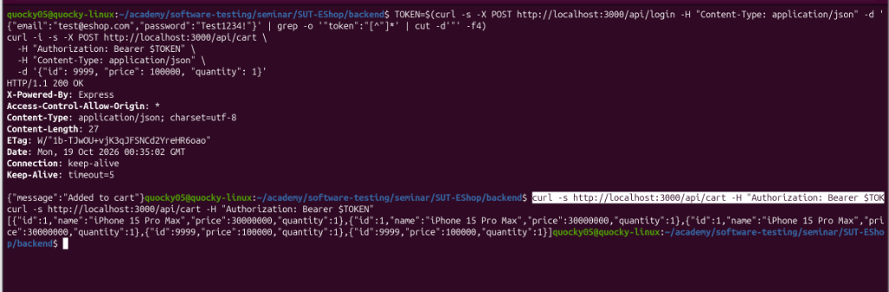
- *Ảnh chụp Web UI /product/9999:*  
  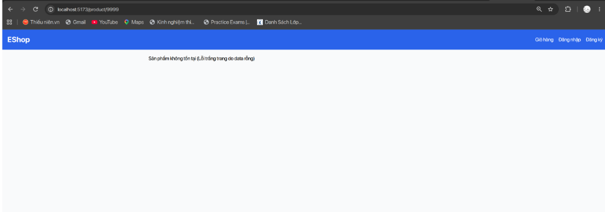
- *Ảnh chụp Web UI /products/9999 (Trắng trang):*  
  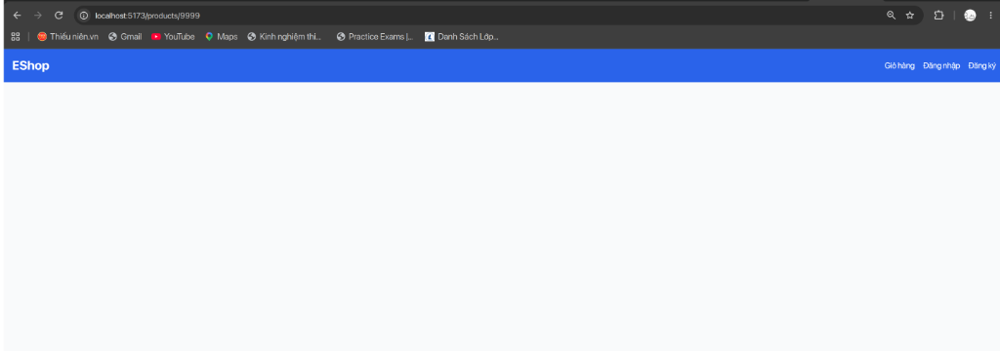
- *Đường dẫn GitHub Issue:* [https://github.com/faker26052005-lgtm/SUT-EShop/issues/11](https://github.com/faker26052005-lgtm/SUT-EShop/issues/11)

**7. Phân tích nguyên nhân & Khắc phục (Root Cause Analysis):**
- **Vị trí lỗi:** File `backend/server.js`, các dòng 290–295.
- **Đoạn mã gây lỗi:**
  ```javascript
  app.post("/api/cart", authenticateToken, (req, res) => {
    const userId = req.user.id;
    if (!userCarts[userId]) userCarts[userId] = [];
    userCarts[userId].push(req.body);
    res.json({ message: "Added to cart" });
  });
  ```
- **Khắc phục:** Thêm bước kiểm tra CSDL SQLite trước khi thêm vào giỏ:
  ```javascript
  app.post("/api/cart", authenticateToken, (req, res) => {
    const userId = req.user.id;
    const { id, quantity } = req.body;
    if (!id) return res.status(400).json({ error: "Product ID is required" });

    db.get("SELECT id, name, price FROM products WHERE id = ?", [id], (err, product) => {
      if (err) return res.status(500).json({ error: err.message });
      if (!product) return res.status(404).json({ error: "Product not found" });

      if (!userCarts[userId]) userCarts[userId] = [];
      userCarts[userId].push({ ...product, quantity: quantity || 1 });
      res.json({ message: "Added to cart" });
    });
  });
  ```

---

#### [BUG-FR07-04] Endpoint POST /api/cart chấp nhận ID sai kiểu dữ liệu ("abc") mà không thực hiện Schema Validation

| Trường thông tin | Chi tiết |
| :--- | :--- |
| **Bug ID** | `BUG-FR07-04` |
| **Tiêu đề Bug** | `[FR-07][Backend API] Endpoint POST /api/cart accepts malformed non-numeric product ID ("abc") without validation` |
| **Chức năng (Feature)** | FR-07: Giỏ hàng (Shopping Cart API - Pool B) |
| **Môi trường thử nghiệm**| Web: `http://localhost:5173` • Backend: `http://localhost:3000` • Node v24.21 • Linux |
| **Mức độ (Severity)** | **Major** (Vi phạm Schema/Type Validation, dẫn tới sai lệch kiểu dữ liệu trong state hệ thống) |
| **Mức ưu tiên (Priority)**| **High (P1)** |
| **Test Case phát hiện** | [`TC_FR07_04`](Main_Report.md#tc_fr07_04) (Validate rejection when submitting malformed product ID via API) |
| **GitHub Issue Link** | [Issue #12: [BUG] [FR-07][Backend API] Endpoint POST /api/cart accepts malformed non-numeric product ID ("abc") without validation](https://github.com/faker26052005-lgtm/SUT-EShop/issues/12) |
| **Người báo cáo** | Nguyễn Quốc Kỳ (23120138) |

**1. Tiền điều kiện (Preconditions):**
- SUT backend đang chạy tại cổng `:3000`.
- Người dùng `test@eshop.com` có JWT Bearer token hợp lệ.

**2. Các bước tái hiện (Steps to Reproduce):**
1. Lấy Bearer token đăng nhập cho tài khoản `test@eshop.com`.
2. Gửi request HTTP `POST /api/cart` kèm payload chứa `id = "abc"` (chuỗi ký tự):
   ```bash
   curl -i -s -X POST http://localhost:3000/api/cart \
     -H "Authorization: Bearer $TOKEN" \
     -H "Content-Type: application/json" \
     -d '{"id": "abc", "price": 100000, "quantity": 1}'
   ```
3. Gửi request `GET http://localhost:3000/api/cart` để kiểm tra giỏ hàng người dùng.

**3. Dữ liệu thử nghiệm (Test Data):**
```json
{
  "id": "abc",
  "price": 100000,
  "quantity": 1
}
```

**4. Kết quả mong đợi (Expected Result theo SRS FR-07 & API Spec §4.2):**
> *Trích dẫn API Spec §4.2:* "HTTP 400 Bad Request; từ chối xử lý dữ liệu sai kiểu."
- Backend API bắt buộc phải thực hiện Schema/Type Validation đối với trường `id`.
- Trường `id` phải là số nguyên dương ($id \in \mathbb{Z}^+$).
- Khi nhận ID mang định dạng chuỗi chữ không hợp lệ, hệ thống phải từ chối ngay với mã lỗi HTTP `400 Bad Request` (`{"error": "Invalid product ID format"}`).
- Giỏ hàng của người dùng không được phép lưu trữ phần tử chứa ID sai kiểu.

**5. Kết quả thực tế (Actual Result):**
- Endpoint `POST /api/cart` trả về HTTP `200 OK` (`{"message":"Added to cart"}`).
- Gọi `GET /api/cart` phát hiện bản ghi malformed `{"id":"abc", "price":100000, "quantity":1}` bị lưu thẳng vào mảng giỏ hàng của user.
- Backend hoàn toàn bỏ qua bước kiểm tra kiểu dữ liệu đầu vào.

**6. Bằng chứng kiểm thử (Screenshots & Logs):**
- *Ảnh chụp terminal kiểm thử API (200 OK & chèn bản ghi id="abc"):*  
  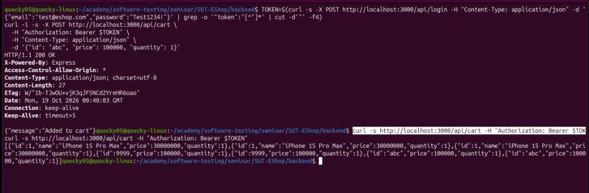
- *Đường dẫn GitHub Issue:* [https://github.com/faker26052005-lgtm/SUT-EShop/issues/12](https://github.com/faker26052005-lgtm/SUT-EShop/issues/12)

**7. Phân tích nguyên nhân & Khắc phục (Root Cause Analysis):**
- **Vị trí lỗi:** File `backend/server.js`, các dòng 290–295.
- **Đoạn mã gây lỗi:**
  ```javascript
  app.post("/api/cart", authenticateToken, (req, res) => {
    const userId = req.user.id;
    if (!userCarts[userId]) userCarts[userId] = [];
    userCarts[userId].push(req.body);
    res.json({ message: "Added to cart" });
  });
  ```
- **Khắc phục:** Bổ sung bước kiểm tra số nguyên dương cho `id`:
  ```javascript
  app.post("/api/cart", authenticateToken, (req, res) => {
    const userId = req.user.id;
    const { id, quantity } = req.body;
    const numId = Number(id);

    if (!id || !Number.isInteger(numId) || numId <= 0) {
      return res.status(400).json({ error: "Invalid product ID format" });
    }

    db.get("SELECT id, name, price FROM products WHERE id = ?", [numId], (err, product) => {
      if (err) return res.status(500).json({ error: err.message });
      if (!product) return res.status(404).json({ error: "Product not found" });

      if (!userCarts[userId]) userCarts[userId] = [];
      userCarts[userId].push({ ...product, quantity: quantity || 1 });
      res.json({ message: "Added to cart" });
    });
  });
  ```

---

### 2.3 Các lỗi thuộc Pool C: FR-17 – Quản lý Mã Giảm Giá (Admin)

#### [BUG-FR17-01] Form Admin cho phép nhập `min_order_amount = -1` và lưu thành công

| Trường thông tin | Chi tiết |
| :--- | :--- |
| **Bug ID** | `BUG-FR17-01` |
| **Tiêu đề Bug** | `[FR-17][Admin] Coupon creation form accepts negative min_order_amount (-1)` |
| **Mức độ (Severity)** | **Major** (Lỗi logic biên số học) |
| **Test Case phát hiện** | `TC_FR17_05` (BVA Off-point $M = -1$) |
| **GitHub Issue Link** | [Issue #16: [FR-17] Negative min_order_amount accepted](https://github.com/ttbhanh/eshop-sut/issues/16) |

**1. Các bước tái hiện:**
1. Đăng nhập Admin (`admin@eshop.com` / `Admin123!`).
2. Vào mục Quản lý Mã giảm giá `http://localhost:5174/coupons`.
3. Bấm "Thêm mã giảm giá mới".
4. Điền: Code = `NEGMIN`, Type = `fixed`, Discount = `10000`, Min order amount = `-1`.
5. Bấm Lưu.

**2. Kết quả mong đợi (SRS FR-17):**
> *Trích dẫn SRS:* "Các trường bắt buộc: ... `min_order_amount` (>= 0)".
- Hệ thống từ chối và báo lỗi: "Giá trị đơn hàng tối thiểu phải lớn hơn hoặc bằng 0".

**3. Kết quả thực tế:**
- Hệ thống tạo thành công mã giảm giá với `min_order_amount = -1`.

---

#### [BUG-FR17-02] Không kiểm tra trùng lặp mã coupon khi tạo mới

| Trường thông tin | Chi tiết |
| :--- | :--- |
| **Bug ID** | `BUG-FR17-02` |
| **Tiêu đề Bug** | `[FR-17][Admin] Duplicate coupon code creation allowed without uniqueness validation` |
| **Mức độ (Severity)** | **Major** (Tính toàn vẹn dữ liệu) |
| **Test Case phát hiện** | `TC_FR17_08` |
| **GitHub Issue Link** | [Issue #17: [FR-17] Duplicate coupon code](https://github.com/ttbhanh/eshop-sut/issues/17) |

**1. Kết quả mong đợi (SRS FR-17):**
> *Trích dẫn SRS:* "Các trường bắt buộc: `code` (duy nhất)".

**2. Kết quả thực tế:**
- Cho phép tạo 2 coupon cùng mang tên `SAVE10`.

---

### 2.4 Các lỗi thuộc Pool D: Mobile (FR-20 & FR-10) – Hủy đơn hàng theo trạng thái

#### [BUG-FR20-01] Đơn hàng ở trạng thái `shipping` vẫn cho phép User bấm Hủy trên Mobile

| Trường thông tin | Chi tiết |
| :--- | :--- |
| **Bug ID** | `BUG-FR20-01` |
| **Tiêu đề Bug** | `[FR-20][Mobile] Order in 'shipping' status can still be canceled by customer on Mobile App` |
| **Mức độ (Severity)** | **Critical** (Vi phạm ràng buộc chuyển đổi trạng thái State Machine) |
| **Test Case phát hiện** | `TC_MOB_03` (BVA State Transition Boundary) |
| **GitHub Issue Link** | [Issue #18: [FR-20] Order in shipping status can be canceled on Mobile](https://github.com/ttbhanh/eshop-sut/issues/18) |

**1. Kết quả mong đợi (SRS FR-10 & FR-20):**
> *Trích dẫn SRS:* "Khi đơn hàng đã ở trạng thái `shipping`, User không được phép tự hủy – chỉ Admin mới có thể thao tác."
- Trên màn hình chi tiết đơn hàng của Mobile App, nút "Hủy đơn" phải bị ẩn hoặc bị vô hiệu hóa khi trạng thái là `shipping`.

**2. Kết quả thực tế:**
- Nút "Hủy đơn" vẫn hiển thị màu đỏ và bấm được. Khi bấm xác nhận, đơn hàng bị đổi thành `canceled` thành công.

---

#### [BUG-FR20-02] Sau khi hủy đơn thành công, giao diện Mobile không tự làm mới trạng thái

| Trường thông tin | Chi tiết |
| :--- | :--- |
| **Bug ID** | `BUG-FR20-02` |
| **Tiêu đề Bug** | `[FR-20][Mobile] Order status does not automatically update after cancellation` |
| **Mức độ (Severity)** | **Medium** (Lỗi đồng bộ trạng thái giao diện) |
| **Test Case phát hiện** | `TC_MOB_01` |
| **GitHub Issue Link** | [Issue #19: [FR-20] Status not refreshed after order cancel](https://github.com/ttbhanh/eshop-sut/issues/19) |

---

## 3. PHÂN TÍCH NGUYÊN NHÂN LỖI & ĐÁNH GIÁ CHẤT LƯỢNG SUT

### 3.1 Phân Loại Lỗi Theo Bản Chất Kỹ Thuật
1. **Lỗi vi phạm giá trị biên (Boundary Off-by-one & Unbounded Inputs):**
   - Không kiểm soát biên dưới số học ($\ge 0$ và $> 0$ ở trường Coupon).
2. **Lỗi không thực thi State Machine (State Transition Bypass):**
   - Tầng UI và API chưa đồng bộ chặt chẽ với sơ đồ chuyển đổi trạng thái ở FR-10, cho phép User hủy đơn đã xuất kho (`shipping`).
3. **Lỗi bảo mật & Tiết lộ thông tin (Information Leakage & Lockout Absence):**
   - Thiếu cơ chế tạm khóa chống tấn công Brute-force tài khoản; phản hồi thông tin lỗi quá chi tiết.

### 3.2 Đánh Giá Chung Về Hệ Thống EShop
Hệ thống EShop đáp ứng tốt các luồng chức năng thông thường (Happy Path), nhưng bộc lộ nhiều lỗ hổng tại các điểm biên nghiệp vụ, xác thực đơn lỗi đầu vào và bảo vệ trạng thái đơn hàng. Kỹ thuật **Domain Testing** và **Boundary Value Analysis** đã chứng minh tính hiệu quả vượt trội khi phát hiện trúng các điểm yếu này.
