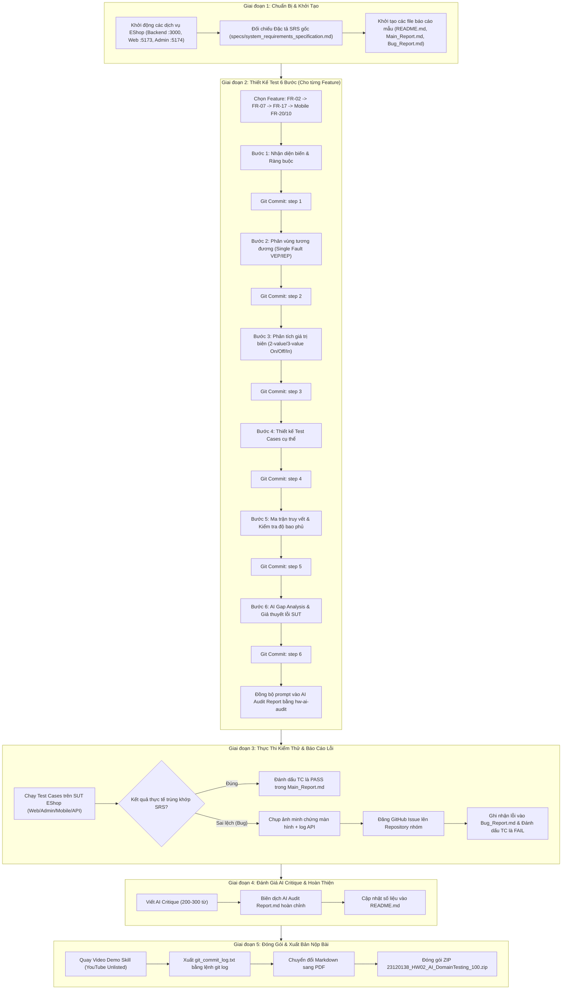

# HW02 – Hướng Dẫn Quy Trình Thực Hiện (Workflow Guide)

Tài liệu này mô tả chi tiết quy trình 5 giai đoạn thực hiện bài tập HW02 – Domain Testing trên hệ thống EShop. Bạn cũng có thể xem bản thiết kế tương tác trong artifact hệ thống.

---

## 1. Sơ Đồ Quy Trình Tổng Thể



---

## 2. Chi Tiết Lệnh Git Commit Theo Từng Bước Của Từng Feature

Quy định mục 12 yêu cầu mỗi bước của mỗi chức năng phải có 1 commit riêng:

### Feature A: FR-02 (Đăng nhập & Khóa tài khoản)
```bash
git commit -m "feat(FR-02): step 1 - identify variables and input domain constraints"
git commit -m "feat(FR-02): step 2 - define equivalence partitions and single-fault baselines"
git commit -m "feat(FR-02): step 3 - boundary value analysis with On/Off/In point classification"
git commit -m "feat(FR-02): step 4 - design test cases with EP and BVA traceability"
git commit -m "feat(FR-02): step 5 - coverage analysis and traceability verification"
git commit -m "feat(FR-02): step 6 - ai gap analysis and exploratory defect hypotheses"
```

### Feature B: FR-07 (Giỏ hàng)
```bash
git commit -m "feat(FR-07): step 1 - identify variables and input domain constraints"
git commit -m "feat(FR-07): step 2 - define equivalence partitions and single-fault baselines"
git commit -m "feat(FR-07): step 3 - boundary value analysis with On/Off/In point classification"
git commit -m "feat(FR-07): step 4 - design test cases with EP and BVA traceability"
git commit -m "feat(FR-07): step 5 - coverage analysis and traceability verification"
git commit -m "feat(FR-07): step 6 - ai gap analysis and exploratory defect hypotheses"
```

### Feature C: FR-17 (Quản lý Mã Giảm Giá)
```bash
git commit -m "feat(FR-17): step 1 - identify variables and input domain constraints"
git commit -m "feat(FR-17): step 2 - define equivalence partitions and single-fault baselines"
git commit -m "feat(FR-17): step 3 - boundary value analysis with On/Off/In point classification"
git commit -m "feat(FR-17): step 4 - design test cases with EP and BVA traceability"
git commit -m "feat(FR-17): step 5 - coverage analysis and traceability verification"
git commit -m "feat(FR-17): step 6 - ai gap analysis and exploratory defect hypotheses"
```

### Feature D: Mobile FR-20 & FR-10 (Hủy đơn hàng)
```bash
git commit -m "feat(FR-20): step 1 - identify state variables and transition constraints"
git commit -m "feat(FR-20): step 2 - define equivalence partitions for order states"
git commit -m "feat(FR-20): step 3 - boundary value analysis on state transition thresholds"
git commit -m "feat(FR-20): step 4 - design test cases with EP and BVA traceability"
git commit -m "feat(FR-20): step 5 - coverage analysis and state machine verification"
git commit -m "feat(FR-20): step 6 - ai gap analysis and mobile defect hypotheses"
```

---

## 3. Lệnh Xuất Báo Cáo & Nén Bài Nộp

1. **Xuất lịch sử Git Commit:**
   ```bash
   git log --pretty=format:"%h - %cd : %s" --date=iso > git_commit_log.txt
   ```

2. **Chạy cập nhật báo cáo AI Audit:**
   ```bash
   python3 ~/.gemini/config/skills/hw-ai-audit/scripts/audit_engine.py generate-report \
     --workspace-root . \
     --output "AI Audit Report.md"
   ```

3. **Tạo file nén ZIP:**
   ```bash
   zip -r 23120138_HW02_AI_DomainTesting_100.zip \
     README.md \
     Main_Report.md \
     Main_Report.pdf \
     Bug_Report.md \
     Bug_Report.pdf \
     "AI Audit Report.md" \
     "AI Audit Report.pdf" \
     git_commit_log.txt \
     screenshots/
   ```
