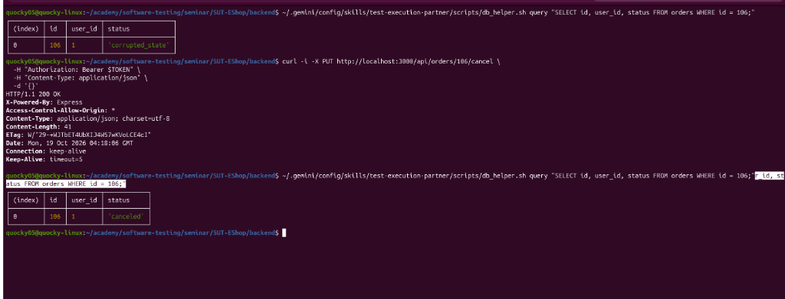

# [BUG] [FR-20][Backend API] Endpoint PUT /api/orders/:id/cancel mutates orders with corrupted/unknown status to 'canceled'

### 1. Defect Metadata
- **Bug ID:** `BUG-FR20-02`
- **Discovered by Test Case:** [`TC_MOB_08`](../Main_Report.md#tc_mob_08)
- **Feature / Subsystem:** Order State Machine & Robustness (`FR-10`, `FR-20`)
- **Severity:** `Medium` (Robustness & State Integrity Flaw / Blacklist Validation Failure)
- **Priority:** `Medium (P2)`
- **Reporter:** Nguyễn Quốc Kỳ (23120138)
- **Environment:**
  - OS: Linux x86_64
  - Node.js: v24.21.0
  - SUT URLs: Web `http://localhost:5173` | Admin `http://localhost:5174` | API `http://localhost:3000`
  - Database: SQLite 3

### 2. Preconditions
- SUT backend running on `http://localhost:3000`.
- In `orders` table, order `id = 106` belongs to User 1 (`user_id = 1`) with abnormal status `status = 'corrupted_state'`.
- User 1 credentials logged in with valid JWT token.

### 3. Steps to Reproduce
1. Query SQLite DB to verify order 106 is currently in abnormal status `'corrupted_state'`:
   ```bash
   SELECT id, user_id, status FROM orders WHERE id = 106;
   ```
2. Send an HTTP PUT request to cancel order 106:
   ```bash
   curl -i -X PUT http://localhost:3000/api/orders/106/cancel \
     -H "Authorization: Bearer $TOKEN" \
     -H "Content-Type: application/json" \
     -d '{}'
   ```
3. Observe the HTTP response status code and response body.
4. Re-query SQLite DB to check order 106 status:
   ```bash
   SELECT id, user_id, status FROM orders WHERE id = 106;
   ```

### 4. Test Data / Payload
- Target URL: `PUT http://localhost:3000/api/orders/106/cancel`
- Headers: `Authorization: Bearer <user1_jwt>`, `Content-Type: application/json`
- Body: `{}`

### 5. Expected Result (Authoritative SRS Citation)
> *Quote from `specs/system_requirements_specification.md` (FR-10 Order State Machine Robustness):*
> "Hệ thống chỉ cho phép hủy đơn hàng khi trạng thái hiện tại là `pending` hoặc `confirmed`. Mọi trạng thái khác không nằm trong danh mục chuyển đổi hợp lệ đều phải bị từ chối và giữ nguyên trạng thái cũ."
- API Layer: Return HTTP Status **`400 Bad Request`** with error message such as `{"error": "Cannot cancel this order."}`.
- Database Layer: `orders.status` for `id = 106` **must remain `'corrupted_state'`**, without being altered to `'canceled'`.

### 6. Actual Result (Observed on SUT)
- API accepts the cancellation request and returns HTTP **`200 OK`**:
  ```json
  {"message": "Order canceled successfully"}
  ```
- Database Layer: `orders.status` for `id = 106` is overwritten from `'corrupted_state'` to **`'canceled'`**.

### 7. Evidence & Visual Proof
- **Terminal Execution Screenshot:** `deliverables/04-exercises/quoc-ky/hw_02/screenshots/BUG_FR20_02_actual.png`
- 

### 8. Root Cause Analysis (Code Inspection)
- **Suspect File:** `backend/server.js` (Lines 328–331):
  ```javascript
  // Lẽ ra phải là: if (order.status !== 'pending' && order.status !== 'confirmed')
  if (order.status === "delivered" || order.status === "canceled") {
    return res.status(400).json({ error: "Cannot cancel this order." });
  }

  db.run(
    "UPDATE orders SET status = ? WHERE id = ?",
    ["canceled", req.params.id],
    function (err) {
      res.json({ message: "Order canceled successfully" });
    },
  );
  ```
- **Explanation:**
  The server relies on a flawed blacklist pattern (`status === 'delivered' || status === 'canceled'`) instead of enforcing a strict whitelist of allowable source states (`pending`, `confirmed`). As a result, corrupt or unrecognized status values are blindly transitioned to `canceled`.
- **Proposed Fix:**
  Replace the check with strict positive whitelisting:
  ```javascript
  if (order.status !== "pending" && order.status !== "confirmed") {
    return res.status(400).json({ error: "Cannot cancel this order." });
  }
  ```
