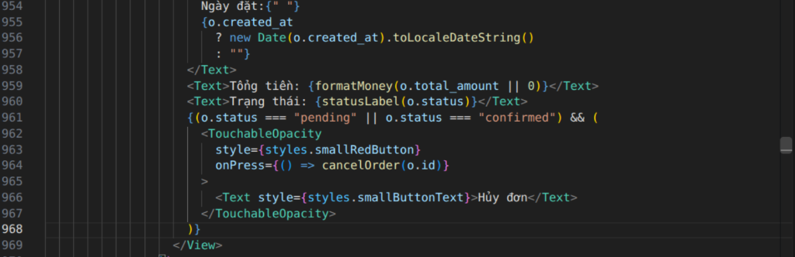
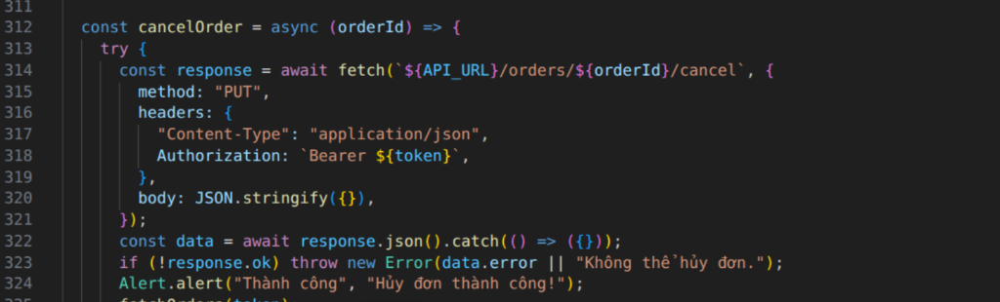

# [BUG] [FR-20][Mobile UI] Cancel order button invokes cancellation immediately without confirmation alert dialog

### 1. Defect Metadata
- **Bug ID:** `BUG-FR20-03`
- **Discovered by Test Case:** [`TC_MOB_23`](../Main_Report.md#tc_mob_23)
- **Feature / Subsystem:** Mobile UI Order Cancellation & GUI Safety (`FR-20`, `FR-21`, `FR-24`)
- **Severity:** `Major` (Accidental Action Hazard / Missing Destruction Confirmation Dialog)
- **Priority:** `High (P1)`
- **Reporter:** Nguyễn Quốc Kỳ (23120138)
- **Environment:**
  - OS: Linux x86_64
  - Framework: React Native / Expo 57
  - Target Layer: Mobile App (`frontend-mobile/App.js`)
  - SUT URLs: Backend `http://localhost:3000` | Expo `:8082`

### 2. Preconditions
- SUT backend running on `http://localhost:3000`.
- Mobile App running on Expo.
- User logged into customer account with order `#101` in `pending` or `confirmed` status.

### 3. Steps to Reproduce
1. Open EShop Mobile App and navigate to Profile / My Orders screen.
2. Locate order `#101` currently in "Chờ xác nhận" (`pending`) status.
3. Observe the red button labeled "Hủy đơn".
4. Tap the "Hủy đơn" button.
5. Check if an Alert confirmation dialog appears asking for confirmation with "Hủy bỏ" and "Đồng ý" buttons.

### 4. Test Data / Payload
- UI Element: Red Button "Hủy đơn" (`TouchableOpacity`)
- Action: Single tap on "Hủy đơn" button
- Component: `frontend-mobile/App.js:961–967`

### 5. Expected Result (Authoritative SRS Citation)
> *Quote from `specs/system_requirements_specification.md` (FR-21 & FR-24 GUI Safety Standards):*
> "Đối với các thao tác mang tính phá hủy hoặc không thể hoàn tác như Hủy đơn hàng, ứng dụng Mobile bắt buộc phải kích hoạt hộp thoại xác nhận (Alert Dialog) với hai lựa chọn 'Hủy bỏ' và 'Đồng ý' trước khi gửi yêu cầu lên máy chủ."
- UI Layer: An `Alert.alert` dialog must pop up asking: *"Bạn có chắc chắn muốn hủy đơn hàng này không?"* with two options:
  - "Hủy bỏ" (Cancel): Closes dialog, sends no API request, order remains pending.
  - "Đồng ý" (Confirm): Sends cancellation request to API.

### 6. Actual Result (Observed on SUT)
- No confirmation dialog is displayed.
- Tapping "Hủy đơn" immediately triggers `cancelOrder(o.id)`:
  - Instantly issues HTTP `PUT /api/orders/:id/cancel`.
  - Pops up `Alert.alert("Thành công", "Hủy đơn thành công!")`.
  - Mutates order status in database without giving the user any chance to cancel an accidental touch.

### 7. Evidence & Visual Proof
- **Button Handler Implementation:** `screenshots/BUG_FR20_03_button_handler.png`
- **Missing Confirmation Code:** `screenshots/BUG_FR20_03_missing_confirmation.png`
- 
- 

### 8. Root Cause Analysis (Code Inspection)
- **Suspect File:** `frontend-mobile/App.js` (Lines 961–967 & 312–325):
  - At line 964, `onPress` is directly wired to `cancelOrder(o.id)`:
    ```javascript
    {(o.status === "pending" || o.status === "confirmed") && (
      <TouchableOpacity
        style={styles.smallRedButton}
        onPress={() => cancelOrder(o.id)}
      >
        <Text style={styles.smallButtonText}>Hủy đơn</Text>
      </TouchableOpacity>
    )}
    ```
  - In `cancelOrder`, `fetch` is executed immediately without an interactive confirmation prompt:
    ```javascript
    const cancelOrder = async (orderId) => {
      try {
        const response = await fetch(`${API_URL}/orders/${orderId}/cancel`, { ... });
        ...
        Alert.alert("Thành công", "Hủy đơn thành công!");
    ```
- **Proposed Fix:**
  Wrap `cancelOrder` with a two-button confirmation dialog:
  ```javascript
  const confirmCancelOrder = (orderId) => {
    Alert.alert(
      "Xác nhận hủy đơn",
      "Bạn có chắc chắn muốn hủy đơn hàng này không?",
      [
        { text: "Hủy bỏ", style: "cancel" },
        { text: "Đồng ý", style: "destructive", onPress: () => cancelOrder(orderId) }
      ]
    );
  };
  ```
  And update button `onPress={() => confirmCancelOrder(o.id)}`.
