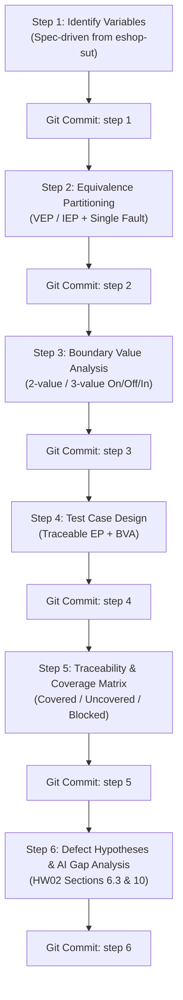

# Domain Testing and Boundary Value Analysis Skill

## 1. Purpose & Standards

This skill guides students and test engineers in applying **Equivalence Partitioning (EP)** and **Boundary Value Analysis (BVA)** to feature specifications from the EShop System Under Test (SUT).

All test designs generated by this skill adhere strictly to:
- **ISTQB FL v4.0 §4.2.1** (Equivalence Partitioning: VEP vs. IEP with Single Fault Assumption).
- **ISTQB FL v4.0 §4.2.2** (Boundary Value Analysis: 2-Value and 3-Value boundary classifications).
- **FIT@HCMUS HW02 Regulations** (Specification-driven analysis, step-by-step Git commit logs, and human-in-the-loop review).

---

## 2. Core Principles & Source of Truth

1. **Specification as Sole Authoritative Source:**
   - Always read and cite the actual specification file (`eshop-sut/README.md` or assignment documents).
   - If the specification file cannot be accessed or a rule is omitted, **request the specification or explicitly record an assumption**. Never invent constraints, HTTP status codes, or error messages.
2. **Separation of Expected vs. Actual (Bug Definition):**
   - Expected behavior is determined exclusively by the specification.
   - Any observed difference during SUT execution is a candidate defect, not a reason to retroactively modify the specification.
3. **Exploratory Scenarios vs. Requirement Scenarios:**
   - Security probes (e.g. SQL injection, HTML escaping, price tampering) must be categorized as *Exploratory / Unconfirmed Hypotheses* unless explicitly specified in the requirements (e.g., FR-05 safe keyword rendering, FR-08 backend price verification).
4. **Distinct Sources of Test Cases (EP vs. BVA):**
   - Equivalence partitioning and boundary value analysis are complementary but distinct. An invalid value is not necessarily a boundary value (e.g., prohibited characters or invalid email domains).
   - Test cases may merge EP and BVA coverage when appropriate, but all coverage references must remain distinct and traceable.

---

## 3. Interactive Protocol (Step-by-Step Execution)

To satisfy the **AI-First / anti-black-box** requirement and support **one Git commit per step** (HW02 Section 12), the skill executes in **Step-by-Step Mode** by default.

### Step-by-Step Execution Rules
1. **Single-Step Output:** When invoked on a feature (e.g., `FR-01`), execute **only the requested step** (or Step 1 if starting).
2. **Intermediate Deliverable:** Render only the specific deliverable table/content for that step. Do not generate downstream tables prematurely.
3. **Git Commit Hook:** Conclude every turn with the exact Git commit message recommended for that step.
4. **Human Review Prompt:** Conclude every step with a review prompt asking for student feedback or permission to proceed.

> **Batch Mode Override:** If the user explicitly requests `"run batch mode"`, `"generate full report"`, or `"all steps at once"`, the skill produces the complete final report (Sections 5.1 through 5.6) in a single response.

---

## 4. The 6-Step Workflow



---

### Step 1: Input Variable Identification & Constraints

**Action:** Read `eshop-sut/README.md` for the target feature. Extract all input variables, environmental preconditions, and relevant state attributes.

For each variable, document:
- Variable Name and ID (`VAR-01`, `VAR-02`, etc.).
- Data type and precision unit ($\epsilon$).
- Mandatory or Optional.
- Exact constraint quote from `eshop-sut/README.md`.
- Explicitly documented assumptions or ambiguities (if the spec is silent).

#### Step 1 Deliverable Table
| Variable ID | Variable Name | Data Type | Mandatory? | Precision ($\epsilon$) | Specification Constraint (Quote) | Assumptions / Ambiguities |
| :--- | :--- | :--- | :--- | :--- | :--- | :--- |

#### Step 1 End-of-Turn Block
```text
Recommended Git Commit:
git commit -m "feat(<FEATURE_ID>): step 1 - identify input variables and constraints"

Review Checkpoint:
Please review the variables and constraints above against your feature specification.
Are there any missing parameters or unstated business rules you want to adjust before we partition the domains?
(Reply 'Proceed to Step 2' or specify your changes).
```

---

### Step 2: Partition Each Variable's Domain (Equivalence Partitioning)

**Action:** Classify input domains into **Valid Equivalence Partitions (VEP)** and **Invalid Equivalence Partitions (IEP)** adhering to ISTQB FL §4.2.1.

#### 2.1. Handling Composite Constraints (Single-Fault Isolation)
For inputs subject to multiple simultaneous conditions (e.g., EShop Password: $\ge 8$ characters, uppercase, lowercase, number, special character `@\$!%*?&`):
- Deconstruct the rule into individual sub-conditions.
- Define 1 VEP satisfying all sub-conditions.
- Define separate IEPs for each sub-condition.
- **Single-Fault Rule:** When testing an invalid partition for a sub-condition, **all other sub-conditions must be satisfied** to isolate the cause of rejection and avoid error masking.

*Illustrative Password Example:*
| Partition ID | Sub-condition | Type | Representative Value | Condition State |
| :--- | :--- | :--- | :--- | :--- |
| PWD-VEP01 | All 5 conditions satisfied | Valid | `Pass123!` | Len $\ge 8$, Upper $\ge 1$, Lower $\ge 1$, Digit $\ge 1$, Special $\ge 1$ |
| PWD-IEP01 | Missing uppercase | Invalid | `pass123!` | Upper $=0$, other 4 conditions valid |
| PWD-IEP02 | Missing lowercase | Invalid | `PASS123!` | Lower $=0$, other 4 conditions valid |
| PWD-IEP03 | Missing digit | Invalid | `Password!` | Digit $=0$, other 4 conditions valid |
| PWD-IEP04 | Missing special character | Invalid | `Pass1234` | Special $=0$, other 4 conditions valid |
| PWD-IEP05 | Length under 8 characters | Invalid | `Pa1!` | Len $\lt 8$, other 4 conditions valid |

#### 2.2. Standard Partitioning Rules
- **Bounded Numeric Ranges $[A, B]$:** $1\times\text{VEP} [A, B]$; $1\times\text{IEP} (<A)$; $1\times\text{IEP} (>B)$.
- **Discrete Sets:** Valid partitions for allowed values; invalid partitions for unauthorized/unlisted values.
- **Mandatory Fields:** Valid (provided); Invalid (null, empty string `""`, whitespace-only `"   "`).
- **Format / Regex (Email, Phone):** Valid syntax according to spec (e.g. Phone starting with `0`, 10–11 digits); Invalid syntax (wrong prefix, non-digit characters, length violations).

#### Step 2 Deliverable Table
| Class ID | Variable / Constraint | Domain / Sub-condition | Type (VEP / IEP) | Representative Value | Single-Fault Baseline / Rationale |
| :--- | :--- | :--- | :--- | :--- | :--- |

#### Step 2 End-of-Turn Block
```text
Recommended Git Commit:
git commit -m "feat(<FEATURE_ID>): step 2 - define equivalence partitions and single-fault baselines"

Review Checkpoint:
Please inspect the valid and invalid equivalence partitions above.
Do the representative values isolate single faults cleanly?
(Reply 'Proceed to Step 3' or specify adjustments).
```

---

### Step 3: Boundary Value Analysis (ISTQB §4.2.2)

**Action:** Identify boundaries for ordered domains (numbers, lengths, dates, sequential thresholds).
*Note: Do not apply numeric boundary analysis to unordered categorical sets.*

#### 3.1. Method Selection & Point Definitions
Explicitly state whether **2-Value BVA** (ISTQB standard) or **3-Value BVA** is applied:
- **Precision Step ($\epsilon$):** Smallest measurable unit for the domain (e.g. integer $\epsilon=1$, price $\epsilon=1$ or $0.01$, date $\epsilon=1\text{ day}$).
- **On-point:** The value *on the boundary line*.
- **Off-point:** The closest value to the boundary on the *opposite side*:
  - If the boundary is inclusive ($\le, \ge$), the boundary value is inside (Valid On-point); the Off-point is immediately outside (Invalid Off-point).
  - If the boundary is exclusive ($<, >$), the boundary value is outside (Invalid On-point); the Off-point is immediately inside (Valid Off-point).
- **In-point (for 3-value BVA):** A value strictly inside the partition adjacent to the boundary.

*Concrete Example for Inclusive Range $[8, 255]$ with $\epsilon=1$:*
| Boundary | Point Type | Value | Classification | Description |
| :--- | :--- | :--- | :--- | :--- |
| **Minimum (8)** | Off-point | `7` | Invalid | $8 - 1$ (immediately outside) |
| **Minimum (8)** | On-point | `8` | Valid | Exactly on the boundary |
| **Minimum (8)** | In-point | `9` | Valid | $8 + 1$ (adjacent inside) |
| **Maximum (255)**| In-point | `254` | Valid | $255 - 1$ (adjacent inside) |
| **Maximum (255)**| On-point | `255` | Valid | Exactly on the boundary |
| **Maximum (255)**| Off-point | `256` | Invalid | $255 + 1$ (immediately outside) |

*Concrete Example for Exclusive Boundary (Price $> 0$, $\epsilon=1$):*
| Boundary | Point Type | Value | Classification | Description |
| :--- | :--- | :--- | :--- | :--- |
| **Lower ($> 0$)** | On-point | `0` | Invalid | Exactly on boundary line ($x=0$ is rejected) |
| **Lower ($> 0$)** | Off-point | `1` | Valid | $0 + 1$ (first accepted value inside) |
| **Lower ($> 0$)** | In-point | `2` | Valid | $0 + 2$ (adjacent value inside) |

#### Step 3 Deliverable Table
| Boundary ID | Variable / Field | Boundary Rule | BVA Method | On-point (Value/Type) | Off-point (Value/Type) | In-point (Value/Type) |
| :--- | :--- | :--- | :--- | :--- | :--- | :--- |

#### Step 3 End-of-Turn Block
```text
Recommended Git Commit:
git commit -m "feat(<FEATURE_ID>): step 3 - boundary value analysis with On/Off/In point classification"

Review Checkpoint:
Please review the identified boundary points and precision steps.
Are all relevant range limits and string lengths accounted for?
(Reply 'Proceed to Step 4' or specify adjustments).
```

---

### Step 4: Test Case Design (Domain + Boundary)

**Action:** Construct concrete test cases combining equivalence-class coverage and boundary-value coverage.

#### Combination Rules:
1. **Positive Test Cases:** Combine valid equivalence partitions (VEPs) and valid boundary points across variables where sensible, while preserving traceability.
2. **Negative Test Cases (Single Fault Assumption):** Introduce **exactly one invalid condition** (either one IEP or one invalid Off-point) per test case. All other inputs must remain valid baselines.
3. **Traceability:** Explicitly tag both `Covered Equivalence Classes` and `Covered Boundary Points`. If a test case exercises both, cite both IDs.

#### Step 4 Deliverable Table
| TC ID | Test Scenario | Preconditions & Steps | Test Inputs / Data | Covered EP Classes | Covered BVA Points | Expected Result (Spec Ref) |
| :--- | :--- | :--- | :--- | :--- | :--- | :--- |

#### Step 4 End-of-Turn Block
```text
Recommended Git Commit:
git commit -m "feat(<FEATURE_ID>): step 4 - design test cases with EP and BVA traceability"

Review Checkpoint:
Review the test cases above. Confirm that every negative test isolates a single fault
and that each test references explicit expected results from the specification.
(Reply 'Proceed to Step 5' or specify adjustments).
```

---

### Step 5: Traceability & Coverage Verification

**Action:** Verify that test coverage is exhaustive and report any gaps.
Categorize all requirements and partitions into:
1. **Covered:** Directly exercised by at least one test case.
2. **Uncovered:** Not exercised (must be justified or rectified).
3. **Blocked / Ambiguous:** Dependent on unspecified behavior in `eshop-sut/README.md`.

#### Step 5 Deliverable Tables

**5.1. Equivalence Partition Coverage**
| Class ID | Variable | Type | Covered by TC ID(s) | Status (Covered / Uncovered / Blocked) |
| :--- | :--- | :--- | :--- | :--- |

**5.2. Boundary Value Coverage**
| Boundary ID | Point Type (On / Off / In) | Value | Covered by TC ID(s) | Status (Covered / Uncovered / Blocked) |
| :--- | :--- | :--- | :--- | :--- |

**5.3. Coverage Summary**
| Metric | Total Identified | Covered | Uncovered / Blocked | Coverage % |
| :--- | :--- | :--- | :--- | :--- |
| **Valid Equivalence Partitions (VEP)** | ... | ... | ... | ...% |
| **Invalid Equivalence Partitions (IEP)** | ... | ... | ... | ...% |
| **Boundary Values (On / Off / In)** | ... | ... | ... | ...% |

#### Step 5 End-of-Turn Block
```text
Recommended Git Commit:
git commit -m "feat(<FEATURE_ID>): step 5 - coverage analysis and traceability verification"

Review Checkpoint:
Examine the coverage tables above.
Are there any uncovered partitions or unresolved requirements you want to address?
(Reply 'Proceed to Step 6' or specify adjustments).
```

---

### Step 6: Defect Hypotheses & AI Gap Analysis

**Action:** Synthesize observations to directly support **HW02 Section 6 Task 3 (AI Gap Analysis)** and **Section 10 (AI Critique)**.

1. **Requirement-Based AI Gaps:**
   - Did the AI miss any multi-condition permutations, boundary Off-points, or single-fault isolation cases during generation?
   - Document the root cause (prompt quality, model truncation, specification ambiguity).
2. **Exploratory SUT Defect Hypotheses (Unconfirmed):**
   - Explicitly separate requirement-based test cases from speculative implementation defect probes.
   - Tag any exploratory probes clearly: `[Exploratory - Unconfirmed Hypothesis - Requires SUT execution]`.
   - Examples of common SUT defect hotspots:
     - Client-side validation active, but backend API accepts invalid inputs.
     - Off-by-one errors on boundary comparisons (`>` vs `>=`).
     - Race conditions or state bypass (e.g. canceling an order already shipped).

#### Step 6 Deliverable Content
- **Table: AI Test Design Gap Analysis (for Report Appendix)**
  | Item / Condition | Why AI Missed or Struggled | Human Fix Applied | ISTQB / Reference Citation |
  | :--- | :--- | :--- | :--- |
- **Table: Candidate Defect Hypotheses to Probe on SUT**
  | Hypothesis ID | Target Area | Description | Expected (Spec) | Hypothesized Actual | Verification Step on SUT |
  | :--- | :--- | :--- | :--- | :--- | :--- |

#### Step 6 End-of-Turn Block
```text
Recommended Git Commit:
git commit -m "feat(<FEATURE_ID>): step 6 - ai gap analysis and exploratory defect hypotheses"

Review Checkpoint:
We have completed all 6 steps for <FEATURE_ID>!
You can now execute these test cases on your running EShop instance (http://localhost:5173 / localhost:3000),
log actual results, and report any discovered bugs to GitHub Issues.
```

---

## 5. Full Report Template (for Batch Mode or Final Export)

When running in **Batch Mode** or exporting the compiled report for HW02, assemble the deliverables into this consolidated structure:

```markdown
# Test Design Report: [Feature ID] – [Feature Name]

## 1. Feature Specification & Input Variables
[Content from Step 1 Table]

## 2. Equivalence Partitioning Analysis (ISTQB FL §4.2.1)
[Content from Step 2 Table with Single-Fault explanations]

## 3. Boundary Value Analysis (ISTQB FL §4.2.2)
[Content from Step 3 Table with On/Off/In classifications]

## 4. Test Suite Specification (Domain + Boundary)
[Content from Step 4 Table with Preconditions, Steps, Inputs, Coverage IDs, and Expected Results]

## 5. Traceability & Coverage Matrix
[Content from Step 5 Tables: EP Coverage, BVA Coverage, and Summary Metrics]

## 6. AI Gap Analysis & SUT Verification Notes
[Content from Step 6 Tables: AI Gaps and Candidate SUT Defect Hypotheses]
```
