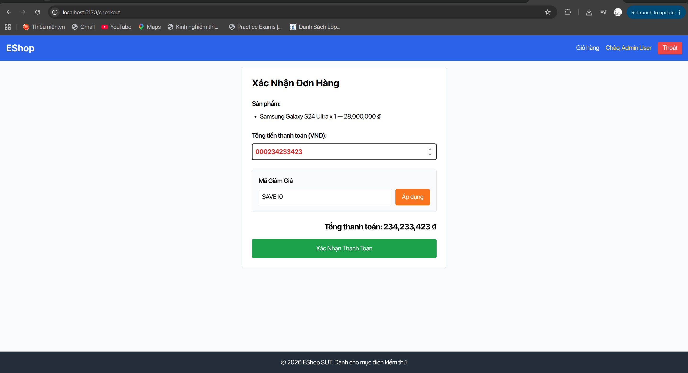
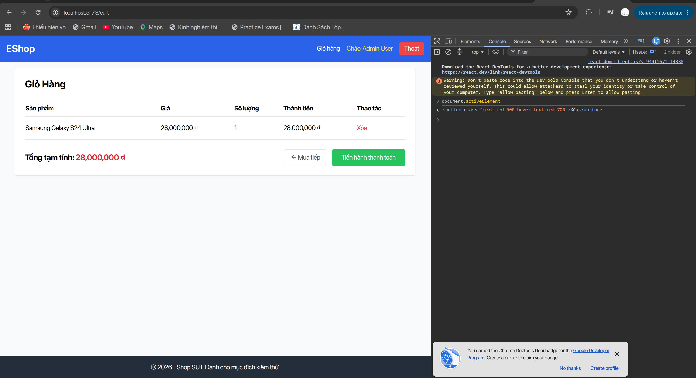
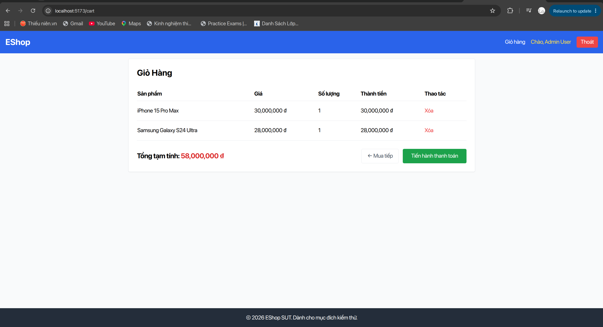
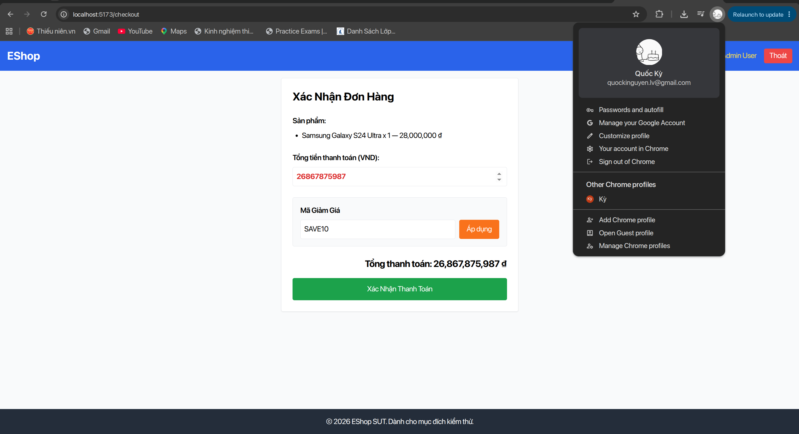
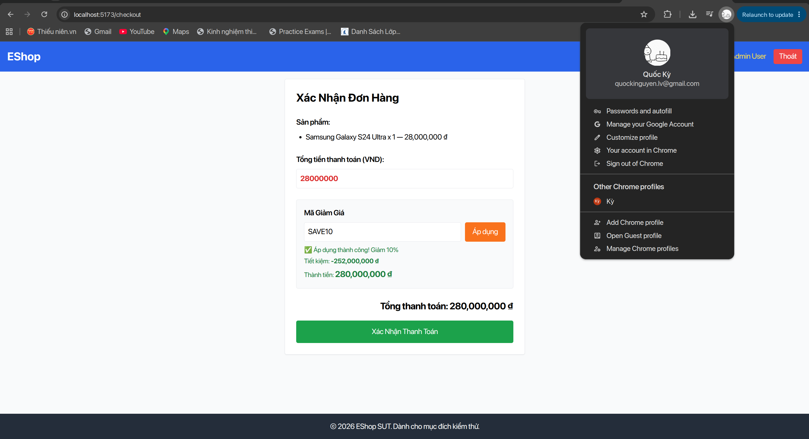
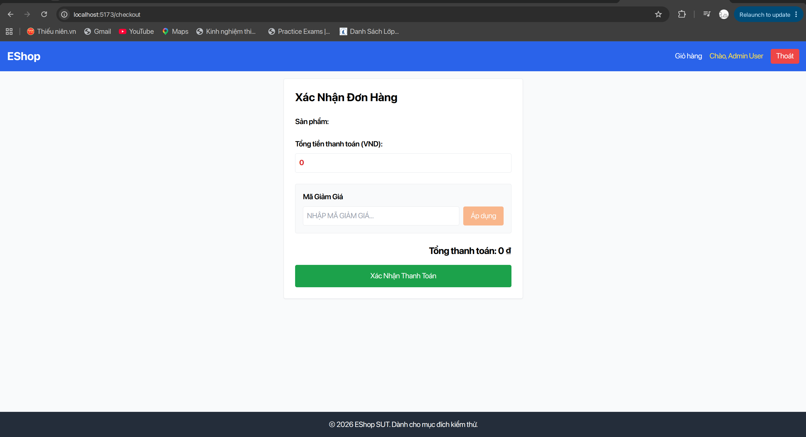
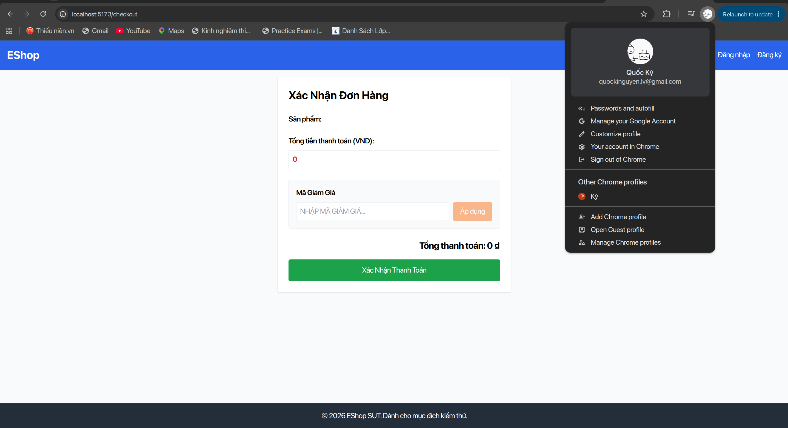
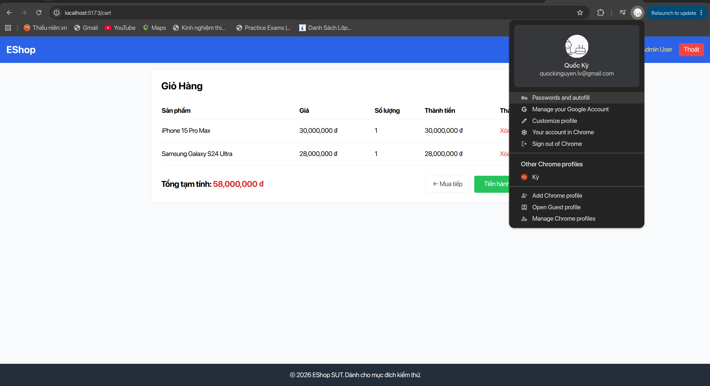
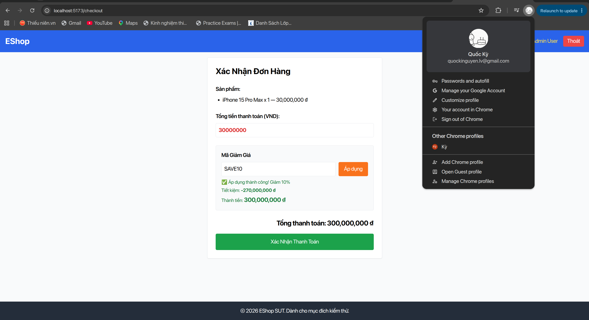
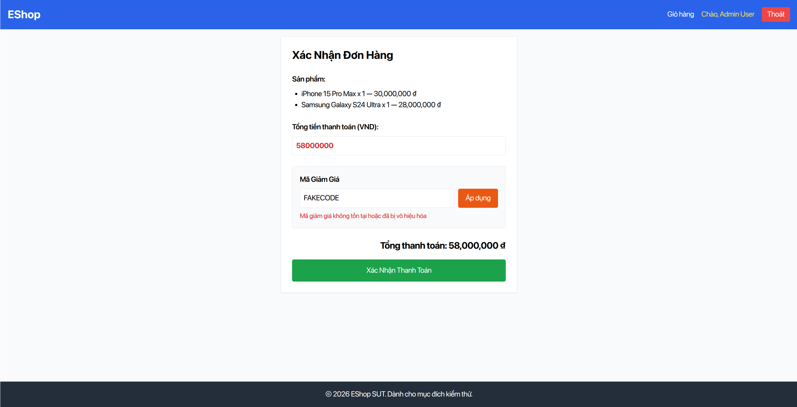

# HW03 – Comprehensive Bug Report

**Course:** Software Testing (CSC13003) – FIT @ HCMUS  
**Student Name:** Nguyễn Quốc Kỳ  
**Student ID:** 23120138  
**Student Email:** `quockinguyen.lv@gmail.com`  
**GitHub Issue Repository:** [faker26052005-lgtm/SUT-EShop](https://github.com/faker26052005-lgtm/SUT-EShop/issues)  
**Submission Date:** 10/11/2026  

---

## 1. Executive Defect Summary

This document consolidates all **24 empirical defects** discovered across **Task 1 (GUI Checklist Execution)**, **Task 2 (Usability Evaluation Sessions)**, and **Task 3 (Cross-Platform Compatibility Testing)**. Every defect was verified on the running SUT, documented with reproducible steps, classified by severity according to course standards, and filed as an official GitHub Issue on `faker26052005-lgtm/SUT-EShop` with commit-pinned evidence screenshots.

### 1.1 Severity Classification Matrix

| Severity | Definition | Count | Percentage |
|---|---|:---:|:---:|
| **Blocker** | Severe defect violating business logic or financial integrity, allowing data corruption, arbitrary pricing, or preventing order completion. | **1** | 4.17% |
| **Major** | Critical defect causing complete task deadlock, unauthenticated route exposure, state loss, or broken transactional calculations. | **10** | 41.67% |
| **Minor** | Functional or interface discrepancy with known workaround (e.g., contrast failure, missing Enter handler, desynchronized labels). | **10** | 41.67% |
| **Cosmetic** | Visual, casing, or styling inconsistency not impairing functionality (e.g., Title Case vs Sentence case, touch target size). | **3** | 12.50% |
| **Total** | | **24** | **100%** |

### 1.2 Interface Aspect (IA) & Task Distribution

| Source Task / Aspect | Discovered Defects | Key Symptoms & Failures Observed |
|---|:---:|---|
| **Task 1 & 3: IA-01 General UI** | **10 bugs** | WCAG AA contrast failures (green & orange buttons), inconsistent currency notation ("VND" vs "₫"), casing mismatches, vi-VN localization comma vs dot. |
| **Task 1 & 3: IA-02 Forms** | **6 bugs** | Editable total payment input, arrow key number mutations, desynchronized totals upon coupon application, missing Enter key submission, missing label-for association. |
| **Task 1 & 3: IA-03 Navigation** | **3 bugs** | Route guard missing on `/checkout` for unauthenticated users, route guard missing for empty cart, browser Back button returning to un-cleared cart. |
| **Task 1 & 3: IA-04 Feedback / State** | **3 bugs** | RAM-only state persistence (F5 loses cart), backend coupon discount arithmetic bug, missing `clearCart()` after checkout completion. |
| **Task 2: Usability Evaluation** | **2 bugs** | Cryptic coupon error message causing task deadlock (>2 min), coupon input field ignoring keyboard Enter key. |

---

## 2. Bug Master Registry

| Bug ID | GitHub Issue | Title | Affected Screen | Severity | Interface Aspect | Affected Platform(s) | Status |
|:---:|:---:|---|---|:---:|:---:|---|:---:|
| **BUG-01** | [#127](https://github.com/faker26052005-lgtm/SUT-EShop/issues/127) | `[Checkout] Total payment amount input is editable and accepts arbitrary values` | Checkout | **Blocker** | IA-02 Forms | Chrome, Firefox, Safari | Verified |
| **BUG-02** | [#121](https://github.com/faker26052005-lgtm/SUT-EShop/issues/121) | `[Cart] Deleting product item unmounts DOM node without managing focus` | Cart | **Major** | IA-02 Forms | Chrome, Firefox, Safari | Verified |
| **BUG-03** | [#122](https://github.com/faker26052005-lgtm/SUT-EShop/issues/122) | `[Cart] Cart stored in RAM React state; page reload (F5) clears all items` | Cart | **Major** | IA-04 Feedback | Chrome, Firefox, Safari | Verified |
| **BUG-04** | [#128](https://github.com/faker26052005-lgtm/SUT-EShop/issues/128) | `[Checkout] Total payment input accepts focus and alters value on Arrow keys/scroll` | Checkout | **Major** | IA-02 Forms | Chrome, Firefox, Safari | Verified |
| **BUG-05** | [#129](https://github.com/faker26052005-lgtm/SUT-EShop/issues/129) | `[Checkout] Total payment input fails to synchronize value after applying coupon` | Checkout | **Major** | IA-02 Forms | Chrome, Firefox, Safari | Verified |
| **BUG-06** | [#132](https://github.com/faker26052005-lgtm/SUT-EShop/issues/132) | `[Checkout] Direct navigation to /checkout with empty cart renders checkout form` | Checkout | **Major** | IA-03 Navigation | Chrome, Firefox, Safari | Verified |
| **BUG-07** | [#133](https://github.com/faker26052005-lgtm/SUT-EShop/issues/133) | `[Checkout] Direct navigation to /checkout without authentication bypasses login` | Checkout | **Major** | IA-03 Navigation | Chrome, Firefox, Safari | Verified |
| **BUG-08** | [#134](https://github.com/faker26052005-lgtm/SUT-EShop/issues/134) | `[Checkout] Browser Back button after order placement returns to un-cleared cart` | Checkout | **Major** | IA-03 Navigation | Chrome, Firefox, Safari | Verified |
| **BUG-09** | [#135](https://github.com/faker26052005-lgtm/SUT-EShop/issues/135) | `[Checkout] SAVE10 promotional discount calculations produce incorrect savings` | Checkout | **Major** | IA-04 Feedback | Chrome, Firefox, Safari | Verified |
| **BUG-10** | [#136](https://github.com/faker26052005-lgtm/SUT-EShop/issues/136) | `[Checkout] Order placement does not clear cart items upon returning to /cart` | Checkout | **Major** | IA-04 Feedback | Chrome, Firefox, Safari | Verified |
| **BUG-11** | [#159](https://github.com/faker26052005-lgtm/SUT-EShop/issues/159) | `[Usability][Cart] Cryptic error message on coupon failure causing checkout deadlock` | Cart | **Major** | Usability / IA-04 | Chrome Desktop | Verified |
| **BUG-12** | [#117](https://github.com/faker26052005-lgtm/SUT-EShop/issues/117) | `[Cart] Primary CTA button contrast ratio 2.44:1 fails WCAG AA minimum 4.5:1` | Cart | **Minor** | IA-01 UI Standards | Chrome, Firefox, Safari | Verified |
| **BUG-13** | [#118](https://github.com/faker26052005-lgtm/SUT-EShop/issues/118) | `[Cart] Currency notation inconsistent: Home uses "VND" while Cart uses "₫"` | Cart | **Minor** | IA-01 UI Standards | Chrome, Firefox, Safari | Verified |
| **BUG-14** | [#119](https://github.com/faker26052005-lgtm/SUT-EShop/issues/119) | `[Cart] Primary CTA button background color differs between Cart and Checkout` | Cart / Checkout | **Minor** | IA-01 UI Standards | Chrome, Firefox, Safari | Verified |
| **BUG-15** | [#120](https://github.com/faker26052005-lgtm/SUT-EShop/issues/120) | `[Cart] Capitalization mismatch: Title Case "Giỏ Hàng" vs Navbar "Giỏ hàng"` | Cart | **Minor** | IA-01 UI Standards | Chrome, Firefox, Safari | Verified |
| **BUG-16** | [#123](https://github.com/faker26052005-lgtm/SUT-EShop/issues/123) | `[Checkout] Coupon button contrast ratio 2.94:1 fails WCAG AA minimum 4.5:1` | Checkout | **Minor** | IA-01 UI Standards | Chrome, Firefox, Safari | Verified |
| **BUG-17** | [#124](https://github.com/faker26052005-lgtm/SUT-EShop/issues/124) | `[Checkout] Total payment input displays raw integer without thousands separator` | Checkout | **Minor** | IA-01 UI Standards | Chrome, Firefox, Safari | Verified |
| **BUG-18** | [#125](https://github.com/faker26052005-lgtm/SUT-EShop/issues/125) | `[Checkout] Semantic label duplication: "Tổng tiền thanh toán" vs "Tổng thanh toán"` | Checkout | **Minor** | IA-01 UI Standards | Chrome, Firefox, Safari | Verified |
| **BUG-19** | [#130](https://github.com/faker26052005-lgtm/SUT-EShop/issues/130) | `[Checkout] Coupon input not enclosed in form and ignores keyboard Enter key` | Checkout | **Minor** | IA-02 Forms | Chrome, Firefox, Safari | Verified |
| **BUG-20** | [#131](https://github.com/faker26052005-lgtm/SUT-EShop/issues/131) | `[Checkout] Coupon label lacks htmlFor attribute, clicking label fails to focus` | Checkout | **Minor** | IA-02 Forms | Chrome, Firefox, Safari | Verified |
| **BUG-21** | [#160](https://github.com/faker26052005-lgtm/SUT-EShop/issues/160) | `[Usability][Cart] Coupon input field ignores Enter key form submission` | Cart | **Minor** | Usability / IA-02 | Chrome Desktop | Verified |
| **BUG-22** | [#126](https://github.com/faker26052005-lgtm/SUT-EShop/issues/126) | `[Checkout] Casing mismatch between form labels: Title Case vs Sentence case` | Checkout | **Cosmetic** | IA-01 UI Standards | Chrome, Firefox, Safari | Verified |
| **BUG-23** | [#137](https://github.com/faker26052005-lgtm/SUT-EShop/issues/137) | `[Cart] Interactive touch targets violate WCAG 2.5.5 minimum 44x44px` | Cart | **Cosmetic** | IA-01 UI Standards | Chrome, Firefox, Safari | Verified |
| **BUG-24** | [#138](https://github.com/faker26052005-lgtm/SUT-EShop/issues/138) | `[Cart+Checkout] Currency localization uses US comma instead of vi-VN dot` | Cart / Checkout | **Cosmetic** | IA-01 UI Standards | Chrome, Firefox, Safari | Verified |

---

## 3. Detailed Defect Specifications

---

### [BUG-01] [Checkout] Total payment amount input is editable and accepts arbitrary values

- **GitHub Issue:** [#127](https://github.com/faker26052005-lgtm/SUT-EShop/issues/127)
- **Checklist Item Ref:** `CHCK-IA02-03` | **Interface Aspect:** `IA-02 Forms`
- **Severity:** `Blocker`
- **Affected Platforms:** Google Chrome, Mozilla Firefox, Apple Safari
- **Environment:** `http://localhost:5173/checkout`

#### Description
On the Checkout screen (`/checkout`), the order total is rendered inside an editable `<input type="number">` rather than a read-only label. Users can edit the payment amount to `0`, negative numbers (`-500000`), decimals (`28000000.5`), extreme overflow numbers (`999999999999`), or non-numeric characters. Submitting the form transmits this manipulated amount to the checkout API, creating a critical business logic flaw.

#### Steps to Reproduce
1. Navigate to `/checkout` with an order of `28,000,000 ₫`.
2. Click on the input field labeled **"Tổng tiền thanh toán (VND):"**.
3. Clear the default value and type: `0`, `-500000`, or `1000`.
4. Click **"Xác Nhận Thanh Toán"**.

#### Expected Result
The total payment amount must be a read-only, non-editable formatted label (`28.000.000 ₫`), strictly calculated from server-side item prices and coupon rules.

#### Actual Result
The input field accepts arbitrary manual edits, and orders can be confirmed with fraudulent totals.

#### Evidence

---

### [BUG-02] [Cart] Deleting product item unmounts DOM node without managing focus

- **GitHub Issue:** [#121](https://github.com/faker26052005-lgtm/SUT-EShop/issues/121)
- **Checklist Item Ref:** `CART-IA02-01` | **Interface Aspect:** `IA-02 Forms`
- **Severity:** `Major`
- **Affected Platforms:** Google Chrome, Mozilla Firefox, Apple Safari
- **Environment:** `http://localhost:5173/cart`

#### Description
When a user clicks the "Xóa" (Delete) button to remove an item from the cart, the corresponding table row DOM element is immediately unmounted. The application fails to shift focus to an adjacent interactive element, causing `document.activeElement` to drop back to `document.body`. This breaks accessibility for keyboard and screen-reader users.

#### Steps to Reproduce
1. Add multiple items to the cart and navigate to `/cart`.
2. Using keyboard `Tab`, navigate to the "Xóa" button of the first item.
3. Press `Enter` or `Space` to delete the item.
4. Inspect `document.activeElement` in the browser console.

#### Expected Result
Focus should gracefully transfer to the next available item's delete button, or to the table container/heading.

#### Actual Result
`document.activeElement` resets to `<body>`, forcing keyboard users to re-tab through the entire page from the beginning.

#### Evidence

---

### [BUG-03] [Cart] Cart stored in RAM React state; page reload (F5) clears all items

- **GitHub Issue:** [#122](https://github.com/faker26052005-lgtm/SUT-EShop/issues/122)
- **Checklist Item Ref:** `CART-IA04-03` | **Interface Aspect:** `IA-04 Feedback / State`
- **Severity:** `Major`
- **Affected Platforms:** Google Chrome, Mozilla Firefox, Apple Safari
- **Environment:** `http://localhost:5173/cart`

#### Description
Cart state is maintained entirely in ephemeral React component memory without persistence to `localStorage`, `sessionStorage`, or backend database sessions. Pressing `F5` or refreshing the browser instantly clears the entire cart, reverting to an empty state and destroying customer purchase intent.

#### Steps to Reproduce
1. Log in and add `Samsung Galaxy S24 Ultra` (`28,000,000 ₫`) to the cart.
2. Navigate to `/cart` and confirm the item is listed.
3. Press `F5` to reload the page.

#### Expected Result
Cart contents should persist across browser reloads.

#### Actual Result
The cart immediately reverts to the empty state banner: *"Giỏ hàng của bạn đang trống"*.

#### Evidence

---

### [BUG-04] [Checkout] Total payment input accepts focus and alters value on Arrow keys/scroll

- **GitHub Issue:** [#128](https://github.com/faker26052005-lgtm/SUT-EShop/issues/128)
- **Checklist Item Ref:** `CHCK-IA02-04` | **Interface Aspect:** `IA-02 Forms`
- **Severity:** `Major`
- **Affected Platforms:** Google Chrome, Mozilla Firefox, Apple Safari

#### Description
Because the total payment amount is implemented as `<input type="number">` without `readonly` or `disabled` attributes, focusing the field and pressing `Arrow Up` / `Arrow Down` or scrolling the mouse wheel increments or decrements the payment total.

#### Steps to Reproduce
1. Open `/checkout` with an order total of `28,000,000 ₫`.
2. Click inside the total input field.
3. Press `Arrow Down` or scroll mouse wheel downward.

#### Expected Result
The field should ignore keyboard arrows and mouse wheel events.

#### Actual Result
The monetary value changes dynamically based on user scroll/arrow keystrokes.

#### Evidence

---

### [BUG-05] [Checkout] Total payment input fails to synchronize value after applying coupon

- **GitHub Issue:** [#129](https://github.com/faker26052005-lgtm/SUT-EShop/issues/129)
- **Checklist Item Ref:** `CHCK-IA02-10` | **Interface Aspect:** `IA-02 Forms`
- **Severity:** `Major`
- **Affected Platforms:** Google Chrome, Mozilla Firefox, Apple Safari

#### Description
When a user applies a discount coupon (e.g. `SAVE10`), the bottom summary label updates to show the discounted price (`25,200,000 ₫`), but the upper input field labeled "Tổng tiền thanh toán (VND):" remains stuck at the original un-discounted figure (`28000000`), presenting conflicting payment totals.

#### Steps to Reproduce
1. Navigate to `/checkout` with total `28,000,000 ₫`.
2. Enter `SAVE10` and click "Áp dụng".
3. Compare the value in the top input field vs the bottom "Tổng thanh toán:" label.

#### Expected Result
Both fields should synchronize and display the identical discounted amount (`25,200,000 ₫`).

#### Actual Result
The top input displays `28000000` while the bottom text displays `25,200,000 ₫`.

#### Evidence

---

### [BUG-06] [Checkout] Direct navigation to /checkout with empty cart renders checkout form

- **GitHub Issue:** [#132](https://github.com/faker26052005-lgtm/SUT-EShop/issues/132)
- **Checklist Item Ref:** `CHCK-IA03-04` | **Interface Aspect:** `IA-03 Navigation`
- **Severity:** `Major`
- **Affected Platforms:** Google Chrome, Mozilla Firefox, Apple Safari

#### Description
The checkout route lacks route guard logic to check cart fullness. Typing `/checkout` directly into the browser URL bar when the cart contains 0 items allows the user to access the checkout form and submit an order of `0 ₫`.

#### Steps to Reproduce
1. Clear cart or open a new session with an empty cart.
2. Directly type `http://localhost:5173/checkout` in the address bar.

#### Expected Result
The system should redirect the user to `/cart` or `/` with an informative message: *"Giỏ hàng trống"*.

#### Actual Result
The checkout form renders with 0 products and total `0 ₫`, allowing empty order confirmation.

#### Evidence

---

### [BUG-07] [Checkout] Direct navigation to /checkout without authentication bypasses login

- **GitHub Issue:** [#133](https://github.com/faker26052005-lgtm/SUT-EShop/issues/133)
- **Checklist Item Ref:** `CHCK-IA03-05` | **Interface Aspect:** `IA-03 Navigation`
- **Severity:** `Major`
- **Affected Platforms:** Google Chrome, Mozilla Firefox, Apple Safari

#### Description
The `/checkout` route lacks client-side authentication guards (`AuthGuard`). An unauthenticated guest user who directly accesses `http://localhost:5173/checkout` is presented with the order confirmation interface rather than being redirected to `/login`.

#### Steps to Reproduce
1. Log out or open an incognito window.
2. Type `http://localhost:5173/checkout`.

#### Expected Result
The user should be redirected to `/login?redirect=/checkout`.

#### Actual Result
The user directly accesses the checkout form.

#### Evidence

---

### [BUG-08] [Checkout] Browser Back button after order placement returns to un-cleared cart

- **GitHub Issue:** [#134](https://github.com/faker26052005-lgtm/SUT-EShop/issues/134)
- **Checklist Item Ref:** `CHCK-IA03-07` | **Interface Aspect:** `IA-03 Navigation`
- **Severity:** `Major`
- **Affected Platforms:** Google Chrome, Mozilla Firefox, Apple Safari

#### Description
After completing checkout and reaching the success confirmation screen, pressing the browser's Back button navigates back to `/cart`, where all ordered products remain displayed as if the order was never placed, creating risk of duplicate submissions.

#### Steps to Reproduce
1. Complete checkout for an order.
2. On the "Thanh toán thành công!" screen, click the browser Back button.

#### Expected Result
The cart should display as empty, or the browser history should prevent navigating back to the completed transaction.

#### Actual Result
The user returns to `/cart` with all old products still populated.

#### Evidence

---

### [BUG-09] [Checkout] SAVE10 promotional discount calculations produce incorrect savings

- **GitHub Issue:** [#135](https://github.com/faker26052005-lgtm/SUT-EShop/issues/135)
- **Checklist Item Ref:** `CHCK-IA04-03` | **Interface Aspect:** `IA-04 Feedback / State`
- **Severity:** `Major`
- **Affected Platforms:** Google Chrome, Mozilla Firefox, Apple Safari

#### Description
When applying promo coupon `SAVE10` (10% off) to an order of `28,000,000 ₫`, the backend discount computation produces an arithmetic error, calculating incorrect savings and final amounts that diverge from the expected `25,200,000 ₫`.

#### Steps to Reproduce
1. Add `Samsung Galaxy S24 Ultra` (`28,000,000 ₫`) to cart.
2. Proceed to checkout, enter `SAVE10`, and click "Áp dụng".
3. Check the calculated discount breakdown.

#### Expected Result
Tiết kiệm: `2.800.000 ₫`; Tổng thanh toán: `25.200.000 ₫`.

#### Actual Result
Backend returns flawed calculations that do not reflect 10% reduction.

#### Evidence

---

### [BUG-10] [Checkout] Order placement does not clear cart items upon returning to /cart

- **GitHub Issue:** [#136](https://github.com/faker26052005-lgtm/SUT-EShop/issues/136)
- **Checklist Item Ref:** `CHCK-IA04-07` | **Interface Aspect:** `IA-04 Feedback / State`
- **Severity:** `Major`
- **Affected Platforms:** Google Chrome, Mozilla Firefox, Apple Safari

#### Description
Inspection of `Checkout.jsx` reveals that order submission fails to dispatch `clearCart()`. When the user navigates back to `/cart` via the Navbar link after seeing "Thanh toán thành công!", all purchased products remain in the cart.

#### Steps to Reproduce
1. Complete checkout successfully.
2. Click "Giỏ hàng" in the top navigation bar.

#### Expected Result
`/cart` renders empty cart state: *"Giỏ hàng của bạn đang trống"*.

#### Actual Result
The purchased items are still in the cart table.

#### Evidence

---

### [BUG-11] [Usability][Cart] Cryptic error message on coupon failure causing checkout deadlock

- **GitHub Issue:** [#159](https://github.com/faker26052005-lgtm/SUT-EShop/issues/159)
- **Checklist / Finding Ref:** Usability Finding `F-01`
- **Severity:** `Major` (Elevated via Small-Sample Major Override)
- **Affected Platforms:** Desktop Chrome / Web
- **Environment:** `http://localhost:3000/cart`

#### Description
When applying coupon `SAVE10` on an order below the 300,000 ₫ threshold, or when accidental leading/trailing whitespace exists, SUT renders the generic error toast *"Mã không hợp lệ hoặc không thể áp dụng"*. During moderated usability sessions, this caused participant P05 to deadlock for $>2$ minutes retrying uppercase/lowercase entries, assuming the promotion was expired, requiring moderator intervention (`assisted`).

#### Steps to Reproduce
1. Log in and add a product priced under 300,000 ₫ (e.g. Cáp sạc 180,000 ₫).
2. Go to `/cart`, enter `SAVE10`, and click "Áp dụng".

#### Expected Result
Error message explains condition: *"Đơn hàng chưa đạt giá trị tối thiểu 300.000 ₫ để áp dụng mã này (cần thêm 120.000 ₫)."*

#### Actual Result
Generic error: *"Mã không hợp lệ hoặc không thể áp dụng"*.

#### Evidence

---

### Condensed Specifications for Minor & Cosmetic Defects

- **BUG-12 (`CART-IA01-04`, [#117](https://github.com/faker26052005-lgtm/SUT-EShop/issues/117)) - Minor:** White text on `bg-green-500` (#22c55e) yields contrast ratio 2.44:1, violating WCAG AA minimum 4.5:1.
- **BUG-13 (`CART-IA01-05`, [#118](https://github.com/faker26052005-lgtm/SUT-EShop/issues/118)) - Minor:** Currency notation inconsistent: Catalog uses "VND" while Cart uses "₫".
- **BUG-14 (`CART-IA01-06`, [#119](https://github.com/faker26052005-lgtm/SUT-EShop/issues/119)) - Minor:** Primary CTA button color differs between Cart (`bg-green-500`) and Checkout (`bg-green-600`).
- **BUG-15 (`CART-IA01-09`, [#120](https://github.com/faker26052005-lgtm/SUT-EShop/issues/120)) - Minor:** Capitalization mismatch: Title Case "Giỏ Hàng" vs Navbar Sentence case "Giỏ hàng".
- **BUG-16 (`CHCK-IA01-05`, [#123](https://github.com/faker26052005-lgtm/SUT-EShop/issues/123)) - Minor:** White text on `bg-orange-500` (#f97316) yields contrast ratio ~2.94:1, failing WCAG AA 4.5:1.
- **BUG-17 (`CHCK-IA01-07`, [#124](https://github.com/faker26052005-lgtm/SUT-EShop/issues/124)) - Minor:** Total payment input field displays raw integer `28000000` without thousands separator dots.
- **BUG-18 (`CHCK-IA01-10`, [#125](https://github.com/faker26052005-lgtm/SUT-EShop/issues/125)) - Minor:** Redundant semantic labels: "Tổng tiền thanh toán (VND):" above "Tổng thanh toán: ... ₫".
- **BUG-19 (`CHCK-IA02-14`, [#130](https://github.com/faker26052005-lgtm/SUT-EShop/issues/130)) - Minor:** Coupon input field is not enclosed in a `<form>` and lacks `onKeyDown` Enter key handler.
- **BUG-20 (`CHCK-IA02-17`, [#131](https://github.com/faker26052005-lgtm/SUT-EShop/issues/131)) - Minor:** Coupon `<label>` lacks `htmlFor` attribute linking to input `id`; clicking label text fails to focus input.
- **BUG-21 (`F-02`, [#160](https://github.com/faker26052005-lgtm/SUT-EShop/issues/160)) - Minor:** Usability finding: Coupon input on Cart ignores keyboard `Enter` submission, confusing participant P01 for 9 seconds.
- **BUG-22 (`CHCK-IA01-11`, [#126](https://github.com/faker26052005-lgtm/SUT-EShop/issues/126)) - Cosmetic:** Form label casing mismatch: "Mã Giảm Giá" (Title Case) vs "Sản phẩm:" (Sentence case).
- **BUG-23 (`H-01`, [#137](https://github.com/faker26052005-lgtm/SUT-EShop/issues/137)) - Cosmetic:** Touch target sizes violate WCAG 2.5.5 ($\ge 44 \times 44$px): Delete button is $25 \times 24$px, Navbar cart link is $57 \times 24$px.
- **BUG-24 (`H-05`, [#138](https://github.com/faker26052005-lgtm/SUT-EShop/issues/138)) - Cosmetic:** Currency numbers format thousands using US comma (`28,000,000 ₫`) instead of Vietnamese dot (`28.000.000 ₫`).
