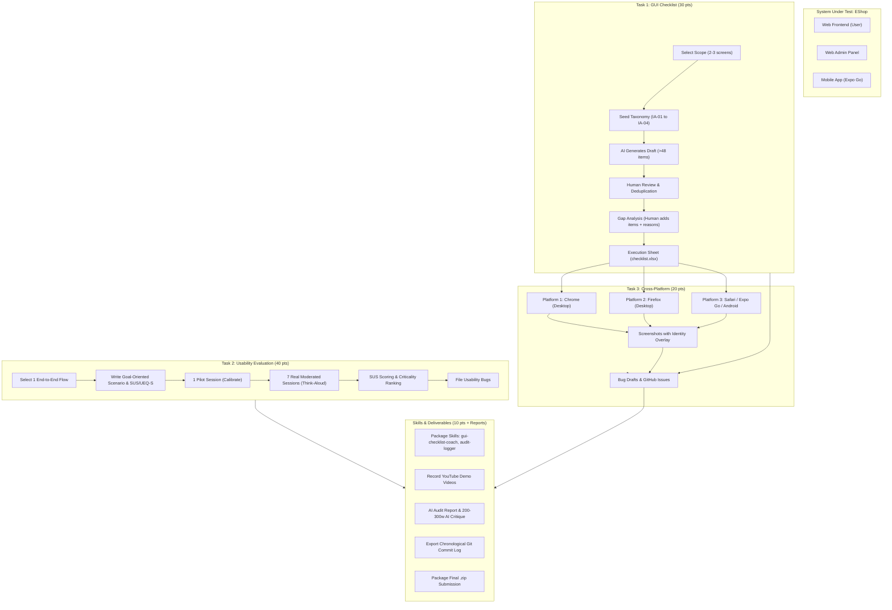

# HW03 – GUI & Usability Testing: Detailed Implementation Plan

## Executive Overview

- **Course:** Software Testing (CSC13003) – FIT @ HCMUS
- **Assignment:** HW03-AI – GUI & Usability Testing
- **Target SUT:** EShop Vietnamese E-commerce Demo ([SUT-EShop](https://github.com/faker26052005-lgtm/SUT-EShop))
- **Grade Breakdown (100 pts):**
  1. **Task 1 – GUI Checklist:** Design (>40 items), execution, and bug reporting on GitHub Issues (**30 pts**)
  2. **Task 2 – Usability Evaluation:** Realistic scenario, 1 pilot + 7 moderated sessions, SUS scoring, severity ranking (**40 pts**)
  3. **Task 3 – Cross-Browser / Cross-Platform:** Execution across $\ge 3$ platforms with student identity overlay (**20 pts**)
  4. **Task 4 – Agent Skills & Demo Videos:** Reusable agent skills with published YouTube demonstration links (**10 pts**)

---

## 1. Scope & Requirement Breakdown



### Critical Assignment Constraints & Non-Negotiable Rules

> [!CAUTION]
> **Anti-Cheat & Verification Penalties:**
> - Missing any mandatory document scores **0 points** for the whole assignment.
> - Fabricating participant details or execution results scores **0 points for Task 2** (TAs will verify and call 2 participants at random).
> - Copying prompts, items, or checklists between students scores **0 points for both**.
> - Late submissions are **strictly not permitted**.

> [!IMPORTANT]
> **Pair Programming & Integrity Boundaries:**
> - **The AI does:** Suggest/structure checklist items, identify blind spots, generate Excel/Markdown templates, draft bug reports from student notes, suggest Git commit messages, format reports.
> - **The Student does (Never the AI):** Decide which items stay/edit/reject, execute tests on running SUT, mark Passed/Failed, take screenshots with identity overlay, conduct usability sessions, write "Why AI missed it" reasoning, write the 200–300 word AI critique, make git commits.

---

## 2. Phased Implementation Roadmap

### Phase 0: Workspace Initialization & Configuration Alignment
- [ ] **Step 0.1: Project Facts Alignment**
  - Update `GEMINI.md` with:
    - Target GitHub repo (`<owner/repo>`) for filing bug issues and storing evidence.
    - Local repo path: `/home/quocky05/academy/software-testing/seminar/SUT-EShop`.
    - Student ID, Full Name, and Student Email.
    - Selected checklist screens (e.g., `Cart` + `Checkout` or `Product Detail` + `Cart`).
    - Selected usability flow (e.g., `Search product → Add to Cart → Apply Coupon → Place Order`).
    - 3 Chosen platforms (e.g., Chrome on Linux, Firefox on Linux, Expo Go on Android / Mobile Chrome).
- [ ] **Step 0.2: Directory Structure Verification**
  Ensure the following structure exists in `deliverables/04-exercises/quoc-ky/hw_03/`:
  ```
  hw_03/
  ├── PLAN.md                      # This plan
  ├── screen-maps/eshop.md
  ├── screen-context/
  │   ├── <screen1>.md
  │   ├── <screen2>.md
  │   └── images/
  ├── hw03-gui-checklist/
  │   ├── PROGRESS.md
  │   ├── checklist.xlsx
  │   ├── checklist.md
  │   ├── test-summary.md
  │   ├── commit-suggestions.md
  │   └── bug-drafts/
  ├── evidence/
  │   ├── screenshots/             # FAILED_<ID>_<Platform>.png
  │   └── cross-platform/          # Identity overlay screenshots
  ├── usability/
  │   ├── scenario.md
  │   ├── notes/                   # session_P01.md to session_P07.md
  │   ├── sus_ueqs_data.xlsx
  │   └── participants.md          # GITIGNORED (contact info)
  ├── report/
  │   ├── HW03_Report.md
  │   ├── AI_Critique.md
  │   └── AI_Audit_Report.md
  ├── skills/
  │   └── gui-checklist-coach/
  └── submission/                  # git-commit-log.txt & final zip
  ```
- [ ] **Step 0.3: Git Identity and Baseline Setup**
  - Verify `git config user.name` and `git config user.email`.
  - Confirm target working branch (e.g., dedicated feature/homework branch or `main`).

---

### Phase 1: Screen Mapping & Context Modeling (Task 1 & 3 Prep)
- [ ] **Step 1.1: Start Local SUT**
  - Launch backend (Express/Nest/FastAPI or MongoDB/Postgres as configured in EShop).
  - Launch web frontend (`localhost:3000` / `localhost:5173`).
  - Verify responsive viewport and API connectivity.
- [x] **Step 1.2: Populate `screen-maps/eshop.md`**
  - Map chosen screens to requirements:
    - *Cart Screen* $\rightarrow$ Pool B: FR-07.
    - *Checkout Screen* $\rightarrow$ Pool B: FR-08, FR-09.
- [x] **Step 1.3: Capture Screen Context in `screen-context/<slug>.md`**
  - Enumerate real UI elements (buttons, inputs, labels, steppers, modals).
  - Document key UI states: `default`, `empty`, `loading`, `validation_error`.
  - Save reference screenshots in `screen-context/images/` for grounding.

---

### Phase 2: Taxonomy Grounding & Initial AI Checklist Generation (Task 1)
- [ ] **Step 2.1: Seed Taxonomy**
  Map elements across the 4 required Interface Aspects:
  1. **IA-01 (General UI standards):** Typography hierarchy, brand colors, alignment, text truncation, responsiveness.
  2. **IA-02 (Forms):** Input constraints, field validation timing, required markers, Tab index order, focus rings, paste support.
  3. **IA-03 (Navigation):** Breadcrumb links, button vs. anchor semantics, back/forward cache behavior, modal dismissibility.
  4. **IA-04 (Feedback / State):** Loading spinners, empty cart placeholders, inline validation banners, toast messages, button disablement on submission.
- [ ] **Step 2.2: Generate Draft Checklist (`checklist.md`)**
  - Produce 48–60 granular items (12–15 per IA) to allow headroom for review rejections.
  - Required schema:
    `ID` | `Screen` | `IA` | `Category` | `Check` | `Expected Result` | `Priority` | `Source (AI)`
  - *Checkpoint 1 & 2 Gate:* Confirm all 4 IAs meet the minimum suggested floor ($\ge 8$ items each).

---

### Phase 3: Student Review, Deduplication & Gap Analysis (Task 1)
- [ ] **Step 3.1: Human Review & Deduplication**
  - Student reviews each AI item: **Keep**, **Edit**, or **Reject**.
  - Log rejections with rationales in `PROGRESS.md` (e.g., untestable, duplicate, testing pure backend logic).
- [ ] **Step 3.2: Human Gap Analysis (The Human Touch)**
  - Student identifies blind spots missed by AI:
    - Vietnamese diacritics & currency formatting (`₫`, number grouping `100.000 đ`).
    - Accessibility: keyboard navigation (`Tab` / `Shift+Tab`, `Enter`/`Space` activation), ARIA labels, contrast ratio.
    - Dynamic state resilience: double-clicking submit button, browser refresh mid-cart update.
    - Network edge cases: slow 3G or offline toast feedback.
  - Student writes own reasoning for each added item in `Why AI missed it` column:
    - *Prompt limitation*, *model limitation*, or *app-specific visual context*.
  - *Checkpoint 3 & 4 Gate:* Final item count must be **$> 40$ items**.

---

### Phase 4: Multi-Platform Test Execution & Evidence Capture (Task 1 & Task 3)
- [ ] **Step 4.1: Build `checklist.xlsx` and Execution Structure**
  - Add 3 platform result columns: `Result: Chrome`, `Result: Firefox`, `Result: Platform 3 (Safari / Expo Go / Android Chrome)`.
  - Add strict dropdown validation: `Passed` / `Failed`.
- [ ] **Step 4.2: Student Executes Checklist**
  - Run tests on each platform manually.
  - Record `Passed` or `Failed` (strictly done by student).
  - For every `Failed` item: write specific observation in `Notes` (prefixed by platform).
- [ ] **Step 4.3: Capture Failed Item Screenshots with Identity Overlay**
  - Take screenshot showing:
    1. Browser / OS / Device header.
    2. Localhost URL.
    3. Student identity overlay: **Student Email** (and/or Student ID + Full Name).
  - Save under `evidence/screenshots/FAILED_<ID>_<Platform>.png`.
  - *Checkpoint 5 Gate:* Every Failed item has an empirical screenshot and detailed note.

---

### Phase 5: GitHub Issues Integration & Test Summary (Task 1)
- [ ] **Step 5.1: Group Failures into Bug Drafts**
  - Consolidate multi-platform failures of the same defect into unified bug drafts in `hw03-gui-checklist/bug-drafts/<ID>.md`.
- [ ] **Step 5.2: Commit & Push Evidence Screenshots**
  - Commit evidence screenshots: `docs(evidence): add failed-item screenshots`.
  - Push commit to GitHub to obtain permanent, commit-pinned raw image URLs:
    `https://github.com/<owner>/<repo>/blob/<commit-sha>/evidence/screenshots/<file>?raw=true`
- [ ] **Step 5.3: Pilot Issue Creation**
  - Create 1 pilot issue on GitHub Issues using `gh` CLI or manual entry.
  - Verify title format: `[<Screen>] <short title>`, labels (`bug`, severity, IA tag, platform tag), and embedded image rendering.
- [ ] **Step 5.4: Batch Issue Creation & Reconciliation**
  - File remaining issues after student approval.
  - Write back Issue numbers and URLs into `checklist.xlsx` and `checklist.md`.
  - Generate `test-summary.md` reconciling: Designed = Executed = Passed + Failed.

---

### Phase 6: Usability Evaluation Planning & Execution (Task 2)
- [ ] **Step 6.1: Plan & Scenario Design**
  - Select 1 end-to-end user flow: e.g., *New visitor discovers a promotional product, adds it to the cart, applies coupon `DISCOUNT10`, and completes checkout.*
  - Write goal-oriented task prompt (no step-by-step instructions).
  - Prepare standard System Usability Scale (SUS) questionnaire (10 Likert questions) or UEQ-S.
  - Prepare qualitative probe questions:
    - *Clarity:* Were labels and icons intuitive?
    - *Error Recovery:* How did you recover when an error occurred?
    - *Speed:* Did any step feel slow or cumbersome?
    - *Trust:* Did the checkout process look secure and trustworthy?
- [ ] **Step 6.2: Participant Recruitment & Masking**
  - Recruit 7 non-classmate participants (outside HW03 class; non-IT preferred).
  - Prepare `usability/participants.md` (Name + phone/Zalo with middle 4 digits masked, e.g., `0901***789`).
  - *Note:* Add `participants.md` to `.gitignore` to protect personal privacy on public repos.
- [ ] **Step 6.3: Pilot Session (P00)**
  - Run 1 pilot evaluation session.
  - Refine scenario clarity, observer cues, and timing.
- [ ] **Step 6.4: Execute 7 Moderated Sessions (P01 to P07)**
  - Brief participant: Think-Aloud protocol, testing the interface, not the person.
  - Neutral observation: Record timestamps, friction points, misclicks, hesitations.
  - Administer SUS questionnaire and post-test probe interview immediately after completion.
  - Record 1 Git commit per session: `test(usability): record session P01` through `P07`.

---

### Phase 7: Usability Data Synthesis & Analysis (Task 2)
- [ ] **Step 7.1: Calculate SUS Scores**
  - Score SUS according to standard formula:
    - For odd items (1, 3, 5, 7, 9): Score contribution = $\text{Response} - 1$.
    - For even items (2, 4, 6, 8, 10): Score contribution = $5 - \text{Response}$.
    - Total SUS Score = $\text{Sum of contributions} \times 2.5$ (scale 0–100).
  - Calculate Mean, Median, and standard deviation across all 7 participants. Compare against benchmark average (~68).
- [ ] **Step 7.2: Qualitative Synthesis & Criticality Matrix**
  - Group observed friction points into themes.
  - Prioritize issues using:
    $$\text{Criticality} = \text{Severity (1 to 4)} \times \text{Probability / Frequency (1 to 7)}$$
  - Distinguish isolated user confusion from systemic UI defects.
- [ ] **Step 7.3: File Usability Defect Issues**
  - Log genuine usability bugs discovered during evaluation on GitHub Issues with tags `usability`, severity, and session evidence.

---

### Phase 8: Agent Skills Development & Video Demos (10 pts)
- [ ] **Step 8.1: Formalize Agent Skills**
  - Standardize `gui-checklist-coach` in `skills/gui-checklist-coach/` with:
    - `SKILL.md`: Metadata, prompt guidelines, phase checkpoints.
    - Scripts/templates: Excel generator script, Markdown converters.
  - Standardize `ai-audit-logger` skill for automatic audit report row extraction.
- [ ] **Step 8.2: Record Demonstration Videos**
  - Record screen walkthrough demonstrating:
    1. Running the `gui-checklist-coach` skill end-to-end on a screen.
    2. Extracting audit logs using the audit skill.
  - Upload unlisted/public videos to YouTube and collect video URLs.

---

### Phase 9: Deliverable Reports & AI Critique Compilation
- [ ] **Step 9.1: Compile Main Report (`report/HW03_Report.md`)**
  - **Section 1: GUI Checklist Report:** Objectives, screen scope, checklist summary, breakdown by IA, bug log with GitHub links.
  - **Section 2: Usability Evaluation Report:** Objectives, participant demographics table, scenario, SUS score breakdown and statistical summary, severity-ranked findings, recommendations.
  - **Section 3: Cross-Platform Evaluation Report:** Browser/platform compatibility matrix, discrepancies observed, overlay screenshot index.
- [ ] **Step 9.2: Complete AI Audit Report (`report/AI_Audit_Report.md`)**
  - Fill out 5-section HCMUS mandatory template:
    - Section 1: Student Information.
    - Section 2: Instructions.
    - Section 3: Audit Table (at least 10 rows covering prompts, raw outputs, verdicts VALID/INVALID/INCOMPLETE, ISTQB citations, student fixes).
    - Section 4: Accuracy summary statistics.
    - Section 5: Conclusion on AI efficacy.
    - Section 6: Mandatory disclosure statement.
- [ ] **Step 9.3: Draft AI Critique (200–300 Words)**
  - Student writes personal critique answering:
    - Where did AI fail or introduce bias?
    - Why did AI miss specific context?
    - What key engineering principle was learned regarding human-AI collaboration?
- [ ] **Step 9.4: Draft README.md**
  - Self-assessment table with score justification for each of the 4 criteria.
  - Consolidated test summary metrics and YouTube video demo links.

---

### Phase 10: Submission Packaging & Pre-Flight Verification
- [ ] **Step 10.1: Export Chronological Git Commit Log**
  - Generate formatted commit log:
    ```bash
    git log --reverse --date=iso --pretty=format:"%h | %ad | %an | %s" > submission/git-commit-log.txt
    ```
- [ ] **Step 10.2: Export Markdown to PDF**
  - Convert `HW03_Report.md` $\rightarrow$ `HW03_Report.pdf`.
  - Convert `AI_Audit_Report.md` + `AI_Critique.md` $\rightarrow$ PDF.
- [ ] **Step 10.3: Pre-Flight Checklist Audit**
  - [ ] Main report (Markdown + PDF) present.
  - [ ] Bug report with GitHub Issue screenshots present.
  - [ ] AI critique (200–300w) & AI Audit Report (Markdown + PDF) present.
  - [ ] Git commit log text file present with step-by-step commits.
  - [ ] `checklist.xlsx` (>40 items) with Summary tab and test-summary.md present.
  - [ ] Usability evidence (scenario, notes P01–P07, SUS scores, 7 masked participants) present.
  - [ ] Cross-platform screenshots with identity overlay present.
  - [ ] README.md with completed self-assessment table and test summary present.
  - [ ] Agent skills folder and valid YouTube links present.
- [ ] **Step 10.4: Package Archive**
  - Build zip: `<StudentID>_HW03_AI_GUIUsability_<SelfAssessedGrade>.zip` (e.g., `21127000_HW03_AI_GUIUsability_095.zip`).

---

## 3. Git Commit Cadence & Timeline Strategy

To satisfy the grading requirement of "one commit per step of the testing procedure showing a genuine working timeline":

| Step | Scope | Commit Message Convention | Staged Files |
|---|---|---|---|
| 1 | `chore` | `chore(setup): initialize HW03 directory structure and gitignore` | `.gitignore`, directory scaffolding |
| 2 | `docs` | `docs(checklist): map SUT screens and interface requirements` | `screen-maps/eshop.md`, `screen-context/` |
| 3 | `docs` | `docs(checklist): generate initial AI checklist for cart and checkout` | `checklist.md` (initial AI draft) |
| 4 | `docs` | `docs(checklist): review AI items and record deduplication decisions` | `PROGRESS.md`, `checklist.md` |
| 5 | `docs` | `docs(checklist): add human items and rationale for AI blind spots` | `checklist.md` (human additions) |
| 6 | `docs` | `docs(checklist): compile multi-platform execution sheet` | `checklist.xlsx` |
| 7 | `test` | `test(checklist): execute GUI checklist on Chrome desktop` | `checklist.xlsx`, `test-summary.md` |
| 8 | `test` | `test(checklist): execute GUI checklist on Firefox desktop` | `checklist.xlsx`, `test-summary.md` |
| 9 | `test` | `test(checklist): execute GUI checklist on Expo Go mobile` | `checklist.xlsx`, `test-summary.md` |
| 10 | `docs` | `docs(evidence): add failed-item cross-platform screenshots` | `evidence/screenshots/*.png` |
| 11 | `docs` | `docs(bugs): draft bug reports and file GitHub issues` | `bug-drafts/*.md`, `checklist.xlsx` |
| 12 | `docs` | `docs(usability): define test plan, task scenario, and SUS instrument` | `usability/scenario.md` |
| 13 | `test` | `test(usability): record pilot session P00` | `usability/notes/session_P00.md` |
| 14-20| `test` | `test(usability): record session P01` ... `P07` (1 commit each) | `usability/notes/session_P0X.md` |
| 21 | `docs` | `docs(usability): score SUS and rank findings by criticality` | `usability/sus_ueqs_data.xlsx`, `usability/findings.md` |
| 22 | `feat` | `feat(skill): implement gui-checklist-coach and audit-logger skills` | `skills/` |
| 23 | `docs` | `docs(report): compile main report and cross-platform matrix` | `report/HW03_Report.md` |
| 24 | `docs` | `docs(audit): complete AI audit report and critique` | `report/AI_Audit_Report.md`, `AI_Critique.md` |
| 25 | `docs` | `docs(summary): finalize README self-assessment and commit log` | `README.md`, `submission/git-commit-log.txt` |

---

## 4. Confirmed Project Parameters & Configuration

| Parameter | Confirmed Value |
|---|---|
| **SUT** | EShop (https://github.com/faker26052005-lgtm/SUT-EShop) |
| **Bug & Evidence Repo** | `faker26052005-lgtm/SUT-EShop` |
| **Local Git Repo Path** | `/home/quocky05/academy/software-testing/seminar/SUT-EShop/` |
| **Student ID & Name** | `23120138` / `Nguyễn Quốc Kỳ` |
| **Student Email** | `quockinguyen.lv@gmail.com` (for Git commits & identity overlay) |
| **Checklist Screens** | `Cart, Checkout` (Pool B: FR-07, FR-08, FR-09) |
| **Usability Flow** | `Product selection → Add to cart → Apply coupon → Checkout` |
| **Test Platforms (≥ 3)** | `BrowserStack (Chrome, Firefox, Safari)` |
| **Audit Log Skill** | `hw-ai-audit` |
| **Deadline** | `10/11/2026` |
