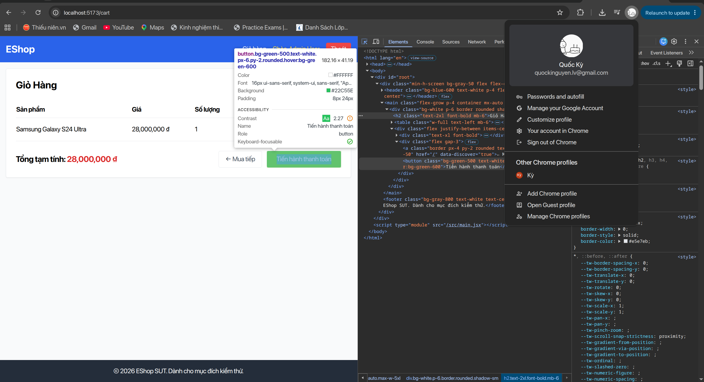
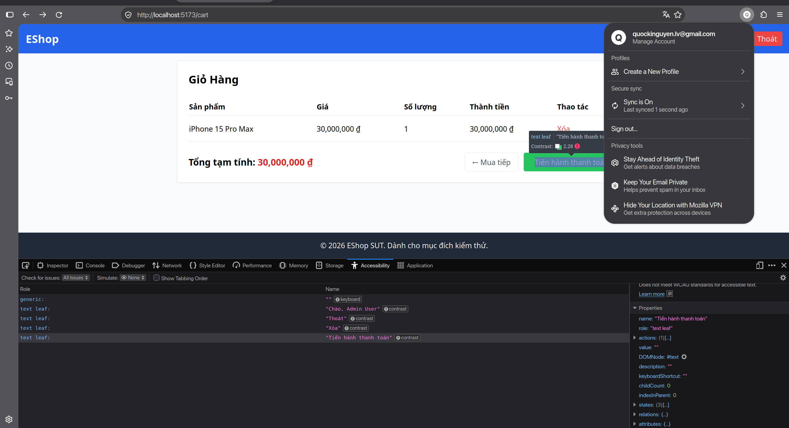
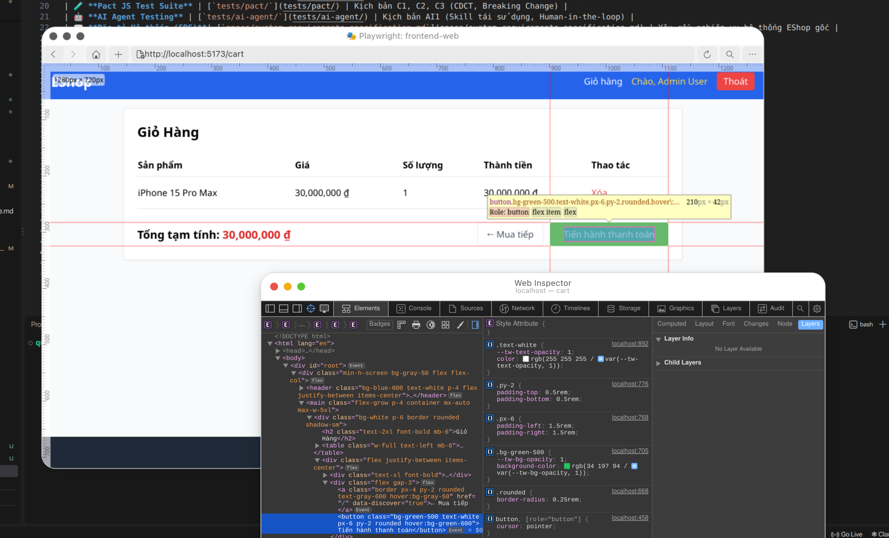

# [Cart] Nút "Tiến hành thanh toán" có độ tương phản chữ không đạt chuẩn WCAG AA

**GitHub Issue:** [#117](https://github.com/faker26052005-lgtm/SUT-EShop/issues/117)

**Checklist item:** `CART-IA01-04`  
**Interface Aspect:** `IA-01` (Color scheme)  
**Platforms affected:** Google Chrome, Mozilla Firefox, Apple Safari (WebKit)  
**Environment:** Linux (Ubuntu x86_64), Node.js, Vite React SUT at `http://localhost:5173`  
**Severity:** Minor  

## Steps to reproduce
1. Đăng nhập và thêm sản phẩm "Samsung Galaxy S24 Ultra" vào giỏ hàng.
2. Truy cập vào trang giỏ hàng tại URL /cart.
3. Mở DevTools (tab Elements/Inspect hoặc Accessibility) và kiểm tra màu sắc nút "Tiến hành thanh toán".
4. Đo tỷ lệ tương phản giữa màu chữ trắng (#ffffff) và màu nền xanh lá cây (#22c55e - bg-green-500).

## Expected result
Nút có nền màu xanh lá cây, chữ màu trắng, tỷ lệ tương phản đạt tối thiểu 4.5:1 (WCAG AA); khi rê chuột vào thì màu nền chuyển sang màu xanh lá cây sẫm hơn

## Actual result
- Chrome: Tỷ lệ tương phản chữ trắng trên nền xanh bg-green-500 chỉ đạt 2.44:1, không đạt chuẩn WCAG AA 4.5:1
- Firefox: Tab Accessibility trên Firefox báo lỗi tương phản: chữ trắng trên nền xanh bg-green-500 chỉ đạt 2.44:1, không đạt chuẩn WCAG AA 4.5:1
- Safari: Tỷ lệ tương phản chữ trắng trên nền xanh bg-green-500 #22c55e chỉ đạt ~2.44:1, không đạt chuẩn WCAG AA tối thiểu 4.5:1

## Evidence

