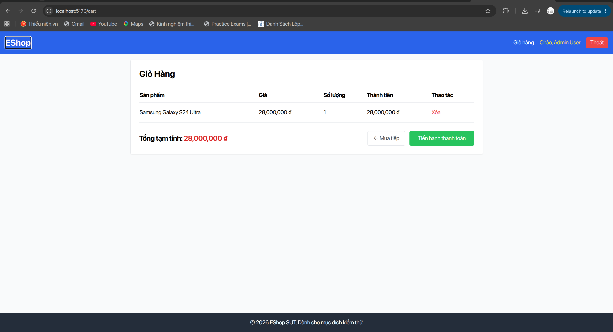
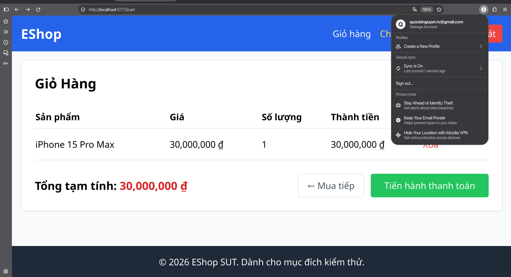
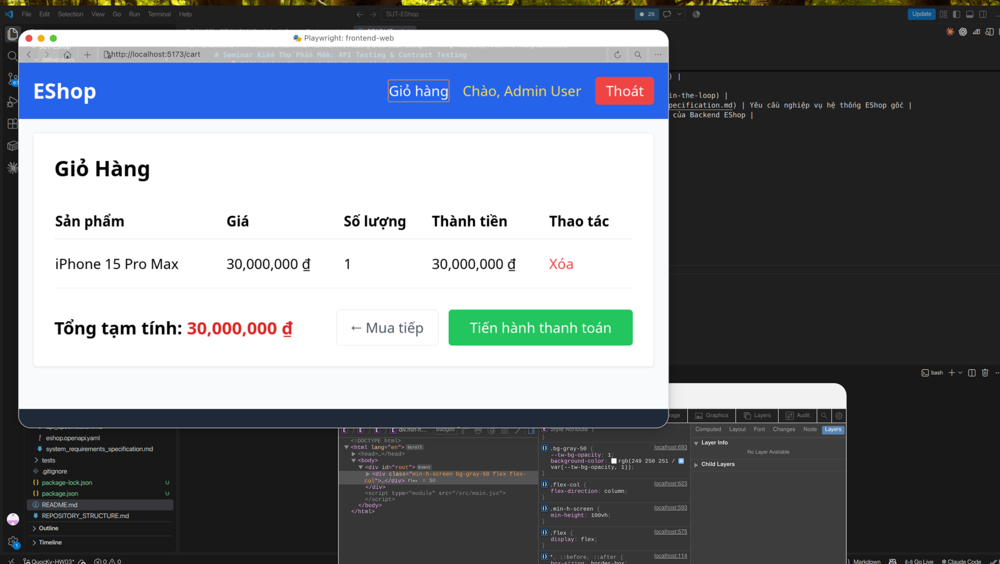

# [Cart] Không nhất quán quy cách viết hoa giữa tiêu đề trang và liên kết Navbar

**GitHub Issue:** [#120](https://github.com/faker26052005-lgtm/SUT-EShop/issues/120)

**Checklist item:** `CART-IA01-09`  
**Interface Aspect:** `IA-01` (Labels)  
**Platforms affected:** Google Chrome, Mozilla Firefox, Apple Safari (WebKit)  
**Environment:** Linux (Ubuntu x86_64), Node.js, Vite React SUT at `http://localhost:5173`  
**Severity:** Cosmetic  

## Steps to reproduce
1. Truy cập vào trang giỏ hàng tại URL /cart.
2. Quan sát tiêu đề lớn của trang và liên kết giỏ hàng trên thanh Navbar phía trên.

## Expected result
Tiêu đề trang và liên kết trên Navbar sử dụng cùng cách viết hoa

## Actual result
- Chrome: Không nhất quán quy cách viết hoa: Tiêu đề trang dùng Title Case "Giỏ Hàng", liên kết trên Navbar dùng Sentence case "Giỏ hàng"
- Firefox: Không nhất quán viết hoa: Tiêu đề trang dùng "Giỏ Hàng", liên kết Navbar dùng "Giỏ hàng"
- Safari: Không nhất quán viết hoa: Tiêu đề trang dùng "Giỏ Hàng", liên kết Navbar dùng "Giỏ hàng"

## Evidence

