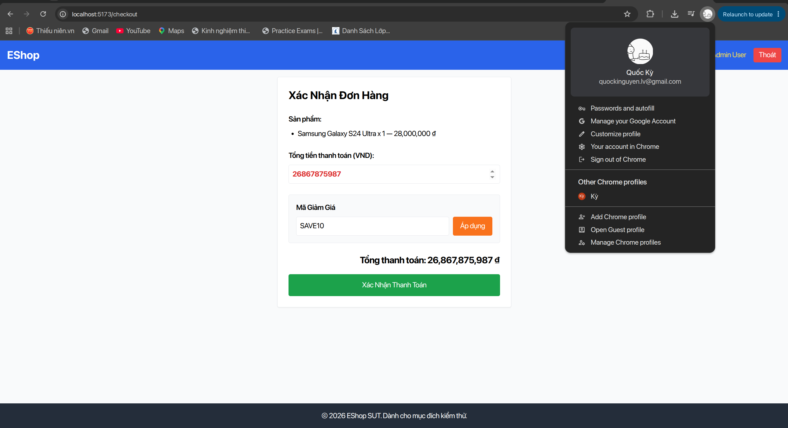
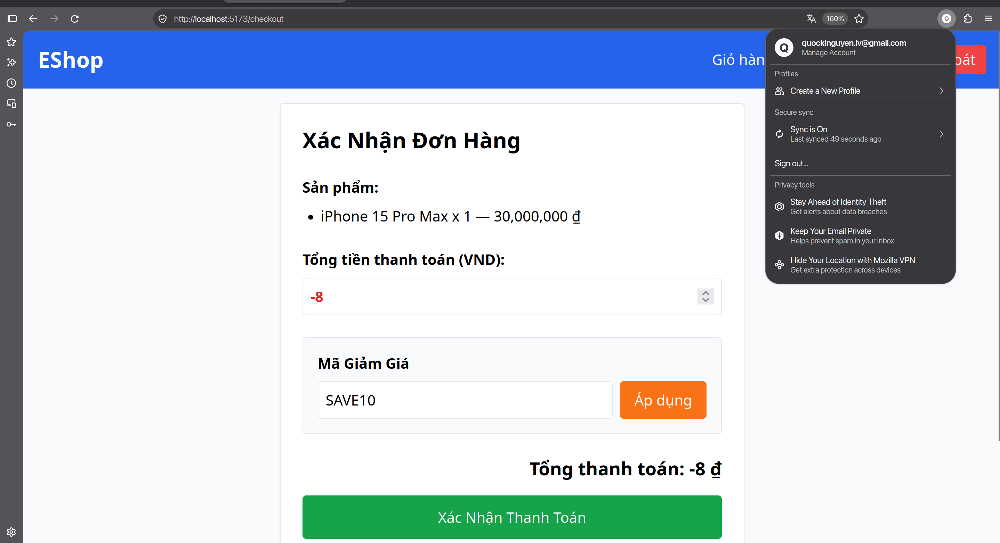
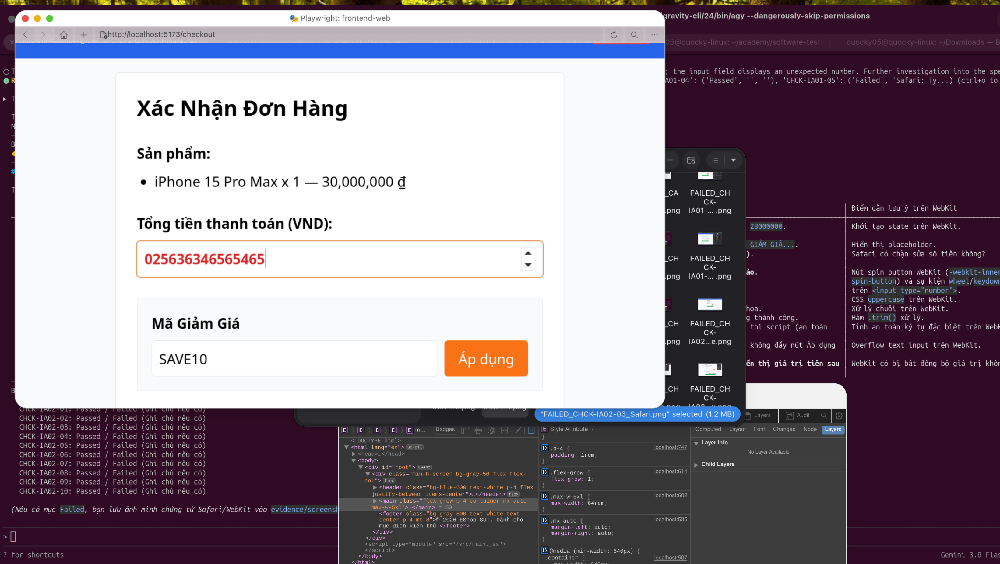

# [Checkout] Ô tổng tiền nhận con trỏ soạn thảo và bị thay đổi giá trị khi cuộn chuột hoặc bấm phím mũi tên

**GitHub Issue:** [#128](https://github.com/faker26052005-lgtm/SUT-EShop/issues/128)

**Checklist item:** `CHCK-IA02-04`  
**Interface Aspect:** `IA-02` (Input constraints)  
**Platforms affected:** Google Chrome, Mozilla Firefox, Apple Safari (WebKit)  
**Environment:** Linux (Ubuntu x86_64), Node.js, Vite React SUT at `http://localhost:5173`  
**Severity:** Major  

## Steps to reproduce
1. Truy cập /checkout với giỏ hàng có sản phẩm.
2. Nhấp chuột vào ô "Tổng tiền thanh toán (VND):".
3. Nhấn phím mũi tên Lên/Xuống trên bàn phím hoặc lăn bánh xe cuộn chuột trong ô.

## Expected result
Giá trị trong ô giữ nguyên `28,000,000 ₫` và không có con trỏ soạn thảo

## Actual result
- Chrome: Ô tổng tiền cho phép gõ số mới 25000000, nhận con trỏ soạn thảo và bị thay đổi số tiền khi cuộn chuột hoặc bấm phím mũi tên
- Firefox: Ô tổng tiền nhận con trỏ soạn thảo, cho phép gõ số mới 25000000 và bị thay đổi giá trị khi nhấn phím mũi tên hoặc cuộn chuột
- Safari: Ô tổng tiền nhận con trỏ soạn thảo, cho phép gõ số mới 25000000 và bị thay đổi giá trị khi nhấn phím mũi tên lên/xuống

## Evidence

