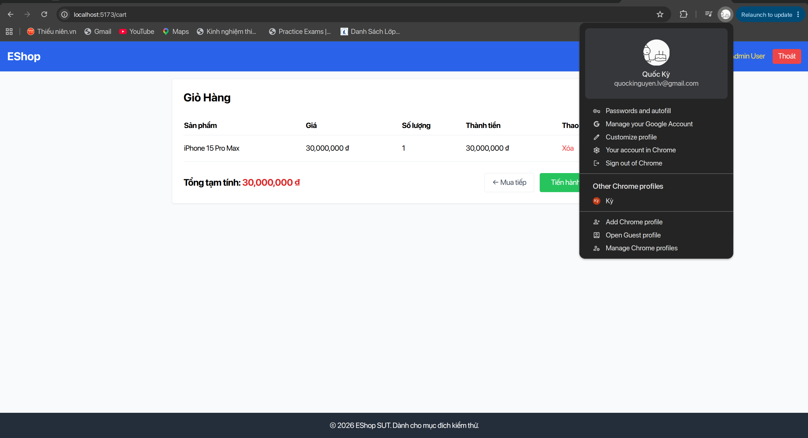
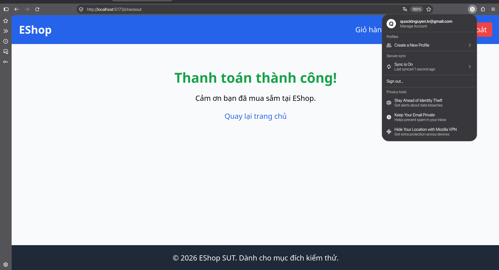
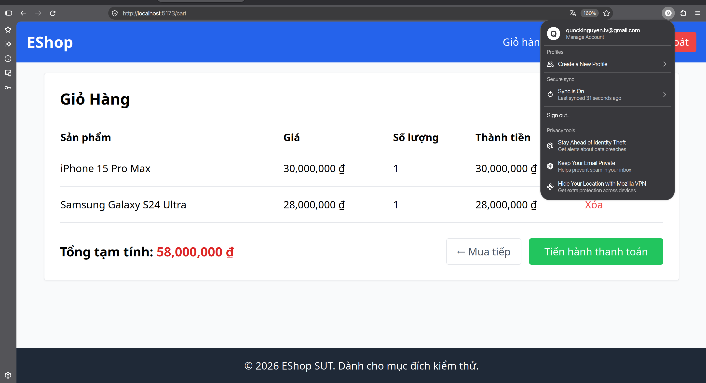
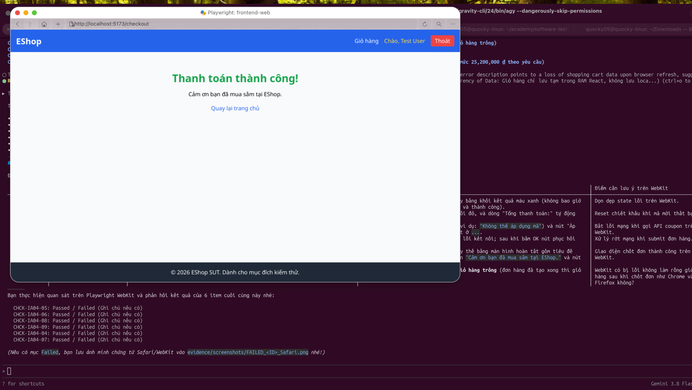
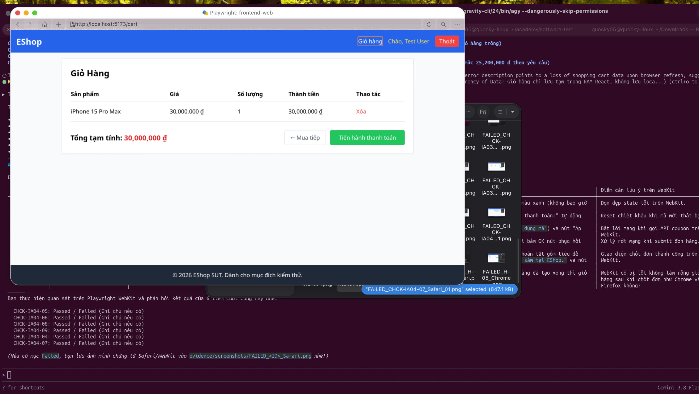

# [Checkout] Không làm rỗng giỏ hàng sau khi chốt đơn thành công, truy cập lại /cart vẫn còn nguyên sản phẩm

**GitHub Issue:** [#136](https://github.com/faker26052005-lgtm/SUT-EShop/issues/136)

**Checklist item:** `CHCK-IA04-07`  
**Interface Aspect:** `IA-04` (Control state aligned with data state)  
**Platforms affected:** Google Chrome, Mozilla Firefox, Apple Safari (WebKit)  
**Environment:** Linux (Ubuntu x86_64), Node.js, Vite React SUT at `http://localhost:5173`  
**Severity:** Major  

## Steps to reproduce
1. Tại /checkout, bấm "Xác Nhận Thanh Toán" để đặt hàng thành công (hiển thị view "Thanh toán thành công!").
2. Nhấp vào liên kết "Giỏ hàng" trên thanh Navbar để mở trang /cart.

## Expected result
Bấm liên kết "Giỏ hàng" trên Navbar mở trang /cart, màn hình hiển thị thông báo giỏ hàng trống

## Actual result
- Chrome: Lỗi đồng bộ state: Sau khi thanh toán thành công hệ thống không làm rỗng giỏ hàng, truy cập lại /cart vẫn còn nguyên sản phẩm cũ
- Firefox: Lỗi đồng bộ state: Sau khi thanh toán thành công hệ thống không làm rỗng giỏ hàng, truy cập lại /cart vẫn còn nguyên sản phẩm cũ
- Safari: Lỗi đồng bộ state: Sau khi thanh toán thành công hệ thống không làm rỗng giỏ hàng, truy cập lại /cart vẫn còn nguyên sản phẩm cũ

## Evidence

