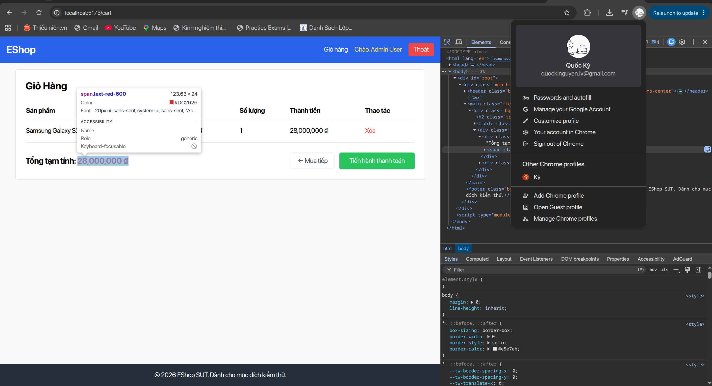
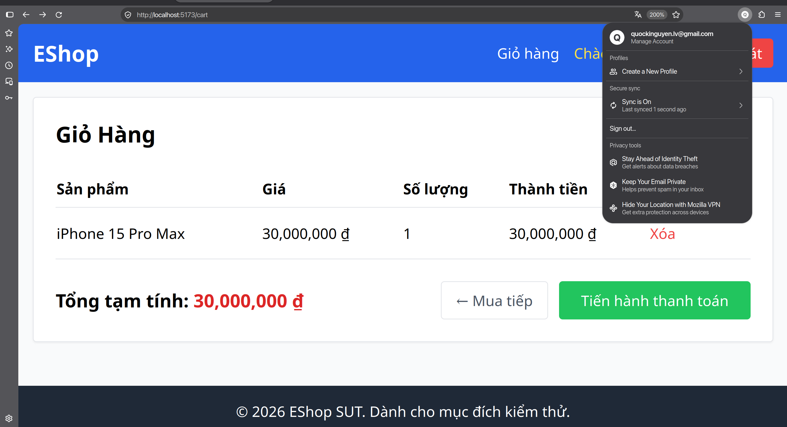
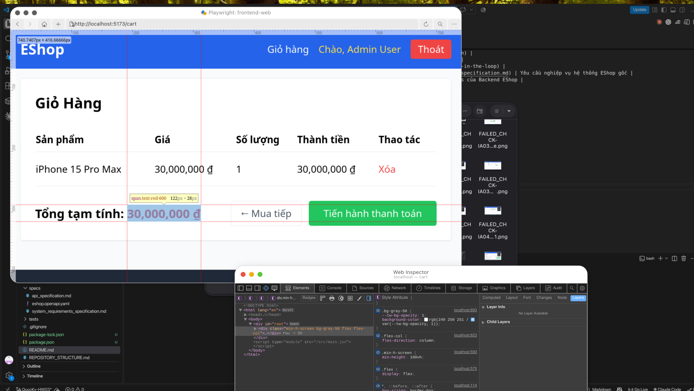

# [Cart/Checkout] Định dạng số tiền sử dụng dấu phẩy phân cách hàng nghìn kiểu US thay vì dấu chấm vi-VN

**GitHub Issue:** [#138](https://github.com/faker26052005-lgtm/SUT-EShop/issues/138)

**Checklist item:** `H-05`  
**Interface Aspect:** `IA-01` (Application and GUI standards (localization))  
**Platforms affected:** Google Chrome, Mozilla Firefox, Apple Safari (WebKit)  
**Environment:** Linux (Ubuntu x86_64), Node.js, Vite React SUT at `http://localhost:5173`  
**Severity:** Minor  

## Steps to reproduce
1. Thêm sản phẩm đơn giá lớn "Samsung Galaxy S24 Ultra" vào giỏ hàng.
2. Truy cập /cart và /checkout, quan sát cách hiển thị các số tiền (28,000,000 ₫).

## Expected result
Dùng dấu chấm ("28.000.000 đ")

## Actual result
- Chrome: Định dạng số tiền không đúng chuẩn bản địa hóa tiếng Việt vi-VN: sử dụng dấu phẩy phân tách hàng nghìn kiểu US như 28,000,000 ₫ thay vì dấu chấm 28.000.000 ₫
- Firefox: Định dạng tiền tệ dùng dấu phẩy phân cách hàng nghìn 28,000,000 ₫ thay vì dấu chấm 28.000.000 ₫ theo chuẩn bản địa hóa vi-VN
- Safari: Định dạng tiền tệ dùng dấu phẩy phân cách hàng nghìn 28,000,000 ₫ thay vì dấu chấm 28.000.000 ₫ theo chuẩn bản địa hóa vi-VN

## Evidence

