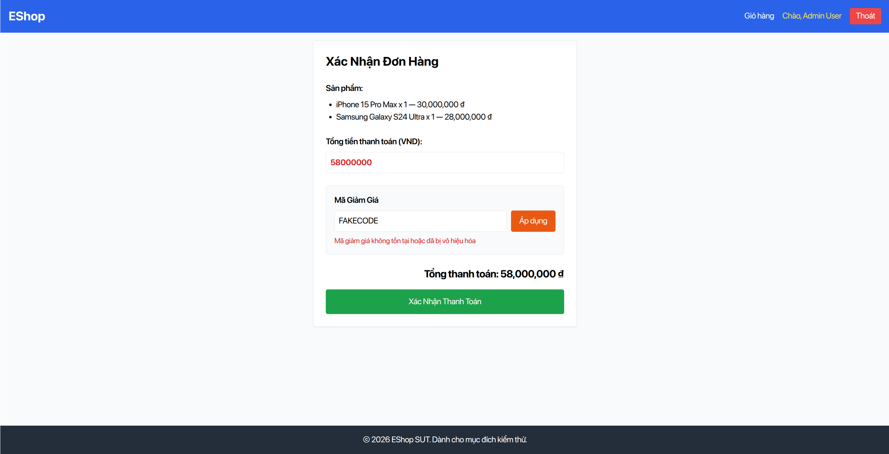

# [Usability][Cart] Cryptic error message on coupon condition failure causing checkout deadlock

- **Finding ID:** `F-01`
- **Affected Participants:** `[P03, P05]`
- **Severity:** `Major`
- **Labels:** `bug`, `severity:Major`, `usability`, `platform:Web`
- **Environment:** Chrome Desktop 130 / Ubuntu 22.04 & macOS 14 / `http://localhost:3000` (SUT baseline commit `35b8c5a07ec556df9ffefb5f237bb8fe536ed4aa`)
- **GitHub Issue:** [#159](https://github.com/faker26052005-lgtm/SUT-EShop/issues/159)

---

## Description
When applying a promotional coupon code that does not satisfy prerequisites (e.g., minimum order value `min_order_amount` not met, or accidental leading/trailing whitespace), the system returns a vague, unhelpful error message such as *"Mã không hợp lệ hoặc không thể áp dụng"* or *"Mã giảm giá không tồn tại"*. 

Because the frontend fails to relay the specific reason returned by the API (or validate format client-side), users are unable to diagnose what is wrong. During testing, this caused complete task deadlock exceeding 2 minutes for participant P05, who repeatedly re-entered the valid promo code `SAVE10` in uppercase and lowercase, assumed the promotion had expired, and required moderator intervention (`assisted`).

---

## Steps to Reproduce
1. Log in to EShop with test user account (`test@eshop.com`).
2. Add any product with price below 300,000 ₫ (e.g., "Cáp sạc Type-C" 180,000 ₫) to the cart.
3. Navigate to the Cart page (`http://localhost:3000/cart`).
4. In the coupon input field, enter active valid coupon code `SAVE10` (which requires order total $\ge 300,000$ ₫).
5. Click the "Áp dụng" button.

---

## Expected Result
The system should display a specific, actionable error message explaining why the coupon cannot be applied, for example:
> *"Đơn hàng chưa đạt giá trị tối thiểu 300.000 ₫ để áp dụng mã này (cần thêm 120.000 ₫)."*
If whitespace is present (e.g., `SAVE 10`), the system should either automatically trim whitespace or inform: *"Mã không được chứa khoảng trắng"*.

---

## Actual Result
The system displays a generic error message:
> *"Mã không hợp lệ hoặc không thể áp dụng"*
The user has no indication that the code itself is valid but the cart value is insufficient, leading to repeated failed attempts, frustration, and checkout abandonment.

---

## Session Evidence
- **Participant P05:** Deadlocked for over 2 minutes (01:11 - 02:20). Retried entering `SAVE10` 3 times in frustration. Quote: *"Ủa mã này bị hết hạn rồi hả bạn?"* / *"Thông báo lỗi nên ghi rõ lý do như 'Đơn hàng chưa đủ 300k' thay vì chỉ báo 'Mã không hợp lệ'."* (Task outcome degraded to `assisted`, SUS score plummeted to 42.5).
- **Participant P03:** Accidentally typed `SAVE 10` (with a space) and was told *"Mã giảm giá không tồn tại"*, causing initial confusion before self-correcting.

---

## Screenshot Evidence

