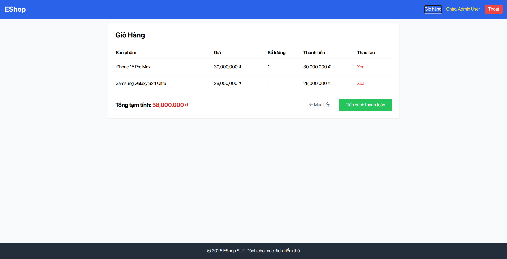

# [Usability][Cart] Coupon input field ignores Enter key form submission

- **Finding ID:** `F-02`
- **Affected Participants:** `[P01]`
- **Severity:** `Minor`
- **Labels:** `bug`, `severity:Minor`, `usability`, `platform:Web`
- **Environment:** Chrome Desktop 130 / Ubuntu 22.04 / `http://localhost:3000` (SUT baseline commit `35b8c5a07ec556df9ffefb5f237bb8fe536ed4aa`)
- **GitHub Issue:** Pending Review

---

## Description
In the Shopping Cart screen (`/cart`), the promotional coupon input box does not listen for keyboard `Enter` (KeyCode 13) submission, nor is it encapsulated within an HTML `<form>` element with a submit handler. 

Desktop keyboard users who type a coupon code and instinctively hit `Enter` experience complete lack of responsiveness. The input neither submits nor produces visual feedback, misleading users to assume the interface is frozen or unresponsive.

---

## Steps to Reproduce
1. Log in to EShop and add any eligible product to the cart.
2. Navigate to the Cart page (`http://localhost:3000/cart`).
3. Click on the coupon code input field and type `SAVE10`.
4. Press the `Enter` key on the physical keyboard.

---

## Expected Result
Pressing `Enter` while focused on the coupon text field should trigger the coupon verification function (identical to clicking the "Áp dụng" button).

---

## Actual Result
Nothing happens. The cursor remains in the input field, the coupon is not evaluated, and no feedback is displayed. The user is forced to switch back to the mouse to click the button.

---

## Session Evidence
- **Participant P01:** Timestamp `00:51 - 01:20`. Typed `SAVE10`, pressed `Enter`, and waited 9 seconds staring at the screen in confusion assuming the browser had lagged, before manually reaching for the mouse to click "Áp dụng".
- **Verbatim Quote [P01]:** *"Gõ mã xong mình quen tay bấm Enter nhưng web không nhận, tưởng bị đơ một lúc mới thấy cần phải bấm chuột vào nút Áp dụng bên cạnh."*

---

## Screenshot Evidence

