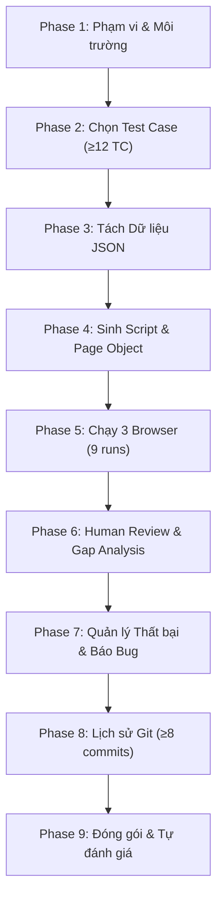

# Playwright Automation Coach – Tài liệu Hướng dẫn Agent Skill (HW04)

> **Môn học:** Kiểm thử Phần mềm (CS423 / CSC13003) – FIT@HCMUS  
> **Sinh viên thực hiện:** Nguyễn Quốc Kỳ  
> **MSSV:** 23120138 – **Lớp:** 23CLC02  
> **Hệ thống thử nghiệm (SUT):** EShop (Web, Admin, Backend REST API)  
> **Repository:** `git@github.com:faker26052005-lgtm/SUT-EShop.git`  
> **Định vị Skill:** `.agents/skills/playwright-automation-coach/`  

---

## 1. Giới thiệu Tổng quan (Skill Overview)

**`playwright-automation-coach`** là một Agent Skill chuyên biệt hướng dẫn quy trình tự động hóa kiểm thử giao diện web đa trình duyệt (Chromium, Firefox, WebKit) sử dụng Playwright và TypeScript cho hệ thống SUT EShop.

### Mục tiêu cốt lõi:
- **Tuân thủ nguyên tắc kiểm thử có kỷ luật:** Tránh biến AI thành một "hộp đen" sinh mã mất kiểm soát bằng cách phân chia quy trình thành **9 giai đoạn (staged workflow)** tuần tự với các checkpoint nghiêm ngặt.
- **Tách rời dữ liệu (Data-driven):** Dữ liệu kiểm thử nằm độc lập trong file JSON (`data/*.json`), không hardcode mảng dữ liệu trong code test.
- **Đa trình duyệt thực chất:** Tự động hóa việc chạy test trên cả 3 engine trình duyệt chính (`chromium`, `firefox`, `webkit`), xuất 9 bộ HTML Report mang danh tính sinh viên (`Run by: 23120138`) và timestamp ISO thực tế.
- **Lấy con người làm trung tâm (Human-in-the-loop):** Phân định rạch ròi giữa bản nháp do AI sinh và bản sửa lỗi do sinh viên review, tạo tiền đề cho báo cáo phân tích khoảng cách (Gap Analysis) và phản biện năng lực AI (AI Critique).

---

## 2. Bảng Phân chia Vai trò & Quy định Quyền hạn Reviewer

Bài tập HW04 đánh giá năng lực kiểm soát, phản biện và trách nhiệm cá nhân của sinh viên đối với sản phẩm kiểm thử. AI chỉ là trợ lý có kỷ luật, **Reviewer (Sinh viên Nguyễn Quốc Kỳ) nắm giữ quyền quyết định tối cao**.

### 🛡️ Nguyên tắc Vận hành Bắt buộc giữa AI và Reviewer:
1. **Kiểm soát Từng Phase Độc lập (Strict Phase-by-Phase Gate):**
   - AI bắt buộc phải làm việc theo **từng phase đơn lẻ**.
   - **Tuyệt đối cấm gộp (batching) thực hiện liên tiếp 2–3 phase rồi mới báo cáo cho Reviewer.** Sau khi kết thúc mỗi phase, AI phải dừng lại, trình bày kết quả chi tiết, chỉ rõ trạng thái Checkpoint và chờ Reviewer phê duyệt nghiệm thu mới được chuyển sang phase tiếp theo.
2. **Quy tắc "Hỏi trước khi Áp dụng" (Ask-Before-Apply):**
   - Trước khi tạo mới tập tin, chỉnh sửa mã nguồn trên đĩa hoặc thực thi lệnh thay đổi trạng thái (cài đặt package, chạy test suite, commit git), AI **bắt buộc phải giải thích lý do, nội dung thay đổi dự kiến và hỏi ý kiến Reviewer trước khi thực hiện**.
   - Reviewer có quyền từ chối, yêu cầu giải thích thêm hoặc yêu cầu chỉnh sửa phương án trước khi bất kỳ thay đổi nào được ghi xuống hệ thống.

| Nội dung công việc | Trách nhiệm của AI Assistant | Trách nhiệm của Reviewer (Sinh viên Nguyễn Quốc Kỳ) |
| :--- | :--- | :--- |
| **Quyết định thay đổi & thực thi** | Trình bày đề xuất, giải thích phương án kỹ thuật và **xin phép trước khi thao tác** | **Phê duyệt hoặc từ chối** trước khi AI áp dụng thay đổi thật xuống đĩa |
| **Phân tích yêu cầu & Chọn test case** | Phân tích SRS và bảng HW02, gợi ý các case thích hợp data-driven | **Quyết định** đưa vào, sửa đổi hoặc loại bỏ test case; chịu trách nhiệm danh sách chọn |
| **Trích xuất dữ liệu kiểm thử** | Chạy script trích xuất JSON khi được duyệt, chuẩn hóa schema | **Kiểm chứng** từng giá trị expected với tài liệu đặc tả SRS `specs/system_requirements_specification.md` |
| **Sinh mã nguồn kiểm thử** | Sinh bản thảo Page Objects và Playwright Specs (AI Draft) | **Rà soát từng dòng code**, sửa lỗi selector, bổ sung assertion, tối ưu wait |
| **Thực thi kiểm thử** | Cung cấp script runner `run-all.mjs` và config Playwright | **Trực tiếp chạy test** trên máy local qua 3 trình duyệt; tuyệt đối không để AI can thiệp |
| **Báo cáo kết quả & Thẩm định** | Cung cấp công cụ thẩm định tự động `check_requirements.py` | Mở trực quan từng HTML report, xác nhận hiển thị `Run by: 23120138` |
| **Phân tích khoảng cách (Gap Analysis)** | Gợi ý danh mục lỗi kỹ thuật theo `review-checklist.md` | **Tự viết** cột *"Nguyên nhân AI mắc lỗi"* và bài học kinh nghiệm bằng ngôn từ của mình |
| **Quản lý lỗi SUT & GitHub Issues** | Soạn thảo bản nháp báo cáo lỗi theo mẫu | **Xác nhận lỗi SUT thật**, chụp ảnh màn hình, tạo và duyệt GitHub Issues trên repo |
| **Lịch sử Git & Commit** | Gợi ý thông điệp commit chuẩn Conventional Commits | **Tự thực hiện commit** (≥ 8 commit sửa spec) và xuất file `docs/git-commit-log.txt` |
| **Video Demo & Tự đánh giá** | Cung cấp kịch bản chi tiết trong `demo-script.md` | **Tự quay video demo** (giọng nói, terminal `whoami`), tự chấm điểm bài làm |

> [!CAUTION]
> **Ranh giới Đạo đức Kiểm thử (Testing Integrity Rules):**
> - Tuyệt đối không tự ý chạy liên tiếp 2–3 phase mà không dừng lại xin phép Reviewer nghiệm thu từng phase.
> - Tuyệt đối không tự ý tạo/sửa file hoặc chạy lệnh thay đổi trạng thái khi chưa hỏi trước Reviewer.
> - Tuyệt đối không để AI tạo giả hoặc chỉnh sửa file HTML Report, timestamp ISO, ảnh chụp màn hình hay log chạy terminal.
> - Tuyệt đối không để AI viết hộ bài AI Critique (200–300 từ) hoặc tự ý đánh giá điểm số.
> - Nếu test fail vì lỗi thật của SUT, tuyệt đối không được sửa script hay sửa expected value cho pass. Phải giữ nguyên và ghi nhận bug.

---

## 3. Quy trình Chi tiết 9 Giai đoạn (9-Phase Staged Workflow)



---

### Phase 1: Phạm vi & Môi trường Kiểm thử (Scope & Environment)
* **Mục đích:** Thống nhất danh sách 3 tính năng, các cổng dịch vụ local và cấu hình biến môi trường.
* **Đầu vào (Input):**
  - Tài liệu đề bài `materials/hw04.md` và `GEMINI.md`.
  - Hệ thống SUT EShop local (`./run_servers.sh`).
* **Đầu ra (Output):**
  - File `.env` chứa các URL: `BASE_URL=http://localhost:5173`, `ADMIN_URL=http://localhost:5174`, `API_URL=http://localhost:3000` và `STUDENT_ID=23120138`.
  - File cấu hình mapping [`assets/features.json`](assets/features.json).
* **AI sẽ làm gì:**
  - Hướng dẫn cấu hình cổng phân hệ, kiểm tra kết nối tới các dịch vụ của EShop.
  - Cung cấp template `.env.example` và `features.json`.
* **Reviewer (Sinh viên) sẽ làm gì:**
  - Khởi động SUT local bằng `./run_servers.sh`.
  - Xác nhận 3 tính năng đã chọn không bị trùng lặp với các thành viên khác trong nhóm.
* **Tiêu chí nghiệm thu (Checkpoint 1):**
  - 3 dịch vụ Backend (:3000), Web (:5173), Admin (:5174) phản hồi thành công; file `.env` đã được thiết lập.

---

### Phase 2: Lựa chọn Test Case để Tự động hóa (Test Case Selection)
* **Mục đích:** Tuyển chọn và lập luận danh sách gồm **≥ 12 test case tự động hóa** cho mỗi tính năng từ dữ liệu kiểm thử HW02.
* **Đầu vào (Input):**
  - Bảng đặc tả Test Case tại `../hw_02/Main_Report.md`:
    - Pool A: **FR-02** (Đăng nhập & Khóa tài khoản - 24 test cases)
    - Pool B: **FR-07** (Giỏ hàng - 20 test cases)
    - Pool C: **FR-17** (Quản lý mã giảm giá Admin - 36 test cases)
* **Đầu ra (Output):**
  - Danh sách test case chọn lọc cho mỗi tính năng (đảm bảo đa dạng: positive, negative, edge boundary).
  - Bảng ghi nhận các test case không tự động hóa ("Not automated") kèm lý do kỹ thuật (ví dụ: thời gian phạt khóa 180s).
* **AI sẽ làm gì:**
  - Áp dụng tiêu chí từ [`references/test-selection.md`](references/test-selection.md) để phân tích các case phù hợp data-driven.
  - Đề xuất phân loại: `Automate` hoặc `Not automated`.
* **Reviewer (Sinh viên) sẽ làm gì:**
  - Phê duyệt danh sách test case chính thức; quyết định loại bỏ các case không khả thi.
  - Xác nhận mỗi tính năng có ít nhất 12 case được chọn.
* **Tiêu chí nghiệm thu (Checkpoint 2):**
  - Cả 3 tính năng đều có ≥ 12 test case tự động hóa với đầy đủ ID định dạng `TC_<FR>_<NN>`. Các case bị bỏ qua đều có giải trình kỹ thuật rõ ràng.

---

### Phase 3: Tách rời Dữ liệu Kiểm thử (Test Data Separation)
* **Mục đích:** Trích xuất toàn bộ dữ liệu đầu vào và kết quả mong đợi ra các file JSON độc lập ngoài mã test script.
* **Đầu vào (Input):**
  - Bảng test case trong `../hw_02/Main_Report.md`.
  - Công cụ trích xuất [`scripts/tc_to_json.py`](scripts/tc_to_json.py).
* **Đầu ra (Output):**
  - `data/fr02-login.json` (24 cases)
  - `data/fr07-cart.json` (20 cases)
  - `data/fr17-coupon.json` (36 cases)
* **AI sẽ làm gì:**
  - Thực thi script `tc_to_json.py` để phân giải bảng Markdown thành cấu trúc JSON chuẩn hóa schema.
  - Đánh dấu trường `human_verification: "TODO: verify with SRS"` trên từng bản ghi.
* **Reviewer (Sinh viên) sẽ làm gì:**
  - Mở các file JSON, đối chiếu các giá trị `expectedStatus`, `expectedMessage`, `expectedUrl` với tài liệu `specs/system_requirements_specification.md`.
  - Đảm bảo dữ liệu phản ánh kết quả mong đợi theo đặc tả, không chép theo hành vi sai hiện tại của app.
* **Tiêu chí nghiệm thu (Checkpoint 3):**
  - 3 file JSON tồn tại trong thư mục `data/`, không chứa mảng dữ liệu nào trong spec, mỗi dòng map khớp chính xác với ID HW02.

---

### Phase 4: Sinh Mã nguồn Kiểm thử (Script Generation - AI Draft)
* **Mục đích:** Xây dựng khung Page Object Models và Playwright Specs theo mô hình Data-Driven lặp qua dữ liệu JSON.
* **Đầu vào (Input):**
  - Các file dữ liệu JSON trong `data/`.
  - Hướng dẫn locator [`references/selector-and-wait-rules.md`](references/selector-and-wait-rules.md).
  - 8 mẫu assertion từ [`references/assertion-patterns.md`](references/assertion-patterns.md).
* **Đầu ra (Output):**
  - Page Objects: `pages/login.page.ts`, `pages/cart.page.ts`, `pages/admin-coupon.page.ts`.
  - Data-driven Specs: `tests/fr02-login.spec.ts`, `tests/fr07-cart.spec.ts`, `tests/fr17-coupon.spec.ts`.
* **AI sẽ làm gì:**
  - Sinh mã nguồn bản nháp đầu tiên (AI Draft) cho từng tính năng.
  - Áp dụng cấu trúc `test.describe` lặp qua mảng JSON.
  - Sử dụng các locator cơ bản và phối hợp ≥ 3 kiểu assertion khác nhau.
* **Reviewer (Sinh viên) sẽ làm gì:**
  - Chạy thử lệnh biên dịch TypeScript và chạy nháp 1 case trên Chromium.
  - **Tạo commit Git riêng biệt** đánh dấu bản do AI sinh:
    `test(FR-xx): generate AI draft for TC_FRxx_01-12`.
* **Tiêu chí nghiệm thu (Checkpoint 4):**
  - Code biên dịch không lỗi cú pháp, spec đọc dữ liệu từ JSON và chạy được ít nhất 1 lần trên Chromium.

---

### Phase 5: Chạy Đa Trình Duyệt & Xuất Báo Cáo (Multi-Browser Runs)
* **Mục đích:** Thực hiện **9 lượt chạy thực tế** (3 features $\times$ 3 browsers: Chromium, Firefox, WebKit) để xuất ra 9 bộ báo cáo HTML mang danh tính sinh viên.
* **Đầu vào (Input):**
  - Mã nguồn spec đã chuẩn bị ở Phase 4.
  - Cấu hình đa trình duyệt [`assets/playwright.config.ts`](assets/playwright.config.ts).
  - Runner tự động [`assets/run-all.mjs`](assets/run-all.mjs).
* **Đầu ra (Output):**
  - 9 thư mục báo cáo tại `reports/<feature>/<browser>/` chứa `index.html` và `results.json`.
  - Tiêu đề báo cáo và metadata hiển thị: **`Run by: 23120138`** cùng ISO timestamp thực tế.
* **AI sẽ làm gì:**
  - Cung cấp runner `run-all.mjs` tự động thiết lập biến môi trường và điều phối 9 lượt chạy tuần tự (`workers: 1`, `retries: 0`).
  - Hướng dẫn chẩn đoán lỗi nếu trình duyệt không khởi động được.
* **Reviewer (Sinh viên) sẽ làm gì:**
  - **Trực tiếp chạy lệnh:** `node scripts/run-all.mjs` trên máy của mình.
  - Mở từng báo cáo HTML xác nhận tiêu đề hiển thị đúng MSSV và timestamp.
  - Chạy script kiểm tra: `python3 scripts/check_requirements.py`.
* **Tiêu chí nghiệm thu (Checkpoint 5):**
  - Đủ 9 thư mục báo cáo HTML tương ứng 9 lần chạy thật, script `check_requirements.py` xác nhận metadata `Run by` và `Run at` hợp lệ 100%.

---

### Phase 6: Rà soát & Phân tích Khoảng cách (Review & Gap Analysis)
* **Mục đích:** Sinh viên trực tiếp phản biện các điểm yếu trong mã nguồn do AI sinh ra, sửa lỗi, và viết phân tích khoảng cách phục vụ báo cáo và video demo.
* **Đầu vào (Input):**
  - Mã nguồn AI Draft từ Phase 4.
  - Bảng tiêu chí rà soát [`references/review-checklist.md`](references/review-checklist.md).
* **Đầu ra (Output):**
  - Các commit Git sửa lỗi riêng biệt (type `fix`).
  - Bảng Gap Analysis hoàn chỉnh trong `docs/main-report.md`.
  - Chọn được ít nhất 1 lỗi điển hình để thuyết minh trong video demo.

#### 5 Tiêu chí Đánh giá Script cần Chỉnh sửa (Review Criteria):
Dựa vào các tiêu chuẩn kiểm thử tự động chuyên nghiệp và yêu cầu của môn học, một script do AI sinh ra bị coi là **cần phải chỉnh sửa** nếu vi phạm 1 trong 5 tiêu chí sau:

1. **Độ bền vững của Selector (Locators):**
   - *Dấu hiệu lỗi của AI:* Sử dụng CSS selector bám vào layout hoặc class dài dễ thay đổi (`button.btn-primary.mt-2`, `div > span:nth-child(2)`), chuỗi XPath tuyệt đối, hoặc text selector bị ảnh hưởng bởi dấu tiếng Việt.
   - *Chuẩn chỉnh sửa:* Bắt buộc thay bằng **Accessible Locators** theo khuyến nghị của Playwright: `getByRole('button', { name: /đăng nhập/i })`, `getByLabel`, `getByPlaceholder`, hoặc `getByTestId`.
2. **Cơ chế chờ đợi & Triệt tiêu Flakiness (Waits & Flakiness):**
   - *Dấu hiệu lỗi của AI:* Sử dụng `page.waitForTimeout(3000)` hoặc `sleep()` cố định để "chờ mạng". Đây là hành vi bị đề bài nghiêm cấm vì làm chậm suite và gây lỗi chập chờn (flaky).
   - *Chuẩn chỉnh sửa:* Thay thế bằng **Web-first Assertions** tự động retry: `await expect(locator).toBeVisible()`, `page.waitForURL()`, hoặc lắng nghe phản hồi mạng `page.waitForResponse()`.
3. **Chất lượng & Độ đa dạng của Assertion (Assertions Quality & Variety):**
   - *Dấu hiệu lỗi của AI:* Chỉ dùng duy nhất 1 kiểu assertion (vi phạm tiêu chí $\ge 3$ kiểu); dùng assertion yếu (`toBeTruthy`, chỉ kiểm tra trang không bị crash mà không kiểm tra nội dung phản hồi); dùng non-retrying assertion (`expect(await el.isVisible()).toBe(true)`).
   - *Chuẩn chỉnh sửa:* Kết hợp linh hoạt $\ge 3$ nhóm assertion khác nhau (`toHaveURL`, `toBeVisible`, `toHaveText`, network status); 100% assertion giao diện phải dùng dạng async web-first: `await expect(el)...`.
4. **Tính Độc lập & Cách ly Trạng thái (Test Independence & State Isolation):**
   - *Dấu hiệu lỗi của AI:* Dùng chung một tài khoản seed (`test@eshop.com`) cho mọi test case. Ở FR-02, sau 3 test sai liên tiếp tài khoản bị khóa 180s khiến các test phía sau bị fail oan (State Pollution). Ở FR-17, tạo coupon trùng mã gây lỗi Unique constraint.
   - *Chuẩn chỉnh sửa:* Tích hợp helper API `registerFreshUser()` để mỗi test case tự đăng ký 1 user độc lập; thêm hook `afterEach` gọi API xóa sạch coupon test sau khi chạy xong.
5. **Tính Chuẩn xác theo Đặc tả (Specification as Sole Truth):**
   - *Dấu hiệu lỗi của AI:* Đoán kết quả mong đợi theo thói quen web thông thường, hoặc "sao chép" theo hành vi lỗi hiện tại của SUT.
   - *Chuẩn chỉnh sửa:* Đối chiếu trực tiếp với `specs/system_requirements_specification.md`. Nếu SUT trả về kết quả khác với SRS thì expected trong test **vẫn phải giữ đúng theo SRS** để bắt lỗi của SUT (Defect), tuyệt đối không sửa test cho pass.

* **AI sẽ làm gì:**
  - Rà soát mã nguồn cùng sinh viên, đối chiếu 5 tiêu chí trên và gợi ý phân loại các lỗi phát hiện được.
* **Reviewer (Sinh viên) sẽ làm gì:**
  - Trực tiếp sửa mã nguồn theo các chuẩn đã nêu.
  - **Tự viết bằng ngôn từ của mình** cột *"Nguyên nhân AI mắc lỗi"* trong bảng Gap Analysis (`docs/main-report.md`).
  - Tạo các commit sửa lỗi riêng biệt: `fix(FR-xx): replace fragile selectors with getByRole`.
* **Tiêu chí nghiệm thu (Checkpoint 6):**
  - Bảng Gap Analysis có đủ các mục sửa lỗi thực tế, có diff Git chứng minh sự can thiệp của sinh viên, và chọn được 1 lỗi cụ thể cho video demo.

---

### Phase 7: Quản lý Thất bại & Báo cáo Lỗi (Defects & Bug Reports)
* **Mục đích:** Phân định giữa lỗi do script test và lỗi thật của hệ thống SUT; tạo GitHub Issues có ảnh chụp minh chứng.
* **Đầu vào (Input):**
  - Danh sách các test case bị `FAIL` sau lần chạy ở Phase 5.
  - Tài liệu đặc tả `specs/system_requirements_specification.md`.
  - Báo cáo lỗi HW02 `../hw_02/Bug_Report.md`.
* **Đầu ra (Output):**
  - File `docs/bug-report.md` theo mẫu chuẩn.
  - Các GitHub Issues được tạo trên repository nhóm kèm ảnh chụp màn hình lưu tại `evidence/`.
* **AI sẽ làm gì:**
  - Hỗ trợ đối chiếu kết quả thực tế với điều khoản SRS để khẳng định có phải lỗi SUT không.
  - Soạn thảo khung báo cáo lỗi (Bug Report draft) từ mẫu [`assets/bug-report.md`](assets/bug-report.md).
* **Reviewer (Sinh viên) sẽ làm gì:**
  - Xác nhận lỗi SUT thật (ví dụ: thời gian khóa 180s thay vì 30s; form coupon cho phép giá trị âm...).
  - Chụp ảnh màn hình bằng chứng, tạo GitHub Issue trên repo của sinh viên và gán mã Issue vào báo cáo.
* **Tiêu chí nghiệm thu (Checkpoint 7):**
  - Mọi test case thất bại đều được phân loại rõ ràng; các bug thật đều có GitHub Issue tương ứng kèm ảnh bằng chứng.

---

### Phase 8: Lịch sử Git & Commit Log (Git Hygiene)
* **Mục đích:** Duy trì lịch sử commit minh bạch, thể hiện sự phát triển bài tập qua từng bước với tối thiểu **8 commit có sửa đổi file spec (`.spec.ts`) do Nguyễn Quốc Kỳ tạo**.
* **Đầu vào (Input):**
  - Các commit đã thực hiện xuyên suốt từ Phase 1 đến Phase 7.
  - Quy chuẩn Conventional Commits trong `GEMINI.md`: `<type>(<scope>): <subject>`.
* **Đầu ra (Output):**
  - File nhật ký commit: `docs/git-commit-log.txt`.
* **AI sẽ làm gì:**
  - Cung cấp cú pháp lệnh xuất log lọc đúng tác giả:
    ```bash
    git log --author="Nguyen Quoc Ky" --pretty=format:"%h | %an | %ad | %s" --date=iso -- . > docs/git-commit-log.txt
    ```
* **Reviewer (Sinh viên) sẽ làm gì:**
  - Thực thi lệnh xuất log và kiểm tra số lượng commit chạm file spec.
* **Tiêu chí nghiệm thu (Checkpoint 8):**
  - File `docs/git-commit-log.txt` tồn tại và script `check_requirements.py` xác nhận đạt $\ge 8$ commit sửa spec của tác giả.

---

### Phase 9: Đóng gói & Tự đánh giá (Packaging & Submission)
* **Mục đích:** Hoàn thiện 100% hồ sơ nộp bài, kiểm tra đối chiếu checklist và đóng gói file zip theo quy định.
* **Đầu vào (Input):**
  - Toàn bộ source code, data, reports, tài liệu trong `docs/` và link video demo.
* **Đầu ra (Output):**
  - `README.md` hoàn thiện bảng Self-Assessment (100/100) và Test Summary.
  - Bản xuất `.pdf` của `docs/main-report.md`, `docs/ai-audit-report.md`, `docs/ai-critique.md`.
  - File zip nộp bài: `23120138_HW04_AI_Automation_100.zip`.
* **AI sẽ làm gì:**
  - Chạy công cụ kiểm tra lần cuối: `python3 scripts/check_requirements.py`.
  - Đối chiếu checklist các file bắt buộc nộp theo mục 12 `GEMINI.md`.
* **Reviewer (Sinh viên) sẽ làm gì:**
  - Tự tay viết bài **AI Critique** (200–300 từ) trong `docs/ai-critique.md`.
  - Quay 2 video demo (Automation Script và Agent Skill) bám theo [`references/demo-script.md`](references/demo-script.md), tải lên YouTube chế độ Unlisted và dán link vào `README.md`.
  - Xuất các file PDF và nén file zip nộp bài.
* **Tiêu chí nghiệm thu (Checkpoint 9):**
  - Script thẩm định xác nhận đạt 100% compliant; đầy đủ tất cả deliverables bắt buộc.

---

## 4. Bộ Công cụ Kèm theo Skill

| Tên tập tin | Đường dẫn | Mục đích sử dụng |
| :--- | :--- | :--- |
| **`tc_to_json.py`** | `scripts/tc_to_json.py` | Tự động parse bảng test case HW02 thành các file data JSON |
| **`check_requirements.py`** | `scripts/check_requirements.py` | Kiểm tra tự động 100% tiêu chí cứng của bài tập |
| **`run-all.mjs`** | `assets/run-all.mjs` | Runner điều phối 9 lượt chạy đa trình duyệt với timestamp ISO |
| **`fixtures.ts`** | `assets/fixtures.ts` | API helper đăng ký user mới, tạo/xóa coupon phục vụ test isolation |
| **`features.json`** | `assets/features.json` | Cấu hình ánh xạ chuẩn cho 3 tính năng FR-02, FR-07, FR-17 |
| **`demo-script.md`** | `references/demo-script.md` | Kịch bản chi tiết từng phút để sinh viên quay video demo |
| **`eshop-sut.md`** | `references/eshop-sut.md` | Cẩm nang đặc thù SUT EShop và chiến lược reset dữ liệu |
