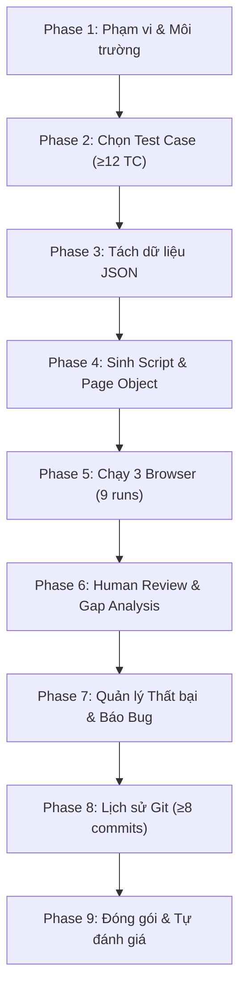

# Playwright Automation Coach (HW04)

Hệ thống hướng dẫn và đồng hành (coaching workflow) dành cho sinh viên môn Kiểm thử Phần mềm (CS423 / CSC13003 – FIT@HCMUS) thực hiện bài tập **HW04: Automation Testing giao diện Web** trên hệ thống **SUT EShop**.

- **Sinh viên:** Nguyễn Quốc Kỳ  
- **MSSV:** 23120138 – **Lớp:** 23CLC02  
- **3 Tính năng được kiểm thử:**
  - **Pool A:** `FR-02` – Đăng nhập & khóa tài khoản (Web / Backend API)
  - **Pool B:** `FR-07` – Giỏ hàng (Web React frontend)
  - **Pool C:** `FR-17` – Quản lý mã giảm giá Admin (Admin web / Backend API)

---

## 1. Nguyên tắc Cốt lõi & Phân công Trách nhiệm

Bài tập đánh giá năng lực kiểm soát, rà soát phản biện và tính xác thực của bằng chứng kiểm thử. AI đóng vai trò trợ lý có kỷ luật, **không phải hộp đen** tự động sinh toàn bộ code.

| Nhiệm vụ của AI | Trách nhiệm BẮT BUỘC của Sinh viên |
| :--- | :--- |
| Hỗ trợ phân tích đặc tả SRS và cấu trúc DOM | Quyết định đưa vào, sửa đổi hoặc loại bỏ test case |
| Sinh mã nguồn bản nháp (draft Page Objects, specs, data) | Review từng dòng code, sửa lỗi và chịu trách nhiệm cuối cùng |
| Cung cấp công cụ chuyển đổi data (`tc_to_json.py`) và kiểm tra (`check_requirements.py`) | Trực tiếp chạy test suite trên máy local trên cả 3 trình duyệt |
| Gợi ý danh mục lỗi dựa trên `review-checklist.md` | Tự viết phân tích khoảng cách (Gap Analysis) và AI Critique bằng lời của mình |
| Hỗ trợ soạn thảo khung báo cáo lỗi (Bug Report draft) | Xác định lỗi SUT thật, chụp ảnh màn hình, tạo GitHub Issues |
| Gợi ý commit message chuẩn Conventional Commits | Trực tiếp thực hiện git commit và xuất file git log |

> [!CAUTION]
> **Tuyệt đối KHÔNG ĐƯỢC:**
> - Bịa đặt hoặc chỉnh sửa file HTML report, timestamp ISO, ảnh chụp màn hình, hay log terminal.
> - Viết hộ phần AI Critique (200–300 từ) hoặc tự ý đánh giá điểm số.
> - Sửa code test hay sửa kết quả mong đợi cho pass khi SUT bị lỗi thật.

---

## 2. Cấu trúc Dự án (Chuẩn theo GEMINI.md)

Skill tuân thủ nghiêm ngặt layout thư mục đã quy định trong `GEMINI.md`:

```
hw_04/
├── GEMINI.md
├── README.md                      # Self-assessment + Test summary + Video links
├── playwright.config.ts           # Config đa trình duyệt + Metadata 'Run by'
├── package.json
├── features.json                  # Cấu hình mapping 3 feature
├── data/                          # Dữ liệu tách rời: fr02-login.json, fr07-cart.json, fr17-coupon.json
├── pages/                         # Page Object Models
├── tests/                         # Flat specs: fr02-login.spec.ts, fr07-cart.spec.ts, fr17-coupon.spec.ts
├── reports/<feature>/<browser>/   # Báo cáo HTML và results.json cho 9 runs
├── docs/
│   ├── main-report.md             # Automation report + Gap analysis + Not automated
│   ├── ai-audit-report.md         # Khai báo sử dụng AI
│   ├── ai-critique.md             # Đánh giá năng lực AI (200-300 từ)
│   ├── bug-report.md              # Báo cáo bug thật kèm link GitHub Issues
│   └── git-commit-log.txt         # Log commit xuất từ Git
├── evidence/                      # Ảnh chụp màn hình lỗi và GitHub Issues
└── .agents/skills/
    └── playwright-automation-coach/
```

---

## 3. Quy trình 9 Giai đoạn (9-Phase Staged Workflow)

Chi tiết từng bước, checklist và hành vi tương tác được quy định tại [`references/phases.md`](references/phases.md).



### Tóm tắt các Checkpoint bắt buộc:
1. **Checkpoint 1 (Scope):** Thống nhất 3 feature (FR-02, FR-07, FR-17), SUT chạy local, file `.env` sẵn sàng.
2. **Checkpoint 2 (Test Selection):** Mỗi feature có ≥ 12 test case tự động hóa (lấy từ HW02 `TC_FRxx_xx`). Các case không thể tự động hóa phải ghi rõ lý do.
3. **Checkpoint 3 (Test Data):** Dữ liệu nằm độc lập trong `data/*.json`, không hardcode inline array trong spec. Sử dụng `scripts/tc_to_json.py` để trích xuất.
4. **Checkpoint 4 (Script Draft):** Page Object và Spec biên dịch thành công. Áp dụng **≥ 3 kiểu assertion khác nhau**. Tách commit "bản AI sinh" và "bản sinh viên sửa".
5. **Checkpoint 5 (Multi-Browser Runs):** Hoàn thành **9 lượt chạy thực tế** (3 features x Chromium, Firefox, WebKit). Báo cáo HTML hiển thị `Run by: 23120138` và ISO timestamp.
6. **Checkpoint 6 (Review & Gap Analysis):** Rà soát theo `review-checklist.md`. Ghi nhận các lỗi của AI vào `docs/main-report.md`. Chuẩn bị ít nhất 1 lỗi điển hình để thuyết minh trong video.
7. **Checkpoint 7 (Bug Reporting):** Phân loại lỗi script và lỗi SUT thật. Đối chiếu `specs/system_requirements_specification.md` và bug HW02. Tạo GitHub Issue kèm ảnh bằng chứng.
8. **Checkpoint 8 (Git Hygiene):** Tối thiểu **8 commit sửa spec (`.spec.ts`) do Nguyễn Quốc Kỳ tạo**. Xuất log ra `docs/git-commit-log.txt`.
9. **Checkpoint 9 (Package & Submit):** Chạy `python3 scripts/check_requirements.py` xác nhận 100% tiêu chí đạt. Chuẩn bị video demo theo [`references/demo-script.md`](references/demo-script.md).

---

## 4. Công cụ & Tài nguyên Kèm theo Skill

### 4.1 Scripts Thực thi:
- [`scripts/tc_to_json.py`](scripts/tc_to_json.py): Trích xuất test case từ `../hw_02/Main_Report.md` thành `data/<slug>.json`.
- [`scripts/check_requirements.py`](scripts/check_requirements.py): Thẩm định tự động toàn bộ điều kiện cứng của bài tập (số case, assertion, số run, metadata `Run by`, git commit tác giả, tài liệu).

### 4.2 Tài liệu Tham chiếu (References):
- [`references/eshop-sut.md`](references/eshop-sut.md): Đặc thù SUT EShop (URL, port, reset database, cách ly user, React state giỏ hàng, lỗi khóa 180s vs SRS 30s).
- [`references/demo-script.md`](references/demo-script.md): Kịch bản quay video demo chi tiết từng phút (chứng minh danh tính, thao tác skill, thuyết minh 1 fix, kiểm tra report).
- [`references/review-checklist.md`](references/review-checklist.md): Danh mục rà soát lỗi AI (selector, assertion, wait, edge cases).
- [`references/assertion-patterns.md`](references/assertion-patterns.md): 8 mẫu assertion Playwright để kết hợp (visibility, text, URL, count, value, network response, computed, soft).
- [`references/selector-and-wait-rules.md`](references/selector-and-wait-rules.md): Quy tắc chọn locator ổn định và cấm fixed sleeps.
- [`references/test-selection.md`](references/test-selection.md): Tiêu chí chọn case tự động hóa và bảng giải trình "Not automated".

### 4.3 Mẫu Template (Assets):
- `assets/playwright.config.ts`: Cấu hình 3 trình duyệt, nạp `.env`, metadata `Run by`, output `reports/<feature>/<browser>/`.
- `assets/run-all.mjs`: Runner tự động thực thi tuần tự 9 runs với ISO timestamp thống nhất.
- `assets/fixtures.ts`: API setup/teardown helpers (`registerFreshUser`, `createAdminCoupon`, `deleteAdminCoupon`).
- `assets/.env.example`: Mẫu cấu hình môi trường local.
- `assets/features.json`: Mapping chuẩn giữa mã FR, slug, spec, data file và cổng ứng dụng.

---

## 5. Tích hợp AI Audit Log (`hw-ai-audit`)

Sau mỗi phiên làm việc hoặc sau mỗi Checkpoint được phê duyệt:
1. Ghi nhật ký tương tác AI vào `docs/ai-audit-report.md` (Tool, Ngày giờ, Prompt, Output thô, và Phần sinh viên đã sửa).
2. Tuyên bố rõ ràng: *"I use AI tools for the following tasks..."*.
3. Ghi chép chi tiết các hạn chế của AI (selector dễ vỡ, assertion yếu, thiếu biên, giả định sai về state) phục vụ báo cáo Gap Analysis và AI Critique.
