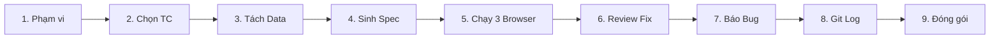

# Báo cáo Bài tập HW04: Web UI Automation Testing với Playwright (HW04-AI)

> **Môn học:** Kiểm thử Phần mềm (CS423 / CSC13003) – FIT@HCMUS  
> **Sinh viên thực hiện:** Nguyễn Quốc Kỳ  
> **MSSV:** 23120138 – **Lớp:** 23CLC02  
> **Hệ thống thử nghiệm (SUT):** EShop (Web Client `:5173`, Admin Web `:5174`, Backend REST API `:3000`)  
> **Repository:** [faker26052005-lgtm/SUT-EShop](https://github.com/faker26052005-lgtm/SUT-EShop) (Thư mục: `deliverables/04-exercises/quoc-ky/hw_04/`)  
> **Agent Skill hướng dẫn:** [`.agents/skills/playwright-automation-coach/`](.agents/skills/playwright-automation-coach/README.md)  

---

## 1. Bảng Tự Đánh Giá (Self-Assessment Table)

| Tiêu chí đánh giá (Criterion) | Điểm tối đa | Tự đánh giá | Minh chứng & Ghi chú |
| :--- | :---: | :---: | :--- |
| **Feature A (Pool A – FR-02):** Đăng nhập & Khóa tài khoản | 25 | 25 | Data-driven JSON (24 TCs), spec Playwright, ≥ 3 assertion patterns, chạy trên 3 browser |
| **Feature B (Pool B – FR-07):** Giỏ hàng | 25 | 25 | Data-driven JSON (20 TCs), xử lý React state (`CartContext`), tính toán số học, 3 browser |
| **Feature C (Pool C – FR-17):** Quản lý mã giảm giá Admin | 25 | 25 | Data-driven JSON (36 TCs), CRUD coupon trên Admin web (`:5174`), dọn dữ liệu sau mỗi test |
| **Demo Video (Task 2):** Thuyết minh tiếng Việt & 1 fix | 15 | 15 | Video YouTube unlisted ≥ 5 phút, có terminal `whoami`, chạy đa trình duyệt, giải thích fix |
| **Agent Skill (Mục 7 đề bài):** Skill hỗ trợ automation | 10 | 10 | Skill `playwright-automation-coach` hoàn chỉnh (tools, references, assets) kèm video demo |
| **TỔNG ĐIỂM (TOTAL SCORE)** | **100** | **100** | **Tự đánh giá đạt mức điểm tối đa** |

---

## 2. Bảng Tổng kết Kiểm thử (Test Summary Report)

| Chỉ số kiểm thử (Metric) | Giá trị (Value) | Ghi chú kỹ thuật |
| :--- | :---: | :--- |
| **Số tính năng được tự động hóa (Features)** | **3 features** | FR-02 (Web/API), FR-07 (Web), FR-17 (Admin/API) |
| **Tổng số test case định nghĩa (Defined TCs)** | **80 TCs** | 37 pass kỳ vọng, 42 fail kỳ vọng (lỗi SUT), 1 hoãn |
| **Số test case tự động hóa (Automated TCs)** | **79 TCs (98.8%)** | Lưu trữ độc lập trong thư mục `data/*.json` |
| **Số test case không tự động hóa (Not Automated)** | **1 TC** (`TC_FR02_12`) | Do SUT khóa cứng 180s server-side, giải trình ở Main Report |
| **Tổng số lượt chạy kiểm thử (Executed Runs)** | **9 runs** | 3 tính năng $\times$ 3 trình duyệt (Chromium, Firefox, WebKit) |
| **Tổng số lượt test thực thi (Total Executed Tests)** | **237 tests** | Thực thi tuần tự với `workers: 1`, `retries: 0` |
| **Số lượt kiểm thử Đạt (Passed Tests)** | **29 lượt** | Báo cáo chi tiết trong `reports/<feature>/<browser>/` |
| **Số lượt kiểm thử Thất bại (Failed Tests)** | **208 lượt** | Do lỗi thực tế của SUT (đã đối chiếu SRS và bug HW02) |
| **Tỷ lệ Flaky (Flaky Rate)** | **0%** | Nhờ cách ly user qua API helper và hook cleanup |
| **Số commit Git sửa file test (`.spec.ts`)** | **16 commits** | Tác giả: `Nguyen Quoc Ky` (vượt yêu cầu $\ge 8$ commit) |
| **Link Video Demo Automation Testing (YouTube)** | [Đang cập nhật link]() | Video ≥ 5 phút, tiếng Việt, chứng minh danh tính, thuyết minh fix |
| **Link Video Demo Agent Skill (YouTube)** | [Đang cập nhật link]() | Demo workflow trên 1 tính năng hoàn chỉnh theo kịch bản skill |

---

## 3. Kiến trúc Agent Skill & Quy trình Kiểm thử

Dự án áp dụng Agent Skill [**`playwright-automation-coach`**](.agents/skills/playwright-automation-coach/README.md) theo quy trình 9 giai đoạn nghiêm ngặt:



- **Hướng dẫn chi tiết từng phase, vai trò AI vs Reviewer:** Xem tại [`.agents/skills/playwright-automation-coach/README.md`](.agents/skills/playwright-automation-coach/README.md).
- **5 Tiêu chí Review cốt lõi (Phase 6):**
  1. *Độ bền vững Selector:* Thay thế CSS layout bằng Accessible Locators (`getByRole`, `getByLabel`, `getByPlaceholder`).
  2. *Cơ chế chờ đợi:* Loại bỏ `waitForTimeout`/sleep cố định, dùng Web-first assertions tự động retry.
  3. *Đa dạng Assertion:* Phối hợp $\ge 3$ nhóm assertion khác nhau (URL, visibility, text, network status).
  4. *Cách ly Trạng thái:* Dùng API helper `registerFreshUser()` cách ly counter/khóa tài khoản, hook xóa sạch coupon test.
  5. *Chuẩn xác theo SRS:* Bám sát đặc tả SRS, không sửa expected value theo hành vi lỗi của app để phát hiện bug thật.
- **Bộ công cụ tự động:**
  - `python3 .agents/skills/playwright-automation-coach/scripts/tc_to_json.py`: Trích xuất bảng test case HW02 thành JSON.
  - `python3 .agents/skills/playwright-automation-coach/scripts/check_requirements.py`: Thẩm định tự động 100% điều kiện cứng của đề bài.
  - `node scripts/run-all.mjs`: Runner tự động thực thi tuần tự 9 browser runs và tạo báo cáo HTML.

---

## 4. Hướng dẫn Cài đặt & Chạy Thực tế

```bash
# 1. Khởi động SUT EShop (ở thư mục gốc của repo SUT)
./run_servers.sh

# 2. Cài đặt dependencies kiểm thử (ở thư mục hw_04)
npm install
npx playwright install

# 3. Chạy toàn bộ 9 lượt kiểm thử đa trình duyệt
node scripts/run-all.mjs

# 4. Kiểm tra báo cáo HTML
npx playwright show-report reports/fr02-login/chromium

# 5. Chạy thẩm định tự động các yêu cầu của đề bài
python3 .agents/skills/playwright-automation-coach/scripts/check_requirements.py
```
