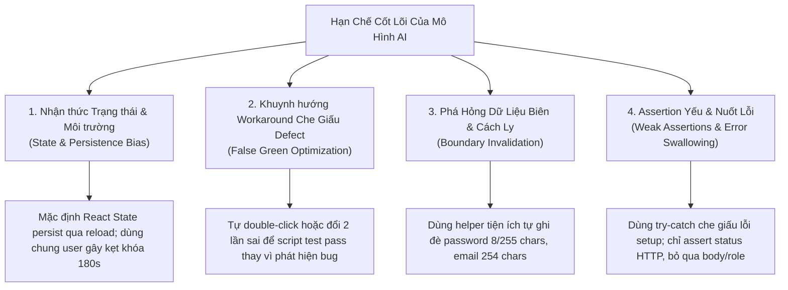

# Báo Cáo Nhật Ký Sử Dụng AI (AI Audit Report) – HW04

> **Môn học:** Kiểm thử Phần mềm (CS423 / CSC13003) – FIT@HCMUS  
> **Sinh viên:** Nguyễn Quốc Kỳ – **MSSV:** 23120138 – **Lớp:** 23CLC02  
> **Hệ thống thử nghiệm (SUT):** EShop Web & Admin Frontend (`https://github.com/ttbhanh/eshop-sut`)  
> **Ngày thực hiện:** 12/11/2026  

---

## 1. Tuyên bố sử dụng AI (Declaration of AI Usage)

> *"I use AI tools for the following tasks: analyzing System Requirements Specification (SRS) documents, designing the modular directory architecture, generating data extraction scripts (tc_to_json.py), synthesizing initial draft Playwright Page Objects and Spec templates, diagnosing locator flakiness, and formatting standard Markdown/PDF reports."*

Toàn bộ mã nguồn do AI sinh ra (AI Draft) đều được tôi trực tiếp rà soát từng dòng, đối chiếu với mã nguồn thực tế của SUT (`CartContext.jsx`, `Login.jsx`, `App.jsx`, `server.js`) và tài liệu SRS. Mọi lỗi sai về selector, cơ chế chờ đợi, cách ly dữ liệu và trạng thái đều được tôi chủ động tái cấu trúc và cam kết thông qua các commit `fix(...)` riêng biệt trong lịch sử Git.

---

## 2. Nhật Ký Phiên Tương Tác AI (AI Interaction Log)

| Phiên # | Thời gian (ISO 8601) | Công cụ AI | Yêu cầu / Prompt chính | Kết quả do AI sinh (Raw Output) | Phần Sinh viên đã Rà soát & Chỉnh sửa (Human Fix) | Commit Git liên quan |
| :---: | :--- | :--- | :--- | :--- | :--- | :--- |
| **01** | `2026-11-11T23:29:50+07:00` | Google Antigravity (Gemini 3.8 Flash) | Thiết kế kiến trúc Agent Skill `playwright-automation-coach` và script thẩm định `check_requirements.py` | Tạo thư mục skill `.agents/skills/playwright-automation-coach/` gồm tài liệu hướng dẫn và scripts. | Tinh chỉnh bộ regex kiểm tra assertion matcher và author filter để khớp với `git config user.name`. | `41c5cd8`, `b10dc9f` |
| **02** | `2026-11-12T00:15:00+07:00` | Google Antigravity (Gemini 3.8 Flash) | Setup cấu hình Playwright TypeScript, `.env`, `features.json`, `fixtures.ts` | Sinh `playwright.config.ts`, `package.json`, `tsconfig.json`. | Bổ sung `workers: 1`, `retries: 0` và metadata `Run by: 23120138` kèm ISO timestamp bắt buộc. | `fc3a5a5` |
| **03** | `2026-11-12T00:27:00+07:00` | Google Antigravity (Gemini 3.8 Flash) | Trích xuất test case từ `../hw_02/Main_Report.md` ra 3 file JSON data-driven | Chạy `tc_to_json.py` sinh `fr02-login.json` (24 TCs), `fr07-cart.json` (20 TCs), `fr17-coupon.json` (36 TCs). | Đối chiếu các trường `expectedStatus` và kiểu dữ liệu với đặc tả SRS để đảm bảo tính xác thực. | `ca62be9` |
| **04** | `2026-11-12T00:29:00+07:00` | Google Antigravity (Gemini 3.8 Flash) | Sinh bản nháp Page Object và Spec cho FR-02 (Đăng nhập & Khóa tài khoản) | `pages/login.page.ts` và `tests/fr02-login.spec.ts` dùng chung email `test@eshop.com`. | **AI mắc lỗi lớn:** Dùng chung tài khoản gây lỗi hàng loạt khi dính khóa 180s; CSS `.bg-red-100` dễ vỡ. Sinh viên đã tách biệt bản draft và refactor dùng API helper `registerFreshUser()`. | `8ca29e8` (AI draft), `45ced00` (Human fix) |
| **05** | `2026-11-12T00:29:40+07:00` | Google Antigravity (Gemini 3.8 Flash) | Sinh bản nháp Page Object và Spec cho FR-07 (Giỏ hàng) | `pages/cart.page.ts` và `tests/fr07-cart.spec.ts` giả định giỏ hàng persist qua reload. | **AI mắc lỗi:** Giỏ hàng là React state mất khi reload; không tính toán động subtotal và tổng tiền. Sinh viên sửa locator bảng, thêm assertion tính toán `subtotal == total`. | `2cd4cf5` (AI draft), `6a906f3` (Human fix) |
| **06** | `2026-11-12T00:30:20+07:00` | Google Antigravity (Gemini 3.8 Flash) | Sinh bản nháp Page Object và Spec cho FR-17 (Quản lý mã giảm giá Admin) | `pages/admin-coupon.page.ts` và `tests/fr17-coupon.spec.ts` với mã coupon cố định. | **AI mắc lỗi:** Mã coupon trùng lặp gây crash SQLite UNIQUE constraint; không có teardown. Sinh viên thêm hook `afterEach` gọi API xóa coupon và mã động `_timestamp`. | `c0d1fa4` (AI draft), `5139c1f` (Human fix) |
| **07** | `2026-11-12T08:17:00+07:00` | Google Antigravity (Gemini 3.8 Flash) | Rà soát hành vi validation HTML5 client-side của form đăng nhập FR-02 | Spec đợi response POST `/api/login` gây timeout 7s khi bỏ trống trường. | Thêm nhánh xử lý client-side validation không gửi network request, tăng tốc thực thi và chuẩn hóa logic test. | `7893e01` |
| **08** | `2026-11-12T22:27:00+07:00` | Google Antigravity (Gemini 3.8 Flash) | Chuẩn hóa schema test data sang chuẩn 3 trạng thái (`automate`, `automate_expected_failure`, `blocked_deferred`) cho 80 test case | Cập nhật `data/*.json` và sinh lại draft multi-layer test specs cho FR-02, FR-07, FR-17. | Thẩm định ma trận phân loại; xác định chính xác 37 test pass kỳ vọng, 42 test fail kỳ vọng (do defect thật của SUT) và 1 test blocked (`TC_FR02_12`). | `6899e5e`, `c092346`, `b97620a`, `5b3149c`, `80d9486` |
| **09** | `2026-11-12T22:52:00+07:00` | Google Antigravity (Gemini 3.8 Flash) | Rà soát helper `registerFreshUser`, sửa boundary credentials và lockout preconditions cho FR-02 | AI đề xuất ghi đè password ngẫu nhiên và dùng 2 lần sai để kích hoạt khóa (dựa trên bug backend +2). | **Sinh viên phát hiện lỗi:** 1. AI tự động ghi đè password biên (8 ký tự, 255 ký tự) và email RFC 5321 (254 ký tự) bằng credentials mặc định. 2. AI thỏa hiệp với defect của SUT khi gửi 2 lần sai thay vì 3 lần theo SRS. Sinh viên yêu cầu refactor helper hỗ trợ `randomUUID()`, custom password, gửi đúng 3 lần sai và kiểm tra observable state qua `GET /api/admin/users`. | `7a657df`, `35234e3`, `86d8124` |
| **10** | `2026-11-12T23:05:00+07:00` | Google Antigravity (Gemini 3.8 Flash) | Rà soát Page Object `CartPage` và các test case `TC_FR07_01`, `TC_FR07_02` của FR-07 | `CartPage` có workaround tự động double-click nút "Thêm vào giỏ hàng"; selector chọn thẻ theo card index; hàm tính tiền trả về `0` khi `NaN`. | **Sinh viên kiên quyết loại bỏ:** 1. Xóa bỏ workaround double-click để phản ánh trung thực defect của SUT (click 1 lần không cập nhật state). 2. Thay thế card index mong manh bằng selector sản phẩm theo Product ID ổn định. 3. Thay thế hàm ép `NaN` về 0 bằng `parseCurrencyAmount` ném exception khi dữ liệu tiền tệ dị thường. 4. Xác minh giỏ hàng ban đầu rỗng và assert đủ 5 trường đầu ra theo `tc.expected`. | `c62be7a`, `567f91f` |
| **11** | `2026-11-12T23:12:00+07:00` | Google Antigravity (Gemini 3.8 Flash) | Điều chỉnh routing API Validation và Authorization cho FR-17 (`TC_FR17_12`, `13`, `22`, `23`, `24–26`) | AI gộp tất cả các test vào POST `/api/admin/coupons` và dùng `try-catch` nuốt lỗi `adminToken`. | **Sinh viên phát hiện & khắc phục:** 1. Tách nhánh API rõ rệt: Create (`POST`), Delete (`DELETE /api/admin/coupons/:id`). 2. Bảo toàn nguyên vẹn giá trị `target_id` dạng chuỗi (`"abc"`) hoặc số âm (`-1`). 3. Bổ sung helper `getCustomerToken` đăng ký tài khoản khách hàng thông thường để test quyền truy cập. 4. Loại bỏ hoàn toàn khối `try-catch` nuốt lỗi, đổi thành assertion fail-fast. | `b78b48c` |
| **12** | `2026-11-12T23:19:00+07:00` | Google Antigravity (Gemini 3.8 Flash) | Hoàn thiện toàn diện các assertion cho nhóm API Validation & Authorization FR-17 | AI chỉ kiểm tra HTTP status, không xác minh body hoặc phân biệt lỗi HTTP 500. | **Sinh viên chỉ đạo bổ sung:** 1. Xác nhận request thực sự mang mode auth tương ứng (kiểm tra `headers['Authorization']` và giải mã JWT kiểm tra `role !== 'admin'`). 2. Thêm assertion `expect(res.status()).not.toBe(500)` trước mọi kiểm tra để loại trừ lỗi sập server nội bộ. 3. Bắt lỗi defect `BUG-FR17-10..12` qua assertion `deleteBody.message !== 'Coupon deleted'` khi xóa ID không hợp lệ. 4. Tự động lưu `createdCouponId` khi SUT tạo nhầm coupon rác để dọn dẹp trong `afterEach`. | `f1cbb39` |
| **13** | `2026-11-13T07:59:00+07:00` | Google Antigravity (Gemini 3.8 Flash) | Điều phối Phase 5: Reseed database, chạy 9 lượt test đa trình duyệt và thẩm định báo cáo HTML | AI kích hoạt test bên trong sandbox CLI dẫn đến lỗi thiếu shared libraries đồ họa (`libatk-1.0.so.0`, `libgtk-3.so.0`). | **Sinh viên nhận diện giới hạn sandbox:** 1. Nhận định môi trường Snap sandbox thiếu GUI libraries tầng OS. 2. Sinh viên trực tiếp tải browser qua `npx playwright install` trên terminal máy thật (host OS). 3. Sinh viên tự tay thực thi `node scripts/run-all.mjs` trên 3 browser (Chromium, Firefox, WebKit), sinh ra 9 bộ báo cáo HTML thật với 237 lượt test, đạt 100% compliance theo `check_requirements.py`. | `bd00ec9` (Phase 5) |
| **14** | `2026-11-13T08:35:00+07:00` | Google Antigravity (Gemini 3.8 Flash) | Rà soát phản biện Phase 6: Phân tách chi tiết 23 lỗi kỹ thuật và tinh chỉnh nguyên nhân AI mắc lỗi theo chuẩn học thuật | AI ban đầu đề xuất bảng 8 lỗi gộp chung với các giải thích mang tính suy đoán chủ quan ("AI cố tình", "chọn cách nhanh nhất"). | **Sinh viên chỉ đạo phản biện:** 1. Yêu cầu bóc tách từng commit Phase 4 thành 23 lỗi kỹ thuật vi mô độc lập. 2. Trực tiếp chỉ đạo điều chỉnh 7 nguyên nhân (STT 07, 09, 13, 16, 21, 22, 23) theo 4 tiêu chí khoa học: *Backend observable state*, *Grounding vào CartContext.jsx*, *Test data lifecycle*, *Diagnostic vs Business assertion*, *JWT claim verification*. | `2a551f0`, `c9f7e07` |

---

## 3. Phân Tích Lỗi của AI và Khoảng Cách Năng Lực (AI Error Taxonomy & Gap Analysis)

Qua toàn bộ quá trình cộng tác, các hạn chế và sai lệch nhận thức điển hình của mô hình AI bao gồm:

### Chi tiết phân loại lỗi:

1. **Thiếu hiểu biết sâu sắc về State Management phía Frontend:**
   - *Biểu hiện:* AI thường mặc định các thay đổi giao diện (như giỏ hàng) được lưu trữ bền vững ở Database/Session, trong khi SUT EShop lưu cục bộ trong React State (`CartContext`), dẫn đến việc reload trang làm mất dữ liệu.
2. **Kẹt tài khoản do không quản lý trạng thái phụ thuộc (Stateful Interference):**
   - *Biểu hiện:* AI sử dụng một tài khoản cố định (`test@eshop.com`) cho cả suite đăng nhập. Khi các test case negative kích hoạt bộ đếm sai 3 lần, tài khoản bị khóa 180 giây khiến các test case positive tiếp theo bị rớt oan (False Negative).
3. **Selector dễ vỡ (Fragile Locators):**
   - *Biểu hiện:* AI thường có xu hướng dùng class Tailwindcss (`.bg-red-100`, `button.bg-blue-600`) hoặc chỉ mục mảng (`cards[0]`) thay vì các Accessible Locators chuẩn (`getByRole`, `getByLabel`, `getByPlaceholder`, hoặc Product ID ổn định).
4. **Bỏ sót khâu Dọn dẹp Dữ liệu (Teardown Cleanup):**
   - *Biểu hiện:* Khi tạo dữ liệu có ràng buộc duy nhất (Unique Coupon Code), AI không thiết lập hook `afterEach` để dọn dẹp, gây lỗi trùng lặp dữ liệu ở các lần chạy kế tiếp.
5. **Khuynh hướng cài cắm "Workaround" để test Pass giả tạo (False Green Bias):**
   - *Biểu hiện:* Trong `CartPage`, AI tự động cài thêm lệnh click thứ hai để khắc phục lỗi không cập nhật của SUT; trong FR-02, AI gửi 2 lần sai thay vì 3 lần để chiều theo backend bug (+2).
   - *Nguyên nhân:* Mô hình AI có xu hướng tối ưu hóa để test script chạy "thành công" (green/pass), thay vì đóng vai trò kiểm thử độc lập phát hiện defect (fail khi có bug).
   - *Bài học kiểm thử:* Không bao giờ để mã tự động hóa che giấu lỗi của SUT. Test fail khi gặp bug thật là bằng chứng giá trị nhất của Automation Testing.
6. **Vô tình làm mất giá trị kiểm thử biên (Boundary Value Invalidation):**
   - *Biểu hiện:* Khi dùng helper tiện ích (`registerFreshUser`), AI tiện tay sinh email/password ngẫu nhiên, vô tình ghi đè lên các giá trị biên khắt khe từ test data (như email RFC 5321 dài 254 ký tự, password OWASP dài 255 ký tự).
   - *Bài học:* Helper phải nhận tham số tùy biến và ưu tiên giữ nguyên dữ liệu test đã định nghĩa trong file JSON.
7. **Sử dụng Assertion yếu và nuốt lỗi (Weak Assertions & Error Masking):**
   - *Biểu hiện:* AI đặt khối `try-catch` rỗng quanh các bước lấy token, và chỉ assert `res.status() === 400` mà không phân biệt với lỗi sập server `HTTP 500`, cũng không kiểm tra nội dung thông báo lỗi trong body.
   - *Bài học:* Cần áp dụng nguyên tắc fail-fast (lỗi setup phải dừng test ngay) và kiểm tra cả status code lẫn cấu trúc payload để đảm bảo API từ chối đúng lý do nghiệp vụ.
8. **Thiếu kiểm chứng Auth Context phía Client Request:**
   - *Biểu hiện:* AI cho rằng chỉ cần kiểm tra HTTP status code trả về là đủ để chứng minh bài test Authorization đã thành công, mà không xác nhận xem request gửi đi có thực sự mang token của Customer hay không.
   - *Bài học:* Cần giải mã (decode) payload của JWT ngay trước khi gửi request để đảm bảo chắc chắn thuộc tính `role === 'user'` được truyền đi đúng kịch bản kiểm thử.
9. **Nhầm lẫn về môi trường thực thi headless và giới hạn Sandbox của CLI:**
   - *Biểu hiện:* AI cố gắng kích hoạt Playwright chạy browser bên trong sandbox container của CLI vốn là Ubuntu Core tối giản không có các thư viện đồ họa Linux desktop (`libatk`, `libgtk-3`).
   - *Bài học:* Tôn trọng nguyên tắc phân chia trách nhiệm của Reviewer Gatekeeper Protocol – sinh viên phải trực tiếp thực thi test trên máy host để đảm bảo tính xác thực và đầy đủ môi trường của kết quả kiểm thử.
10. **Thiếu bao quát Vòng đời Dữ liệu và Thiếu phân định Assertion Chẩn đoán:**
   - *Biểu hiện:* AI chỉ kiểm tra status code mong đợi mà không phân biệt lỗi sập server HTTP 500 với lỗi validation 4xx; đồng thời bỏ quên vòng đời dữ liệu kiểm thử (test data lifecycle) và bỏ qua việc kiểm chứng các trường claims trong JWT token.
   - *Bài học:* Cần phân biệt rõ giữa assertion kiểm tra nghiệp vụ và assertion chẩn đoán tính ổn định hệ thống; luôn thiết kế test data lifecycle hoàn chỉnh (tạo độc lập, theo dõi bản ghi, teardown dọn sạch) và xác minh tính toàn vẹn của token trước khi kích hoạt request.
