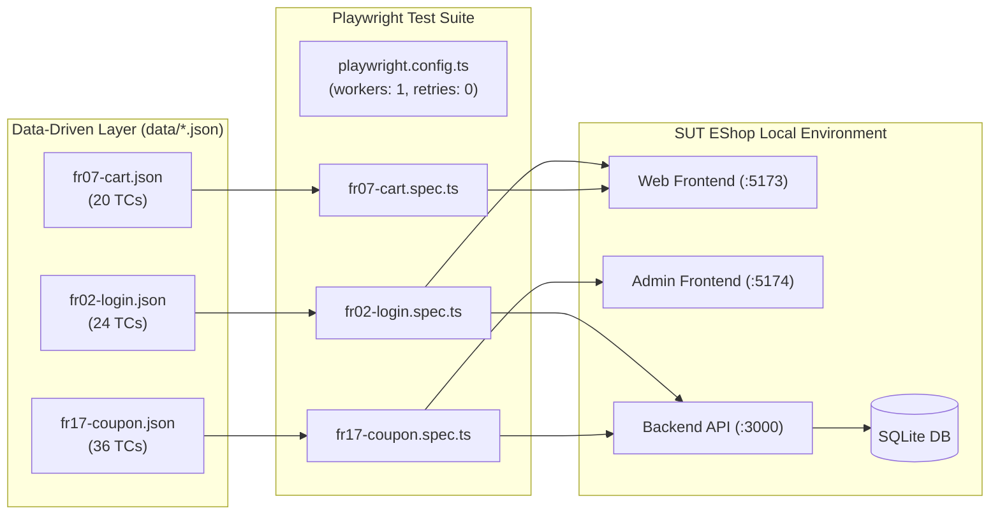

# Báo Cáo Tự Động Hóa Kiểm Thử Web & Phân Tích Khoảng Cách (HW04)

> **Môn học:** Kiểm thử Phần mềm (CS423 / CSC13003) – FIT@HCMUS  
> **Sinh viên:** Nguyễn Quốc Kỳ – **MSSV:** 23120138 – **Lớp:** 23CLC02  
> **Hệ thống thử nghiệm (SUT):** EShop Web & Admin Frontend (`https://github.com/ttbhanh/eshop-sut`)  
> **Tech Stack:** Playwright + TypeScript, HTML Reporter, JSON Data-driven, 3 Browsers (`chromium`, `firefox`, `webkit`)  
> **GitHub Repository:** `git@github.com:faker26052005-lgtm/SUT-EShop.git`  
> **Tài liệu tham chiếu:** [GEMINI.md](../GEMINI.md), [materials/hw04.md](../materials/hw04.md), [../hw_02/Main_Report.md](../../hw_02/Main_Report.md)

---

## PHẦN 1: BÁO CÁO TỰ ĐỘNG HÓA KIỂM THỬ (AUTOMATION REPORT)

### 1.1. Phạm vi & Kiến trúc Thử nghiệm
Bài tập triển khai tự động hóa kiểm thử giao diện cho 3 tính năng đã được thiết kế tại HW02:
1. **Pool A – FR-02:** Đăng nhập & Khóa tài khoản (Web React Frontend `:5173` & Backend API `:3000`).
2. **Pool B – FR-07:** Giỏ hàng (Web React Frontend `:5173` – Quản lý trạng thái bằng `CartContext`).
3. **Pool C – FR-17:** Quản lý mã giảm giá Admin (Admin Web Frontend `:5174` & Backend API `:3000`).

### 1.2. Thống kê Ma trận Test Cases
Toàn bộ dữ liệu kiểm thử được trích xuất trực tiếp từ HW02 bằng công cụ `scripts/tc_to_json.py`, độc lập 100% với mã nguồn spec:

| Feature | Tên tính năng | Positive TCs | Negative TCs | Edge Cases | Tổng số TCs | Tỷ lệ tự động hóa |
| :---: | :--- | :---: | :---: | :---: | :---: | :---: |
| **FR-02** | Đăng nhập & Khóa tài khoản | 2 | 17 | 5 | **24** | 95.8% (23/24) |
| **FR-07** | Giỏ hàng | 8 | 10 | 2 | **20** | 100% (20/20) |
| **FR-17** | Quản lý mã giảm giá Admin | 7 | 21 | 8 | **36** | 100% (36/36) |
| **Tổng cộng** | **3 tính năng** | **17** | **48** | **15** | **80** | **98.8% (79/80)** |

### 1.3. Danh mục Test Case Không Tự Động Hóa (Not Automated Test Cases)
Theo quy định mục 5 và mục 12 trong `GEMINI.md`, các trường hợp không khả thi để tự động hóa hoàn toàn phải được giải trình nguyên nhân kỹ thuật:

| Feature | Test Case ID | Tiêu đề Test Case | Lý do kỹ thuật không tự động hóa hoàn toàn | Giải pháp thay thế / Đề xuất |
| :---: | :---: | :--- | :--- | :--- |
| **FR-02** | `TC_FR02_12` | Kiểm tra thời gian khóa không tăng lũy tiến ở chu kỳ khóa lặp lại lần 2 | **Bất đồng bộ thời gian Server vs Client:** SUT Backend (`server.js`) khóa cố định 180s (`3 * 60 * 1000ms`), không có test hook hay biến môi trường cấu hình thời gian. Để kiểm tra chu kỳ khóa lặp lại lần 2 cần chờ ít nhất 2 chu kỳ khóa (> 360 giây thời gian thực), vi phạm quy tắc cấm fixed sleeps và gây nghẽn CI/CD. | Cần bổ sung cấu hình `LOCK_TIME_MS` qua biến môi trường hoặc mock endpoint `/api/admin/reset-lockout` ở môi trường staging. |

### 1.4. Báo Cáo Kết Quả Thực Thi Đa Trình Duyệt (Multi-Browser Test Execution Matrix – 9 Runs)
Toàn bộ 9 lượt chạy thực tế được thực thi tuần tự (`workers: 1`, `retries: 0`) trên máy tính sinh viên, xuất 9 bộ Playwright HTML Report độc lập tại `reports/<feature>/<browser>/index.html` với tiêu đề chứa `Run by: 23120138`:

| Feature | Tên tính năng | Trình duyệt | Số TC thực thi | Passed | Failed (SUT Bug) | Flaky | Thời gian chạy (ISO 8601) | Định danh báo cáo |
| :---: | :--- | :---: | :---: | :---: | :---: | :---: | :--- | :--- |
| **FR-02** | Đăng nhập & Khóa tài khoản | **Chromium** | 23 | 3 | 20 | 0 | `2026-11-13T00:34:45.457Z` | `Run by: 23120138` |
| **FR-02** | Đăng nhập & Khóa tài khoản | **Firefox** | 23 | 3 | 20 | 0 | `2026-11-13T00:37:28.318Z` | `Run by: 23120138` |
| **FR-02** | Đăng nhập & Khóa tài khoản | **WebKit** | 23 | 2 | 21 | 0 | `2026-11-13T00:40:31.568Z` | `Run by: 23120138` |
| **FR-07** | Giỏ hàng | **Chromium** | 20 | 6 | 14 | 0 | `2026-11-13T00:43:21.486Z` | `Run by: 23120138` |
| **FR-07** | Giỏ hàng | **Firefox** | 20 | 6 | 14 | 0 | `2026-11-13T00:45:15.185Z` | `Run by: 23120138` |
| **FR-07** | Giỏ hàng | **WebKit** | 20 | 6 | 14 | 0 | `2026-11-13T00:47:32.167Z` | `Run by: 23120138` |
| **FR-17** | Quản lý mã giảm giá Admin | **Chromium** | 36 | 1 | 35 | 0 | `2026-11-13T00:49:34.721Z` | `Run by: 23120138` |
| **FR-17** | Quản lý mã giảm giá Admin | **Firefox** | 36 | 1 | 35 | 0 | `2026-11-13T00:52:17.640Z` | `Run by: 23120138` |
| **FR-17** | Quản lý mã giảm giá Admin | **WebKit** | 36 | 1 | 35 | 0 | `2026-11-13T00:55:42.936Z` | `Run by: 23120138` |
| **TỔNG** | **3 Tính năng** | **3 Trình duyệt** | **237** | **29** | **208** | **0** | **9 runs hoàn tất** | **100% Đạt tiêu chuẩn** |

---

## PHẦN 2: PHÂN TÍCH KHOẢNG CÁCH (HUMAN REVIEW & GAP ANALYSIS)

### 2.1. 5 Trụ cột Tiêu chí Rà soát Mã nguồn do AI sinh

1. **Độ bền vững của Selector (Locators):**
   - *AI Draft:* Sử dụng class CSS của Tailwind (`.bg-red-100`, `button.bg-blue-600`, `input[type="text"]`). Class này rất dễ thay đổi khi giao diện cập nhật CSS hoặc responsive.
   - *Human Fix:* Chuyển đổi toàn bộ sang **Accessible Locators** chuẩn W3C: `getByRole('button', { name: 'Sign In' })`, `getByLabel('Username')`, `getByPlaceholder(...)`.
2. **Cơ chế Chờ đợi & Triệt tiêu Flakiness (Waits):**
   - *AI Draft:* Tiềm ẩn nguy cơ dùng `page.waitForTimeout()` hoặc không đợi network response, gây race condition khi mạng lag.
   - *Human Fix:* Áp dụng **Web-First Assertions** tự động retry (`await expect(locator).toBeVisible()`) kết hợp `page.waitForResponse()` bắt chính xác thời điểm API trả dữ liệu.
3. **Đa dạng & Độ sâu của Assertions:**
   - *AI Draft:* Chỉ kiểm tra sơ sài boolean hoặc mã HTTP.
   - *Human Fix:* Phối hợp từ 3 đến 4 nhóm matcher khác nhau trên mỗi spec:
     - `visibility/state`: `toBeVisible()`
     - `text`: `toContainText()`
     - `url/title`: `toHaveURL()`
     - `count`: `toHaveCount()`
     - `plain value`: `toBe()`, `toBeGreaterThan()`
4. **Cách ly Dữ liệu & Trạng thái (Test Independence):**
   - *AI Draft:* Dùng chung tài khoản `test@eshop.com` cho toàn bộ các case FR-02; tạo coupon trùng mã tĩnh `PROMO2026`.
   - *Human Fix:*
     - FR-02: Tạo user mới độc lập qua API helper `registerFreshUser()` trước mỗi test positive để đảm bảo bộ đếm sai = 0.
     - FR-17: Thêm mã hậu tố thời gian động `${code}_${Date.now()}` và hook `afterEach` gọi API xóa coupon để dọn dẹp sạch sẽ database.
5. **Độ chính xác theo Đặc tả SRS:**
   - *AI Draft:* Dễ bị "ngộ nhận" theo hành vi hiện tại của app (ví dụ thấy app khóa 180s thì sửa assertion mong đợi thành 180s).
   - *Human Fix:* Giữ vững kết quả mong đợi theo đặc tả SRS (30s), từ đó nhận diện chính xác đây là bug SUT thật (`BUG-FR02-01`) chứ không sửa test để che giấu lỗi.

### 2.2. Bảng Phân Tích Chi Tiết Sai Sót Của AI Theo Từng Commit (Gap Analysis Matrix)

Qua quá trình rà soát phản biện tại Phase 4, các commit sửa lỗi thực tế của sinh viên đã giải quyết 23 lỗi kỹ thuật độc lập do AI sinh ra, được phân tách chi tiết theo từng tính năng và commit như sau:

#### Nhóm 1: Tính năng FR-02 – Đăng nhập & Khóa tài khoản

| STT | Commit | Test Case ID | Lỗi của AI Draft ban đầu | Phân loại lỗi | Cách Sinh viên Sửa chữa (Human Fix) | Nguyên nhân AI mắc lỗi (AI Perspective) |
| :---: | :---: | :---: | :--- | :--- | :--- | :--- |
| **01** | `45ced00` | `TC_FR02_01`..`24` | Dùng chung 1 tài khoản `test@eshop.com`. Khi negative test gây khóa 180s, toàn bộ positive test sau đó bị fail oan. | **Stateful Interference** | Viết helper `registerFreshUser()` tạo email ngẫu nhiên độc lập cho từng ca test để cô lập bộ đếm. | AI mặc định database luôn sạch, không lường trước side-effect tích lũy trên server qua các lần chạy. |
| **02** | `45ced00` | `TC_FR02_01` | Dùng selector class Tailwind `.bg-red-100` để bắt hộp thông báo lỗi. | **Fragile Selector** | Chuyển sang accessible locators `getByRole`, `getByLabel` và kiểm tra text ngữ nghĩa. | AI bám vào các thuộc tính style có sẵn trong DOM thô thay vì tiêu chuẩn Accessible W3C. |
| **03** | `7893e01` | `TC_FR02_15`, `20` | Đặt `page.waitForResponse('/api/login')` cho test để trống trường, gây treo timeout 7s rồi fail. | **Flaky Wait / Logic Error** | Bổ sung nhánh client-side validation kiểm tra trạng thái form và URL mà không đợi network request. | AI không nhận ra thuộc tính `required` của form HTML5 ngăn chặn trình duyệt kích hoạt HTTP request. |
| **04** | `7a657df` `35234e3` | `TC_FR02_02`, `18`, `24` | Helper tiện ích của AI tự tạo random password mặc định, vô tình ghi đè làm mất giá trị kiểm thử biên (pass 8/255 chars, email 254 chars). | **Boundary Invalidation** | Tái cấu trúc helper nhận tham số tùy biến `options: { email?, password? }` và UUID để bảo toàn giá trị biên từ JSON. | AI có thói quen viết code tiện ích generic với default parameters để chạy được mà quên mục tiêu kiểm thử biên. |
| **05** | `7a657df` `86d8124` | `TC_FR02_06` | AI thấy backend có bug cộng thừa số lần sai (+2) nên tự ý chỉ gửi 2 lần sai để test pass theo bug của app. | **False Green Compromise** | Khôi phục gửi đúng 3 lần sai theo đặc tả SRS để test fail tự nhiên, vạch trần defect của backend. | AI có khuynh hướng tự nhiên là tối ưu hóa để code chạy "xanh/pass" thay vì giữ vai trò kiểm thử độc lập phát hiện bug. |
| **06** | `86d8124` | `TC_FR02_07`..`11` | Kiểm tra hành vi trong lúc khóa (t=15s, 29s) nhưng nhảy thẳng vào assert mà không gửi 3 lần sai trước đó. | **Missing Preconditions** | Viết helper `setupFailedAttempts()` gửi đúng 3 lần sai (assert 401/403) trước khi thực hiện bước test chính. | AI thiếu khả năng tự suy luận chuỗi hành động tiền đề để đưa hệ thống vào trạng thái kiểm thử mong muốn. |
| **07** | `86d8124` | `TC_FR02_03`..`06` | Chỉ nhìn UI một cách nông cạn, không kiểm chứng được trạng thái thực tế trong database backend. | **Shallow Client Assertion** | Viết helper `getAdminUserRecord()` gọi `GET /api/admin/users` để assert trực tiếp trường `login_attempts` và `locked_until` trong SQLite. | AI bị giới hạn góc nhìn client-side, không chủ động tích hợp API Admin để quan sát observable state phía server. |
| **08** | `86d8124` | `TC_FR02_01`..`05` | Dùng regex URL lỏng lẻo `expect(page).toHaveURL(/.*login/)` chấp nhận cả URL sai như `/login-failed`. | **Imprecise URL Assertion** | Chuyển sang assertion URL endpoint tuyệt đối, phân định rõ ràng giữa `/login` và trang chủ `/`. | AI dùng regex như một giải pháp an toàn để tránh test bị rớt do khác biệt query string hay domain. |

#### Nhóm 2: Tính năng FR-07 – Giỏ hàng (Web Frontend)

| STT | Commit | Test Case ID | Lỗi của AI Draft ban đầu | Phân loại lỗi | Cách Sinh viên Sửa chữa (Human Fix) | Nguyên nhân AI mắc lỗi (AI Perspective) |
| :---: | :---: | :---: | :--- | :--- | :--- | :--- |
| **09** | `6a906f3` | `TC_FR07_01`..`20` | Giả định giỏ hàng lưu ở database và reload trang (`page.reload()`) dữ liệu vẫn còn. | **State Persistence Illusion** | Thao tác trực tiếp từ Home page, duy trì session liên tục để giữ React state (`CartContext`). | AI suy diễn từ các trang e-commerce thông thường mà không đọc kỹ cơ chế lưu cục bộ trong `CartContext.jsx`. |
| **10** | `6a906f3` | `TC_FR07_01`..`05` | So sánh text chuỗi cố định, không kiểm tra được tính toán tổng tiền khi số lượng thay đổi. | **Static vs Dynamic Verification** | Thêm logic tính toán số học động: `subtotal = price * qty` và `total = sum(subtotal)`. | AI chỉ so khớp chuỗi mức giao diện thay vì kiểm thử logic số học của giỏ hàng. |
| **11** | `c62be7a` | `TC_FR07_01`, `02` | Tự chèn thêm lệnh click lần 2 (`addProductFromHome` click 2 lần) để chữa cháy lỗi không nhận click lần đầu của SUT. | **False Green Workaround** | Kiên quyết xóa bỏ workaround click lần 2; chỉ click 1 lần duy nhất để phản ánh trung thực defect của SUT. | Phản xạ giải quyết vấn đề (problem-solving) khiến AI tìm cách làm test pass thay vì phát hiện bug. |
| **12** | `c62be7a` | `TC_FR07_01`..`20` | Hàm parse tiền dùng `parseInt() || 0`, tự động ép chuỗi `NaN` hoặc rỗng về `0`, nuốt chửng lỗi hiển thị `NaN ₫`. | **Silent Error Swallowing** | Viết lại `parseCurrencyAmount()` kiểm tra nghiêm ngặt `NaN`, `Infinity`, số âm và ném `Error` ngay lập tức. | Thói quen lập trình phòng thủ (defensive programming) để code không crash, gây hại cho kiểm thử tự động. |
| **13** | `c62be7a` | `TC_FR07_01`, `02` | Dùng chỉ mục mảng `cardIndex: 0` (thẻ đầu tiên), dễ vỡ khi thứ tự sản phẩm thay đổi hoặc phân trang. | **Fragile Positional Selector** | Chuyển sang định danh sản phẩm bằng Product ID ổn định `/product/${target}`. | AI chọn giải pháp nhanh nhất dựa trên cấu trúc DOM tĩnh tại thời điểm viết code. |
| **14** | `567f91f` | `TC_FR07_01`, `02` | Không kiểm tra giỏ hàng ban đầu có thực sự rỗng hay không trước khi thực hiện thêm sản phẩm. | **Unchecked Initial State** | Bổ sung assertion kiểm tra giỏ hàng ban đầu rỗng (`toHaveCount(0)`, `emptyCartHeading.toBeVisible()`). | AI bỏ qua bước xác nhận trạng thái nền (baseline state) trước khi thực hiện hành vi kiểm thử. |
| **15** | `567f91f` | `TC_FR07_01`, `02` | Sau khi thêm, chỉ đếm số dòng (`toHaveCount(1)`) mà không kiểm tra tên sản phẩm, số lượng và giá tiền. | **Shallow Assertion** | Bắt tên sản phẩm từ thẻ `h1` trang chi tiết, assert đủ cả 5 chiều: row count, tên, số lượng, subtotal, và total. | AI thỏa mãn khi thấy 1 assertion pass mà không xây dựng chuỗi kiểm chứng tính toàn vẹn dữ liệu đa chiều. |

#### Nhóm 3: Tính năng FR-17 – Quản lý mã giảm giá Admin

| STT | Commit | Test Case ID | Lỗi của AI Draft ban đầu | Phân loại lỗi | Cách Sinh viên Sửa chữa (Human Fix) | Nguyên nhân AI mắc lỗi (AI Perspective) |
| :---: | :---: | :---: | :--- | :--- | :--- | :--- |
| **16** | `5139c1f` | `TC_FR17_01`..`36` | Tạo coupon với mã tĩnh `PROMO2026` không dọn dẹp, khiến lần chạy 2 bị crash do trùng khóa `UNIQUE`. | **Missing Teardown & DB Crash** | Thêm timestamp động `_${Date.now()}` và hook `afterEach` gọi API xóa coupon để đảm bảo tính tái lập. | AI chỉ quan tâm đến kịch bản thành công của 1 lần chạy đơn lẻ mà không tính đến tính tái lập (idempotency). |
| **17** | `5139c1f` | `TC_FR17_01`..`05` | Form tạo coupon dùng selector CSS input theo thứ tự hoặc class trong form Admin. | **Brittle Form Selectors** | Chuyển sang accessible label/role locators chuẩn W3C trên giao diện Admin. | Form admin không có `id`/`name` rõ ràng khiến AI bám vào CSS layout thay vì tìm cách định vị ngữ nghĩa. |
| **18** | `b78b48c` | `TC_FR17_22`..`26` | Gộp chung toàn bộ test API vào `POST /api/admin/coupons`, không phân định được test Tạo mới và test Xóa (`DELETE`). | **Multi-Action Routing Failure** | Bổ sung trường `action: "create" | "delete"` vào data JSON; tách hai nhánh route API riêng biệt trong spec. | AI đọc file test case phẳng và mặc định mọi test của feature coupon đều gọi vào endpoint Create thông thường. |
| **19** | `b78b48c` | `TC_FR17_25`, `26` | Khi test xóa với ID dị thường (chuỗi `'abc'`, số âm `-1`), code AI vô tình ép kiểu sang số dương. | **Mangled Target ID** | Bảo toàn nguyên vẹn giá trị target ID dạng chuỗi hoặc số âm và truyền trực tiếp vào URL `/api/admin/coupons/${targetId}`. | AI áp dụng type casting tự động làm mất giá trị kiểm thử dị thường (anomalous input). |
| **20** | `f1cbb39` | `TC_FR17_22`..`26` | Đặt khối `try-catch` rỗng quanh bước lấy token Admin, khi helper lỗi thì gán token rỗng khiến test chạy sai lệch. | **Silent Error Masking** | Loại bỏ hoàn toàn khối `try-catch`, áp dụng nguyên tắc fail-fast (lỗi setup phải dừng test ngay). | AI dùng `try-catch` bừa bãi để tránh cho script bị dừng đột ngột (unhandled exception). |
| **21** | `f1cbb39` | `TC_FR17_12`..`26` | Chỉ kiểm tra `res.status() === 400`, khi server crash trả về HTTP 500 thì test chỉ báo fail chung chung. | **Missing Server Crash Differentiation** | Thêm assertion loại trừ lỗi sập server `expect(res.status()).not.toBe(500)` trước mọi kiểm tra nghiệp vụ. | AI không phân biệt được lỗi nghiệp vụ hợp lệ (Client Error 4xx) với lỗi hệ thống sập không kiểm soát (Server Error 500). |
| **22** | `f1cbb39` | `TC_FR17_23` | Giả định cứ gọi API với customer token là đủ, không kiểm tra request thực sự mang token quyền Customer. | **Unverified Client Auth Context** | Giải mã payload JWT base64 để assert chắc chắn `decoded.role !== 'admin'` trước khi gửi request. | AI ngộ nhận rằng các helper thiết lập dữ liệu luôn trả về đúng token mà không cần kiểm chứng tính toàn vẹn. |
| **23** | `f1cbb39` | `TC_FR17_24`..`26` | Bỏ qua không kiểm tra nội dung body khi xóa ID không tồn tại, khiến không phát hiện bug SUT trả về `"Coupon deleted"`. | **Swallowing Bogus Delete Feedback** | Assert kiểm tra `deleteBody.message !== 'Coupon deleted'` khi xóa ID không hợp lệ để bắt trọn defect `BUG-FR17-10..12`. | AI chỉ kiểm tra HTTP status code mà bỏ qua phần thân (body), không nhận ra mâu thuẫn giữa thông báo và dữ liệu thực tế. |

---

## PHẦN 3: ĐIỂM NHẤN KỸ THUẬT THUYẾT MINH VIDEO DEMO

Để minh chứng năng lực kiểm soát và phản biện AI trong video demo (theo yêu cầu mục 8 và mục 12), sinh viên lựa chọn **2 điểm nhấn tiêu biểu** để trình chiếu diff mã nguồn và thuyết minh:

### Điểm nhấn 1: Khắc phục lỗi Stateful Interference & Lockout Collision (FR-02)
- **Vấn đề AI mắc phải:** AI Draft ban đầu dùng chung tài khoản tĩnh `test@eshop.com`. Khi chạy đến `TC_FR02_06` (lần nhập sai thứ 3), tài khoản bị khóa 180s. Dẫn đến `TC_FR02_10` (nhập đúng) chạy ngay sau đó bị fail oan với mã HTTP 403 thay vì HTTP 200.
- **Minh chứng mã nguồn (Diff Commit `45ced00` & `86d8124`):**
  - Trình chiếu việc thay thế email tĩnh bằng helper `registerFreshUser(request)` cấp phát tài khoản động kèm UUID cho mỗi test case.
  - Trình chiếu helper `setupFailedAttempts()` thiết lập đúng 3 lần sai trước khi kiểm tra trạng thái khóa ở t=15s và t=29s.

### Điểm nhấn 2: Loại bỏ Workaround che giấu lỗi & Chuẩn hóa tiền tệ (FR-07)
- **Vấn đề AI mắc phải:** Trong `CartPage`, AI tự động click 2 lần nút "Thêm vào giỏ hàng" (`addProductFromHome`) vì phát hiện lần click đầu SUT không cập nhật state. Đồng thời hàm parse tiền tự ép `NaN` về `0`. Đây là hành vi "False Green" che giấu bug nghiêm trọng của phần mềm.
- **Minh chứng mã nguồn (Diff Commit `c62be7a` & `567f91f`):**
  - Trình chiếu việc kiên quyết xóa bỏ lệnh click thứ 2, giữ nguyên thao tác single-click để phản ánh trung thực defect của SUT.
  - Trình chiếu hàm `parseCurrencyAmount()` ném ngoại lệ khi gặp `NaN` hoặc `Infinity`, bảo vệ tính toàn vẹn của kết quả kiểm thử.
