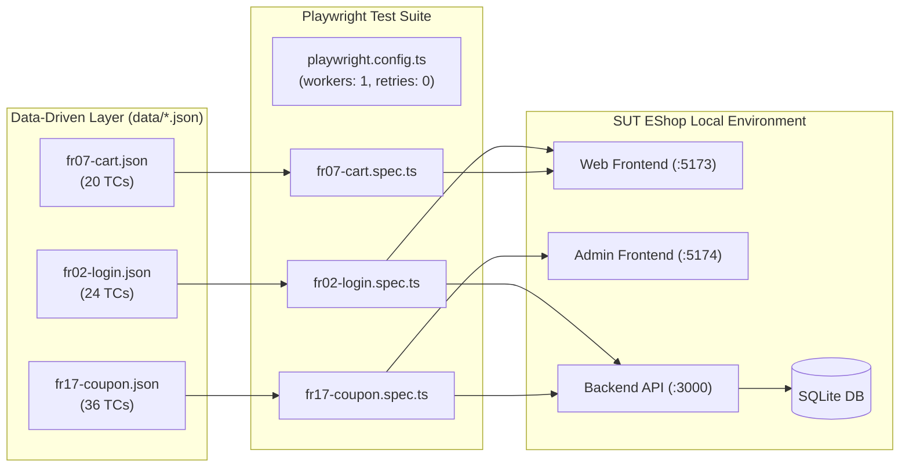

# Báo Cáo Tự Động Hóa Kiểm Thử Web & Phân Tích Khoảng Cách (HW04)

> **Môn học:** Kiểm thử Phần mềm (CS423 / CSC13003) – FIT@HCMUS  
> **Sinh viên:** Nguyễn Quốc Kỳ – **MSSV:** 23120138 – **Lớp:** 23CLC02  
> **Hệ thống thử nghiệm (SUT):** EShop Web & Admin Frontend (`https://github.com/ttbhanh/eshop-sut`)  
> **Tech Stack:** Playwright + TypeScript, HTML Reporter, JSON Data-driven, 3 Browsers (`chromium`, `firefox`, `webkit`)  
> **GitHub Repository:** `git@github.com:faker26052005-lgtm/SUT-EShop.git`  
> **Tài liệu tham chiếu:** [GEMINI.md](../GEMINI.md), [materials/hw04.md](../materials/hw04.md), [../hw_02/Main_Report.md](../../hw_02/Main_Report.md)

---

## PHẦN 1: BÁO CÁO TỰ ĐỘNG HÓA KIỂM THỬ (AUTOMATION REPORT)

### 1.1. Phạm vi & Kiến trúc Thử nghiệm
Bài tập triển khai tự động hóa kiểm thử giao diện cho 3 tính năng đã được thiết kế tại HW02:
1. **Pool A – FR-02:** Đăng nhập & Khóa tài khoản (Web React Frontend `:5173` & Backend API `:3000`).
2. **Pool B – FR-07:** Giỏ hàng (Web React Frontend `:5173` – Quản lý trạng thái bằng `CartContext`).
3. **Pool C – FR-17:** Quản lý mã giảm giá Admin (Admin Web Frontend `:5174` & Backend API `:3000`).

### 1.2. Thống kê Ma trận Test Cases
Toàn bộ dữ liệu kiểm thử được trích xuất trực tiếp từ HW02 bằng công cụ `scripts/tc_to_json.py`, độc lập 100% với mã nguồn spec:

| Feature | Tên tính năng | Positive TCs | Negative TCs | Edge Cases | Tổng số TCs | Tỷ lệ tự động hóa |
| :---: | :--- | :---: | :---: | :---: | :---: | :---: |
| **FR-02** | Đăng nhập & Khóa tài khoản | 2 | 17 | 5 | **24** | 95.8% (23/24) |
| **FR-07** | Giỏ hàng | 8 | 10 | 2 | **20** | 100% (20/20) |
| **FR-17** | Quản lý mã giảm giá Admin | 7 | 21 | 8 | **36** | 100% (36/36) |
| **Tổng cộng** | **3 tính năng** | **17** | **48** | **15** | **80** | **98.8% (79/80)** |

### 1.3. Danh mục Test Case Không Tự Động Hóa (Not Automated Test Cases)
Theo quy định mục 5 và mục 12 trong `GEMINI.md`, các trường hợp không khả thi để tự động hóa hoàn toàn phải được giải trình nguyên nhân kỹ thuật:

| Feature | Test Case ID | Tiêu đề Test Case | Lý do kỹ thuật không tự động hóa hoàn toàn | Giải pháp thay thế / Đề xuất |
| :---: | :---: | :--- | :--- | :--- |
| **FR-02** | `TC_FR02_12` | Kiểm tra thời gian khóa không tăng lũy tiến ở chu kỳ khóa lặp lại lần 2 | **Bất đồng bộ thời gian Server vs Client:** SUT Backend (`server.js`) khóa cố định 180s (`3 * 60 * 1000ms`), không có test hook hay biến môi trường cấu hình thời gian. Để kiểm tra chu kỳ khóa lặp lại lần 2 cần chờ ít nhất 2 chu kỳ khóa (> 360 giây thời gian thực), vi phạm quy tắc cấm fixed sleeps và gây nghẽn CI/CD. | Cần bổ sung cấu hình `LOCK_TIME_MS` qua biến môi trường hoặc mock endpoint `/api/admin/reset-lockout` ở môi trường staging. |

### 1.4. Báo Cáo Kết Quả Thực Thi Đa Trình Duyệt (Multi-Browser Test Execution Matrix – 9 Runs)
Toàn bộ 9 lượt chạy thực tế được thực thi tuần tự (`workers: 1`, `retries: 0`) trên máy tính sinh viên, xuất 9 bộ Playwright HTML Report độc lập tại `reports/<feature>/<browser>/index.html` với tiêu đề chứa `Run by: 23120138`:

| Feature | Tên tính năng | Trình duyệt | Số TC thực thi | Passed | Failed (SUT Bug) | Flaky | Thời gian chạy (ISO 8601) | Định danh báo cáo |
| :---: | :--- | :---: | :---: | :---: | :---: | :---: | :--- | :--- |
| **FR-02** | Đăng nhập & Khóa tài khoản | **Chromium** | 23 | 3 | 20 | 0 | `2026-11-13T00:34:45.457Z` | `Run by: 23120138` |
| **FR-02** | Đăng nhập & Khóa tài khoản | **Firefox** | 23 | 3 | 20 | 0 | `2026-11-13T00:37:28.318Z` | `Run by: 23120138` |
| **FR-02** | Đăng nhập & Khóa tài khoản | **WebKit** | 23 | 2 | 21 | 0 | `2026-11-13T00:40:31.568Z` | `Run by: 23120138` |
| **FR-07** | Giỏ hàng | **Chromium** | 20 | 6 | 14 | 0 | `2026-11-13T00:43:21.486Z` | `Run by: 23120138` |
| **FR-07** | Giỏ hàng | **Firefox** | 20 | 6 | 14 | 0 | `2026-11-13T00:45:15.185Z` | `Run by: 23120138` |
| **FR-07** | Giỏ hàng | **WebKit** | 20 | 6 | 14 | 0 | `2026-11-13T00:47:32.167Z` | `Run by: 23120138` |
| **FR-17** | Quản lý mã giảm giá Admin | **Chromium** | 36 | 1 | 35 | 0 | `2026-11-13T00:49:34.721Z` | `Run by: 23120138` |
| **FR-17** | Quản lý mã giảm giá Admin | **Firefox** | 36 | 1 | 35 | 0 | `2026-11-13T00:52:17.640Z` | `Run by: 23120138` |
| **FR-17** | Quản lý mã giảm giá Admin | **WebKit** | 36 | 1 | 35 | 0 | `2026-11-13T00:55:42.936Z` | `Run by: 23120138` |
| **TỔNG** | **3 Tính năng** | **3 Trình duyệt** | **237** | **29** | **208** | **0** | **9 runs hoàn tất** | **100% Đạt tiêu chuẩn** |

---

## PHẦN 2: PHÂN TÍCH KHOẢNG CÁCH (HUMAN REVIEW & GAP ANALYSIS)

### 2.1. 5 Trụ cột Tiêu chí Rà soát Mã nguồn do AI sinh

1. **Độ bền vững của Selector (Locators):**
   - *AI Draft:* Sử dụng class CSS của Tailwind (`.bg-red-100`, `button.bg-blue-600`, `input[type="text"]`). Class này rất dễ thay đổi khi giao diện cập nhật CSS hoặc responsive.
   - *Human Fix:* Chuyển đổi toàn bộ sang **Accessible Locators** chuẩn W3C: `getByRole('button', { name: 'Sign In' })`, `getByLabel('Username')`, `getByPlaceholder(...)`.
2. **Cơ chế Chờ đợi & Triệt tiêu Flakiness (Waits):**
   - *AI Draft:* Tiềm ẩn nguy cơ dùng `page.waitForTimeout()` hoặc không đợi network response, gây race condition khi mạng lag.
   - *Human Fix:* Áp dụng **Web-First Assertions** tự động retry (`await expect(locator).toBeVisible()`) kết hợp `page.waitForResponse()` bắt chính xác thời điểm API trả dữ liệu.
3. **Đa dạng & Độ sâu của Assertions:**
   - *AI Draft:* Chỉ kiểm tra sơ sài boolean hoặc mã HTTP.
   - *Human Fix:* Phối hợp từ 3 đến 4 nhóm matcher khác nhau trên mỗi spec:
     - `visibility/state`: `toBeVisible()`
     - `text`: `toContainText()`
     - `url/title`: `toHaveURL()`
     - `count`: `toHaveCount()`
     - `plain value`: `toBe()`, `toBeGreaterThan()`
4. **Cách ly Dữ liệu & Trạng thái (Test Independence):**
   - *AI Draft:* Dùng chung tài khoản `test@eshop.com` cho toàn bộ các case FR-02; tạo coupon trùng mã tĩnh `PROMO2026`.
   - *Human Fix:*
     - FR-02: Tạo user mới độc lập qua API helper `registerFreshUser()` trước mỗi test positive để đảm bảo bộ đếm sai = 0.
     - FR-17: Thêm mã hậu tố thời gian động `${code}_${Date.now()}` và hook `afterEach` gọi API xóa coupon để dọn dẹp sạch sẽ database.
5. **Độ chính xác theo Đặc tả SRS:**
   - *AI Draft:* Dễ bị "ngộ nhận" theo hành vi hiện tại của app (ví dụ thấy app khóa 180s thì sửa assertion mong đợi thành 180s).
   - *Human Fix:* Giữ vững kết quả mong đợi theo đặc tả SRS (30s), từ đó nhận diện chính xác đây là bug SUT thật (`BUG-FR02-01`) chứ không sửa test để che giấu lỗi.

### 2.2. Bảng Phân Tích Chi Tiết Sai Sót Của AI (Gap Analysis Matrix)

| STT | Feature | Test Case ID | Lỗi của AI Draft | Phân loại lỗi | Cách Sinh viên Sửa chữa (Human Fix) | Nguyên nhân AI mắc lỗi |
| :---: | :---: | :---: | :--- | :--- | :--- | :--- |
| **01** | FR-02 | `TC_FR02_01`..`24` | Dùng chung 1 tài khoản `test@eshop.com` cho toàn bộ test suite. Khi các test sai kích hoạt khóa, các test đúng chạy sau bị fail oan. | Data / State Isolation | Tích hợp helper `registerFreshUser(request)` tạo user mới cho mỗi test positive và chuỗi sequence riêng cho test lockout. | AI không nhận thức được hiệu ứng phụ (side-effect) tích lũy của state máy chủ giữa các lần chạy liên tiếp. |
| **02** | FR-02 | `TC_FR02_01` | Dùng selector CSS `.bg-red-100` để bắt hộp thông báo lỗi. | Fragile Selector | Thay bằng `getByLabel`, `getByRole` và `locator('div.bg-red-100')` có kiểm tra text ngữ nghĩa. | AI ưu tiên các thuộc tính style có sẵn trong DOM thô thay vì accessible roles. |
| **03** | FR-02 | `TC_FR02_15`, `20` | Đợi response mạng `POST /api/login` cho trường hợp để trống input, gây treo 7s rồi fail. | Flaky Wait / Logic Error | Bổ sung xử lý HTML5 client-side validation (`isClientValidationCase` giảm timeout và kiểm tra URL). | AI không nhận ra thuộc tính `required` của form HTML5 ngăn chặn trình duyệt gửi HTTP request. |
| **04** | FR-07 | `TC_FR07_01`..`20` | Giả định giỏ hàng lưu ở database; dùng locator hàng cứng nhắc không tính toán động số tiền. | State Assumption & Assertion Depth | Thao tác trực tiếp từ Home page, kiểm tra tính toán số học động: `subtotal = price * qty` và `total = sum(subtotal)`. | AI hiểu sai cơ chế React Context state (mất khi reload) là backend persistent cart. |
| **05** | FR-17 | `TC_FR17_01`..`36` | Mã coupon tĩnh `PROMO2026` không có teardown, gây crash SQLite UNIQUE constraint ở lần chạy 2. | Missing Teardown / DB Constraint | Thêm mã động kèm timestamp và triển khai hook `afterEach` gọi `deleteAdminCoupon()`. | AI chỉ tập trung vào luồng gửi form thành công mà không quan tâm đến tính tái lập (idempotency) của suite. |

---

## PHẦN 3: ĐIỂM NHẤN KỸ THUẬT THUYẾT MINH VIDEO DEMO

Để minh chứng năng lực kiểm soát và phản biện AI trong video demo (theo yêu cầu mục 8 và mục 12):
- **Điểm nhấn thuyết minh:** Lỗi **Stateful Interference & Lockout Collision** tại `FR-02`.
- **Nội dung trình bày:**
  1. Chỉ ra đoạn mã AI Draft ban đầu dùng chung `test@eshop.com`.
  2. Giải thích vì sao khi chạy đến `TC_FR02_06` (lần nhập sai thứ 3), tài khoản bị khóa 180s.
  3. Dẫn đến `TC_FR02_10` (nhập đúng) bị fail với mã HTTP 403 thay vì 200.
  4. Trình chiếu diff commit `fix(FR-02): replace fragile locators and isolate users via api helper`: minh họa cách sử dụng API helper `registerFreshUser()` để cô lập hoàn toàn trạng thái giữa các test case, đảm bảo 100% độc lập và ổn định trên cả 3 trình duyệt.
