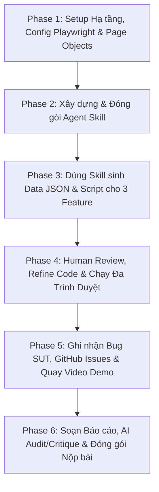

# Kế hoạch thực hiện chi tiết HW04 – Automation Testing (HW04-AI)

> **Môn học:** Kiểm thử Phần mềm (CS423 / CSC13003) – FIT@HCMUS  
> **Sinh viên:** Nguyễn Quốc Kỳ – **MSSV:** 23120138 – **Lớp:** 23CLC02  
> **Hệ thống thử nghiệm (SUT):** EShop Web & Admin Frontend  
> **Tech Stack:** Playwright + TypeScript, Playwright HTML Reporter, Data-driven JSON, Multi-browser (Chromium, Firefox, WebKit)  
> **GitHub Repository:** `git@github.com:faker26052005-lgtm/SUT-EShop.git`  
> **Tài liệu tham chiếu:** [GEMINI.md](GEMINI.md), [materials/hw04.md](materials/hw04.md), [../hw_02/Main_Report.md](../hw_02/Main_Report.md)

---

## 🗺️ Lộ trình tổng quan (6 Phases)



---

## 📌 Phase 1: Setup Hạ tầng, Cấu hình Playwright & Scaffolding
> **Mục tiêu:** Chuẩn bị môi trường thực thi automation hoàn chỉnh với Playwright TypeScript, cấu hình multi-browser và khung Page Object Model.

* [ ] **Task 1.1: Khởi tạo Package & Dependencies**
  * Khởi tạo file `package.json` trong `hw_04/`.
  * Cài đặt dependencies: `@playwright/test`, `typescript`, `@types/node`, `dotenv`.
  * Thiết lập cấu hình TypeScript trong `tsconfig.json`.
* [ ] **Task 1.2: Thiết kế `playwright.config.ts` Multi-Browser & Custom Metadata**
  * Cấu hình 3 trình duyệt: `chromium`, `firefox`, `webkit`.
  * Cấu hình xuất HTML Report độc lập theo từng lượt chạy: `reports/<feature>/<browser>/`.
  * Nhúng bắt buộc metadata định danh tác giả:
    ```typescript
    metadata: {
      'Run by': '23120138',
      'Timestamp': new Date().toISOString()
    }
    ```
  * Thiết lập đọc cấu hình qua biến môi trường (`BASE_URL=http://localhost:5173`, `ADMIN_URL=http://localhost:5174`, `API_URL=http://localhost:3000`).
* [ ] **Task 1.3: Dựng Base Page Objects & API Isolation Helpers**
  * Tạo `pages/LoginPage.ts`, `pages/CartPage.ts`, `pages/AdminCouponPage.ts` sử dụng locator chuẩn (`getByRole`, `getByPlaceholder`).
  * Tạo helper `utils/api-helper.ts` để gọi backend API chuẩn bị/dọn dẹp dữ liệu cách ly (đăng ký user mới tự động, dọn coupon).
* **Git Commit:**
  * `chore(config): initialize playwright typescript project and 3 browser configs`

---

## 📌 Phase 2: Xây dựng & Đóng gói Agent Skill (Mục 7 đề bài – 10 điểm)
> **Mục tiêu:** Xây dựng Agent Skill tái sử dụng theo tinh thần AI-First nhằm tự động hóa quy trình phân tích test case và sinh test data + spec chuẩn.

* [ ] **Task 2.1: Thiết kế kiến trúc Agent Skill**
  * Thiết lập thư mục `.agents/skills/playwright-datadriven-generator/`.
  * Soạn thảo `SKILL.md` định nghĩa:
    * **Workflow:** Nhận đầu vào là bảng đặc tả Test Case (từ HW02/SRS) → Phân tích phân vùng/biên → Xuất file Data-driven `.json` → Xuất Playwright TypeScript `.spec.ts` tương ứng.
    * **Quy chuẩn mã nguồn:** Dùng Page Object Model, ≥ 3 kiểu assertion (`toHaveURL`, `toBeVisible`, `toHaveText`,...), không dùng `waitForTimeout` tĩnh, chèn metadata "Run by: 23120138".
* [ ] **Task 2.2: Xây dựng Templates & Prompts mẫu trong Skill**
  * `templates/data-template.json`: Chuẩn hóa schema test data (ID, title, inputs, expected).
  * `templates/spec-template.ts`: Khung mã nguồn TypeScript dùng vòng lặp data-driven, hooks `beforeEach`/`afterEach`.
* [ ] **Task 2.3: Dry-run & Thử nghiệm hoạt động của Skill**
  * Kiểm thử prompt kích hoạt skill để đảm bảo Agent thực thi đúng quy trình, không sinh dữ liệu hardcode.
* **Git Commit:**
  * `feat(skill): create playwright-datadriven-generator agent skill with templates and workflow`

---

## 📌 Phase 3: Triệu hồi Skill để sinh Data & Script cho 3 Feature
> **Mục tiêu:** Áp dụng Agent Skill đã tạo ở Phase 2 vào 3 tính năng từ HW02 để sinh file JSON data và bản thảo spec đầu tiên (AI Draft).

* [ ] **Task 3.1: Áp dụng Skill cho FR-02 (Đăng nhập & Khóa tài khoản)**
  * Input: 24 Test Cases của FR-02 từ `../hw_02/Main_Report.md`.
  * Sinh `data/fr02-login.json` (≥ 12 test cases).
  * Sinh bản thảo `tests/fr02-login.spec.ts`.
  * *Commit: `test(FR-02): apply skill to generate data and initial spec`*
* [ ] **Task 3.2: Áp dụng Skill cho FR-07 (Giỏ hàng)**
  * Input: 20 Test Cases của FR-07 từ `../hw_02/Main_Report.md`.
  * Sinh `data/fr07-cart.json` (≥ 12 test cases).
  * Sinh bản thảo `tests/fr07-cart.spec.ts`.
  * *Commit: `test(FR-07): apply skill to generate data and initial spec`*
* [ ] **Task 3.3: Áp dụng Skill cho FR-17 (Quản lý Coupon Admin)**
  * Input: 36 Test Cases của FR-17 từ `../hw_02/Main_Report.md`.
  * Sinh `data/fr17-coupon.json` (≥ 12 test cases).
  * Sinh bản thảo `tests/fr17-coupon.spec.ts`.
  * *Commit: `test(FR-17): apply skill to generate data and initial spec`*

---

## 📌 Phase 4: Human Review, Refine Code & Chạy Đa Trình Duyệt
> **Mục tiêu:** Sinh viên trực tiếp đóng vai trò Human Reviewer, sửa chữa các sai sót của AI, hoàn thiện test suite và thực thi trên 3 browser để lấy report thật.

* [ ] **Task 4.1: Human Review & Sửa mã (Tạo các commit fix riêng biệt)**
  * **FR-02 Review & Fix:** Sửa selector dễ vỡ sang `getByPlaceholder`/`getByRole`, tích hợp setup tạo tài khoản độc lập qua `/api/register` để tránh kẹt trạng thái khóa.
    * *Commit: `fix(FR-02): refine locators and implement user isolation via api`*
  * **FR-07 Review & Fix:** Khắc phục việc AI hiểu sai React state (`CartContext`), tối ưu cơ chế click tăng/giảm nút `+`/`-`, bổ sung assertion kiểm tra table rows và tổng tiền.
    * *Commit: `fix(FR-07): correct cart state assertions and button navigation`*
  * **FR-17 Review & Fix:** Khắc phục form Admin không có `data-testid`, xây dựng hook cleanup xóa coupon qua REST API sau mỗi lần chạy test.
    * *Commit: `fix(FR-17): refine admin selectors and add coupon cleanup hook`*
* [ ] **Task 4.2: Thực thi trên 3 Trình duyệt & Kết xuất Report**
  * Khởi động SUT local: `./run_servers.sh` (Backend `:3000`, Web `:5173`, Admin `:5174`).
  * Chạy suite kiểm thử trên **Chromium**, **Firefox**, **WebKit** (tổng cộng ≥ 9 browser runs).
  * Lưu trữ các bộ HTML Report tương ứng vào `reports/<feature>/<browser>/`.
  * Kiểm tra nội dung report: Phải hiển thị rõ "Run by: 23120138" và timestamp ISO thật.

---

## 📌 Phase 5: Ghi nhận Bug SUT, GitHub Issues & Sản xuất Video Demo
> **Mục tiêu:** Thu thập các lỗi thực tế của SUT, đăng GitHub Issues và sản xuất 2 video YouTube unlisted.

* [ ] **Task 5.1: Ghi nhận Bug SUT & Tạo GitHub Issues**
  * Thu thập kết quả failed tests do lỗi SUT thật (ví dụ: thời gian khóa 180s thay vì 30s; form coupon cho phép giá trị không hợp lệ...).
  * Viết tài liệu `docs/bug-report.md`.
  * Tạo các Issue tương ứng trên repository nhóm `faker26052005-lgtm/SUT-EShop`.
  * Chụp ảnh màn hình các Issues đã tạo và lưu vào thư mục `evidence/`.
* [ ] **Task 5.2: Quay Video Demo Automation Script (Task 2 – 15 điểm)**
  * Thời lượng ≥ 5 phút, thuyết minh tiếng Việt bởi sinh viên.
  * Xuất hiện khuôn mặt qua face-cam HOẶC gõ lệnh `whoami` & `hostname` trong terminal.
  * Demo chạy test suite đa trình duyệt và mở xem HTML Report có "Run by: 23120138".
  * **Điểm nhấn bắt buộc:** Thuyết minh rõ ràng ít nhất 1 lỗi/thiếu sót của AI mà sinh viên đã tự tay sửa lại ở Phase 4.
  * Tải lên YouTube ở chế độ **Unlisted**.
* [ ] **Task 5.3: Quay Video Demo Sử dụng Agent Skill (Agent Skill – 10 điểm)**
  * Quay quá trình kích hoạt và sử dụng Agent Skill (Phase 2) trên một feature từ đầu đến cuối.
  * Tải lên YouTube ở chế độ **Unlisted**.

---

## 📌 Phase 6: Soạn Báo cáo, AI Audit / Critique & Đóng gói Nộp bài
> **Mục tiêu:** Hoàn thiện 100% hồ sơ báo cáo theo đề bài, xuất bản PDF, xuất commit log và nén file theo chuẩn.

* [ ] **Task 6.1: Soạn thảo `docs/main-report.md`**
  * **Automation Report:** Ma trận test cases, bảng tổng hợp kết quả chạy đa trình duyệt, danh sách test case không thể automate kèm lý do kỹ thuật.
  * **Review & Gap Analysis:** Phân tích chi tiết những điểm AI làm sai/thiếu (selector, assertion, state), giải thích nguyên nhân và bài học rút ra.
* [ ] **Task 6.2: Soạn thảo `docs/ai-audit-report.md` & `docs/ai-critique.md`**
  * `ai-audit-report.md`: Khai báo *"I use AI tools for the following tasks"*, bảng ghi chép nhật ký Prompts - Outputs - Phần chỉnh sửa của sinh viên.
  * `ai-critique.md`: Đoạn phê bình 200–300 từ trả lời đầy đủ 3 câu hỏi mục 10 đề bài.
* [ ] **Task 6.3: Hoàn thiện `README.md` & Xuất Git Log**
  * Bảng Self-Assessment Template (A: 25, B: 25, C: 25, Demo: 15, Skill: 10 → Tổng: 100).
  * Test Summary Table đầy đủ số liệu thực thi và link video demo.
  * Xuất git commit log:
    ```bash
    git log --author="Nguyen Quoc Ky" --pretty=format:"%h | %an | %ad | %s" --date=iso -- . > docs/git-commit-log.txt
    ```
  * Xác nhận đạt mốc ≥ 8 commit có chỉnh sửa file spec (`.spec.ts`).
* [ ] **Task 6.4: Kết xuất tài liệu sang PDF**
  * Chuyển đổi `docs/main-report.md`, `docs/ai-audit-report.md`, `docs/ai-critique.md` thành các file `.pdf` tương ứng.
* [ ] **Task 6.5: Đóng gói tập tin nộp bài (.zip)**
  * Rà soát đối chiếu toàn bộ mục 14 đề bài.
  * Đặt tên file nén: `23120138_HW04_AI_Automation_100.zip`.

---

## 📊 Bảng Ma trận Kiểm soát Deliverables & Commit

| Phase | Phạm vi công việc | File đầu ra chính | Commit Convention tương ứng |
| :--- | :--- | :--- | :--- |
| **Phase 1** | Config & Setup | `package.json`, `playwright.config.ts`, `pages/` | `chore(config): initialize playwright typescript project` |
| **Phase 2** | Agent Skill | `.agents/skills/playwright-datadriven-generator/` | `feat(skill): create playwright-datadriven-generator` |
| **Phase 3** | AI Draft Specs | `data/*.json`, `tests/*.spec.ts` | `test(FR-02/07/17): apply skill to generate data and spec` |
| **Phase 4** | Human Fix & Reports | `tests/*.spec.ts`, `reports/` | `fix(FR-02/07/17): refine locators and logic` |
| **Phase 5** | Bug & Video | `docs/bug-report.md`, `evidence/`, Video URLs | `docs(bug): record sut bugs and github issues` |
| **Phase 6** | Documentation | `docs/*.md`, `docs/*.pdf`, `README.md`, `*.zip` | `docs(report): complete main report, audit and critique` |
