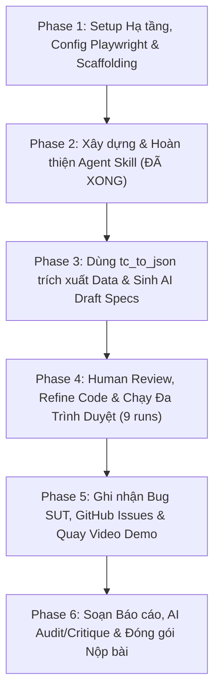

# Kế hoạch thực hiện chi tiết HW04 – Automation Testing (HW04-AI)

> **Môn học:** Kiểm thử Phần mềm (CS423 / CSC13003) – FIT@HCMUS  
> **Sinh viên:** Nguyễn Quốc Kỳ – **MSSV:** 23120138 – **Lớp:** 23CLC02  
> **Hệ thống thử nghiệm (SUT):** EShop Web & Admin Frontend (`https://github.com/ttbhanh/eshop-sut`)  
> **Tech Stack:** Playwright + TypeScript, Playwright HTML Reporter, Data-driven JSON, Multi-browser (Chromium, Firefox, WebKit)  
> **GitHub Repository:** `git@github.com:faker26052005-lgtm/SUT-EShop.git`  
> **Tài liệu tham chiếu:** [GEMINI.md](GEMINI.md), [materials/hw04.md](materials/hw04.md), [../hw_02/Main_Report.md](../hw_02/Main_Report.md), [.agents/skills/playwright-automation-coach/](.agents/skills/playwright-automation-coach/)

---

## 🗺️ Lộ trình tổng quan (Tích hợp với Agent Skill `playwright-automation-coach`)



---

## 📌 Phase 1: Setup Hạ tầng, Cấu hình Playwright & Scaffolding
> **Mục tiêu:** Chuẩn bị môi trường thực thi automation hoàn chỉnh với Playwright TypeScript, cấu hình multi-browser từ assets của skill và khung Page Object Model.

* [ ] **Task 1.1: Khởi tạo Package & Dependencies**
  * Khởi tạo file `package.json` trong `hw_04/`.
  * Cài đặt dependencies: `@playwright/test`, `typescript`, `@types/node`, `dotenv`.
  * Cài đặt browser engines: `npx playwright install`.
  * Thiết lập cấu hình TypeScript trong `tsconfig.json`.
* [ ] **Task 1.2: Triển khai Cấu hình từ Skill Assets (`playwright.config.ts`, `.env`, `features.json`)**
  * Sao chép và hiệu chỉnh `playwright.config.ts` từ `assets/playwright.config.ts`:
    * Hỗ trợ 3 trình duyệt: `chromium`, `firefox`, `webkit`.
    * Cấu hình xuất HTML Report độc lập theo từng lượt chạy: `reports/<feature>/<browser>/`.
    * Nhúng bắt buộc metadata định danh tác giả:
      ```typescript
      metadata: {
        'Run by': process.env.STUDENT_ID ?? '23120138',
        'Run at': process.env.RUN_AT ?? new Date().toISOString(),
        Feature: process.env.FEATURE ?? 'all',
        Browser: process.env.BROWSER_TAG ?? 'all',
        Host: os.hostname(),
      }
      ```
    * `retries: 0`, `workers: 1`.
  * Khởi tạo `.env` từ `assets/.env.example` (`BASE_URL=http://localhost:5173`, `ADMIN_URL=http://localhost:5174`, `API_URL=http://localhost:3000`, `STUDENT_ID=23120138`).
  * Triển khai `features.json` từ `assets/features.json` để quản lý mapping 3 tính năng.
  * Bổ sung `.gitignore` từ `assets/.gitignore` (chặn `node_modules/`, `.env`, `test-results/`).
* [ ] **Task 1.3: Dựng Base Page Objects & API Fixture Helpers**
  * Triển khai `fixtures.ts` từ `assets/fixtures.ts` (các helper gọi REST API: `registerFreshUser`, `getAdminToken`, `createAdminCoupon`, `deleteAdminCoupon`).
  * Tạo khung Page Object trong `pages/`: `pages/login.page.ts`, `pages/cart.page.ts`, `pages/admin-coupon.page.ts` sử dụng locator ổn định (`getByRole`, `getByLabel`, `getByPlaceholder`).
* **Git Commit dự kiến:**
  * `chore(config): initialize playwright typescript project and 3 browser configs`

---

## 📌 Phase 2: Xây dựng & Đóng gói Agent Skill (Mục 7 đề bài – 10 điểm)
> **Mục tiêu:** Xây dựng Agent Skill tái sử dụng theo tinh thần AI-First nhằm tự động hóa quy trình phân tích test case, sinh test data, kiểm tra điều kiện và hướng dẫn sinh viên.
> **Trạng thái:** ✅ **ĐÃ HOÀN THÀNH 100%** tại `.agents/skills/playwright-automation-coach/`

* [x] **Task 2.1: Thiết kế kiến trúc & Quy trình Agent Skill (`SKILL.md`)**
  * Định vị tại `.agents/skills/playwright-automation-coach/`.
  * Xây dựng workflow 9 giai đoạn (staged workflow), phân định rõ ràng trách nhiệm AI vs Sinh viên.
  * Tích hợp nhật ký AI Audit với skill `hw-ai-audit`.
* [x] **Task 2.2: Xây dựng Bộ Công cụ Tự động (Scripts)**
  * `scripts/tc_to_json.py`: Bộ phân giải markdown bảng test case HW02 thành JSON chuẩn data-driven. Đã kiểm thử thành công trên 24 case FR-02, 20 case FR-07, và 36 case FR-17.
  * `scripts/check_requirements.py`: Bộ kiểm tra tự động 100% yêu cầu cứng của đề bài (case count, assertion patterns, 9 browser runs, Run-by metadata, git commits theo author, docs existence, bảo mật .env).
* [x] **Task 2.3: Xây dựng Tài liệu Tham chiếu Sâu (References)**
  * `references/phases.md`: Chi tiết từng bước và checkpoint của 9 phase.
  * `references/eshop-sut.md`: Cẩm nang đặc thù SUT EShop (port, auth, API setup/cleanup, React state cart, lỗi khóa 180s vs 30s SRS).
  * `references/demo-script.md`: Kịch bản video demo chi tiết từng phút cho sinh viên.
  * `references/review-checklist.md`, `references/assertion-patterns.md`, `references/selector-and-wait-rules.md`, `references/test-selection.md`.
* [x] **Task 2.4: Xây dựng Bộ Templates & Runner (Assets)**
  * `assets/playwright.config.ts`, `assets/run-all.mjs`, `assets/fixtures.ts`, `assets/features.json`, `assets/.env.example`, `assets/.gitignore`, `assets/PROGRESS.md`, `assets/data-driven.spec.ts`, `assets/page-object.ts`, `assets/test-data.example.json`, `assets/bug-report.md`, `assets/test-summary.md`.
* **Git Commit dự kiến:**
  * `feat(skill): create playwright-automation-coach agent skill with tools and references`

---

## 📌 Phase 3: Dùng Skill sinh Data JSON & Script cho 3 Feature
> **Mục tiêu:** Sử dụng công cụ `tc_to_json.py` trích xuất dữ liệu từ HW02, sau đó triệu hồi Agent Skill để sinh mã nguồn bản nháp đầu tiên (AI Draft) cho 3 tính năng.

* [ ] **Task 3.1: Trích xuất Data JSON cho cả 3 Feature**
  * Chạy: `python3 .agents/skills/playwright-automation-coach/scripts/tc_to_json.py --source ../hw_02/Main_Report.md --output-dir data`
  * Kết quả tạo ra:
    * `data/fr02-login.json` (24 test cases)
    * `data/fr07-cart.json` (20 test cases)
    * `data/fr17-coupon.json` (36 test cases)
  * Đối chiếu sơ bộ các trường `expected` với `specs/system_requirements_specification.md`.
  * *Commit: `test(data): extract test cases from hw02 to json data files`*
* [ ] **Task 3.2: Sinh Bản nháp Spec & Page Object cho FR-02 (Đăng nhập & Khóa tài khoản)**
  * Triệu hồi skill sinh `pages/login.page.ts` và `tests/fr02-login.spec.ts`.
  * Đảm bảo data-driven hoàn toàn (không inline array), dùng `TC_FR02_xx` trong test name.
  * *Commit: `test(FR-02): generate AI draft for TC_FR02_01-24`*
* [ ] **Task 3.3: Sinh Bản nháp Spec & Page Object cho FR-07 (Giỏ hàng)**
  * Triệu hồi skill sinh `pages/cart.page.ts` và `tests/fr07-cart.spec.ts`.
  * Đảm bảo data-driven hoàn toàn, dùng `TC_FR07_xx` trong test name.
  * *Commit: `test(FR-07): generate AI draft for TC_FR07_01-20`*
* [ ] **Task 3.4: Sinh Bản nháp Spec & Page Object cho FR-17 (Quản lý Coupon Admin)**
  * Triệu hồi skill sinh `pages/admin-coupon.page.ts` và `tests/fr17-coupon.spec.ts`.
  * Đảm bảo data-driven hoàn toàn, dùng `TC_FR17_xx` trong test name.
  * *Commit: `test(FR-17): generate AI draft for TC_FR17_01-36`*

---

## 📌 Phase 4: Human Review, Refine Code & Chạy Đa Trình Duyệt (9 Runs)
> **Mục tiêu:** Sinh viên trực tiếp đóng vai trò Human Reviewer, đối chiếu `review-checklist.md`, sửa chữa các sai sót của AI, tạo các commit fix độc lập, và thực thi 9 runs thật trên 3 trình duyệt.

* [ ] **Task 4.1: Human Review & Sửa mã FR-02 (Tạo commit fix riêng)**
  * Rà soát selector (thay CSS bằng `getByRole`/`getByLabel`), loại bỏ fixed wait.
  * Tích hợp helper `registerFreshUser()` để cách ly counter và trạng thái khóa giữa các test.
  * Ghi nhận test kiểm tra hết hạn khóa 180s (lệch SRS 30s) vào danh sách "Not automated" trong `docs/main-report.md`.
  * *Commit: `fix(FR-02): replace fragile locators and isolate users via api helper`*
* [ ] **Task 4.2: Human Review & Sửa mã FR-07 (Tạo commit fix riêng)**
  * Khắc phục việc AI hiểu sai React state (`CartContext`), tối ưu cơ chế click tăng/giảm nút `+`/`-`.
  * Bổ sung assertion kiểm tra table rows (`toHaveCount`) và tính toán tổng tiền số học (pattern 4 & 7).
  * *Commit: `fix(FR-07): correct cart state assertions and dynamic row subtotal`*
* [ ] **Task 4.3: Human Review & Sửa mã FR-17 (Tạo commit fix riêng)**
  * Tối ưu locator form Admin (dùng accessible selectors, xử lý input type percent/fixed).
  * Thêm hook `afterEach` gọi `deleteAdminCoupon()` dọn sạch mã coupon sau mỗi test.
  * *Commit: `fix(FR-17): refine admin selectors and add coupon cleanup teardown`*
* [ ] **Task 4.4: Thực thi trên 3 Trình duyệt & Xuất Báo cáo HTML (9 Runs)**
  * Khởi động SUT local: `./run_servers.sh` (Backend `:3000`, Web `:5173`, Admin `:5174`).
  * Thực thi toàn bộ bằng runner: `node scripts/run-all.mjs` (hoặc chạy lẻ từng lệnh).
  * Đảm bảo đủ 9 bộ report tại `reports/<feature>/<browser>/` (`fr02-login`, `fr07-cart`, `fr17-coupon` x `chromium`, `firefox`, `webkit`).
  * Mở xem từng report, xác nhận hiển thị chuỗi `"Run by: 23120138"` và timestamp ISO thật.
* [ ] **Task 4.5: Chạy Thẩm định Tự động bằng Script của Skill**
  * Chạy: `python3 .agents/skills/playwright-automation-coach/scripts/check_requirements.py`.
  * Kiểm tra và giải quyết mọi cảnh báo/vấn đề cho tới khi đạt 100% compliant.

---

## 📌 Phase 5: Ghi nhận Bug SUT, GitHub Issues & Sản xuất Video Demo
> **Mục tiêu:** Thu thập các lỗi thực tế của SUT, đăng GitHub Issues kèm ảnh minh chứng và quay 2 video YouTube unlisted theo đúng kịch bản của skill.

* [ ] **Task 5.1: Ghi nhận Bug SUT & Tạo GitHub Issues**
  * Thu thập kết quả failed tests do lỗi SUT thật (đối chiếu SRS và HW02: khóa 180s vs 30s, validation form...).
  * Soạn tài liệu `docs/bug-report.md` theo mẫu `assets/bug-report.md`.
  * Tạo các Issue tương ứng trên repository nhóm `faker26052005-lgtm/SUT-EShop`.
  * Chụp ảnh màn hình các Issues đã tạo và lưu vào thư mục `evidence/`.
  * *Commit: `docs(bug): document genuine sut defects and link github issues`*
* [ ] **Task 5.2: Quay Video Demo Automation Script (Task 2 – 15 điểm)**
  * Thời lượng ≥ 5 phút, thuyết minh tiếng Việt bởi sinh viên Nguyễn Quốc Kỳ.
  * Xuất hiện khuôn mặt qua face-cam HOẶC gõ lệnh `whoami` & `hostname` trong terminal.
  * Demo chạy test suite đa trình duyệt và mở xem HTML Report có "Run by: 23120138".
  * **Điểm nhấn bắt buộc:** Thuyết minh rõ ràng ít nhất 1 lỗi của AI mà sinh viên đã tự tay sửa lại ở Phase 4 (theo gợi ý tại Phase 6 của skill).
  * Tải lên YouTube ở chế độ **Unlisted**.
* [ ] **Task 5.3: Quay Video Demo Sử dụng Agent Skill (Agent Skill – 10 điểm)**
  * Thực hiện theo kịch bản mẫu tại [`.agents/skills/playwright-automation-coach/references/demo-script.md`](.agents/skills/playwright-automation-coach/references/demo-script.md).
  * Thao tác trên 1 feature hoàn chỉnh (FR-02 hoặc FR-17): chạy `tc_to_json.py`, sinh spec, review fix, chạy 3 browser, mở report và chạy `check_requirements.py`.
  * Tải lên YouTube ở chế độ **Unlisted**.

---

## 📌 Phase 6: Soạn Báo cáo, AI Audit / Critique & Đóng gói Nộp bài
> **Mục tiêu:** Hoàn thiện 100% hồ sơ báo cáo theo đề bài, xuất bản PDF, xuất commit log và nén file theo chuẩn.

* [ ] **Task 6.1: Soạn thảo `docs/main-report.md`**
  * **Automation Report:** Ma trận test cases, bảng tổng hợp kết quả chạy đa trình duyệt, danh sách test case không thể automate kèm lý do kỹ thuật (khóa 180s, payment mock...).
  * **Review & Gap Analysis:** Bảng phân tích chi tiết những điểm AI làm sai/thiếu (selector, assertion, state), giải thích nguyên nhân và bài học rút ra.
* [ ] **Task 6.2: Soạn thảo `docs/ai-audit-report.md` & `docs/ai-critique.md`**
  * `docs/ai-audit-report.md`: Khai báo *"I use AI tools for the following tasks"*, bảng nhật ký Prompts - Outputs - Phần chỉnh sửa của sinh viên.
  * `docs/ai-critique.md`: Đoạn phê bình 200–300 từ trả lời đầy đủ 3 câu hỏi mục 10 đề bài.
* [ ] **Task 6.3: Hoàn thiện `README.md` & Xuất Git Log**
  * Bảng Self-Assessment Template (A: 25, B: 25, C: 25, Demo Video: 15, Agent Skill: 10 → Tổng: 100/100).
  * Test Summary Table đầy đủ số liệu thực thi và link 2 video demo.
  * Xuất git commit log theo quy định của `GEMINI.md`:
    ```bash
    git log --author="Nguyen Quoc Ky" --pretty=format:"%h | %an | %ad | %s" --date=iso -- . > docs/git-commit-log.txt
    ```
  * Xác nhận đạt mốc ≥ 8 commit có chỉnh sửa file spec (`.spec.ts`) do Nguyễn Quốc Kỳ tạo.
* [ ] **Task 6.4: Kết xuất tài liệu sang PDF**
  * Chuyển đổi `docs/main-report.md`, `docs/ai-audit-report.md`, `docs/ai-critique.md` thành các file `.pdf` tương ứng.
* [ ] **Task 6.5: Đóng gói tập tin nộp bài (.zip)**
  * Rà soát đối chiếu toàn bộ checklist mục 12 trong `GEMINI.md`.
  * Đặt tên file nén: `23120138_HW04_AI_Automation_100.zip`.
* **Git Commit dự kiến:**
  * `docs(report): complete main report, audit report, critique and test summary`

---

## 📊 Bảng Ma trận Kiểm soát Deliverables & Commit

| Phase | Phạm vi công việc | File đầu ra chính | Commit Convention tương ứng (Conventional Commits) |
| :--- | :--- | :--- | :--- |
| **Phase 1** | Config & Setup | `package.json`, `playwright.config.ts`, `fixtures.ts`, `.env` | `chore(config): initialize playwright typescript project` |
| **Phase 2** | Agent Skill | `.agents/skills/playwright-automation-coach/` | `feat(skill): create playwright-automation-coach agent skill` |
| **Phase 3** | Data & AI Draft Specs | `data/*.json`, `tests/*.spec.ts` | `test(FR-02): generate AI draft for TC_FR02_01-24`<br>`test(FR-07): generate AI draft for TC_FR07_01-20`<br>`test(FR-17): generate AI draft for TC_FR17_01-36` |
| **Phase 4** | Human Fix & Reports | `tests/*.spec.ts`, `reports/` (9 runs) | `fix(FR-02): replace fragile locators and isolate users`<br>`fix(FR-07): correct cart state assertions`<br>`fix(FR-17): refine admin selectors and add cleanup` |
| **Phase 5** | Bug & Video | `docs/bug-report.md`, `evidence/`, Video URLs | `docs(bug): record genuine sut defects and link github issues` |
| **Phase 6** | Documentation | `docs/*.md`, `docs/*.pdf`, `README.md`, `*.zip` | `docs(report): complete main report, audit and critique` |
