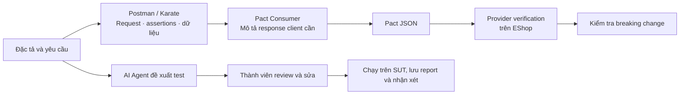

# API Testing & Contract Testing

## FIT HCMUS · Software Testing Seminar · Gặp mặt lần 1 (Tuần 2–3)

> **Chủ đề T06 · Case study: EShop · Bản phác thảo xin góp ý**  
> Đây là kế hoạch dự kiến. Cần cập nhật sau khi nhóm chạy thử và nhận góp ý của giảng viên.

## 1. Mục tiêu seminar

Giúp người học chưa tìm hiểu chủ đề có thể hiểu và thực hiện kiểm thử API cơ bản, sau đó thấy cách kiểm tra tương thích giữa ứng dụng tiêu thụ API (**Consumer**) và dịch vụ cung cấp API (**Provider**).

**Thông điệp chính:** HTTP 200 chưa đủ để kết luận API hoạt động đúng. Response vẫn có thể sai field hoặc sai kiểu dữ liệu khiến client không hoạt động đúng.

## 2. Bối cảnh và luồng kiểm thử

Backend Node/Express của EShop đóng vai trò Provider. Frontend và client giả lập đóng vai trò Consumers. Nhóm dự kiến chọn một số endpoint để kiểm tra response và minh họa tương tác Consumer–Provider.

| API testing | Contract testing (CDCT) |
|---|---|
| Kiểm tra hành vi endpoint qua request/response. | Kiểm tra tương thích của tương tác Consumer–Provider đã mô tả. |
| Assertions/checkpoints có thể kiểm tra status, body, field, kiểu dữ liệu và quy tắc cần thiết. | Consumer test tạo Pact; Provider verification đối chiếu contract với backend. |
| Có thể chạy lại request, dùng nhiều bộ dữ liệu và tự động hóa bằng runner. | Giúp phát hiện thay đổi phá vỡ Consumer trong phạm vi contract. |

**Ví dụ để trình bày:** Provider đổi `price` thành `unit_price`. Endpoint có thể vẫn trả thành công, nhưng Consumer đọc field cũ có thể hỏng. Nhóm sẽ xác nhận ví dụ bằng lần chạy thật trước khi ghi là kết quả thực tế.

Consumer Mobile trong demo được mô phỏng bằng client JS nhỏ; không khẳng định repo có ứng dụng Mobile hoàn chỉnh.

## 3. Lý thuyết và công cụ dự kiến

### Các phần lý thuyết

- **Nền tảng API:** method, path, params, headers, JSON body, status, response body; functional testing, schema check và vị trí trong quy trình kiểm thử.
- **Contract testing:** Consumer, Provider, interaction, provider state, Pact file, verification, Broker, breaking change và giới hạn của contract.
- **AI trong testing:** dùng AI/Agent đề xuất test matrix và test case; con người review, chạy trên SUT và ghi nhận phần đúng, sai hoặc thiếu.

### Công cụ thực hành trong demo-script

| Công cụ / hướng | Vai trò | Nội dung dự kiến |
|---|---|---|
| **Postman + Newman** | API client, collection, chạy GUI và CLI | Request, variables, assertions, Runner, data-driven, exit code và report |
| **Karate** | API testing bằng feature Gherkin | Assertions, Scenario Outline/data-driven, workflow và report |
| **Pact JS** | Consumer Driven Contract Testing | Consumer test, Pact JSON, Provider verification và breaking change |
| **AI Agent** (hướng áp dụng riêng) | Đề xuất matrix và Karate feature; chạy sau khi được review | Khả năng tái sử dụng, chất lượng đầu ra và giới hạn |

Newman là runner bổ trợ của Postman. Pact Broker/PactFlow và `can-i-deploy` là phần chia sẻ/kiểm tra tương thích nếu cấu hình khả thi; không phải điều kiện để minh họa contract cốt lõi. AI được trình bày riêng theo yêu cầu seminar.

## 4. Kịch bản demo dự kiến

Mỗi công cụ chính có ba kịch bản: cài đặt, chức năng cơ bản và luồng phức tạp. Dữ liệu, phiên bản, lệnh và kết quả sẽ được cập nhật sau khi nhóm chạy thử.

| Công cụ | Cài đặt và lần chạy đầu | Chức năng cơ bản | Luồng phức tạp |
|---|---|---|---|
| **Postman / Newman** | **P1:** Tạo collection/environment, gọi `GET /api/products`, lưu và gửi lại request. | **P2:** Login → lưu token → gọi cart; chạy nhiều input; kiểm tra status/body/field và xem ca fail. | **P3:** Newman chạy collection đã export; xem reporter/exit code; tạo mismatch có kiểm soát. |
| **Karate** | **K1:** Tạo project Java/Maven, viết feature đầu tiên và chạy trên EShop. | **K2:** Gherkin, Scenario Outline/Examples, assertions và report. | **K3:** Chạy workflow EShop nhiều bước; giải thích dữ liệu, state, kết quả và điểm yếu. |
| **Pact JS** | **C1:** Viết Consumer test tạo interaction và Pact JSON từ nhu cầu client. | **C2:** Chuẩn bị provider state và xác minh contract trên backend. | **C3:** Đổi field/kiểu có kiểm soát, quan sát verification fail; minh họa Broker nếu sẵn sàng. |

### Ba yếu tố cơ bản phải thể hiện

1. **Record & playback:** lưu và chạy lại request hoặc scenario.
2. **Data-driven:** tái sử dụng test với nhiều input.
3. **Checkpoints:** assertions có ý nghĩa và kết quả pass/fail rõ ràng.

### Demo AI có khả năng tái sử dụng

Agent đọc spec/requirement → tạo test matrix và Karate feature → thành viên review/sửa → chạy test → lưu report và nhận xét đầu ra. Dùng lại cùng Skill trên operation thứ hai để thể hiện khả năng tái sử dụng.

## 5. Đánh giá và minh chứng

### Failure modes cần chỉ ra

- HTTP 200 nhưng body sai hoặc thiếu field.
- Assertion quá lỏng, sai kiểu dữ liệu hoặc schema đã lỗi thời.
- Token cũ, thứ tự collection phụ thuộc state, test data không sạch.
- Contract chỉ bảo vệ các interaction đã mô tả; Pact không thay thế mọi loại test.
- AI có thể bỏ sót business logic, phân quyền, coupon hoặc ca biên; nhóm phải review và chịu trách nhiệm với nội dung đưa vào seminar.

### Endpoint dự kiến

`GET /api/products` · `GET /api/products/:id` · `POST /api/login` · `GET /api/cart` · checkout nếu xác nhận được state và test data.

> `api_specification.md` hiện là Markdown, không phải OpenAPI. Nếu cần import hoặc sinh test từ OpenAPI, nhóm sẽ chuyển đổi sang YAML/JSON và review thủ công trước.

### Minh chứng cần chuẩn bị

- Slide và báo cáo gồm lý thuyết, thuật ngữ, nguyên lý hoạt động và so sánh công cụ.
- Source gồm collection, feature, contract và dữ liệu mẫu đã loại secret.
- Video do nhóm tự chạy, có thuyết minh và thể hiện các bước thao tác.
- Log/report ghi ngày chạy, phiên bản, commit/hash, endpoint, lệnh và trạng thái backend/database.
- Bài tập áp dụng có gợi ý để người học làm theo.

### Nguyên tắc demo

Dùng database demo và test data riêng; mô tả setup/cleanup; không để lộ token hoặc secret. Phân biệt hành vi SUT quan sát được với kết quả mong muốn theo đặc tả. AI chỉ đề xuất; nhóm review và xác nhận bằng lần chạy thật. Slide dùng nền trắng chữ đen, video sáng rõ và có thuyết minh.

## 6. Kế hoạch và phân công dự kiến

| Mốc | Công việc dự kiến |
|---|---|
| **Tuần 2–3 · Gặp giảng viên lần 1** | Trình bày đề cương, tool, case study và kế hoạch demo; xin góp ý phạm vi. |
| **Tuần 3–4 · Sprint 1** | Hoàn thiện nền tảng lý thuyết, setup công cụ, test cơ bản và phân công. |
| **Tuần 4–5 · Sprint 2** | Làm workflow phức tạp, Pact verification, AI và chạy thử demo. |
| **Tuần 6 · Nộp chấm điểm** | Slide, báo cáo, video, bài tập và minh chứng. |
| **Trước seminar** | Chủ động trình bày thử với giảng viên và chỉnh sửa. |
| **Tuần 12 · Nộp cuối** | Nộp toàn bộ nội dung seminar đã hiệu chỉnh. |

### Bảng phân công cần điền tên thật

| Phần việc | Người phụ trách | Người review |
|---|---|---|
| Lý thuyết API, Postman/Newman | [Tên] | [Tên] |
| Pact Consumer và Provider | [Tên] | [Tên] |
| AI Agent, Skill và Karate | [Tên] | [Tên] |
| Video, slide, quản lý tiến độ | [Tên] | [Tên] |

Theo dõi công việc bằng một công cụ nhóm (ví dụ GitHub Projects, Trello hoặc Notion) và lưu minh chứng qua commit/ảnh công việc.

## 7. Câu hỏi xin góp ý giảng viên

1. Phạm vi Postman/Newman, Karate và Pact có phù hợp yêu cầu 2–3 công cụ không?
2. Mỗi công cụ nên đào sâu đến mức nào để đủ lý thuyết và ba kịch bản demo?
3. Minh họa Broker/`can-i-deploy` cần cấu hình thật hay có thể giải thích bằng artifact?
4. Demo AI tạo, review và chạy lại trên operation thứ hai đã thể hiện đủ tính tái sử dụng chưa?
5. Thầy/cô muốn nhóm bổ sung loại minh chứng hoặc nội dung nào?

> **Mục tiêu buổi gặp:** thống nhất phạm vi công cụ, ưu tiên nội dung, góp ý demo và xác nhận cách đánh giá minh chứng.

---

**Nguồn nội bộ:** [`demo-script.md`](demo-script.md) · [`FITHCMUS-SoftwareTesting-SeminarRequirements.md`](FITHCMUS-SoftwareTesting-SeminarRequirements.md)  
**Lưu ý trạng thái:** thời lượng, phân công, lệnh và kết quả chạy đều là dự kiến/chưa chốt cho đến khi nhóm xác nhận.
