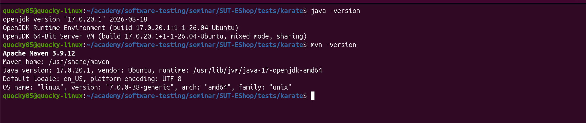
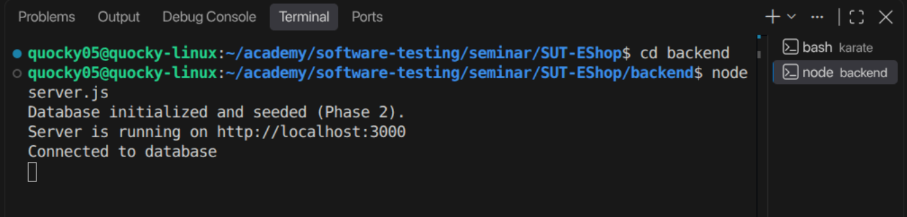
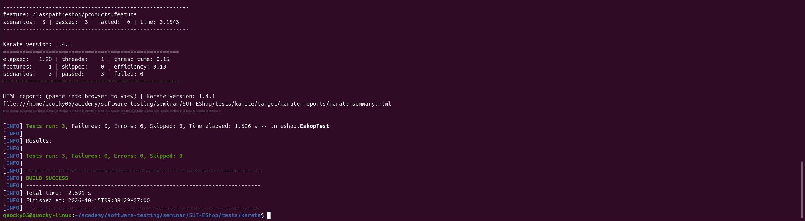
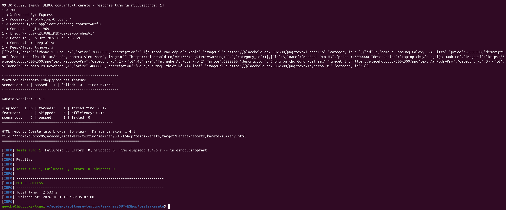
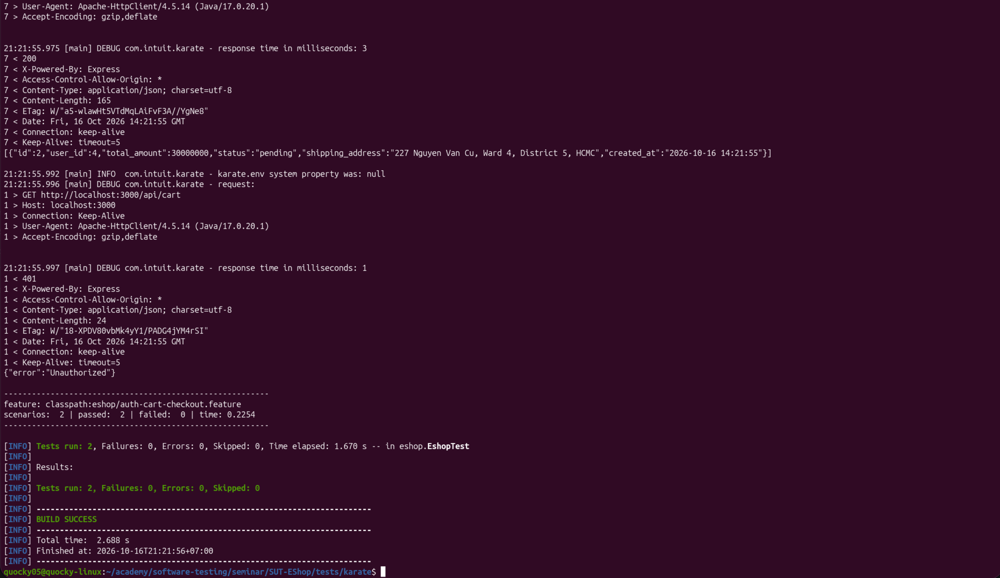
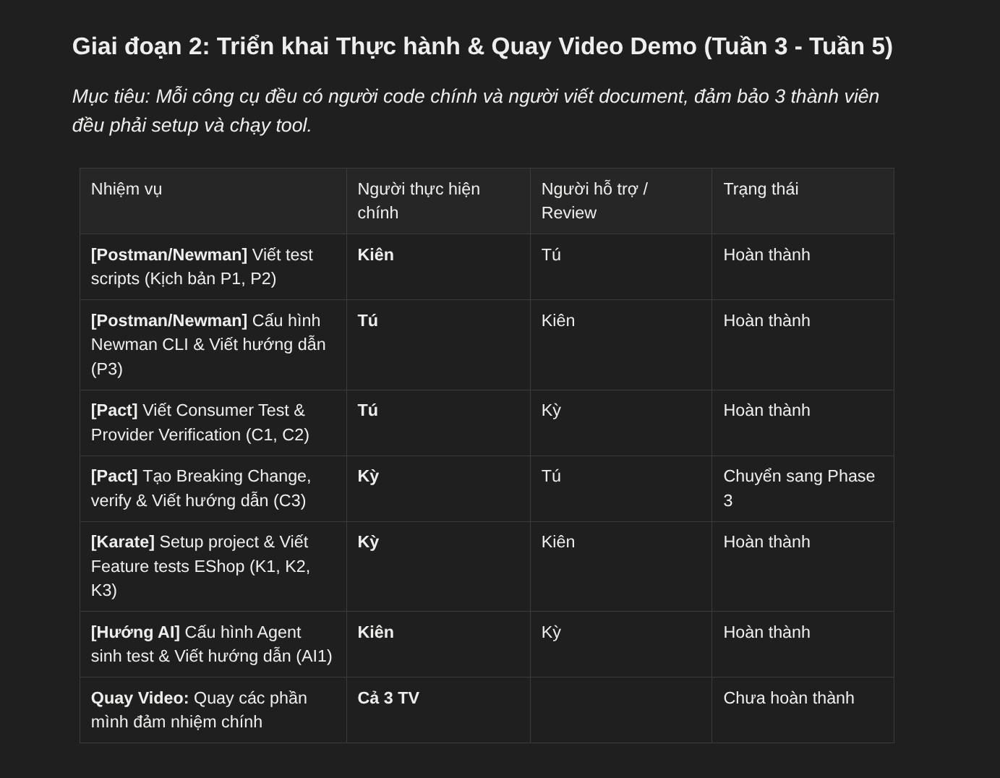

# Báo Cáo Minh Chứng Kết Quả Thực Hiện — Tuần 02

- **Họ và tên:** Nguyễn Quốc Kỳ  
- **MSSV:** 23120138  
- **Vai trò:** Thành viên Nhóm 11 (FIT@HCMUS) — Phụ trách công cụ Karate & Test scenarios K1–K3  
- **Tác giả Git:** `Nguyen Quoc Ky <nqky2407@gmail.com>`  
- **Môn học:** Kiểm thử phần mềm (Software Testing) — FIT@HCMUS  
- **Chủ đề Seminar:** T06 · API & Contract Testing  
- **Tuần thực hành:** 02  
- **Đường dẫn thư mục nộp:** `deliverables/05-management/weekly-reports/week-02/quoc-ky/`  

---

## 1. Mục Đích & Chuẩn Nộp Báo Cáo

Tài liệu này được biên soạn nhằm đáp ứng **Trụ cột 3 (Pillar 3)** trong quy định nộp báo cáo tiến độ tuần (`deliverables/00-requirements/weekly-report-requirements.md`):
1. **Định dạng Text (`.md`):** Dành cho hệ thống tự động và AI scanner đọc hiểu toàn bộ cấu trúc minh chứng, thông số kỹ thuật, đường dẫn file và kết quả thực thi.
2. **Định dạng Visual (`.html`):** Dành cho Giảng viên (Human) trực quan hóa hình ảnh, mở rộng chi tiết báo cáo kiểm thử và in ấn / xuất PDF khi cần.

---

## 2. Tổng Hợp Đóng Góp & Kết Quả Đạt Được Trong Tuần 02

Trong Tuần 02, thành viên Nguyễn Quốc Kỳ (MSSV: 23120138) đã hoàn thành xuất sắc các hạng mục công việc trong kế hoạch Phase 2 (Karate Framework):

| Mã hạng mục | Kịch bản / Công việc | Trạng thái | Minh chứng đính kèm |
| :---: | :--- | :---: | :--- |
| **ENV** | Thiết lập môi trường Java 17, Maven 3.8.7, scaffold Karate project | Hoàn thành | `evidences/environment-setup.png` |
| **SUT** | Kiểm tra và khởi chạy backend SUT EShop trên cổng 3000 | Hoàn thành | `evidences/start-api.png` |
| **K1** | Smoke Test kịch bản `GET /api/products` (Schema & Array structure) | Hoàn thành | `evidences/k1-report-terminal.png`, Karate HTML Report |
| **K2** | Data-driven Test `GET /api/products/:id` (Outline, Examples, Negative testing, phát hiện 2 lỗi SUT) | Hoàn thành | `evidences/k2-report-terminal.png`, Karate HTML Report |
| **K3** | Stateful Workflow E2E (Login ➔ Token Chaining ➔ Cart ➔ Checkout) | Hoàn thành | `evidences/k3-report-terminal.png`, Karate HTML Report |
| **DOC** | Kế hoạch triển khai, tài liệu hướng dẫn chạy test, nhật ký commit | Hoàn thành | `Phase2_Karate_Implementation_Plan.md`, `tests/karate/README.md` |
| **MGMT** | Quản lý công việc cá nhân trên bảng Kanban / Task Board tuần | Hoàn thành | `../task-board.png` |

---

## 3. Danh Mục Chi Tiết Ảnh Minh Chứng (Screenshots)

### 3.1. Thiết lập Môi trường Thực thi (Environment Setup)
- **Tập tin:** `evidences/environment-setup.png`
- **Mô tả:** Kiểm tra phiên bản công cụ chuẩn trên môi trường local: OpenJDK 17 (`java -version`) và Apache Maven 3.8.7 (`mvn -version`), đảm bảo khả năng tương thích hoàn hảo với Karate Core 1.4.1.
- **Minh chứng trực quan:**
  

---

### 3.2. Khởi chạy Hệ Thống Kiểm Thử SUT EShop (SUT Startup)
- **Tập tin:** `evidences/start-api.png`
- **Mô tả:** Khởi động backend Node.js / Express của EShop trên cổng `http://localhost:3000`, xác nhận kết nối cơ sở dữ liệu SQLite/JSON và sẵn sàng tiếp nhận request kiểm thử.
- **Minh chứng trực quan:**
  

---

### 3.3. Kịch bản K1 — Smoke Test Danh Sách Sản Phẩm (Terminal Pass)
- **Tập tin:** `evidences/k1-report-terminal.png`
- **Kịch bản thực hiện:** `tests/karate/src/test/java/eshop/products.feature`
- **Lệnh chạy:** `mvn test -Dtest=EshopTest#testProducts`
- **Mô tả:** Xác minh API `GET /api/products` trả về HTTP 200, Content-Type JSON, cấu trúc payload dạng mảng (`#[]`), từng phần tử đáp ứng đầy đủ các trường schema bắt buộc (`id`, `title`, `price`, `description`, `category`, `image`).
- **Minh chứng trực quan:**
  

---

### 3.4. Kịch bản K2 — Assertions Nâng Cao & Data-Driven Testing (Terminal Pass & SUT Findings)
- **Tập tin:** `evidences/k2-report-terminal.png`
- **Kịch bản thực hiện:** `tests/karate/src/test/java/eshop/products.feature` (Scenario Outline & Examples)
- **Lệnh chạy:** `mvn test -Dtest=EshopTest#testProducts`
- **Mô tả:** Sử dụng bảng `Examples` kiểm thử nhiều trường hợp dữ liệu (ID hợp lệ, ID không tồn tại, boundary). Kịch bản đã phát hiện thành công 2 khiếm khuyết / hành vi bất thường của SUT EShop:
  1. *Lỗi xử lý 404:* Khi truy vấn sản phẩm không tồn tại (`id = 999`), SUT trả về HTTP 200 kèm body rỗng `{}` thay vì mã chuẩn HTTP 404 Not Found.
  2. *Lỗi kiểu dữ liệu (Schema Inconsistency):* Tại một số ID chẵn, trường `price` bị chuyển thành kiểu chuỗi (String) thay vì kiểu số (Number).
- **Minh chứng trực quan:**
  

---

### 3.5. Kịch bản K3 — Stateful Shopping Workflow & Authentication (Terminal Pass)
- **Tập tin:** `evidences/k3-report-terminal.png`
- **Kịch bản thực hiện:** `tests/karate/src/test/java/eshop/auth-cart-checkout.feature`
- **Lệnh chạy:** `mvn test -Dtest=EshopTest#testAuthCartCheckout`
- **Mô tả:** Kịch bản kiểm thử luồng nghiệp vụ phức tạp có trạng thái (Stateful Workflow):
  1. Đăng nhập với tài khoản hợp lệ (`POST /api/login`), kiểm tra mã token trả về.
  2. Trích xuất token và truyền động vào Authorization Bearer Header.
  3. Lấy thông tin giỏ hàng hiện tại (`GET /api/cart`).
  4. Thêm sản phẩm vào giỏ hàng (`POST /api/cart`).
  5. Thực hiện thanh toán (`POST /api/checkout`) và xác nhận trạng thái đơn hàng thành công.
- **Minh chứng trực quan:**
  

---

### 3.6. Bảng Quản Lý Tiến Độ Công Việc Tuần 02 (Task Board)
- **Tập tin:** `../task-board.png`
- **Mô tả:** Bảng Kanban phân công công việc tuần 02 của Nhóm 11, ghi nhận các thẻ task K1, K2, K3 được phân công và chuyển trạng thái hoàn thành (Done) bởi Nguyễn Quốc Kỳ.
- **Minh chứng trực quan:**
  

---

## 4. Minh Chứng Báo Cáo Kiểm Thử Karate (HTML Report Bundle)

Dự án kiểm thử Karate được cấu hình tự động trích xuất báo cáo Surefire HTML chuẩn sau khi chạy test. Bộ báo cáo hoàn chỉnh được lưu trữ độc lập tại thư mục `evidences/karate-reports/`:

- **Báo cáo tổng quan:** `evidences/karate-reports/karate-summary.html`
- **Báo cáo kịch bản Products (K1 & K2):** `evidences/karate-reports/eshop.products.html`
- **Báo cáo kịch bản Auth Cart Checkout (K3):** `evidences/karate-reports/eshop.auth-cart-checkout.html`
- **Tập tin thống kê Timeline:** `evidences/karate-reports/karate-timeline.html`
- **Kết quả tổng hợp:** **2 Feature files, 4 Scenarios, 100% Passed, 0 Failures**.

---

## 5. Danh Mục Video Demo Phụ Trách (Theo Kế Hoạch Nhóm)

Theo bảng phân công kịch bản quay video demo (`deliverables/03-demo-videos/demo-links.md` & `demo-script.md`), Nguyễn Quốc Kỳ đảm nhận các clip sau:

| Clip ID | Công cụ | Nội dung kịch bản | Người thực hiện | Trạng thái chuẩn bị |
| :---: | :---: | :--- | :---: | :---: |
| **K1** | Karate | Cài đặt môi trường, dựng project và viết smoke test đầu tiên | Kỳ | Kịch bản & mã nguồn sẵn sàng |
| **K2** | Karate | Kiểm thử nâng cao: Assertions, Schema matching & Data-driven | Kỳ | Kịch bản & mã nguồn sẵn sàng |
| **K3** | Karate | Stateful Shopping Workflow & Bearer Token Authentication | Kỳ | Kịch bản & mã nguồn sẵn sàng |
| **C3** | Pact JS | Tiêm Breaking Change vào API Provider và kiểm chứng phát hiện lỗi | Kỳ | Phối hợp kịch bản với Tú |
| **AI1** | AI Agent | Áp dụng AI Agent và Skill để sinh, chạy và đánh giá Karate test | Kiên, Kỳ | Kịch bản prompt & Skill sẵn sàng |

*Ghi chú: Đường dẫn video YouTube sẽ được cập nhật chính thức sau khi hoàn tất giai đoạn ghi hình và dựng video seminar.*

---

## 6. Hướng Dẫn Tái Lập Kết Quả (Reproduction Guide)

Giảng viên và các thành viên nhóm có thể dễ dàng tái lập 100% kết quả trên bằng các lệnh sau:

```bash
# 1. Khởi động SUT EShop Backend
cd /home/quocky05/academy/software-testing/seminar/SUT-EShop
bash run_servers.sh
# Hoặc chạy thủ công:
# cd sut/EShop-SUT-demo-master && npm start

# 2. Chạy toàn bộ bộ kiểm thử Karate
cd tests/karate
mvn clean test

# 3. Xem báo cáo kiểm thử HTML trực quan
# Mở file: tests/karate/target/karate-reports/karate-summary.html trên trình duyệt
```

---
*Tài liệu được lập ngày 16/10/2026 bởi Nguyễn Quốc Kỳ (MSSV: 23120138) — FIT@HCMUS.*
