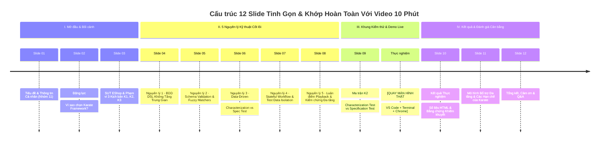

# TỔNG HỢP NỘI DUNG VÀ BỐ CỤC SLIDE THUYẾT TRÌNH: KARATE FRAMEWORK (BẢN TINH GỌN 12 SLIDES)
## Chủ đề: Kiểm Thử API Tự Động Toàn Diện Với Karate Framework (Bộ kịch bản K1, K2 & K3)
**Người trình bày:** Nguyễn Quốc Kỳ (MSSV: 23120138) — Nhóm 11  
**Môn học:** Kiểm thử phần mềm — FIT@HCMUS  
**Tài liệu tham chiếu:** [Video_Script_Karate_K1_K2.md](file:///home/quocky05/academy/software-testing/seminar/SUT-EShop/deliverables/05-management/weekly-reports/week-05/quoc-ky/Video_Script_Karate_K1_K2.md)

---

## TỔNG QUAN CẤU TRÚC BỘ SLIDE TINH GỌN (12 SLIDES)



---

## CHI TIẾT NỘI DUNG TỪNG SLIDE & ĐỀ XUẤT THIẾT KẾ BỐ CỤC

---

### SLIDE 01: TIÊU ĐỀ & THÔNG TIN BÁO CÁO
- **Mục tiêu:** Định vị video seminar chính thức, ngắn gọn, minh bạch thông tin người trình bày và bộ công nghệ.
- **Bố cục đề xuất (Layout):**
  - **Dạng:** Modern Cover Slide (Nền xanh tím công nghệ `#1e1b4b`, chữ trắng và điểm nhấn vàng kim `#fbbf24`).
  - **Bên trái (65%):** Logo FIT@HCMUS, Tên đề tài seminar, Tiêu đề kịch bản.
  - **Bên phải (35%):** Card thông tin sinh viên và bộ thẻ công nghệ (Tech badges).
- **Nội dung hiển thị chi tiết:**
  - **Tên cơ quan & Môn học:** TRƯỜNG ĐẠI HỌC KHOA HỌC TỰ NHIÊN, ĐHQG-HCM (FIT@HCMUS) — SEMINAR KIỂM THỬ PHẦN MỀM
  - **Chủ đề Seminar:** T06 · API Testing & Contract Testing
  - **Tiêu đề chính:** KIỂM THỬ API TỰ ĐỘNG VỚI KARATE FRAMEWORK
  - **Tiêu đề phụ:** Thiết kế, thực thi và đối soát khiếm khuyết hệ thống thương mại điện tử qua bộ kịch bản K1, K2 & K3
  - **Thông tin người trình bày:**
    - **Sinh viên thực hiện:** Nguyễn Quốc Kỳ
    - **MSSV:** 23120138 — **Nhóm:** 11
    - **Công nghệ chính:** Karate v1.4.1 · Java 17 · JUnit 5 · Maven CLI
- **Mô tả Hình ảnh / Sơ đồ:**
  - Logo FIT@HCMUS góc trên bên trái.
  - Logo chú võ sĩ Karate Framework và Java 17 góc phải.
- **Ghi chú thuyết trình:**
  - Webcam PiP góc dưới phải, chào ngắn gọn trong 15 giây và dẫn thẳng vào lý do chọn công cụ.

---

### SLIDE 02: ĐỘNG LỰC — VÌ SAO CHỌN KARATE FRAMEWORK?
- **Mục tiêu:** Nêu bật 3 lý do kỹ thuật cốt lõi khiến nhóm lựa chọn Karate Framework cho phần Code-based API Testing (tinh gọn, không lan man).
- **Bố cục đề xuất (Layout):**
  - **Dạng:** 3-Column Focus Cards (3 thẻ tính năng ngang hàng, mỗi thẻ có icon nổi bật và 2 dòng giải thích súc tích).
- **Nội dung hiển thị chi tiết:**
  - **Tiêu đề slide:** Động Lực Giải Pháp: 3 Ưu Thế Cốt Lõi Của Karate Framework
  - **3 Điểm nhấn kỹ thuật chính:**
    1. **Cú pháp BDD DSL trực quan (No Step Definitions):** Viết kịch bản bằng ngôn ngữ Gherkin tự nhiên, tích hợp sẵn giao thức HTTP mà không cần viết mã trung gian Java.
    2. **Hỗ trợ Schema Validation bản địa:** Xác thực cấu trúc dữ liệu JSON sâu và xử lý linh hoạt dữ liệu động thông qua hệ thống Fuzzy Matchers tích hợp sẵn.
    3. **Tự động hóa CI/CD tự nhiên qua Maven:** Quản lý kịch bản dạng mã nguồn thuần (Git-friendly), thực thi nhanh chóng bằng một dòng lệnh CLI và tự động tạo báo cáo HTML độc lập.
- **Mô tả Hình ảnh / Sơ đồ:**
  - 3 biểu tượng minh họa: Biểu tượng Code BDD $\rightarrow$ Biểu tượng Khiên Schema $\rightarrow$ Biểu tượng Đường ống CI/CD Maven.
- **Ghi chú thuyết trình (Thời lượng: ~25s):**
  - Trình bày dứt khoát 3 điểm cốt lõi, không so sánh dìm hàng công cụ khác.

---

### SLIDE 03: SUT ESHOP & PHẠM VI 3 KỊCH BẢN KIỂM THỬ (K1, K2, K3)
- **Mục tiêu:** Giới thiệu ngắn gọn hệ thống SUT và phân bổ 3 cấp độ kiểm thử được thiết kế.
- **Bố cục đề xuất (Layout):**
  - **Dạng:** Split View (Bên trái: SUT Architecture thu nhỏ; Bên phải: 3 khối kịch bản kiểm thử K1, K2, K3).
- **Nội dung hiển thị chi tiết:**
  - **Tiêu đề slide:** Hệ Thống SUT EShop & Chiến Lược Bao Phủ 3 Cấp Độ
  - **Bên trái — Kiến trúc SUT EShop:**
    - Backend: Node.js / Express REST API (Cổng 3000)
    - Database: SQLite (`eshop.db`) với các ràng buộc duy nhất (Unique Constraints)
    - Cơ chế bảo mật: Xác thực JWT Bearer cho các endpoint giỏ hàng và thanh toán
  - **Bên phải — 3 Cấp độ kiểm thử được nhóm thiết kế:**
    - **K1 (@smoke):** Kiểm tra sẵn sàng và Schema danh mục sản phẩm (`GET /api/products`).
    - **K2 (@data-driven):** Tham số hóa kiểm thử chi tiết sản phẩm (`GET /api/products/:id`), ghi nhận đối soát các trường hợp lệch đặc tả.
    - **K3 (@e2e):** Chuỗi mua sắm hoàn chỉnh 7 bước (Đăng ký $\rightarrow$ Đăng nhập $\rightarrow$ Giỏ hàng $\rightarrow$ Thanh toán $\rightarrow$ Đối soát) và ca Negative Security 401.
- **Mô tả Hình ảnh / Sơ đồ:**
  ```mermaid
  graph LR
      K1["K1: Smoke & Schema<br/>GET /api/products"] --> SUT["🖥️ SUT EShop<br/>(Port 3000)"]
      K2["K2: Data-Driven<br/>GET /api/products/:id"] --> SUT
      K3["K3: E2E & Security<br/>7 bước Mua sắm + JWT"] --> SUT
      
      style SUT fill:#f8fafc,stroke:#475569,stroke-width:2px;
      style K1 fill:#eff6ff,stroke:#3b82f6,stroke-width:1.5px;
      style K2 fill:#fef3c7,stroke:#f59e0b,stroke-width:1.5px;
      style K3 fill:#dcfce7,stroke:#16a34a,stroke-width:1.5px;
  ```
- **Ghi chú thuyết trình (Thời lượng: ~25s):**
  - Nêu rõ đây là lộ trình mà video sẽ đi qua từ nguyên lý đến thực thi thực tế.

---

### SLIDE 04: NGUYÊN LÝ 1 — TRIẾT LÝ BDD DSL KHÔNG TẦNG TRUNG GIAN (NO STEP DEFINITIONS)
- **Mục tiêu:** Làm rõ nguyên lý đột phá về mặt cấu trúc của Karate so với các framework BDD truyền thống.
- **Bố cục đề xuất (Layout):**
  - **Dạng:** Diagram-Centered (Sơ đồ so sánh kiến trúc trực quan ở giữa, 2 dòng kết luận ở dưới).
- **Nội dung hiển thị chi tiết:**
  - **Tiêu đề slide:** Nguyên lý 1: Triết Lý BDD DSL Không Tầng Trung Gian
  - **So sánh mô hình kiến trúc:**
    - **Framework truyền thống (Cucumber + REST-Assured):** Mô hình 3 tầng $\rightarrow$ Cần viết thêm lớp trung gian mã Java (Step Definitions) để nối câu chữ Gherkin với HTTP Client.
    - **Karate Framework:** Mô hình 2 tầng $\rightarrow$ Cú pháp Gherkin (`Given path`, `When method`, `Then status`, `And match`) kết nối trực tiếp với HTTP Engine nội tại.
  - **Lợi ích thực tế:** Kịch bản `.feature` vừa đóng vai trò tài liệu đặc tả sống (**Living Documentation**) cho các bên liên quan, vừa là mã nguồn tự động hóa chạy được ngay mà không cần bảo trì các lớp code trung gian.
- **Mô tả Hình ảnh / Sơ đồ:**
  ```mermaid
  graph TD
      subgraph Trad ["Mô hình 3 tầng truyền thống"]
          T1[".feature"] --> T2["Step Definitions (Java)"] --> T3["HTTP Client"]
      end
      subgraph Karate ["Mô hình 2 tầng tinh gọn của Karate"]
          K1[".feature (Native HTTP DSL)"] --> K2["Karate HTTP Engine"]
      end
      style Trad fill:#fef2f2,stroke:#ef4444,stroke-width:1px;
      style Karate fill:#f0fdf4,stroke:#16a34a,stroke-width:2px;
  ```
- **Ghi chú thuyết trình (Thời lượng: ~25s):**
  - Nhấn mạnh: Không cần viết Step Definition giúp tập trung vào logic kiểm thử thay vì boilerplate.

---

### SLIDE 05: NGUYÊN LÝ 2 — SCHEMA VALIDATION & FUZZY MATCHERS
- **Mục tiêu:** Trình bày giải pháp xác thực cấu trúc và xử lý dữ liệu động (Dynamic Data) bằng Fuzzy Matchers.
- **Bố cục đề xuất (Layout):**
  - **Dạng:** Reference Card (Khung tra cứu matchers bên trái, ví dụ đoạn mã Gherkin bên phải).
- **Nội dung hiển thị chi tiết:**
  - **Tiêu đề slide:** Nguyên lý 2: Checkpoints & Schema Validation với Fuzzy Matchers
  - **Vấn đề dữ liệu động (Dynamic Data):** Các trường như ID tự tăng, JWT Token, hoặc thời gian liên tục biến đổi $\rightarrow$ So khớp giá trị tĩnh (Hardcoded) sẽ dễ gãy bài test.
  - **Hệ thống Fuzzy Matchers của Karate:**
    - `#number`: Khớp số nguyên hoặc số thực.
    - `#string`: Khớp chuỗi ký tự bất kỳ.
    - `#[]`: Khớp cấu trúc mảng JSON (`JSON Array`).
    - `contains deep`: Khớp cấu trúc thuộc tính lồng nhau.
  - **Minh họa kiểm tra trong K1:**
    ```cucumber
    And match response == '#[]'
    And match response[0] contains { id: '#number', name: '#string', price: '#number' }
    ```
- **Mô tả Hình ảnh / Sơ đồ:**
  - Bảng highlight màu sắc tương ứng từng kiểu dữ liệu với icon kiểm tra toàn vẹn cấu trúc.
- **Ghi chú thuyết trình (Thời lượng: ~25s):**
  - Khẳng định: Fuzzy Matcher giúp bài test bền vững hơn trước dữ liệu thay đổi của môi trường.

---

### SLIDE 06: NGUYÊN LÝ 3 — DATA-DRIVEN: CHARACTERIZATION TEST VS SPECIFICATION TEST
- **Mục tiêu:** Chuẩn hóa khái niệm kiểm thử: Phân biệt rõ việc ghi nhận hành vi hiện tại (Characterization Test) và kiểm chứng theo đặc tả chuẩn (Specification Test).
- **Bố cục đề xuất (Layout):**
  - **Dạng:** Conceptual Split (2 khối hộp đối sánh rõ ràng giữa 2 mục đích kiểm thử).
- **Nội dung hiển thị chi tiết:**
  - **Tiêu đề slide:** Nguyên lý 3: Data-Driven Testing — Characterization vs Spec Test
  - **Khái niệm `Scenario Outline` + `Examples:`:** Tách bạch giữa logic kiểm thử và bộ dữ liệu đầu vào.
  - **Phân biệt hai mục đích kiểm thử trong kịch bản K2:**
    - **1. Characterization Test (Kiểm thử ghi nhận hành vi):**
      - Mục đích: Ghi lại trung thực hành vi hiện tại của hệ thống để làm mốc đối soát hồi quy (Regression Baseline).
      - Ví dụ: Ghi nhận backend trả về `price` dạng chuỗi (`#string`) ở ID 2 để theo dõi, tránh test gãy ngoài ý muốn trong quá trình xây dựng test suite.
    - **2. Specification Test (Kiểm thử kiểm chứng đặc tả):**
      - Mục đích: Áp đặt ràng buộc chuẩn theo tài liệu đặc tả (ví dụ RESTful quy định ID không tồn tại phải trả về `404 Not Found`).
      - Khi hành vi thực tế lệch đặc tả $\rightarrow$ **Test FAIL**, và đây chính là bằng chứng phát hiện lỗi (Defect Evidence).
- **Mô tả Hình ảnh / Sơ đồ:**
  - Hộp Xanh: Baseline/Characterization Test (Tracking current state) $\longleftrightarrow$ Hộp Đỏ: Specification Test (Asserting intended behavior $\rightarrow$ Fail detects bugs).
- **Ghi chú thuyết trình (Thời lượng: ~30s):**
  - Nhấn mạnh sự phân biệt này để thể hiện tư duy kiểm thử chuẩn mực, tránh hiểu nhầm là "ép xanh".

---

### SLIDE 07: NGUYÊN LÝ 4 — STATEFUL WORKFLOW & TEST DATA ISOLATION (K3)
- **Mục tiêu:** Trình bày nguyên lý quản lý trạng thái luồng nghiệp vụ 7 bước và giải pháp cô lập dữ liệu bằng email động.
- **Bố cục đề xuất (Layout):**
  - **Dạng:** Process Pipeline (Luồng trạng thái 7 bước nằm ngang, bên dưới có 2 khung lưu ý kỹ thuật).
- **Nội dung hiển thị chi tiết:**
  - **Tiêu đề slide:** Nguyên lý 4: Stateful Workflow & Cô Lập Dữ Liệu Động (K3)
  - **Duy trì trạng thái liên hoàn (State Chaining qua 7 bước):**
    - Trích xuất JWT Token từ API Đăng nhập $\rightarrow$ Đính kèm Header `Authorization: Bearer` cho toàn bộ các bước Thêm giỏ hàng, Thanh toán, và Đối soát đơn hàng.
  - **Cô lập dữ liệu kiểm thử (Test Data Isolation):**
    - Cơ sở dữ liệu EShop có ràng buộc duy nhất (`UNIQUE email`). Nếu dùng email cố định, các lần chạy sau trên CI/CD sẽ bị lỗi trùng lặp dữ liệu (`Duplicate Email Error`).
    - Karate gọi Java runtime sinh email độc nhất theo timestamp: `karate_k3_<timestamp>@eshop.com`, đảm bảo bài test luôn chạy độc lập và lặp lại được vô số lần.
  - **Ca kiểm thử bảo mật (Negative Test):** Gọi giỏ hàng khi thiếu token $\rightarrow$ Khẳng định server chặn đứng với mã HTTP 401 Unauthorized.
- **Mô tả Hình ảnh / Sơ đồ:**
  ```mermaid
  graph LR
      Gen["Sinh email timestamp<br/>(Tránh Duplicate)"] --> Reg["1. Register &<br/>2. Login"]
      Reg -->|JWT Bearer| Cart["3-5. Thêm giỏ &<br/>Xác nhận"]
      Cart --> Checkout["6. Checkout &<br/>7. Orders"]
      
      Sec["Ca Negative: Không Token"] -.->|GET /api/cart| Block["Chặn 401 Unauthorized"]
      
      style Gen fill:#fef3c7,stroke:#f59e0b,stroke-width:1px;
      style Reg fill:#eff6ff,stroke:#3b82f6,stroke-width:1.5px;
      style Cart fill:#eff6ff,stroke:#3b82f6,stroke-width:1.5px;
      style Checkout fill:#dcfce7,stroke:#16a34a,stroke-width:1.5px;
      style Block fill:#fee2e2,stroke:#ef4444,stroke-width:1.5px;
  ```
- **Ghi chú thuyết trình (Thời lượng: ~25s):**
  - Giải thích rõ: Email động là giải pháp chuẩn cho bài toán Unique Constraint trên pipeline.

---

### SLIDE 08: NGUYÊN LÝ 5 — LUẬN ĐIỂM PLAYBACK & KIỂM CHỨNG ĐA TẦNG TRÁNH BẪY XANH ẢO
- **Mục tiêu:** Biện giải khái niệm Record & Playback trong kiểm thử mã nguồn và giải pháp kiểm chứng đa tầng để hạn chế rủi ro xanh ảo.
- **Bố cục đề xuất (Layout):**
  - **Dạng:** 2-Card Thesis (Thẻ 1: Khái niệm Playback; Thẻ 2: 3 tầng kiểm chứng tránh xanh ảo).
- **Nội dung hiển thị chi tiết:**
  - **Tiêu đề slide:** Nguyên lý 5: Luận Điểm Playback & Kiểm Chứng Đa Tầng
  - **1. Luận điểm "Playback" trong Code-based Testing:**
    - Khái niệm "Playback" ở đây là khả năng **tái hiện tự động 100% (Automated Replay)** các kịch bản `.feature` thông qua Maven CLI và CI/CD pipeline, đảm bảo tính nhất quán và loại bỏ rủi ro thao tác thủ công.
  - **2. Hạn chế bẫy "Xanh ảo" (False Positive):**
    - Rủi ro xanh ảo xuất hiện khi kịch bản chỉ kiểm tra sơ sài HTTP Status 200 mà bỏ qua nội dung payload (ví dụ server trả về 200 nhưng body rỗng hoặc sai kiểu).
    - **Chiến lược kiểm chứng 3 tầng của nhóm:**
      - *Tầng 1 (Status):* Khẳng định mã phản hồi HTTP (`status 200 / 401`).
      - *Tầng 2 (Structure):* Kiểm tra mảng không rỗng và độ dài (`match response == '#[]'`, `assert response.length > 0`).
      - *Tầng 3 (Schema & Deep Match):* Ràng buộc kiểu dữ liệu từng trường và đối soát sâu thuộc tính nghiệp vụ (`contains deep`).
- **Mô tả Hình ảnh / Sơ đồ:**
  - Mô hình 3 lớp khiên bảo vệ (Status Shield $\rightarrow$ Structure Shield $\rightarrow$ Schema Deep Shield).
- **Ghi chú thuyết trình (Thời lượng: ~25s):**
  - Nhắc nhở: Không có công cụ nào tự động chống xanh ảo; chính thiết kế kiểm chứng đa tầng mới là yếu tố quyết định.

---

### SLIDE 09: MA TRẬN K2 — ĐỐI SOÁT HÀNH VI HIỆN TẠI VS KIỂM CHỨNG ĐẶC TẢ
- **Mục tiêu:** Chiếu bảng ma trận K2 trước khi vào demo, làm rõ vai trò của từng ca kiểm thử và lưu ý kỹ thuật về so khớp object rỗng.
- **Bố cục đề xuất (Layout):**
  - **Dạng:** Decision Table & Technical Alert (Bảng ma trận 3 ca K2 ở trên, khung ghi chú kỹ thuật `match response == {}` ở dưới).
- **Nội dung hiển thị chi tiết:**
  - **Tiêu đề slide:** Ma Trận K2: Đối Soát Hành Vi Thực Tế vs Kiểm Chứng Đặc Tả
  - **Bảng ma trận 3 ca kiểm thử của Kịch bản K2:**
    | Ca kiểm thử | ID Sản phẩm | Mục đích kiểm thử | Hành vi Backend SUT | Assertion áp dụng trong kịch bản |
    | :---: | :---: | :--- | :--- | :--- |
    | **Ca 1** | `1` | Happy Path | Trả về `price: 30000000` (Number) | `match response contains { price: '#number' }` |
    | **Ca 2** | `2` | Characterization (Ghi nhận lệch kiểu) | Trả về `price: "28000000"` (String) | `match response contains { price: '#string' }` |
    | **Ca 3** | `9999` | Characterization (Ghi nhận biên) | Trả về `200 OK` + `{}` (thay vì 404) | `status 200` & `match response == {}` |
  - **⚠️ Lưu ý kỹ thuật quan trọng về so khớp:**
    - Cú pháp `match response contains {}` luôn đúng với mọi JSON Object, do đó không thể chứng minh response rỗng!
    - Để khẳng định response thực sự là object rỗng, nhóm áp dụng so khớp bằng tuyệt đối: **`match response == {}`**.
- **Mô tả Hình ảnh / Sơ đồ:**
  - Bảng biểu rõ ràng, có highlight cảnh báo kỹ thuật màu vàng ở góc dưới.
- **Ghi chú chuyển cảnh (BẮT ĐẦU VÀO PHẦN DEMO THỰC TẾ):**
  - Chuyển màn hình từ Slide sang cửa sổ làm việc: **Mở VS Code + Terminal + Trình duyệt Chrome**.
  - *(Từ phút 03:30 đến 08:30 không cần chiếu slide, tập trung 100% vào màn hình quay thật).*

---

### 🖥️ KHUNG HÌNH THỰC NGHIỆM TRÊN MÀN HÌNH THẬT (TỪ 03:30 ĐẾN 08:30 — KHÔNG DÙNG SLIDE)
*Ghi chú hướng dẫn các thao tác chuẩn xác cần quay trên màn hình:*
1. **VS Code (Toàn màn hình):** Lướt qua `products.feature` và `auth-cart-checkout.feature` giải thích nhanh cấu trúc Gherkin.
2. **Terminal (Chia đôi với VS Code):**
   - Lệnh 1: `curl -I http://localhost:3000/api/products` $\rightarrow$ Xác nhận SUT sẵn sàng 200 OK.
   - Lệnh 2: `mvn test -Dkarate.options="classpath:eshop/products.feature"` $\rightarrow$ Chỉ rõ HTTP Wire Logs và 4 Scenarios Passed.
   - Lệnh 3: `mvn test -Dkarate.options="classpath:eshop/auth-cart-checkout.feature"` $\rightarrow$ Chỉ rõ email dynamic, chuỗi JWT Bearer và ca 401.
3. **Thử nghiệm Spec Test (Intentional Failure):**
   - Sửa dòng 44 `products.feature`: `expectedStatus` từ `200` $\rightarrow$ `404`.
   - Chạy `mvn test -Dkarate.options="classpath:eshop/products.feature"` $\rightarrow$ Maven dừng ngay với `BUILD FAILURE`, chỉ rõ `status code was: 200, expected: 404`. Minh chứng test phát hiện đúng khi hành vi lệch đặc tả.
   - Nhấn `Ctrl + Z` hoàn nguyên về `200`.
4. **QUY TRÌNH CHUẨN ĐỂ SINH BÁO CÁO HTML:**
   - **Thao tác bắt buộc:** Chạy lại toàn bộ test suite bằng lệnh:
     ```bash
     mvn test
     ```
   - Chờ hoàn tất: Toàn bộ 2 Features, 6 Scenarios đạt **`BUILD SUCCESS`**.
5. **Google Chrome:** Mở file `tests/karate/target/karate-reports/karate-summary.html` để trực quan hóa báo cáo.
6. **Sau khi xem báo cáo xong $\rightarrow$ Chuyển lại Slide 10 để tổng kết.**

---

### SLIDE 10: KẾT QUẢ THỰC NGHIỆM — BẰNG CHỨNG BÁO CÁO HTML & KHIẾM KHUYẾT SUT
- **Mục tiêu:** Trình chiếu số liệu tổng kết từ báo cáo HTML sau khi chạy lại suite hoàn chỉnh và tổng hợp 2 khiếm khuyết phát hiện được của SUT.
- **Bố cục đề xuất (Layout):**
  - **Dạng:** Dashboard & Bug Evidence (Bên trái: Thống kê số liệu HTML; Bên phải: 2 bằng chứng khiếm khuyết SUT).
- **Nội dung hiển thị chi tiết:**
  - **Tiêu đề slide:** Kết Quả Thực Nghiệm: Bằng Chứng Báo Cáo HTML & Khiếm Khuyết SUT
  - **Bên trái — Chỉ số thực thi trên `karate-summary.html`:**
    - Tổng số Feature Files: **2 Features** (`products` & `auth-cart-checkout`)
    - Tổng số Scenarios: **6 Scenarios (Passed 100%, 0 Failed)**
    - Tổng thời gian thực thi: **~350 mili-giây** (Hiệu năng cao nhờ chạy qua HTTP Client tối ưu)
  - **Bên phải — Bằng chứng 2 khiếm khuyết của SUT EShop:**
    - **Khiếm khuyết 1 (Sai kiểu dữ liệu ở ID chẵn):** Endpoint `GET /api/products/2` trả về `price: "28000000"` (String) thay vì Number, gây rủi ro tính toán giỏ hàng.
    - **Khiếm khuyết 2 (Thiếu mã lỗi 404 RESTful):** Endpoint `GET /api/products/9999` trả về `200 OK` kèm `{}` thay vì mã chuẩn `404 Not Found`.
  - **Ý nghĩa:** Báo cáo HTML là **Bằng chứng kiểm thử (Test Evidence)** độc lập, minh bạch, sẵn sàng đính kèm vào ticket để đội ngũ phát triển sửa lỗi.
- **Mô tả Hình ảnh / Sơ đồ:**
  - Ảnh chụp thu nhỏ báo cáo `karate-summary.html` có biểu đồ tròn xanh lá 100% kèm 2 trích đoạn JSON payload khiếm khuyết.
- **Ghi chú thuyết trình (Thời lượng: ~30s):**
  - Trình bày mạch lạc kết quả sau khi đã trực tiếp chứng minh trên trình duyệt.

---

### SLIDE 11: MÔ HÌNH BỔ TRỢ ĐA TẦNG & CÁC HẠN CHẾ THỰC TẾ CỦA KARATE
- **Mục tiêu:** Đưa ra góc nhìn đa chiều, khách quan: Vị trí bổ trợ của Karate trong chiến lược kiểm thử và các hạn chế thực tế cần lưu ý.
- **Bố cục đề xuất (Layout):**
  - **Dạng:** Balanced Perspective (Bên trái: Mô hình phối hợp bổ trợ 3 công cụ; Bên phải: 4 hạn chế thực tế của Karate).
- **Nội dung hiển thị chi tiết:**
  - **Tiêu đề slide:** Mô Hình Bổ Trợ Đa Tầng & Các Hạn Chế Thực Tế Của Karate
  - **Bên trái — Phối hợp bổ trợ 3 công cụ trong dự án:**
    - **Postman:** Khám phá API ban đầu, kiểm thử thủ công và debug nhanh cho lập trình viên.
    - **Pact:** Kiểm thử hợp đồng (Contract Testing), bảo đảm tính tương thích giữa các microservices độc lập.
    - **Karate Framework:** Kiểm thử hồi quy tự động (Automated Regression), kiểm tra chuỗi nghiệp vụ có trạng thái (Stateful E2E) tích hợp sâu vào CI/CD.
  - **Bên phải — Các hạn chế thực tế của Karate cần lưu ý:**
    - Phụ thuộc môi trường thực thi Java và công cụ quản lý dự án Maven.
    - Cú pháp DSL riêng có đường cong học tập (Learning curve) và khó debug sâu so với viết mã Java/JS thuần khi gặp lỗi phức tạp.
    - Hệ sinh thái công cụ hỗ trợ trên IDE còn hạn chế (phụ thuộc vào extension ngoài).
    - Không có tính năng "Record" thao tác mạng tự động thực thụ (phải tự viết file kịch bản).
- **Mô tả Hình ảnh / Sơ đồ:**
  - Sơ đồ tam giác phối hợp bổ trợ 3 công cụ (Postman $\leftrightarrow$ Pact $\leftrightarrow$ Karate) viền xanh; Khung cảnh báo hạn chế viền xám trung tính.
- **Ghi chú thuyết trình (Thời lượng: ~35s):**
  - Thể hiện sự chín chắn, khách quan của người làm kiểm thử phần mềm trước hội đồng chấm.

---

### SLIDE 12: TỔNG KẾT, CẢM ƠN & HỎI ĐÁP (Q&A)
- **Mục tiêu:** Chào kết thúc video chuyên nghiệp, để lại thông tin liên hệ và mã nguồn dự án.
- **Bố cục đề xuất (Layout):**
  - **Dạng:** Closing Summary Slide (Bên trái: 3 thông điệp kết luận súc tích; Bên phải: Thông tin liên hệ, mã nguồn GitHub).
- **Nội dung hiển thị chi tiết:**
  - **Tiêu đề slide:** Tổng Kết & Cảm Ơn
  - **3 Thông điệp đúc kết:**
    1. Karate Framework cung cấp giải pháp kiểm thử API bằng mã nguồn trực quan, loại bỏ mã trung gian và hỗ trợ xác thực schema mạnh mẽ.
    2. Kỹ thuật Data-Driven và Stateful Workflow giúp kiểm chứng trọn vẹn chuỗi mua sắm thực tế, đồng thời lập hồ sơ đối soát trung thực các khiếm khuyết của hệ thống.
    3. Bộ test suite sẵn sàng tích hợp vào đường ống CI/CD để làm cổng kiểm soát chất lượng tự động cho phần mềm.
  - **Lời cảm ơn & Thông tin tương tác:**
    - *"Cảm ơn Thầy và các bạn đã chú ý theo dõi phần trình bày của Nhóm 11!"*
    - **Người thực hiện:** Nguyễn Quốc Kỳ (MSSV: 23120138)
    - **Mã nguồn:** Toàn bộ kịch bản tại thư mục `tests/karate/`.
- **Mô tả Hình ảnh / Sơ đồ:**
  - Biểu tượng Q&A lớn và mã QR liên kết tới GitHub repository.
- **Ghi chú thuyết trình (Thời lượng: ~20s):**
  - Chuyển webcam toàn màn hình, mỉm cười chào kết thúc video.

---

## BẢNG ÁNH XẠ THỜI LƯỢNG & NGUỒN HIỂN THỊ MÀN HÌNH (VIDEO ~10 PHÚT)

| Phân đoạn | Thời lượng ước tính | Nguồn hiển thị màn hình chính | Slide tương ứng | Nội dung thực hiện |
| :--- | :---: | :--- | :---: | :--- |
| **1. Mở đầu & Động lực** | 00:00 – 00:50 | **Chiếu Slide (Webcam PiP)** | Slide 01, 02 | Giới thiệu cá nhân, đề tài và 3 ưu thế cốt lõi của Karate. |
| **2. Bối cảnh SUT & K1-K3** | 00:50 – 01:15 | **Chiếu Slide (Webcam PiP)** | Slide 03 | SUT EShop và lộ trình 3 cấp độ kiểm thử. |
| **3. 5 Nguyên lý kỹ thuật** | 01:15 – 03:10 | **Chiếu Slide (Webcam PiP)** | Slide 04 – 08 | Trình bày 5 nguyên lý (No Step Defs, Schema, DDT, Stateful, Playback). Mỗi slide ~25 giây. |
| **4. Chuẩn bị Demo (Ma trận K2)** | 03:10 – 03:30 | **Chiếu Slide (Webcam PiP)** | Slide 09 | Giới thiệu ma trận K2, phân biệt Characterization vs Spec test và lưu ý `match == {}`. |
| **5. Live Demo: Mã nguồn Gherkin** | 03:30 – 04:30 | **VS Code (Toàn màn hình)** | *(Không dùng slide)* | Mở xem cấu trúc `products.feature` và `auth-cart-checkout.feature`. |
| **6. Live Demo: Chạy K1 & K2** | 04:30 – 06:00 | **Màn hình chia đôi (VS Code + Terminal)** | *(Không dùng slide)* | Chạy `curl -I`, chạy `mvn test` với `products.feature`, phân tích HTTP Wire Logs. |
| **7. Live Demo: Chạy K3 Workflow** | 06:00 – 07:15 | **Terminal (Toàn màn hình)** | *(Không dùng slide)* | Chạy `auth-cart-checkout.feature`, giải thích email timestamp, Bearer token và ca 401. |
| **8. Live Demo: Spec Test Failure** | 07:15 – 07:50 | **VS Code + Terminal** | *(Không dùng slide)* | Đổi ID 9999 sang 404 $\rightarrow$ `BUILD FAILURE` $\rightarrow$ Nhấn `Ctrl + Z` hoàn nguyên. |
| **9. Live Demo: Sinh Báo Cáo HTML** | 07:50 – 08:30 | **Terminal + Google Chrome** | *(Không dùng slide)* | **Chạy `mvn test` để tạo báo cáo sạch 100% Pass** $\rightarrow$ Mở `karate-summary.html` trên Chrome. |
| **10. Kết quả & Đánh giá Cân bằng** | 08:30 – 09:35 | **Chiếu Slide (Webcam PiP)** | Slide 10, 11 | Phân tích số liệu HTML, bằng chứng khiếm khuyết, mô hình bổ trợ 3 công cụ và hạn chế của Karate. |
| **11. Tổng kết & Chào kết thúc** | 09:35 – 10:00 | **Chiếu Slide $\rightarrow$ Webcam toàn cảnh** | Slide 12 | Đúc kết 3 thông điệp, cảm ơn và chào kết thúc. |
