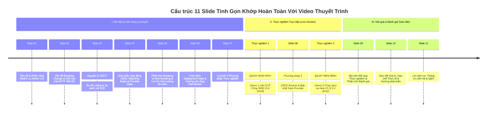

# TỔNG HỢP NỘI DUNG VÀ BỐ CỤC SLIDE THUYẾT TRÌNH: PACT C3 (BẢN TINH GỌN 11 SLIDES)
## Chủ đề: Consumer-Driven Contract Testing với Pact JS — Kịch bản C3: Breaking Change Verification & CI/CD Deployment Gate
**Người trình bày:** Nguyễn Quốc Kỳ (MSSV: 23120138) — Nhóm 11  
**Môn học:** Kiểm thử phần mềm — FIT@HCMUS  
**Tài liệu tham chiếu:** [Video_Script_Pact_C3.md](file:///home/quocky05/academy/software-testing/seminar/SUT-EShop/deliverables/05-management/weekly-reports/week-05/quoc-ky/Video_Script_Pact_C3.md)

---

## TỔNG QUAN CẤU TRÚC BỘ SLIDE TINH GỌN (11 SLIDES)



---

## CHI TIẾT NỘI DUNG TỪNG SLIDE & ĐỀ XUẤT THIẾT KẾ BỐ CỤC

---

### SLIDE 01: TIÊU ĐỀ & PHÂN CÔNG NHIỆM VỤ NHÓM 11
- **Mục tiêu:** Định vị video seminar chính thức, minh bạch vai trò cá nhân và sự phối hợp chặt chẽ giữa 2 thành viên trong Nhóm 11.
- **Bố cục đề xuất (Layout):**
  - **Dạng:** Modern Cover Slide (Nền xanh than công nghệ `#0f172a`, điểm nhấn vàng kim `#f59e0b`).
  - **Bên trái (60%):** Logo FIT@HCMUS, Tên môn học, Tiêu đề chính và tiêu đề phụ của kịch bản C3.
  - **Bên phải (40%):** Khung thẻ Card phân công nhiệm vụ thành viên nhóm (Team Task Matrix).
- **Nội dung hiển thị chi tiết:**
  - **Tên cơ quan & Môn học:** TRƯỜNG ĐẠI HỌC KHOA HỌC TỰ NHIÊN, ĐHQG-HCM (FIT@HCMUS) — KHOA CÔNG NGHỆ THÔNG TIN — SEMINAR KIỂM THỬ PHẦN MỀM (Chủ đề T06: API & Contract Testing)
  - **Tiêu đề chính:** CONSUMER-DRIVEN CONTRACT TESTING VỚI PACT
  - **Tiêu đề phụ:** Kịch bản C3: Kiểm soát tiến hóa phần mềm, mô phỏng Breaking Changes và cơ chế Deployment Gate
  - **Phân công nhiệm vụ Nhóm 11:**
    - **Nguyễn Quốc Kỳ (MSSV: 23120138) — Trình bày chính:** Thiết kế kịch bản C3 (Breaking Change Verification, CLI Mutation & CI/CD Runner).
    - **Nguyễn Hoàng Anh Tú (MSSV: 23120167):** Thiết kế kịch bản C1 (Consumer Test sinh hợp đồng), C2 (Provider Verification cơ bản) & Review chéo mã nguồn.
- **Mô tả Hình ảnh / Sơ đồ:**
  - Logo FIT@HCMUS góc trên trái.
  - Logo Pact Foundation và badge công nghệ: `Pact JS v13` · `Pact Rust Core FFI` · `Node.js` · `SQLite`.
- **Ghi chú thuyết trình (Thời lượng: ~25s):**
  - Webcam PiP góc dưới phải, chào ngắn gọn và nêu rõ sự liên kết logic giữa phần C1/C2 của Tú và phần C3 của Kỳ.

---

### SLIDE 02: BÀI TOÁN BREAKING CHANGE & VÌ SAO HTTP 200 OK LÀ CHƯA ĐỦ?
- **Mục tiêu:** Phân tích nguồn gốc phát sinh Breaking Change trong tiến hóa phần mềm và giải thích khách quan lý do kiểm thử chức năng đơn phương có thể bỏ sót lỗi.
- **Bố cục đề xuất (Layout):**
  - **Dạng:** Split Problem Analysis (Bên trái: Kịch bản Refactoring gây lỗi; Bên phải: So sánh góc nhìn Client vs Server).
- **Nội dung hiển thị chi tiết:**
  - **Tiêu đề slide:** Bài Toán Thực Tế: Tiến Hóa Phần Mềm & Nguy Cơ Breaking Change
  - **Bối cảnh tiến hóa phần mềm (Software Evolution):**
    - Khi Backend tái cấu trúc (refactoring) hoặc tối ưu cơ sở dữ liệu, việc vô tình đổi tên trường (`price` $\rightarrow$ `unit_price`) hoặc format lại kiểu dữ liệu (`price: "30.000.000 ₫"`) rất dễ xảy ra.
    - Định nghĩa: **Breaking Change** là bất kỳ thay đổi nào từ phía Provider làm phá vỡ kỳ vọng đã thỏa thuận của Consumer đang chạy ổn định.
  - **Vì sao kiểm tra mã trạng thái HTTP 200 OK là chưa đủ?**
    - Server xử lý thành công và vẫn phản hồi mã **HTTP 200 OK**.
    - Nếu bộ test API chức năng chỉ kiểm tra status code mà thiếu assertion chặt chẽ về cấu trúc payload, bài test sẽ báo **PASS** dù dữ liệu đã bị biến đổi.
    - Hậu quả trên Client: Mã nguồn ứng dụng di động gọi `product.price` sẽ nhận về `undefined`, dẫn đến phép tính tổng tiền giỏ hàng bị `NaN` hoặc gây lỗi văng ứng dụng (*App Crash*).
  - **Góc nhìn công bằng về công cụ:**
    - Postman hay bất kỳ HTTP Client nào vẫn có thể viết script kiểm tra kiểu dữ liệu (`pm.expect(...)`).
    - Tuy nhiên, sự khác biệt cốt lõi nằm ở: **Ai là người định nghĩa kỳ vọng?** Tester tự phán đoán đơn phương hay chính Consumer đưa ra yêu cầu?
- **Mô tả Hình ảnh / Sơ đồ:**
  - Sơ đồ tương tác giữa Provider đổi tên trường $\rightarrow$ HTTP 200 OK $\rightarrow$ Mobile App tính tiền ra `NaN ₫` do `price === undefined`.
- **Ghi chú thuyết trình (Thời lượng: ~35s):**
  - Giải thích khách quan, không dìm hàng công cụ mà tập trung vào bản chất quản trị kỳ vọng giữa 2 bên.

---

### SLIDE 03: CONSUMER-DRIVEN CONTRACT TESTING (CDCT) & SO SÁNH VỚI E2E
- **Mục tiêu:** Định nghĩa mô hình CDCT, phân tích sơ đồ luồng hoạt động và so sánh lợi ích với kiểm thử End-to-End truyền thống.
- **Bố cục đề xuất (Layout):**
  - **Dạng:** Diagram & Comparison Table (Sơ đồ luồng CDCT ở trên, bảng so sánh CDCT vs E2E ở dưới).
- **Nội dung hiển thị chi tiết:**
  - **Tiêu đề slide:** Consumer-Driven Contract Testing (CDCT) vs Kiểm Thử E2E
  - **Bản chất của CDCT:** Consumer là bên dẫn dắt. Consumer định nghĩa chính xác cấu trúc dữ liệu nó cần và đóng gói thành tệp hợp đồng JSON (`pact file`). Quá trình Provider Verification sẽ phát lại (*replay*) các request trong hợp đồng trực tiếp vào Backend thật để đối soát.
  - **Sơ đồ luồng hoạt động 3 bên:**
    ```mermaid
    sequenceDiagram
        autonumber
        participant C as 📱 Consumer (EShopMobile)
        participant Pkg as 📄 File Hợp đồng JSON<br/>(EShopMobile-EShopBackend.json)
        participant P as 🖥️ Provider (EShopBackend SUT)
        
        Note over C,Pkg: Kịch bản C1: Sinh hợp đồng
        C->>Pkg: Đóng gói kỳ vọng (GET /api/products/1 & price: Integer)
        
        Note over Pkg,P: Kịch bản C2 & C3: Đối soát
        Pkg->>P: Pact Verifier phát lại Request
        P-->>Pkg: Phản hồi thực tế từ Backend
        alt Khớp hợp đồng
            Pkg->>P: ✅ PASS (Exit Code 0)
        else Vi phạm trường / kiểu
            Pkg->>P: ❌ FAILED (Exit Code != 0)
        end
    ```
  - **So sánh với Kiểm thử End-to-End (E2E) truyền thống:**
    - *E2E Test:* Đòi hỏi dựng toàn bộ môi trường (Mobile, Web, DB, Gateway), chạy chậm, tốn tài nguyên và dễ chập chờn (*flaky*).
    - *CDCT (Pact):* Cho phép Consumer và Provider kiểm thử tính tương thích **hoàn toàn độc lập** với tốc độ mili-giây, định vị chính xác nguyên nhân lỗi.
- **Mô tả Hình ảnh / Sơ đồ:**
  - Sơ đồ Sequence Diagram rõ ràng, thể hiện vị trí của C1, C2 và C3.
- **Ghi chú thuyết trình (Thời lượng: ~35s):**
  - Nêu bật tính độc lập: Backend có thể verify mà không cần mở app Mobile.

---

### SLIDE 04: GIẢI PHÁU HỢP ĐỒNG JSON, MATCHING RULES & PROVIDER STATE
- **Mục tiêu:** Mổ xẻ nội dung file hợp đồng thật `EShopMobile-EShopBackend.json`, giải thích cơ chế Loose-Coupling Matcher và khái niệm Provider State.
- **Bố cục đề xuất (Layout):**
  - **Dạng:** Code Inspector (Khung JSON hiển thị bên trái với cú pháp highlight, 3 thẻ chú giải kỹ thuật bên phải).
- **Nội dung hiển thị chi tiết:**
  - **Tiêu đề slide:** Giải Phẫu Tệp Hợp Đồng & Quy Tắc So Khớp (Matching Rules)
  - **Trích đoạn tệp hợp đồng thật (`pacts/EShopMobile-EShopBackend.json`):**
    ```json
    {
      "consumer": { "name": "EShopMobile" },
      "provider": { "name": "EShopBackend" },
      "interactions": [{
        "description": "a request for product with ID 1",
        "providerStates": [{ "name": "product with ID 1 exists" }],
        "request": { "method": "GET", "path": "/api/products/1" },
        "response": {
          "status": 200,
          "body": { "id": 1, "name": "iPhone 15 Pro Max", "price": 30000000 },
          "matchingRules": {
            "body": { "$.price": { "matchers": [{ "match": "integer" }] } }
          }
        }
      }]
    }
    ```
  - **3 Điểm kỹ thuật cốt lõi cần nắm:**
    1. **Loose-Coupling Matcher (`{ "match": "integer" }`):** Không so khớp cứng giá trị cụ thể, mà ràng buộc bắt buộc phải tồn tại trường `price` và kiểu dữ liệu phải là số nguyên để tính toán giỏ hàng.
    2. **Khái niệm Provider State (`"product with ID 1 exists"`):** Thiết lập tiền điều kiện môi trường — Provider phải đảm bảo sản phẩm ID 1 tồn tại trong database trước khi chạy xác thực.
    3. **Giới hạn phạm vi hợp đồng hiện tại:** Hợp đồng chỉ mới đăng ký tương tác cho sản phẩm ID 1. Các endpoint hoặc ID khác (như ID 2) nằm ngoài phạm vi bảo vệ của bản hợp đồng này.
- **Mô tả Hình ảnh / Sơ đồ:**
  - Mũi tên highlight nối từ `providerStates` sang database SQLite và từ `matchingRules` sang logic tính giỏ hàng.
- **Ghi chú thuyết trình (Thời lượng: ~35s):**
  - Chỉ rõ `providerStates` là cầu nối giữa hợp đồng và dữ liệu thật của backend.

---

### SLIDE 05: PHÂN LOẠI BREAKING VS NON-BREAKING & LỢI ÍCH XÓA TRƯỜNG AN TOÀN
- **Mục tiêu:** Phân loại rõ ràng các dạng thay đổi API và nêu bật lợi ích lớn nhất của CDCT: Cho phép Backend tự tin xóa các trường dữ liệu thừa.
- **Bố cục đề xuất (Layout):**
  - **Dạng:** 2 Cột Đối xứng (Cột Đỏ: Các dạng Breaking Change vs Cột Xanh: Lợi ích Tiến hóa An toàn).
- **Nội dung hiển thị chi tiết:**
  - **Tiêu đề slide:** Phân Loại Thay Đổi API: Khi Nào Hợp Đồng Bị Phá Vỡ?
  - **1. Nhóm Thay Đổi Phá Vỡ (Breaking Changes) — Bị Pact chặn đứng:**
    - Đổi tên hoặc xóa trường Consumer đang dùng (`price` $\rightarrow$ `unit_price`).
    - Thay đổi kiểu dữ liệu của trường bắt buộc (Số nguyên $\rightarrow$ Chuỗi format tiền tệ).
    - Thay đổi mã trạng thái HTTP (200 $\rightarrow$ 204 hoặc 400), xóa endpoint, hoặc bổ sung tham số bắt buộc (*required query/header*).
  - **2. Nhóm Thay Đổi An Toàn (Non-breaking Changes) — Được Pact cho phép:**
    - **Bổ sung trường mới (Áp dụng Nguyên lý Postel):** Backend thêm `brand: "Apple"` mà Consumer không đăng ký $\rightarrow$ Pact tự động bỏ qua, bài test vẫn PASS.
    - **LỢI ÍCH MẠNH NHẤT CỦA CDCT — Xóa trường an toàn (Safe Dead Code Removal):**
      - Nếu Backend muốn xóa một trường cũ trong database nhưng sợ làm gãy ứng dụng ngoài client: Chỉ cần kiểm tra hợp đồng!
      - Nếu không có Consumer nào đăng ký trường đó trong Pact, Backend có thể **tự tin xóa bỏ 100% an toàn mà không cần họp hành phán đoán**.
- **Mô tả Hình ảnh / Sơ đồ:**
  - Biểu tượng Khiên bảo vệ màu đỏ (Chặn breaking change) và Biểu tượng Dọn dẹp mã nguồn màu xanh (Safe field removal).
- **Ghi chú thuyết trình (Thời lượng: ~30s):**
  - Nhấn mạnh luận điểm "Safe Field Removal" để ghi điểm tuyệt đối về giá trị thực tế của CDCT.

---

### SLIDE 06: KHÁI NIỆM DEPLOYMENT GATE & HƯỚNG MỞ RỘNG PACT BROKER
- **Mục tiêu:** Định vị vai trò Deployment Gate của Pact trong CI/CD, nêu rõ phạm vi đồ án hiện tại và lộ trình chuẩn công nghiệp với Pact Broker / `can-i-deploy`.
- **Bố cục đề xuất (Layout):**
  - **Dạng:** Pipeline Architecture & Scope Clarification (Sơ đồ CI/CD ở giữa, khung ghi chú phạm vi đồ án bên dưới).
- **Nội dung hiển thị chi tiết:**
  - **Tiêu đề slide:** Pact Như Một Deployment Gate: Hiện Tại & Chuẩn Công Nghiệp
  - **Cơ chế hoạt động của Deployment Gate:**
    - Là chốt chặn tự động trong pipeline CI/CD: Nếu Provider Verification trả về `Exit Code != 0` $\rightarrow$ Lập tức dừng bản build, từ chối triển khai lên Production.
  - **Sơ đồ tích hợp vào Pipeline:**
    ```mermaid
    graph LR
        Git["Backend Commit"] --> Build["CI Build & Unit Test"]
        Build --> Gate{"🛡️ PACT GATE<br/>(Provider Verify)"}
        Gate -- "Exit Code != 0 (Lỗi Hợp đồng)" --> Block["❌ DỪNG BUILD<br/>Từ chối Release!"]
        Gate -- "Exit Code == 0 (Khớp 100%)" --> Deploy["🚀 DEPLOY<br/>Phát hành an toàn"]
        
        style Gate fill:#fef08a,stroke:#ca8a04,stroke-width:2px;
        style Block fill:#fee2e2,stroke:#ef4444,stroke-width:2px;
        style Deploy fill:#dcfce7,stroke:#16a34a,stroke-width:2px;
    ```
  - **Minh bạch phạm vi đồ án & Hướng mở rộng công nghiệp:**
    - *Phạm vi hiện tại của nhóm:* Thực thi **Local Provider Verification** dựa trên tệp JSON tĩnh, chặn build thông qua mã thoát của tiến trình (Process Exit Code).
    - *Chuẩn công nghiệp mở rộng:* Tích hợp **Pact Broker / PactFlow** để lưu trữ hợp đồng tập trung và sử dụng lệnh CLI **`can-i-deploy`** đối soát ma trận phiên bản giữa Consumer và Provider theo từng môi trường triển khai (*Dev $\rightarrow$ Staging $\rightarrow$ Production*).
- **Mô tả Hình ảnh / Sơ đồ:**
  - Badge: `Local Provider Verification: Implemented` $\longleftrightarrow$ `Pact Broker Matrix: Future Roadmap`.
- **Ghi chú thuyết trình (Thời lượng: ~30s):**
  - Trả lời trước câu hỏi tiềm năng của người chấm: *"Broker đâu?"* bằng cách chủ động nêu rõ phạm vi và hướng mở rộng.

---

### SLIDE 07: LỘ TRÌNH 2 PHƯƠNG PHÁP THỰC NGHIỆM
- **Mục tiêu:** Giới thiệu ngắn gọn 2 phương pháp demo thực nghiệm trước khi chuyển sang quay màn hình máy tính.
- **Bố cục đề xuất (Layout):**
  - **Dạng:** 2-Method Roadmap (2 thẻ phương pháp đối song hành).
- **Nội dung hiển thị chi tiết:**
  - **Tiêu đề slide:** Lộ Trình Thực Nghiệm: 2 Góc Nhìn Bổ Trợ
  - **Phương pháp 1 — Bằng chứng thực tế trên SUT Backend Thật (Cổng 3000):**
    - Chạy trực tiếp trên mã nguồn `backend/server.js` và database SQLite thật.
    - Dùng bộ lệnh CLI tiêm lỗi đột biến: Đổi tên trường (`price` $\rightarrow$ `unit_price`) và Format tiền tệ (`'30.000.000 ₫'`).
    - Mục tiêu: Chứng minh tính chân thực của việc Pact bắt lỗi trên hệ thống thật.
  - **Phương pháp 2 — Tự động hóa CI/CD khép kín (Cổng 3005):**
    - Sử dụng trình điều phối tự động `pact-c3-runner.js`.
    - Tự động chạy chu trình 3 pha khép kín: Baseline $\rightarrow$ Tiêm lỗi $\rightarrow$ Non-breaking $\rightarrow$ Rollback chỉ với 1 lệnh `npm run test:c3`.
    - Mục tiêu: Mô phỏng kịch bản kiểm tra tự động trước khi triển khai trong đường ống DevOps.
- **Mô tả Hình ảnh / Sơ đồ:**
  - Biểu tượng SUT thật (Database SQLite) cho PP1 và Biểu tượng CI/CD Runner (Automated Gear) cho PP2.
- **Ghi chú chuyển cảnh (BẮT ĐẦU VÀO PHẦN DEMO 1 THỰC TẾ):**
  - Chuyển màn hình từ Slide sang cửa sổ làm việc: **VS Code + 2 Terminal**.
  - Rút ngắn demo 1 xuống khoảng **3–4 phút**, cắt bỏ các đoạn chờ khởi động server khi dựng video.

---

### 🖥️ KHUNG HÌNH THỰC NGHIỆM PHƯƠNG PHÁP 1 (TỪ 03:00 ĐẾN 06:30 — QUAY MÀN HÌNH THẬT, KHÔNG DÙNG SLIDE)
*Ghi chú các thao tác thực hiện trên màn hình máy tính:*
1. **Khung hình:** Nửa trái mở VS Code (`backend/server.js`), nửa phải mở 2 Terminal (Terminal 1 chạy `node server.js` cổng 3000; Terminal 2 chạy test).
2. **Bước 1 — Baseline:**
   - Terminal 2: `npm run test:provider` $\rightarrow$ Quan sát: Terminal 1 in log truy vấn SQLite, Terminal 2 báo xanh `has a matching body (OK)` (Pass 100%).
3. **Bước 2 — Tiêm lỗi #1: Đổi tên trường:**
   - Terminal 2: `npm run demo:mutate:rename`. Mở `server.js` chỉ vào dòng `unit_price: 30000000`.
   - Restart server cổng 3000. Chạy lại: `npm run test:provider`.
   - **Quan sát kết quả:** Pact in lỗi đỏ rực: `Actual map is missing the following keys: price`. Chặn đứng bản build!
4. **Bước 3 — Tiêm lỗi #2: Format chuỗi tiền tệ:**
   - Terminal 2: `npm run demo:mutate:type`. Mở `server.js` chỉ vào dòng `price: "30.000.000 ₫"`.
   - Restart server cổng 3000. Chạy lại: `npm run test:provider`.
   - **Quan sát kết quả:** Pact chặn đứng với lỗi: `Expected '30.000.000 ₫' (String) to be an integer number`.
5. **Bước 4 — Hoàn nguyên:**
   - Terminal 2: `npm run demo:restore`. Restart server và chạy lại `npm run test:provider` $\rightarrow$ Hệ thống xanh trở lại 100%.
6. **Chuyển tiếp:** Giải thích: Phương pháp 1 rất trực quan nhưng đòi hỏi thao tác sửa file và restart thủ công $\rightarrow$ Chuyển sang Slide 08 để giới thiệu Phương pháp 2 tự động hóa.

---

### SLIDE 08: PHƯƠNG PHÁP 2 — BỘ ĐIỀU PHỐI CI/CD RUNNER & BẢN CHẤT STUB PROVIDER
- **Mục tiêu:** Làm rõ bản chất kỹ thuật của `pact-c3-runner.js`: Sử dụng cơ chế Fault Injection trên Stub Provider để kiểm tra chính cổng kiểm soát (Testing the Quality Gate).
- **Bố cục đề xuất (Layout):**
  - **Dạng:** Architecture & Honest Engineering (Sơ đồ điều phối Runner ở trên, khung giải thích bản chất kỹ thuật ở dưới).
- **Nội dung hiển thị chi tiết:**
  - **Tiêu đề slide:** Phương pháp 2: Bộ Điều Phối CI/CD Runner & Bản Chất Kỹ Thuật
  - **Sơ đồ hoạt động của `pact-c3-runner.js` trên Cổng 3005:**
    ```mermaid
    graph TB
        Runner["⚙️ pact-c3-runner.js (Trình điều phối)"]
        
        subgraph StubServer ["Port 3005: Stub Provider (Phục vụ Fault Injection)"]
            Mode{"currentMode"}
            Mode --> M1["BASELINE: price: 30000000"]
            Mode --> M2["MUTATION_RENAME: unit_price"]
            Mode --> M3["MUTATION_TYPE: '30.000.000 ₫'"]
            Mode --> M4["MUTATION_NON_BREAKING: + brand"]
        end
        
        subgraph Verifier ["Pact Verifier"]
            VTest["Đối soát Hợp đồng JSON"]
        end
        
        Runner -->|Điều khiển mode| Mode
        Runner -->|Kích hoạt| Verifier
        Verifier -->|HTTP Request| StubServer
        
        style StubServer fill:#f8fafc,stroke:#3b82f6,stroke-width:2px;
        style Runner fill:#fef3c7,stroke:#f59e0b,stroke-width:2px;
    ```
  - **Bản chất kỹ thuật minh bạch:**
    - Server cổng 3005 không phải là backend thật, mà là một **Stub Provider có khả năng kiểm soát trạng thái** nhằm phục vụ kỹ thuật tiêm lỗi (*Fault Injection*).
    - **Mục đích thực sự:** Kiểm chứng chính độ nhạy của cổng kiểm soát (Testing the Verification Gate itself) trong một chu trình CI/CD tự động, đảm bảo Verifier bắt đúng lỗi và cho qua đúng trường hợp an toàn mà không làm biến dạng database thật.
- **Mô tả Hình ảnh / Sơ đồ:**
  - Sơ đồ chuyển đổi trạng thái của biến `currentMode` trong bộ nhớ.
- **Ghi chú chuyển cảnh (QUAY MÀN HÌNH DEMO 2):**
  - Chuyển sang màn hình Terminal gõ lệnh duy nhất: `npm run test:c3`. Thời lượng demo 2 khoảng **1.5 – 2 phút**.

---

### 🖥️ KHUNG HÌNH THỰC NGHIỆM PHƯƠNG PHÁP 2 (TỪ 07:00 ĐẾN 08:30 — QUAY MÀN HÌNH THẬT, KHÔNG DÙNG SLIDE)
*Ghi chú thao tác trên màn hình:*
1. Mở Terminal tại `tests/pact`, gõ lệnh:
   ```bash
   npm run test:c3
   ```
2. Cuộn chậm theo từng pha in log:
   - **Pha 1 (Baseline):** Server mode `BASELINE` $\rightarrow$ Log xanh `PASS`.
   - **Pha 2A (Rename):** Server mode `MUTATION_RENAME` $\rightarrow$ Báo lỗi `missing keys: price` $\rightarrow$ Ghi nhận `BLOCKED`.
   - **Pha 2B (Type):** Server mode `MUTATION_TYPE` $\rightarrow$ Báo lỗi `Expected integer but received string` $\rightarrow$ Ghi nhận `BLOCKED`.
   - **Pha 2C (Non-breaking):** Server mode `MUTATION_NON_BREAKING` $\rightarrow$ Log xanh `PASS` (Chứng minh thêm trường `brand` an toàn).
   - **Pha 3 (Rollback):** Server mode `BASELINE` $\rightarrow$ Log xanh `PASS` (Hệ thống an toàn trở lại).
3. Dừng lại ở bảng `console.table(results)` ở cuối terminal $\rightarrow$ Chuyển lại Slide 09 để phân tích kết quả.

---

### SLIDE 09: MA TRẬN KẾT QUẢ THỰC NGHIỆM & PHÂN TÍCH ĐÁNH GIÁ
- **Mục tiêu:** Trình chiếu bảng ma trận kết quả từ `console.table(results)` và phân tích sâu về tính đúng đắn của kết quả đối soát.
- **Bố cục đề xuất (Layout):**
  - **Dạng:** High-Impact Table & Technical Caveat (Bảng ma trận ở trên, khung lưu ý kiểm chứng lỗi ở dưới).
- **Nội dung hiển thị chi tiết:**
  - **Tiêu đề slide:** Ma Trận Đánh Giá Kết Quả Kiểm Thử Toàn Diện
  - **Bảng tổng hợp kết quả thực nghiệm xuất từ `console.table(results)`:**
    | Pha (Phase) | Kịch bản kiểm tra | Kỳ vọng (Expected) | Thực tế (Actual) | Kết luận (Verdict) |
    | :---: | :--- | :---: | :---: | :---: |
    | **1** | Pha 1: Baseline Verification | `PASS` | `PASS` | **ĐẠT (Hợp đồng toàn vẹn)** |
    | **2A** | Pha 2A: Rename `price` $\rightarrow$ `unit_price` | `BLOCK (FAIL)` | `BLOCKED` | **ĐẠT (Bắt đúng thiếu trường)** |
    | **2B** | Pha 2B: Type Integer $\rightarrow$ String | `BLOCK (FAIL)` | `BLOCKED` | **ĐẠT (Bắt đúng lệch kiểu)** |
    | **2C** | Pha 2C: Add `brand` (Non-breaking) | `PASS` | `PASS` | **ĐẠT (Tiến hóa an toàn)** |
    | **3** | Pha 3: Rollback & Re-verify | `PASS` | `PASS` | **ĐẠT (Hệ thống an toàn)** |
  - **⚠️ Lưu ý kỹ thuật chuyên sâu về phán quyết `BLOCKED`:**
    - Nếu runner chỉ kiểm tra `exitCode != 0` mà không kiểm tra nội dung lỗi, hệ thống có thể dính bẫy "đúng kết quả nhưng sai lý do" (ví dụ server sập hoặc lỗi mạng cũng khiến test fail).
    - Bộ runner của nhóm đã đối soát chính xác thông báo lỗi: Phải chứa `missing keys: price` ở pha 2A và `expected integer` ở pha 2B mới kết luận là `BLOCKED ĐẠT`.
- **Mô tả Hình ảnh / Sơ đồ:**
  - Bảng số liệu viền xanh-đỏ trực quan, có biểu tượng chứng nhận "Verified Reason Assertion".
- **Ghi chú thuyết trình (Thời lượng: ~30s):**
  - Thể hiện sự sâu sắc khi phân tích nguy cơ "đúng kết quả nhưng sai lý do".

---

### SLIDE 10: ĐÚC KẾT GIÁ TRỊ, HẠN CHẾ THỰC TẾ & HƯỚNG PHÁT TRIỂN
- **Mục tiêu:** Tổng kết toàn diện giá trị của kịch bản C3, nêu rõ các hạn chế thực tế và định hướng mở rộng công nghiệp.
- **Bố cục đề xuất (Layout):**
  - **Dạng:** Balanced Retrospective (3 cột: Giá trị cốt lõi | Hạn chế thực tế | Hướng phát triển).
- **Nội dung hiển thị chi tiết:**
  - **Tiêu đề slide:** Đúc Kết Giá Trị, Hạn Chế Thực Tế & Hướng Phát Triển
  - **1. Giá trị cốt lõi đạt được:**
    - Khẳng định tính khả thi của việc dùng Pact JS làm Deployment Gate trong CI/CD, tự động hóa việc chặn đứng các lỗi phá vỡ hợp đồng.
    - Cho phép Provider tự do phát triển tính năng mới và tự tin dọn dẹp các trường dữ liệu thừa mà không sợ làm gãy ứng dụng Consumer.
  - **2. Các hạn chế thực tế cần lưu ý:**
    - Hợp đồng kiểm thử phụ thuộc vào phạm vi đăng ký của Consumer (ví dụ hợp đồng C1 hiện tại chỉ mới bảo vệ ID 1, chưa bao phủ ID 2).
    - Cần duy trì các hàm `stateHandlers` đồng bộ với cơ sở dữ liệu thật của Provider khi dữ liệu thay đổi.
  - **3. Hướng phát triển hoàn thiện quy trình:**
    - Triển khai **Pact Broker tập trung** để quản lý hợp đồng giữa nhiều nhóm phát triển độc lập.
    - Tích hợp công cụ CLI **`can-i-deploy`** vào GitHub Actions / GitLab CI để đối soát ma trận tương thích trước mỗi đợt Release lên Staging/Production.
- **Mô tả Hình ảnh / Sơ đồ:**
  - Mô hình liên kết: Local Test $\rightarrow$ Pact Broker Matrix $\rightarrow$ `can-i-deploy` Gate $\rightarrow$ Production.
- **Ghi chú thuyết trình (Thời lượng: ~35s):**
  - Trình bày mạch lạc, thể hiện tầm nhìn kỹ thuật vượt ra ngoài phạm vi bài tập nhỏ.

---

### SLIDE 11: LỜI CẢM ƠN, THÔNG TIN LIÊN HỆ & Q&A
- **Mục tiêu:** Chào kết thúc video chuyên nghiệp, để lại thông tin liên hệ và mã QR truy cập repository.
- **Bố cục đề xuất (Layout):**
  - **Dạng:** Modern Closing Slide (Nền tối sang trọng, biểu tượng Q&A lớn, mã QR và thông tin liên hệ).
- **Nội dung hiển thị chi tiết:**
  - **Tiêu đề slide:** Tổng Kết Kịch Bản C3 & Cảm Ơn
  - **Thông điệp kết thúc:**
    - *"Consumer-Driven Contract Testing với Pact JS đã chứng minh vai trò là một giải pháp kiểm soát tiến hóa phần mềm tin cậy, bảo vệ ứng dụng khỏi các rủi ro Breaking Change ngầm trước khi chạm tới Production."*
  - **Mời thảo luận & Hỏi đáp (Q&A):**
    - Sẵn sàng giải đáp về: Nguyên lý CDCT, Matching Rules, Cơ chế Provider State, Fault Injection Runner hay Quy trình tích hợp CI/CD.
  - **Thông tin liên hệ & Mã nguồn dự án:**
    - **Nhóm 11 — Môn Kiểm thử phần mềm (FIT@HCMUS)**
    - **Sinh viên:** Nguyễn Quốc Kỳ (23120138) & Nguyễn Hoàng Anh Tú (23120167)
    - **Mã nguồn:** Toàn bộ test suite tại thư mục `tests/pact/`.
- **Mô tả Hình ảnh / Sơ đồ:**
  - Mã QR liên kết tới GitHub repository của nhóm.
- **Ghi chú thuyết trình (Thời lượng: ~20s):**
  - Chuyển webcam toàn màn hình, mỉm cười chào kết thúc video.

---

## BẢNG ÁNH XẠ THỜI LƯỢNG & NGUỒN HIỂN THỊ MÀN HÌNH (VIDEO ~10–11 PHÚT)

| Phân đoạn | Thời lượng ước tính | Nguồn hiển thị màn hình chính | Slide tương ứng | Nội dung thực hiện |
| :--- | :---: | :--- | :---: | :--- |
| **1. Mở đầu & Bối cảnh** | 00:00 – 01:00 | **Chiếu Slide (Webcam PiP)** | Slide 01, 02 | Tiêu đề, phân công nhóm 11, bài toán Breaking Change và giới hạn HTTP 200 OK. |
| **2. Nguyên lý CDCT & Matching** | 01:00 – 02:30 | **Chiếu Slide (Webcam PiP)** | Slide 03 – 06 | Sơ đồ luồng CDCT, giải phẫu file JSON, phân loại thay đổi, xóa trường an toàn và Deployment Gate. |
| **3. Lộ trình Thực nghiệm** | 02:30 – 03:00 | **Chiếu Slide (Webcam PiP)** | Slide 07 | Giới thiệu 2 phương pháp demo thực nghiệm (Cổng 3000 SUT thật vs Cổng 3005 Runner). |
| **4. Live Demo 1: SUT Thật (Port 3000)** | 03:00 – 06:30 | **Màn hình chia đôi (VS Code + Terminal)** | *(Không dùng slide)* | Chạy 4 bước (Baseline $\rightarrow$ Rename $\rightarrow$ Type $\rightarrow$ Restore) trên backend EShop và SQLite thật. Cắt các đoạn chờ restart khi biên tập. |
| **5. Giới thiệu Phương pháp 2** | 06:30 – 07:00 | **Chiếu Slide (Webcam PiP)** | Slide 08 | Giải thích bản chất Stub Provider phục vụ Fault Injection để kiểm tra Verification Gate. |
| **6. Live Demo 2: Runner (Port 3005)** | 07:00 – 08:30 | **Terminal (Toàn màn hình)** | *(Không dùng slide)* | Chạy lệnh `npm run test:c3`, cuộn xem 4 giai đoạn log và dừng ở bảng `console.table(results)`. |
| **7. Đánh giá & Hướng mở rộng** | 08:30 – 09:45 | **Chiếu Slide (Webcam PiP)** | Slide 09, 10 | Phân tích ma trận kết quả, lưu ý kiểm chứng lý do lỗi, hạn chế thực tế và hướng mở rộng Pact Broker / `can-i-deploy`. |
| **8. Tổng kết & Chào kết thúc** | 09:45 – 10:15 | **Chiếu Slide $\rightarrow$ Webcam toàn cảnh** | Slide 11 | Đúc kết thông điệp, cảm ơn và chào kết thúc video. |
