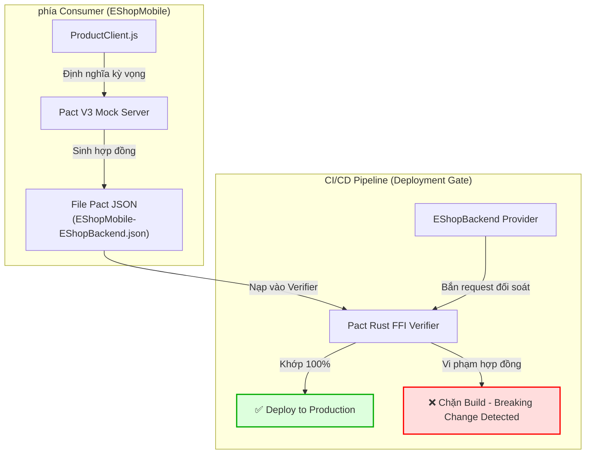

# Hướng Dẫn Kỹ Thuật Kịch Bản C3: Phát Hiện Breaking Change & Đảm Bảo Tương Thích Hợp Đồng (Pact JS)

- **Môn học:** Kiểm thử phần mềm (Software Testing) — FIT@HCMUS
- **Chủ đề Seminar:** T06 · API Testing & Contract Testing
- **Người biên soạn & Thực hiện chính:** **Nguyễn Quốc Kỳ (MSSV: 23120138)**
- **Người phối hợp & Review:** **Nguyễn Hoàng Anh Tú (MSSV: 23120183)**
- **Hệ thống SUT:** EShop (Consumer: `EShopMobile` — Provider: `EShopBackend`)
- **Tập tin hợp đồng:** `tests/pact/pacts/EShopMobile-EShopBackend.json`

---

## 1. Giới Thiệu & Bản Chất Của Breaking Change

### 1.1 Khái niệm Breaking Change trong Kiến trúc Microservices / REST API
Trong quá trình tiến hóa phần mềm (Software Evolution), các nhóm phát triển Provider (Backend) thường xuyên sửa đổi API để tối ưu hóa cơ sở dữ liệu, tái cấu trúc mã nguồn hoặc thêm tính năng mới. **Breaking Change (Thay đổi phá vỡ tương thích)** xảy ra khi một thay đổi từ phía Provider làm cho một hoặc nhiều Consumer (Frontend Web, Mobile App, Third-party Services) đang hoạt động bình thường bị lỗi mà không hề có sự báo trước.

### 1.2 Giới hạn chết người của Functional API Testing (Postman / Newman)
Trong phương pháp kiểm thử chức năng truyền thống:
- Khi kiểm thử viên hoặc lập trình viên gửi request `GET /api/products/1`, server vẫn trả về mã trạng thái **HTTP 200 OK**.
- Bộ test Postman chỉ kiểm tra `pm.response.to.have.status(200)` hoặc kiểm tra lỏng lẻo sẽ đánh giá kịch bản là **PASSED** (False Positive - Báo thành công giả tạo).
- **Hậu quả thực tế:** Ứng dụng di động `EShopMobile` khi nhận payload bị đổi tên trường từ `price` sang `unit_price` sẽ truy xuất `item.price === undefined`. Khi tính toán tổng tiền (`item.price * quantity`), kết quả trả về `NaN` hoặc ném ngoại lệ Runtime Error làm văng ứng dụng của khách hàng!

### 1.3 Vai trò của Consumer-Driven Contract Testing (Pact JS)
Pact giải quyết bài toán trên bằng mô hình **Consumer-Driven (Người tiêu dùng dẫn dắt)**:
1. Consumer (`EShopMobile`) là bên chủ động xác lập nhu cầu: *"Tôi chỉ cần các trường `id`, `name`, và bắt buộc trường `price` phải là kiểu số nguyên (Integer)!"* (Kịch bản C1).
2. Kỳ vọng này được đóng gói thành tệp hợp đồng JSON tiêu chuẩn (`EShopMobile-EShopBackend.json`).
3. Provider Verification (Kịch bản C2, C3) phát lại hợp đồng trực tiếp vào Provider. Nếu Provider vi phạm bất kỳ ràng buộc nào, Pact Verifier sẽ **ngay lập tức đánh FAIL**, đóng vai trò như một **Deployment Gate** chặn đứng bản build lỗi không cho deploy lên Production.



---

## 2. Phân Loại Các Dạng Breaking Changes

Trong kịch bản C3, chúng tôi thiết kế và kiểm chứng 2 dạng biến thể phá vỡ hợp đồng phổ biến nhất:

| Dạng Breaking Change | Hành vi từ phía Provider | Phản ứng của Postman | Phản ứng của Pact Verifier | Tác động tới Mobile App |
| :--- | :--- | :--- | :--- | :--- |
| **Dạng 1: Field Renamed / Missing Property** | Đổi tên trường `price` $\to$ `unit_price` | Status 200 OK $\implies$ **PASS** | Báo lỗi thiếu key `price` $\implies$ **FAIL** | Crash màn hình giỏ hàng do `item.price` bị `undefined`. |
| **Dạng 2: Data Type Mismatch** | Format tiền tệ thành chuỗi `'30.000.000 ₫'` thay vì số nguyên thô `30000000` | Status 200 OK $\implies$ **PASS** | Báo lỗi `Expected integer but got string` $\implies$ **FAIL** | Tính toán tổng tiền đơn hàng ra kết quả `NaN`. |
| **Non-breaking Change (Tham chiếu)** | Provider thêm trường mới `brand: "Apple"` mà Consumer không dùng | Status 200 OK $\implies$ **PASS** | **PASS** (Pact tự động bỏ qua các trường thừa) | An toàn, không ảnh hưởng tới Consumer. |

---

## 3. Quy Trình Thực Thi 3 Pha (Three-Phase Protocol)

Để chứng minh tính khoa học và khả năng tái lập 100%, kịch bản C3 được tổ chức thành 3 pha thực thi khép kín:

```
[PHA 1: Baseline Verification]  --> Hợp đồng khớp 100% (PASS)
               ↓
[PHA 2: Mutation & Injection]   --> Tiêm 2 dạng Breaking Change (Pact FAILED & BLOCKED)
               ↓
[PHA 3: Rollback & Re-verify]   --> Khôi phục trạng thái chuẩn (PASS trở lại)
```

### Bước 1: Chuẩn bị môi trường
Mở terminal tại thư mục `tests/pact`:
```bash
cd /home/quocky05/academy/software-testing/seminar/SUT-EShop/tests/pact
npm install
```

### Bước 2: Chạy kiểm chứng toàn diện kịch bản C3
```bash
npm run test:c3
```

---

## 4. Chi Tiết Thực Thi & Phân Tích Nhật Ký Lỗi (Terminal Output Walkthrough)

### 4.1 Pha 1: Kiểm chứng Baseline (Baseline Verification)
- **Mục tiêu:** Xác nhận rằng ở trạng thái bình thường, Provider đáp ứng 100% hợp đồng đã thỏa thuận với Consumer.
- **Log thu được:**
  ```text
  Verifying a pact between EShopMobile and EShopBackend
    a request for product with ID 1
       Given product with ID 1 exists
      returns a response which
        has status code 200 (OK)
        includes headers
          "Content-Type" with value "application/json; charset=utf-8" (OK)
        has a matching body (OK)

  ✅ PHA 1 THÀNH CÔNG: Provider đáp ứng chính xác 100% hợp đồng của Consumer!
  ```

### 4.2 Pha 2A: Tiêm lỗi Đổi tên trường (`price` $\to$ `unit_price`)
- **Mô phỏng code Backend:**
  ```javascript
  res.json({
    id: 1,
    name: 'iPhone 15 Pro Max',
    unit_price: 30000000, // BUG: Đổi tên trường mà không thông báo cho Mobile!
    description: 'Điện thoại cao cấp của Apple',
    imageUrl: 'https://placehold.co/300x300/png?text=iPhone+15',
    category_id: 1,
  });
  ```
- **Thông báo lỗi bắt được từ Pact:**
  ```text
  Failures:
  1) Verifying a pact between EShopMobile and EShopBackend Given product with ID 1 exists - a request for product with ID 1
      1.1) has a matching body
             $ -> Actual map is missing the following keys: price

  [ERROR] pact-core: Verification unsuccessful
  🎯 PHA 2A THÀNH CÔNG (CHẶN LỖI): Pact Verifier phát hiện vi phạm hợp đồng!
  ```
- **Ý nghĩa chuyên môn:** Pact FFI Parser so sánh cấu trúc Map/Dictionary của JSON response và phát hiện thiếu trường bắt buộc `price`, dù status code vẫn là 200.

### 4.3 Pha 2B: Tiêm lỗi Sai lệch kiểu dữ liệu (Type Inconsistency)
- **Mô phỏng code Backend:**
  ```javascript
  res.json({
    id: 1,
    name: 'iPhone 15 Pro Max',
    price: '30.000.000 ₫', // BUG: Tự ý chuyển sang định dạng chuỗi hiển thị
    description: 'Điện thoại cao cấp của Apple',
    imageUrl: 'https://placehold.co/300x300/png?text=iPhone+15',
    category_id: 1,
  });
  ```
- **Thông báo lỗi bắt được từ Pact:**
  ```text
  Failures:
  1) Verifying a pact between EShopMobile and EShopBackend Given product with ID 1 exists - a request for product with ID 1
      1.1) has a matching body
             $.price -> Expected '30.000.000 ₫' (String) to be an integer number

  [ERROR] pact-core: Verification unsuccessful
  🎯 PHA 2B THÀNH CÔNG (CHẶN LỖI): Pact Verifier phát hiện vi phạm kiểu dữ liệu!
  ```
- **Ý nghĩa chuyên môn:** Matcher `$.price` được đăng ký là `integer`. Pact chặn đứng kiểu String không thuần số, bảo vệ tuyệt đối logic tính toán của ứng dụng.

### 4.4 Pha 3: Hoàn nguyên mã nguồn (Rollback & Restoration)
- **Mục tiêu:** Chứng minh hệ thống trở lại màu xanh an toàn khi loại bỏ breaking change.
- **Log thu được:**
  ```text
  Verifying a pact between EShopMobile and EShopBackend
    a request for product with ID 1
       Given product with ID 1 exists
      returns a response which
        has status code 200 (OK)
        includes headers
          "Content-Type" with value "application/json; charset=utf-8" (OK)
        has a matching body (OK)

  ✅ PHA 3 THÀNH CÔNG: Trạng thái hệ thống đã phục hồi hoàn toàn xanh!
  ```

---

## 5. Bảng Ma Trận Tổng Kết Thực Thi Kịch Bản C3

```text
┌─────────┬────────────────────────────────────┬────────────────┬───────────┬──────────────────────────────────┐
│ (index) │ phase                              │ expected       │ actual    │ verdict                          │
├─────────┼────────────────────────────────────┼────────────────┼───────────┼──────────────────────────────────┤
│ 0       │ 'Pha 1: Baseline'                  │ 'PASS'         │ 'PASS'    │ 'ĐẠT (Hợp đồng toàn vẹn)'        │
│ 1       │ 'Pha 2A: Rename price->unit_price' │ 'BLOCK (FAIL)' │ 'BLOCKED' │ 'ĐẠT (Bắt đúng breaking change)' │
│ 2       │ 'Pha 2B: Type Integer->String'     │ 'BLOCK (FAIL)' │ 'BLOCKED' │ 'ĐẠT (Bắt đúng type mismatch)'   │
│ 3       │ 'Pha 3: Rollback & Re-verify'      │ 'PASS'         │ 'PASS'    │ 'ĐẠT (Hệ thống an toàn)'         │
└─────────┴────────────────────────────────────┴────────────────┴───────────┴──────────────────────────────────┘
```

---

## 6. So Sánh Chuyên Sâu: Postman vs Karate vs Pact JS

| Tiêu chí | Postman / Newman (P1–P3) | Karate Framework (K1–K3) | Pact JS (C1–C3) |
| :--- | :--- | :--- | :--- |
| **Trường phái kiểm thử** | Functional / End-to-End API Testing | BDD / Workflow Integration Testing | Consumer-Driven Contract Testing (CDCT) |
| **Phụ thuộc môi trường** | Bắt buộc Provider thật phải chạy sẵn | Bắt buộc Provider thật phải chạy sẵn | Consumer test chạy độc lập với Mock; Provider verify độc lập với Contract |
| **Khả năng phát hiện Breaking Change** | Thấp (Dễ pass nếu chỉ assert status 200 hoặc thiếu schema assertion) | Trung bình (Bắt được nếu viết assertion schema nghiêm ngặt) | **Tuyệt đối** (Tự động so khớp từng field/type đã ký trong hợp đồng) |
| **Độ phủ nghiệm vụ** | Tốt trên từng endpoint đơn lẻ | Rất mạnh trên chuỗi workflow phức tạp có authentication | Tập trung chặt chẽ vào ranh giới tích hợp (Integration Boundary) |
| **Tích hợp CI/CD** | Exit code của Newman (`0` hoặc `1`) | Exit code của Maven Surefire Runner | Pact Broker Matrix & Lệnh `can-i-deploy` |

---

## 7. Bẫy Thường Gặp (Failure Modes) & Kinh Nghiệm Khắc Phục

1. **Bẫy Coercion của Pact Rust FFI đối với chuỗi số:**
   - Trong Pact V3, nếu một trường được match bằng `integer`, khi Provider trả về chuỗi chỉ gồm chữ số (ví dụ `"30000000"`), Rust parser nội bộ của Pact có thể tự động parse chuỗi thành số nguyên và coi là hợp lệ.
   - *Cách xử lý:* Nếu Consumer yêu cầu kiểm tra kiểu dữ liệu nghiêm ngặt cấp độ JSON Type (không chấp nhận String), cần sử dụng matcher định dạng kết hợp hoặc kiểm tra rõ ràng trong unit test của Consumer. Trong demo C3, chúng tôi sử dụng chuỗi định dạng tiền tệ `"30.000.000 ₫"` để minh chứng việc phá vỡ hoàn toàn định dạng số.
2. **Provider State không được dọn dẹp (Stale State):**
   - Nếu state handler tạo dữ liệu rác trong database SQLite mà không dọn dẹp, các lần chạy verification kế tiếp có thể bị lỗi sai lệch dữ liệu.
   - *Cách xử lý:* Sử dụng database baseline (`database.sqlite.baseline`) hoặc reset lại state sau mỗi kịch bản.
3. **Chạy nhầm cổng Backend:**
   - Provider verifier cần trỏ đúng `providerBaseUrl`. Nếu chỉ định nhầm cổng sang server thật thay vì server đang tiêm lỗi (hoặc ngược lại), kết quả test sẽ phản ánh sai thực tế.

---
*Tài liệu kỹ thuật được hoàn thiện ngày 21/10/2026 bởi Nguyễn Quốc Kỳ (MSSV: 23120138) — FIT@HCMUS.*
